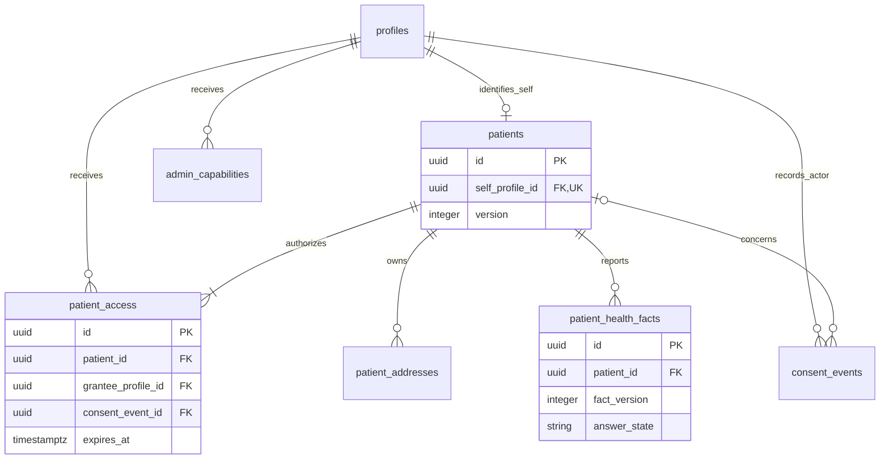
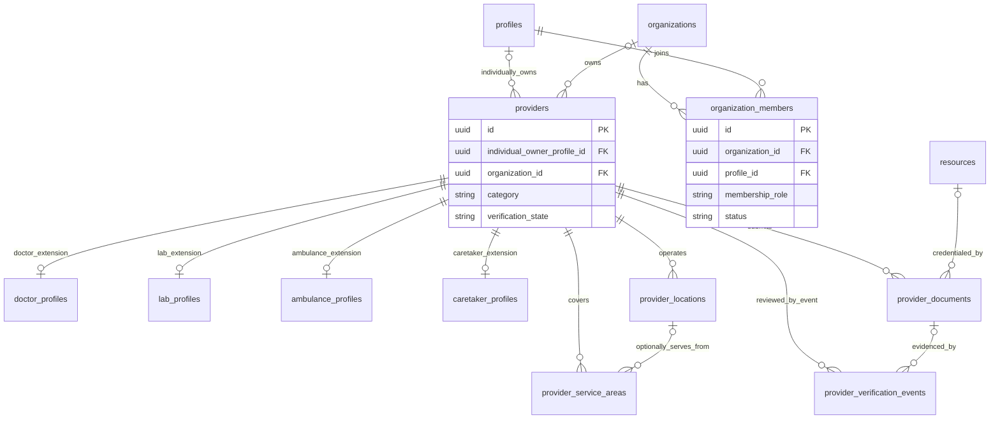
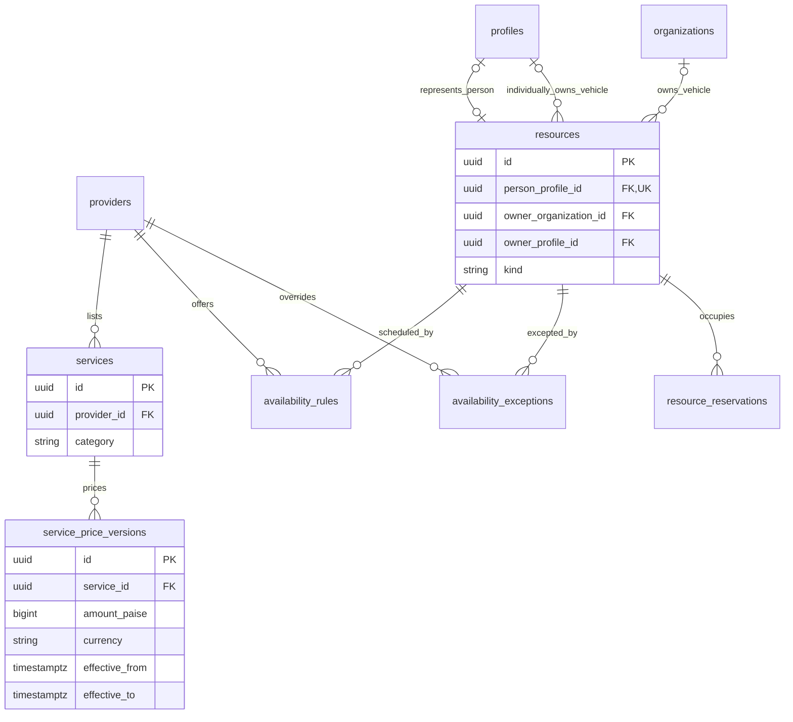
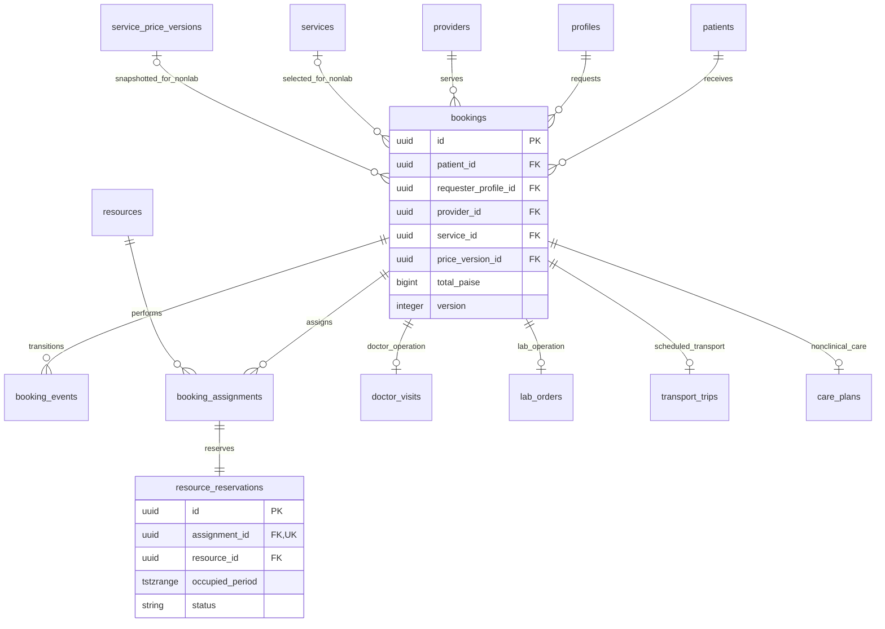
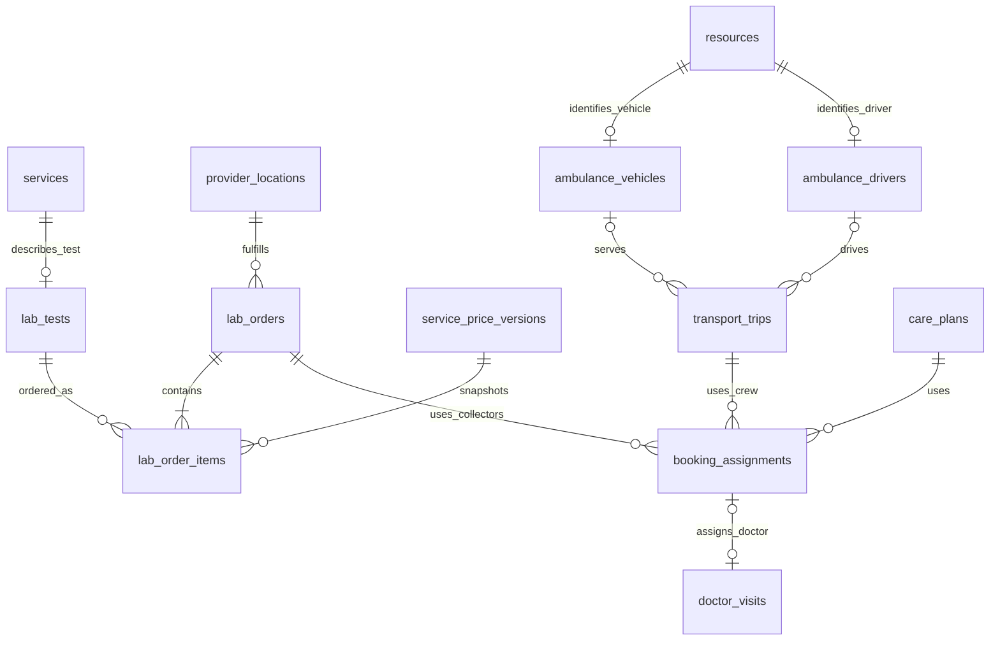
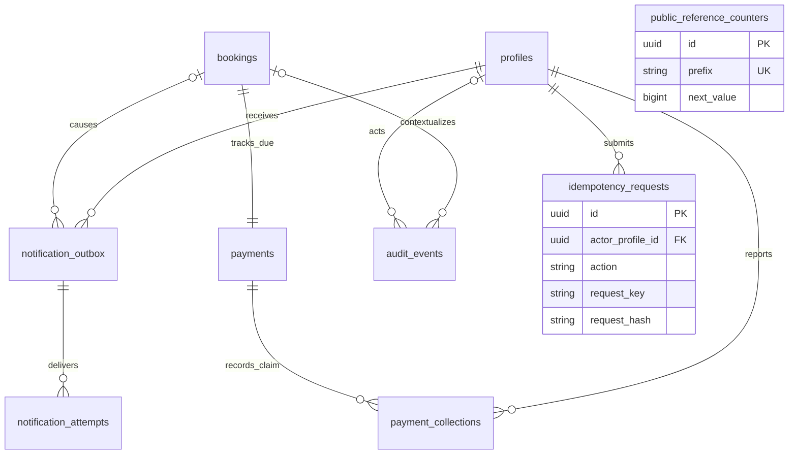
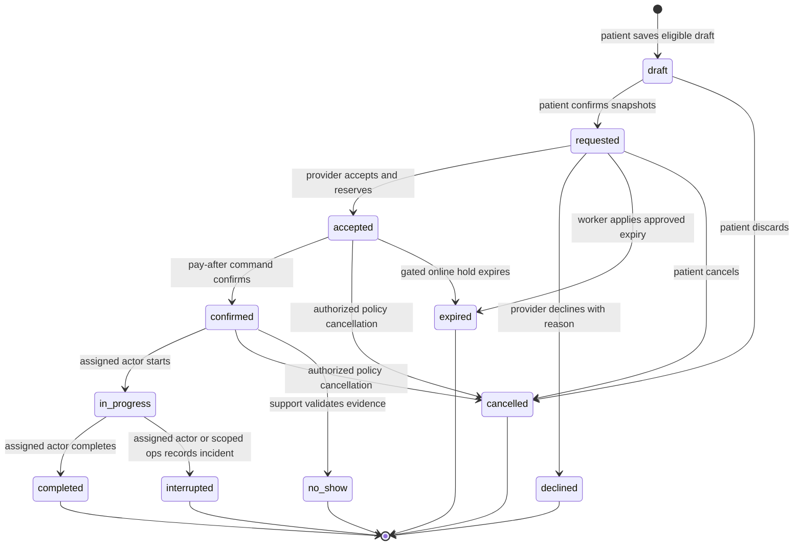
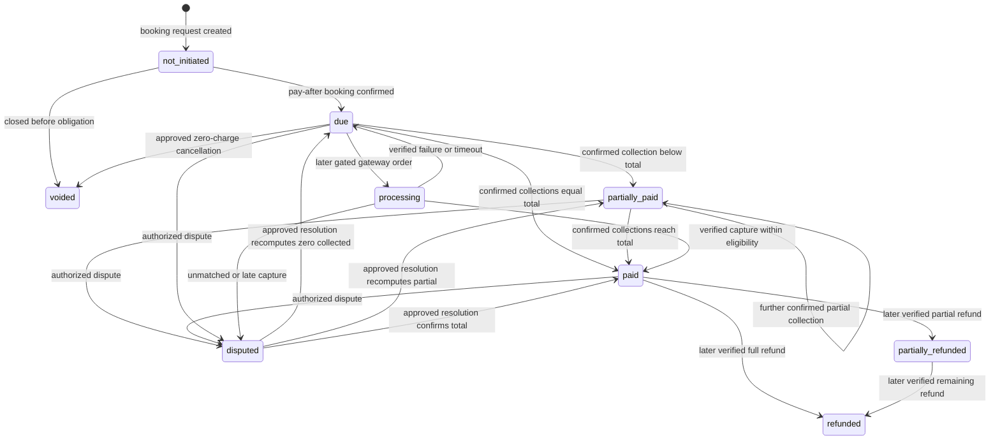

# Canonical schema draft — SureCure Visit

_S00 · Proposed contract v0.1 · 17 November 2026 · Codex · Owner approval PENDING_

---

## 📋 1. Context, scope and design choices

This is a logical design, not SQL or implementation evidence. [SCHEMA_RECONCILIATION.md](SCHEMA_RECONCILIATION.md) contains the complete source crosswalk, task metadata and dated pending approval record. The source of truth for current sequencing is the latest setup decision in [DECISIONS.md](DECISIONS.md): core booking first, then DC01–DC14 with synthetic data and private staging. No real-patient activation is authorized.

Initial release covers identity, the truthful mandatory questionnaire, organization membership, four provider categories, verification, PIN coverage, catalog/pricing, bounded scheduling, manually accepted bookings, operational category details, pay-after collection records and basic audit/outbox. Public transaction enablement still requires the [business approval matrix](BUSINESS_RULES_AND_APPROVAL_MATRIX.md) and [privacy/operations gates](PRIVACY_AND_OPERATIONS_GATES.md). No legal entity, coverage, credential, tax rate or commercial policy is assumed.

### Shared data conventions

- Every application table has `id uuid PRIMARY KEY`. `profiles.id` also references `auth.users.id`; one-to-one extensions use UUID `id` plus unique parent FK, rather than a non-UUID primary key. Auth/Storage managed tables are not recreated.
- Event/instant columns use `timestamptz` in UTC. DOB uses `date`; recurring availability uses local weekday/time plus IANA timezone and effective dates. Display service time in `Asia/Kolkata`; materialize finite half-open UTC intervals `[start,end)`.
- All INR amounts use nonnegative `bigint` paise. JSON/API serializes paise as decimal strings to avoid JavaScript integer precision loss; currency fixed to `INR`. Quantities use positive bounded integers; no float-based price arithmetic.
- Mutable aggregates have `created_at`, `updated_at`, integer `version >= 1`; immutable versions/events have server timestamps and actor/provenance. Server generates IDs and references. FKs and database checks enforce ownership consistency; no public patient reference.
- RLS on every application table, including internal tables if ever exposed, and policies on `storage.objects` for every bucket. Default deny; no browser service-role key, no general authenticated table UPDATE on workflow/financial fields.
- No real records or sample patient/provider listings in this proposal. All retention periods and privacy notices await client/legal approval. No broad cascading deletion of bookings, consent, audit, finance or clinical history.

### Decisions proposed, not approved

| Choice | Recommendation and tradeoff |
|---|---|
| Patient identity | Separate `patients` from `profiles`; supports a recipient without a login, but needs explicit access grants. Core creates only the account holder's patient until dependent controls pass. |
| Provider/category | One provider per owning principal/category with one matching profile extension; duplicates some owner metadata across category entities but isolates approval and service eligibility. |
| Physical resources | One global resource per person or vehicle; eligibility is checked through ownership/membership and verified evidence. Avoid provider-local duplicates that evade overlap checks. |
| Operational vs clinical records | Keep `doctor_visits` for travel/attendance; consultations and signed records start only in P2. Core completion is an operational assertion, not clinical certification. |
| Finance | Keep amount due separate from direct collection claims. No gateway tables in core; later online test integration requires another scoped task/gate. |
| Availability | Rules and exceptions, not permanently generated slots. Requested bookings do not reserve; manual acceptance reserves all required resources atomically. |

## 💾 2. Initial-release ERD

These domain panels form one initial-release ERD. Repeated names are the same entity. Every entity is defined in section 3; cardinalities describe persisted relationships, while activation requirements are section 8 constraints. Only selected key attributes are shown. No P2 or later entity is included.

### Identity and patient access

### Organizations, providers and verification

### Catalog, availability and physical resources

### Shared booking and operational categories

### Lab, scheduled transport and care detail

The final three links are logical through each row's common `booking_id`, not extra cyclic FKs. Trip vehicle/driver links describe accepted trips; those FKs are nullable on a request, mandatory at acceptance. A doctor visit similarly has no assigned doctor until acceptance; reassignment updates its protected current-assignment pointer and retains history.

For doctor, scheduled transport and care, booking `service_id` and `price_version_id` are mandatory. A lab booking represents a basket: those two parent FKs are null, and one or more `lab_order_items` each reference a lab test's service price version. The booking subtotal is the sum of immutable item totals, never a fabricated basket price version or double-counted first test. Every item belongs to the chosen provider; item prices/terms are displayed and confirmed together.

### Pay-after, audit and delivery controls

## 📚 3. Canonical initial-release dictionary

All rows here are `CORE`. Codes in the last column designate the retention policy requiring approval, not an invented statutory duration.

| Class | Proposed retention handling, pending D-PRIV |
|---|---|
| A | Identity/access/catalog: retain for active purpose; deactivate/revoke promptly; later delete or minimize under approved schedule, preserving restricted historical FK integrity. |
| V | Verification evidence: private, validity/review/appeal driven; remove binaries at approved deadline, retain only necessary decision metadata subject to legal hold. |
| H | Health questionnaire: minimum versioned self-reports; approved health-data retention/deletion and consent workflow required before real collection. |
| B | Booking/operational history: approved service/dispute horizon; minimize contact/address snapshots after purpose expires; restricted hold overrides deletion. |
| F | Financial obligations/collections: approved finance/tax/dispute schedule; no cascade or silent modification of evidence. |
| E | Consent/audit: append-only evidence with approved security/privacy schedule; identifiers/payload minimized; deletion is controlled retention processing, not user CRUD. |
| T | Retry/delivery/counter controls: bounded retry/replay horizon; purge safe payloads after approved deadline; preserve dedupe tombstones/references as needed to prevent reuse. |
| C | P2 clinical: approved clinical governance/retention and amendment rules; unavailable for real data until signed off. |

Exact durations, trigger dates, deletion jobs, backup expiry and holds remain Q05. Until approved, only synthetic staging data is allowed; these codes do not authorize indefinite real-data retention.

### Identity and organization

| Exact table | Purpose and important links | Owner / RLS principal | Retention |
|---|---|---|---|
| `profiles` | One Auth user; locale/display/contact metadata; no universal privileged role. | Self; trusted account administration via P_SELF | A |
| `patients` | Service recipient, optional unique `self_profile_id`, DOB if necessary, questionnaire completion/version. | Recipient's active P_PATIENT grants; creation by trusted onboarding | A/H |
| `patient_access` | Patient/grantee/scope, grant source, consent FK, validity/revocation, grantor; self and later explicit delegated grants. | P_PATIENT for own active rights; subject can inspect/revoke permitted grants via command | E |
| `patient_addresses` | Patient-owned structured private address and PIN; never a provider branch record. | P_PATIENT with profile/address scope | A |
| `patient_health_facts` | Immutable fact versions, answer state, source, recorder/time; questionnaire includes no-family/no-document responses. | P_PATIENT with health scope; assigned clinical access only in P2 | H |
| `organizations` | Provider business/agency identity and active status; legal particulars unconfirmed. | Active P_ORG members; no public private/legal fields | A |
| `organization_members` | Invitation/active/disabled membership, role and bounded scopes; trusted membership commands. | P_ORG; self can inspect membership, cannot promote self | E |
| `admin_capabilities` | Invited/MFA-protected, scoped and revocable administrative grants; bootstrap out of band. | P_ADMIN capability administrator; grantee sees own grants | E |

### Provider and catalog

| Exact table | Purpose and important links | Owner / RLS principal | Retention |
|---|---|---|---|
| `providers` | Exactly one individual owner or organization; category, public reference, protected verification/activation projection. | P_PROVIDER; verifier P_VERIFY; public P_PUBLIC projection only | A/V |
| `doctor_profiles` | Unique provider extension; doctor directory fields; individual qualification versus organization service identity distinguished. | P_PROVIDER/P_VERIFY; approved public fields only | A/V |
| `lab_profiles` | Unique lab provider extension; category evidence/operational metadata. | P_PROVIDER/P_VERIFY; sanitized P_PUBLIC | A/V |
| `ambulance_profiles` | Unique operator extension; scheduled service scope and approved fleet description. | P_PROVIDER/P_VERIFY; sanitized P_PUBLIC | A/V |
| `caretaker_profiles` | Unique care provider extension; verified skills/permitted nonclinical scope. | P_PROVIDER/P_VERIFY; sanitized P_PUBLIC | A/V |
| `provider_locations` | Provider branch/base; kind including lab branch, operating status, address and timezone. | P_PROVIDER/P_VERIFY; approved business-address projection only | A |
| `provider_documents` | Private bucket/key, document type, validity/review status; provider FK and optional resource FK. | P_PROVIDER upload/read own evidence; P_VERIFY review | V |
| `provider_verification_events` | Immutable actor/decision/reason/evidence, validity and version; may concern provider or resource evidence. | P_VERIFY append command; provider sees own review decisions | E/V |
| `provider_service_areas` | Provider, optional matching location, exact PIN, verified validity and active flag. | P_PROVIDER proposes; P_VERIFY/coverage capability approves; P_PUBLIC | A/V |
| `services` | Provider/category, approved listing, duration/unit, status; no quote-only checkout initially. | P_PROVIDER catalog scope; sanitized P_PUBLIC | A |
| `service_price_versions` | Immutable amount/unit/terms/version and nonoverlapping effective intervals; no edits to amount of existing version. | P_PROVIDER catalog command; P_PUBLIC eligible current price | F |
| `availability_rules` | Provider + resource, local weekday/time, effective dates and timezone; bounded slot materialization. | P_PROVIDER scheduling scope and resource eligibility | A |
| `availability_exceptions` | Provider + resource UTC interval, unavailable/override reason; new blackout cannot silently cancel accepted work. | P_PROVIDER scheduling scope | A |
| `resources` | Global person or vehicle identity, status; person unique Auth profile; asset belongs to org or individual. | Self/resource owner or eligible P_PROVIDER scheduler; no public personal identifiers | A/V |

### Booking and category operations

| Exact table | Purpose and important links | Owner / RLS principal | Retention |
|---|---|---|---|
| `bookings` | Recipient/requester/provider; service/price FKs for nonlab, lab basket priced by items; immutable amount, terms/address snapshots, UTC interval, expiry, category, state/version. | P_BOOKING patient and provider queue projections; P_ASSIGNED operational detail | B/F |
| `booking_events` | Append-only state/operational events with actor, aggregate version, reason, request/action correlation. | P_BOOKING minimum timeline; trusted transition append | E/B |
| `booking_assignments` | Booking/resource/purpose, active interval, assigned actor permissions and ended/replaced history. | P_PROVIDER scheduler commands; P_ASSIGNED for own assignment | B |
| `resource_reservations` | One per assignment, canonical resource and occupied UTC range including buffers; active/released status. | Trusted booking command; scheduler gets scoped availability, not other patients' reservations | B |
| `doctor_visits` | Unique doctor booking; assigned-doctor assignment FK, travel/arrival/completion state only. | P_ASSIGNED doctor; patient limited P_BOOKING timeline | B |
| `lab_tests` | Unique lab service extension; test code, sample/preparation metadata, optional stated turnaround. | P_PROVIDER catalog; P_PUBLIC permitted catalog | A |
| `lab_orders` | Unique lab booking, matching provider lab branch, collection/processing-handoff status. | P_PROVIDER operational minimum; P_ASSIGNED collector; patient own timeline | B |
| `lab_order_items` | Order/test/price-version FKs, positive quantity and immutable unit/line paise. | P_BOOKING limited item summary; provider/assigned collector operational fields | B/F |
| `ambulance_vehicles` | Unique vehicle resource, registry/permit/equipment status and validity; no public registration/VIN by default. | Asset owner P_PROVIDER; P_VERIFY; driver limited assigned vehicle data | V |
| `ambulance_drivers` | Unique person resource, license validity/status; organization eligibility through active membership. | Driver self, authorized P_PROVIDER; P_VERIFY; no public license | V |
| `transport_trips` | Unique scheduled booking, pickup/destination snapshots, current vehicle/driver and trip progress; no live GPS. | P_ASSIGNED driver; patient own timeline; org queue without route/contact by default | B |
| `care_plans` | Unique care booking; agreed nonclinical instructions/service scope, one interval and completion evidence. | P_PATIENT and P_ASSIGNED caregiver; scheduling staff receive minimum scope only | B |

### Finance and internal controls

| Exact table | Purpose and important links | Owner / RLS principal | Retention |
|---|---|---|---|
| `payments` | Unique booking obligation, frozen INR amount, pay-after path, confirmed total and reconciliation/dispute projection; independent state/version. | Patient own summary, provider P_FINANCE scoped summary; trusted finance commands | F |
| `payment_collections` | Obligation FK, positive direct cash/UPI amount, collector, method/reference, reconciliation outcome and optional superseded claim. | Authorized assigned collector reports; scoped billing reconciles; patient own summary/dispute | F |
| `notification_outbox` | Durable minimal delivery intent, recipient, booking optional, channel/template, dedupe key, due time and lease. | P_WORKER only; domain command inserts atomically | T |
| `notification_attempts` | Append-only attempt number/outcome/time and sanitized vendor result; no medical payload. | P_WORKER and scoped operational auditor | T |
| `audit_events` | Append-only actor/action/target/outcome/correlation, optional booking; no raw request bodies or medical notes. | Trusted append; P_AUDIT scoped readers | E |
| `consent_events` | Append-only purpose/policy-version/decision, actor, patient optional, time, related grant; no assumed consent. | Subject P_PATIENT/self reads; trusted consent commands | E |
| `public_reference_counters` | UUID plus unique prefix/namespace and bigint allocation; no patient prefix. | Internal allocation command only | T; allocated references never reused |
| `idempotency_requests` | Actor/action/key/request hash, processing/result pointer, retention deadline; no full sensitive response. | Internal command only; never client-listed | T |

## 🔐 4. Access policies and private Storage

### Policy families and field boundaries

These are proposed policy/command families, not installed policies. Every implementation must enumerate SELECT/INSERT/UPDATE/DELETE for each table. Unlisted access is denied. RLS filters rows; restricted columns also need column grants or narrow safe functions/projections. Do not expose base rows simply because a patient/provider can read a public subset.[^1]

| Family | Required predicate / enforcement |
|---|---|
| P_SELF | Authenticated active account equals profile ID; only allowlisted self-service fields. |
| P_PATIENT | Active unexpired unrevoked `patient_access` grant to caller with specific action scope; patient self grant tied to `self_profile_id`. Scope is not inherited from a relationship or requester identity. |
| P_ORG | Caller has current active membership in this exact organization, matching role/scope; account/org active. Recheck DB membership, not stale JWT role claims. |
| P_PROVIDER | Individual owner equals caller OR P_ORG for provider's org with action scope. Mutation eligibility additionally checks verification where required, including active credentials/coverage for acceptance. |
| P_VERIFY | Named verification/coverage capability, appropriate org/category scope and MFA; never clinical privileges. Evidence owner cannot self-approve. |
| P_PUBLIC | Safe directory/search projection only: active provider + current verified category/evidence + valid approved PIN coverage + published service + effective price/availability. No patient/evidence/private-contact fields. |
| P_BOOKING | Patient has current booking-read grant; requester access requires continuing grant. Provider receives only own queue locality/time/service summary. Snapshot address/contact is hidden from queue readers. |
| P_ASSIGNED | Current active booking assignment to caller's canonical person resource, correct category/purpose, provider verified and active, account/member still active; accepted/confirmed/in-progress window, minimum fields only. |
| P_FINANCE | Specific active organization billing scope or individual payee scope on this booking; no clinical/health/address scope. Reporting a collection needs an explicit collector grant tied to the current or completed service assignment. That narrow finance grant can survive operational completion under policy; it never restores patient contact/clinical access. |
| P_ADMIN | Specific invite/MFA admin capability; no generic admin bypass. Capability issuance via trusted bootstrap/authorized grantor, never self-granted. |
| P_AUDIT | Named security/operations scope and target boundary; no arbitrary patient search or raw clinical data. |
| P_WORKER | Narrow server-only job/function rights for outbox/expiry/reconciliation; authenticated user cannot invoke broad worker functions. |

Privileged functions, if needed, have fixed search paths, explicit caller checks, narrowly granted execution and no user-controlled SQL. Ordinary requests use the user session and RLS. Owner/BYPASSRLS and service-role behavior must be considered explicitly; ordinary RLS alone does not constrain such credentials.[^1] Any elevation must repeat authorization and field restrictions.

Grant/membership predicates must not recursively query a table through its own policy. Use narrowly scoped internal boolean lookup helpers where required, pinned to the authenticated caller and requested patient/org/action; no arbitrary row export or caller-supplied identity override. Negative tests must cover the helper's execute grants and recursive-policy failure paths.

### Role/organization/patient matrix

`R` means only authorized projected reads; `C` means explicit server/DB command, never unrestricted base CRUD.

| Actor | Read scope | Mutation scope | Storage scope |
|---|---|---|---|
| Guest | P_PUBLIC directory only | No private writes | None |
| Patient self | Own profile, granted patient/address/questionnaire, bookings/payment summary, consent | P_SELF/P_PATIENT onboarding, request/cancel, consent and collection dispute | No clinical upload in core |
| Adult delegate / guardian | Disabled in core until approved proof/consent tests; then exact active grant scopes | Booking/profile actions only as granted; no automatic delegation chain | Only separately granted document purpose in P2 |
| Individual provider owner | Own application/catalog; own booking queue locality; finance summary | Own catalog/availability; manual acceptance/decline/assignment; no self-verification | Own verification objects |
| Org owner / manager | Own org membership/catalog, queue locality/time, permitted operational summaries | Invites/assignments/acceptance within scope; cannot create admin capabilities or approve own credentials | Own org verification objects if evidence scope |
| Assigned doctor | Accepted assigned visit address/contact/time; no questionnaire/clinical data in core | En-route/arrive/start/complete operational events; pay-after claim only with separate P_FINANCE collector grant | No patient documents in core |
| Lab collector | Assigned collection address/contact/test/preparation, no clinical history | Assigned collection milestones | No report objects in core |
| Lab reviewer | Core operational order metadata only if scoped | Report release unavailable until P2 | Clinical/report access unavailable in core |
| Ambulance driver | Assigned trip route/contact and permitted vehicle details | Assigned scheduled-trip progress only | No patient files |
| Caregiver | Assigned single interval/contact and agreed nonclinical instructions | Own attendance/progress only | No patient clinical files |
| Org billing / independent payee | Own financial summaries/collection evidence, no questionnaire/address | Report/reconcile only if scoped and policy approved; no gateway-paid claim | No medical or identity evidence |
| Admin verifier | Submitted provider/resource evidence and coverage | P_VERIFY review/suspend/expire with reason and audit | Verification bucket only; no clinical bucket |
| Admin support / finance | Specifically scoped booking/finance metadata; no automatic exact address | Authorized dispute/cancel/reconcile command under policy | No blanket document access |
| Security auditor | Scoped sanitized audits; no default clinical chart access | No clinical/booking edits; approved incident procedure separately | No blanket access |
| System worker | Minimum leased jobs/expiry candidates | Idempotent retry/expiry, authorized transition only | Only approved specific job purpose |

Revoking patient grants/membership/assignment stops new reads, mutations, Realtime subscriptions and URL issuance. Stop sharing exact operational contact/address outside the assignment window; historical metadata does not justify permanent contact access. Existing signed URLs may remain usable until expiry: propose at most 60 seconds and no caching, pending Q11. For immediate revocation requirements, use an authenticated download proxy rather than claiming a signed URL is instantly revocable.

### Storage buckets and authorization

Bucket names are proposed. All are private; core creates only `provider-verification`. Storage access requires object metadata ownership joins and matching purpose; guessed path prefixes or possession of a booking ID are insufficient. Bucket/object policies apply independently of table policies.[^2]

| Bucket | Metadata table / stage | Authorized use |
|---|---|---|
| `provider-verification` | `provider_documents`, CORE | Owner/authorized org evidence member uploads through reserved metadata; verifier reads; server checks every signed URL issuance and audits it. |
| `patient-documents` | `patient_documents`, P2 | Active patient document grant; assigned clinician only with exact consent/assignment; no manager/verifier inheritance. |
| `clinical-records` | `clinical_records`, P2 | Signed-record/PDF read by subject or authorized clinician; generated immutable versions only. |
| `lab-reports` | `lab_reports`, P2 | Reviewer draft access; subject receives only independently reviewed, released version. |
| `visit-evidence` | `visit_evidence`, P2 | Purpose-specific active media consent + assigned clinician; withdrawal blocks new use/URLs under approved retention rules. |

Object keys are opaque UUID-based identifiers, unique per bucket, bound to one metadata row. Reject MIME/size/magic-byte mismatch, quarantine pending review/scan, prohibit overwrite/upsert of approved evidence and use versioned replacement objects. Reads require non-quarantined status. Upload/delete uses authorized server/Storage APIs, not direct manipulation of managed Storage metadata. No public bucket for clinical/identity files; public brand assets do not carry private data.

## 🔄 5. State machines and transition authority

All transitions require authenticated active actor, exact ownership/grant, permitted category, expected aggregate version and idempotency key; append event/audit and relevant outbox intent in the same transaction. Worker transitions use their narrow trusted identity. Diagram snake_case states map to uppercase database enum values. Payment/clinical states are never derived from browser callbacks or booking status.

### Booking: shared lifecycle

| Transition | Actor and additional guard |
|---|---|
| Draft/request | Active patient booking grant; completed truthful questionnaire, chosen verified provider, actual PIN/availability, patient confirms server quote/terms version. Draft is not a resource hold. |
| Requested → accepted | Provider owner or active scoped scheduler manually acts; lock booking and all resources; recheck evidence/coverage/price/schedule/version; required category assignments and exclusion inserts must succeed together. Admin cannot fabricate acceptance. |
| Accepted → confirmed | CORE pay-after: consecutive event in the same acceptance transaction, set amount DUE without claiming collection. Later online: only verified matched capture while valid hold; diagram's online expiry edge remains disabled in core. |
| Confirmed → in_progress | Assigned authorized person with correct purpose; doctor start, lab collection start, driver pickup or caregiver start as category requires. No OTP claim in core. |
| In_progress → completed | Assigned person; required operational milestones, finite time/actual completion evidence. Lab means collection/processing handoff only. No payment requirement. |
| Decline/expiry/cancel | Provider decline before acceptance; worker expiry only against approved deadline/current version. Patient or scoped provider/support cancellation only per approved policy; preserve snapshots, release reservations and record actor/reason atomically. |
| No-show/interrupted | Scoped support evidence review for no-show; assigned actor/ops records interruption, no automatic patient blame/fee. Incident releases future occupancy through reviewed termination; continuation/replacement is a new approved booking rather than resetting a terminal state. |

No expired/cancelled/completed booking is silently reopened. Reschedule or changed price uses a replacement draft/request with `supersedes_booking_id`, fresh patient approval and atomic release/acceptance, subject to approved policy. The proposed 30-minute request expiry and 15-minute online hold are not approved defaults; expiry transitions are disabled where no approved deadline exists.

Doctor operational substate in core: `scheduled → en_route → arrived → service_started → service_completed`. Assigned doctor only; arrival does not generate OTP until P2. Lab: `scheduled → collecting → collected → processing_handoff`; driver: `assigned → en_route → arrived → picked_up → destination_reached`; care: `assigned → started → ended`. These transitions produce booking events and map to shared progress; skip/reverse/category-mismatch transitions denied. No-show, failed sample collection, vehicle breakdown or caregiver unavailability use explicit interruption/reassignment events. Reassignment before start locks new and old resources, requires eligibility, replaces reservations atomically, invalidates prior action authority and informs patient.

### Consultation: phase 2 only

```mermaid
stateDiagram-v2
    accTitle: Gated Consultation State Machine
    accDescr: Only an assigned credentialed clinician can move from verified arrival into drafting and immutable signing. Corrections add versions; payment does not gate signing.
    [*] --> awaiting_arrival: accepted assigned doctor visit
    awaiting_arrival --> arrived: assigned doctor reports arrival
    arrived --> arrival_verified: assigned doctor verifies patient challenge
    arrival_verified --> in_consultation: assigned doctor starts
    in_consultation --> draft: clinician saves first version
    draft --> draft: clinician autosaves expected version
    draft --> signed: clinician reviews and signs
    signed --> signed: clinician appends signed amendment
    awaiting_arrival --> interrupted: audited incident
    arrived --> interrupted: audited incident
    arrival_verified --> interrupted: audited incident
    in_consultation --> interrupted: audited incident
    draft --> interrupted: audited incident preserves draft
    interrupted --> [*]
```

P2 creation requires clinical feature gate, correct accepted booking, current assigned licensed clinician and approved consent. The patient alone receives a six-digit cryptographically random arrival code through an authenticated private channel after arrival. Store a server-secret-keyed HMAC with per-challenge salt, booking/doctor binding, expiry, attempt count and consumed/revoked timestamps; no plaintext code in DB/logs/Realtime. Five-minute expiry, attempt/resend limits and exception procedure need approval. Regeneration or reassignment revokes prior challenge. Verify and consume under row lock with constant-time comparison; rate-limit failures and reject replay/wrong doctor.

Start, every autosave, sign, amendment and PDF retrieval recheck current authorization/assignment; editing requires unsigned state and expected draft version. Sign transaction freezes exact draft version, vitals, assessment and structured prescription/plan into immutable `clinical_records`, preserving clinician and signature attribution. A signed correction creates `clinical_amendments` and a new linked immutable record version; original never changes. Replaced clinicians cannot edit; post-visit amendments require the signing clinician's explicit continuing authority or approved controlled handover. Patients read only released signed versions; draft access is not implied. P2 clinical completion may require signing, but payment DUE does not block it. Interrupted drafts remain private; support cannot sign or bypass OTP alone. A support-assisted fallback requires approved two-party verification, reason and immutable audit.

### Payment: obligation separate from service

CORE states: `NOT_INITIATED`, `DUE`, `PARTIALLY_PAID`, `PAID`, `DISPUTED`, `VOIDED`; remaining processing/refund states are later and disabled. Normalize source `PARTIAL` to `PARTIALLY_PAID`; preserve independent record and collection reconciliation state. A collector reporting cash/direct UPI creates a `REPORTED` collection claim; it does not change confirmed totals. Authorized reconciliation checks collector/method/reference/evidence under Q04 policy, then marks confirmed or disputed; corrections void/supersede with audit, not delete. No collector self-confirmation by default. Patient acknowledgment can be evidence, not forged by provider.

Only confirmed, nonvoided collections count; sum cannot exceed frozen obligation. Dispute requires reason and scoped patient/provider/billing authority; resolution is a finance command, not patient status PATCH. A due amount can be voided only under approved zero-charge cancellation; no refund is invented. `PAID` carries `collection_path=direct_pay_after`, never gateway-paid. Later capture/refund uses verified gateway order/payment/event IDs, signature/amount/currency, dedupe and cumulative bounds; late capture after booking expiry enters reconciliation, never rebooking. Failed payment/refund never deletes clinical/booking history.

## 📦 6. Phase 2 (after core): DC01–DC14 and clinical data

No table below belongs in initial ERDs/migrations. All are `P2 / DEFERRED`, with UUID PKs, UTC timestamps and RLS. Plan with synthetic data only, after core passes; real-data enablement requires D-PRIV, clinical/legal governance, consent, operational and client gates. Basic family capability is also gated, not inferred from a paid plan.

| Exact proposed table | Purpose / linkage | Owner / RLS principal | Retention |
|---|---|---|---|
| `family_relationships` | Patient-to-patient label; never an authorization grant. | Subject-approved P_PATIENT relationship scope | A |
| `patient_documents` | Private patient file metadata/version and consent purpose. | Patient document grant; specifically authorized assigned clinician | H/C |
| `visit_verification_challenges` | Booking + current assigned doctor-bound expiring one-use verifier. | Patient delivery/assigned-doctor verification commands; no raw table reads | T |
| `consultations` | Unique doctor visit/booking, workflow, assigned clinician, current draft/final version. | Assigned clinician; subject signed-view scope only | C |
| `consultation_drafts` | Versioned private draft snapshots/autosave, no plaintext localStorage. | Current assigned clinician while unsigned | C |
| `vital_observations` | Consultation/version, actual values/units, recorder/time and acknowledged warnings. | Assigned clinician; subject released record | C |
| `clinical_assessments` | Versioned clinician findings/assessment with uncertainty preserved. | Assigned clinician; subject released record | C |
| `clinical_records` | Immutable signed document version, signer/time, source draft and prior-record link, PDF metadata. | Authorized clinician signing/read; subject released version | C |
| `prescriptions` | Signed-record-linked prescription header, clinician attribution; optional if no medicine. | Signing clinician; subject released version | C |
| `prescription_items` | Prescription FK; medicine, strength, dose, route, frequency, duration, quantity, instructions. | Same as prescription; no autonomous AI write | C |
| `recommended_tests` | Signed-record-linked clinician-authored requested tests/indication; no automatic lab booking. | Assigned clinician; subject released version | C |
| `care_instructions` | Clinician-authored advice/follow-up linked to signed record/version. | Assigned clinician; subject released version | C |
| `clinical_amendments` | Immutable correction reason/author/time linking old and new signed versions. | Authorized signer/amendment command; subject released history | C |
| `health_fact_verifications` | Exact patient fact version, professional reviewer/evidence/time, separate from self-report. | Authorized clinician with patient grant; subject own history | H/C |
| `visit_evidence` | Optional photo metadata, explicit purpose-specific consent event and withdrawal/retention status. | Consenting subject and authorized assigned clinician | C |
| `visit_proof_tokens` | Hashed random token, booking/purpose/expiry/revocation; minimal proof only. | Authorized proof-issuance/revoke command; minimal token-check response | T |
| `lab_reports` | Versioned private report, uploader/reviewer, release event/time and patient/order link. | Assigned lab reviewer; patient only reviewed released versions | C |

QR response contains only allowed service-proof fields, never name/phone/address/raw patient ID/OTP/clinical history. Optional photography is never required to complete a record. Consent withdrawal prevents new use and triggers approved media retention handling; legal holds require explicit policy rather than deleting signed clinical evidence indiscriminately. Lab report release needs a distinct reviewer authorization and reviewed version, not uploader self-release by implication.

| Requirement | Proposed design coverage; implementation/test status remains PENDING |
|---|---|
| DC01 assigned-doctor authorization | Common P_ASSIGNED predicate plus gated consultation policies; deny wrong/unassigned/suspended clinician. |
| DC02 arrival OTP | Challenge table, keyed verifier, binding/expiry/attempt/replay controls; approved fallback. |
| DC03 patient progress | Core minimal booking events + scoped Realtime and reconnect refetch; P2 arrival/consultation events separate. |
| DC04 vitals/examination | `vital_observations` and clinical draft/assessment; explicit units, implausibility warnings preserve actual input. |
| DC05 autosave recovery | Versioned `consultation_drafts`, expected-version conflicts, durable save/reconnect; encrypted approved storage. |
| DC06 assessment/diagnosis | Clinician-authored `clinical_assessments`; uncertainty retained, no AI clinical decision. |
| DC07 finalized record | Immutable `clinical_records` and append-only signed amendments; exact draft version locked. |
| DC08 structured prescription | `prescriptions`/`prescription_items`, allergy review, clinician sign; no forced medicine. |
| DC09 patient consultation view | Current subject grant and released signed version; no draft or other-patient access. |
| DC10 independent collection status | Core `payments`/`payment_collections`; later clinical finalization independent of due/paid. |
| DC11 health-fact review history | `health_fact_verifications` points to immutable fact version and actual reviewer evidence. |
| DC12 safe proof QR | Hashed expiring/revocable `visit_proof_tokens`; no health/identity leakage. |
| DC13 optional photo consent | `visit_evidence` + purpose-specific consent, private Storage, withdrawal/retention tests. |
| DC14 PDF report | Signed-record version, private `clinical-records` object, authorized generation/download and hash/version integrity. |

## 📍 7. Later modules and excluded tables

Names only for modules the task explicitly defers:

- Subscriptions/membership: `membership_plans`, `plan_versions`, `patient_subscriptions`, `subscription_members`, `entitlement_usage`
- AI: `conversations`, `conversation_messages`, `assistant_tool_runs`, `ai_usage`
- Emergency dispatch: `dispatch_events`
- Pharmacy
- GPS tracking
- Automated payouts
- Recurring care: `care_shifts`, `care_shift_events`

Other non-core dispositions below specify retention/principals for source concepts without creating speculative core tables.

| Exact later name | Purpose / exclusion reason | Future principal | Retention |
|---|---|---|---|
| `payment_attempts` | Gateway attempts only after separately approved test integration | Scoped payment service; patient safe summary | F |
| `gateway_webhook_events` | Verified durable inbox/dedupe, distinct from browser callback | Narrow webhook worker only | T/F |
| `refunds` | Verified bounded gateway refund ledger after refund policy/tests | Scoped finance service | F |
| `settlement_ledger` | Immutable finance entries only after merchant/payee/legal approval | Scoped finance worker/auditor | F |
| `invoices` | Legal invoice issuer/tax/numbering unresolved | Approved issuer/finance service; customer own copy | F |
| `receipts` | Issuer-confirmed payment document, distinct from confirmation/claim | Approved issuer/finance service; customer own copy | F |
| `whatsapp_contacts` | Automated channel consent/contact model deferred | Subject + scoped messaging service | A/E |
| `whatsapp_events` | Approved automation webhook/history only | Narrow messaging worker | T |
| `support_tickets` | Structured case ownership pending staffed support policy | Requester + assigned scoped support | B |
| `support_events` | Case history pending support workflow | Same case scope; append command | E/B |
| `content_pages` | Excluded DB table in core; use approved versioned static localized copy | Future content editor, never clinical access | A |

No future table automatically acquires broad admin/organization rights. A later task must approve its exact fields, policies, retention, tests and migration boundary.

## ⚙️ 8. Constraints, indexes and concurrency

### Relational and value invariants

| Domain | Required database invariant / index |
|---|---|
| Keys and time | UUID PK every table, indexed non-null FKs where required; finite `start_at < end_at`, explicit UTC and bounded ranges; version positive. Historical entities deactivated, restrictive FK deletion for evidence/history. |
| Patient grants | Unique nonnull `patients.self_profile_id`; trusted onboarding atomically creates patient/self grant/consent. No ownership transfer by editing FK. Grant scope/purpose/expiry/revocation checks; index `(grantee_profile_id, patient_id, scope)` active rows. Delegation cannot create self-granted access to others. |
| Questionnaire | `UNIQUE(patient_id, fact_type, fact_version)`; answer state `known/none/unknown` with value/null compatibility and fact-specific none rules. Blood group unknown distinct from none. Validate required fields including no-family/no-document declaration and persist completed version atomically; no required file. No patient-set professional verification flag. |
| Membership/admin | `UNIQUE(organization_id, profile_id)` for current membership record; invitation/disabled state history in audit. Trusted scoped role changes, cannot promote self or remove last active owner without transfer. Admin capability unique grantee/capability/scope key (explicit global scope, not nullable uniqueness loophole). |
| Providers | XOR individual owner/org, category enum of four; partial unique owner/category keys per ownership type. Composite `(id, category)` referenced by services/bookings; subtype exactly one matching category before submission/activation (deferred constraint trigger or transactional command, not frontend check). |
| Credentials/coverage | Matching provider/location/resource FKs enforced through composite keys or constraint triggers. No self-approval; protected verification projection; expiration uses current time in eligibility queries/commands. Index document expiry/review queue, coverage `(pin_code, provider_id)`, verification state/category. Public queries recheck expiry even if worker is late. |
| Price versions | `UNIQUE(service_id, version)`; INR, paise nonnegative, positive duration/unit rules, finite start with optional open end. Nonoverlap effective intervals per service using range exclusion or serialized version publishing. Amount/unit/terms immutable; only controlled closing of previous effective window with audit. |
| Person/vehicle resource | One person row per `person_profile_id` globally, regardless of clinical/driver/caregiver role. A vehicle row has exactly one org/individual owner and no person FK; person row has no asset-owner FKs. Unique normalized vehicle registry identity and canonical resource FK. Person eligibility depends on active role membership/individual-provider ownership and valid category-specific professional evidence. |
| Booking FKs | Nonlab provider/service/category/price version must match and be nonnull. Lab basket has null parent service/price FKs and one or more matching provider/test/price-version items; no empty or mixed-provider basket. Requester needs active recipient booking grant. Immutable requester, recipient, price/terms/address snapshots after request. Exactly one category row by request commit; accepted bookings require complete assignments. Lab item subtotal plus approved adjustments equals frozen total; positive quantities and correct provider/test/branch enforced. |
| Money | Frozen total equals item subtotal + explicitly approved tax/fee values, all bigint INR; absent approval means no invented fees/taxes and no public paid activation. Checked arithmetic/limits prevent overflow. Payment total equals booking snapshot; one payment obligation per booking. |
| Assignments/reservations | Purpose/category/actor/credential matches; one current clinician/collector/caregiver per required purpose, driver and vehicle both for transport. Unique `resource_reservations.assignment_id`; same resource and interval as assignment plus explicit buffers, enforced by trusted command/constraint trigger. A terminal booking transition does not release the reservation immediately: `occupied_period` already includes the approved turnaround buffer, so the reservation stays `active` until the buffered interval ends and is then released explicitly. Only cancellation before start releases the full period (CodeRabbit finding, verified). |
| Events | `UNIQUE(booking_id, aggregate_version, event_ordinal)`; append-only actor/time/old/new states with command correlation. Historical events distinguish consecutive accepted/confirmed states even in one transaction. Audit/consent insert through narrow functions; revoke client UPDATE/DELETE. |
| Collections | Method restricted to direct cash/UPI initially; amount positive, authorized collector, immutable payment/amount/reference after report. Reconcile under locked obligation and expected version; confirmed sum ≤ due. Unique `(payment_id, collector_profile_id, collection_key)`; global request key also prevents retry duplicates. UPI normalized reference unique in payee/method scope where present; cash never uses invented gateway IDs. |
| Outbox | Unique domain-event/recipient/channel/template-version dedupe key; attempts unique `(outbox_id, attempt_number)`; index due status/time and lease expiry. No health/contact payload in delivery logs. |
| References | Unique prefix/namespace row, atomic increment under row lock or equivalent sequence; unique immutable `public_reference` on target. No `MAX+1`; no public patient reference. Gaps acceptable; sequential reference never grants authorization. |
| Query indexes | All RLS join FKs; bookings `(patient_id, created_at)`, `(provider_id, status, requested_start_at)`, requester history; assignments `(resource_id, active, booking_id)`; audit `(target_type,target_id,occurred_at)`; payment reconciliation status/time. Do not index/log raw clinical payload for public search. |

### Single resource-overlap authority

Use `resource_reservations.occupied_period` as a finite nonempty `tstzrange(start-buffer, end+buffer, '[)')`. Propose GiST exclusion over `resource_id WITH =` and `occupied_period WITH &&`, restricted to stored `status='active'`. Confirm UUID equality operator support through `btree_gist` on the actual managed PostgreSQL version before migration. PostgreSQL documents range exclusion for overlapping intervals.[^3]

Do not put `now()` in an active predicate: expiry is an explicit transactional release. A late expiry worker may conservatively block capacity; acceptance can release a demonstrably expired hold under lock before retry. Adjacent half-open intervals are allowed unless approved travel/turnaround buffers overlap. Drivers and clinicians share the same global person resource, preventing cross-role/cross-org double booking. Vehicle is separately reserved. Staff identity verification must prevent duplicate accounts/resources for the same verified professional or asset.

Every assignment, including reassignment and any future care shift, must use this same ledger. Do not maintain independent exclusion rules on category tables. Derive availability from active resources, current rules/exceptions and reservations; a frontend free slot is advisory only.

### Atomic commands and retry semantics

1. Authenticate and authorize caller, feature/policy gates and expected version. Insert/lock `idempotency_requests` on unique `(actor_profile_id, action, request_key)`; target ID is included in request hash.
2. Same key + same normalized payload returns existing authorized result pointer. Same key + different hash returns 409. Recheck current authorization before replaying a result; never retain raw patient response. Failed transaction rolls back its key; a committed operation keeps a tombstone/result for approved replay horizon.
3. For acceptance, lock booking, relevant provider/verification/coverage/price rows (every lab item price for a basket), and canonical resources in deterministic UUID order. Check requested price still honored; if changed, require replacement patient-approved request. Recheck eligibility at command time, never at page-render time only.
4. Locking protocol also applies to suspension, membership revocation, coverage change, resource deactivation and availability rule/exception (blackout) changes, which take the same canonical resource lock before checking existing reservations (CodeRabbit finding, verified). They serialize against acceptance; suspension revokes new acceptance immediately, blocks unsafe progress and creates an operations exception for existing bookings, without silently cancelling care.
5. Insert assignments and active reservations; exclusion rejects competing transactions. Create category detail/obligation changes; append events and minimal outbox/audit; increment aggregate version; commit as one unit. Pay-after accepted/confirmed are distinct consecutive events in that unit.
6. Map stale version or exclusion conflict to stable 409 without other patients' details. Retry deadlocks/serialization failures only with bounded backoff and the same idempotency key after rechecking authorization. Serializable execution may require transaction retries.[^4]
7. Cancellation/expiry/reassignment/completion locks the same booking/resources, validates previous state, releases/replaces reservations and writes events/outbox atomically. Resource buffers/actual end may not be silently shortened to force another booking through.
8. Collection reporting/reconciliation locks payment obligation and checks aggregate version, confirmed totals and collection key. Outbox worker claims with bounded leases/row locks, commits intent, delivers outside transaction, records attempt/result; delivery is at-least-once with vendor dedupe where supported, never claimed exactly-once.

Idempotency/result retention horizon and request expiry are Q02/Q11; deleting dedupe rows must not permit replay of irreversible collection actions. Keep permanent domain collection/booking uniqueness or minimized tombstones as approved. Public reference allocation participates in transaction but gaps are permitted; references are not legal invoice numbering.

## 🔧 9. Migration sequence and recovery plan

This is an ordered plan only. No migration file, database, extension or bucket was created by S00. One assigned migration author after owner approval; Claude coordinates shared environments.

| Order | Future change and prerequisites | Required evidence / recovery boundary |
|---|---|---|
| 0 | Owner approves canonical draft/material Q decisions; Kiro challenges authorization/concurrency; confirm local synthetic target and actual Postgres/extensions. | Record approved version and designated author. No SQL from this draft before approval. |
| 1 | Primitive checks/helper roles and identity: profiles, patients, grants, addresses, questionnaire; consent/audit foundations. | Migrate a clean isolated DB; apply RLS and grants in the same change; self-grant/other-patient denial. |
| 2 | Orgs/membership/capabilities, canonical resource identity after its owner FKs exist, provider category extensions, private evidence and review/coverage/location. | Bootstrap invitation/MFA path; deny self-approval/cross-org; private evidence upload/sign denial and expiry. |
| 3 | Services/versioned prices, resource eligibility, availability and counters. | Correct bigint/version/validity checks; public projection hides private columns and expired evidence. |
| 4 | Bookings/events/assignments/reservation exclusion and atomic commands; idempotency/outbox/attempts. | Ten competing accepts prove one resource occupancy; stale version/retry/revocation races; all writes atomic. |
| 5 | Doctor operations, lab catalog/orders/items, scheduled fleet/drivers/trips, one-interval care scope. | Four category positive/negative journeys; required category row/resource consistency, no report/clinical activation. |
| 6 | Pay-after obligation/collection/reconciliation, independent payment state. | No browser paid spoof; duplicate/overcollection/dispute tests; finance privacy and zero-charge cancellation guard. |
| 7 | Finalize typed contracts, generated DB types, scoped Realtime, indexes and worker retention/expiry jobs. | Full RLS/Storage/RPC matrix and reconnect tests; review migration diffs plus constraints/indexes; no secrets. |
| 8 | Separately assigned P2 migration series, only after core acceptance and relevant clinical gates. | All DC01–DC14 item evidence plus clinical/consent/amendment/OTP/report release tests; no premature real data. |

Actual table/constraint dependencies may require additive substeps: create booking base before category FKs, create tables before mutually referring audit/grant FKs, add final constraints in the same reviewed batch before granting access. No intermediate externally accessible state without RLS. Internal support tables stay outside exposed API schemas where possible.

Local disposable synthetic DB may be rebuilt after inspecting target; this is not permission to reset a shared project. Each migration must test clean replay and upgrade from previous approved version, including constraint failures and role-token tests. Back up and rehearse restore for shared staging only under coordinated approval.

For failed transactional DDL, roll back that transaction and inspect state. For an already applied migration, use forward correction; do not edit history or drop data to satisfy a new design. Prefer additive nullable column/backfill/validate/read-switch/write-switch before removal. Roll back application to compatible version and disable affected feature, not assume code rollback undoes schema. Financial/clinical evidence is never dropped by a down script. Recovery from irreversible corruption requires approved restore/reconciliation with RPO/RTO and evidence; no automatic destructive rollback.

## 🌐 10. Proposed API contract deltas

Source: [API_CONTRACTS.md](API_CONTRACTS.md); none of these routes exists by virtue of this document. Shared domain commands underlie Route Handlers/Server Actions and constrained DB functions. Schema/API version v0.1 must be reviewed before implementation.

| Route / source | Proposed delta and enforced model contract |
|---|---|
| `GET /api/providers`, `GET /api/providers/:id` | Category belongs to provider row; exact PIN filter, effective price version and current credential/coverage validity. Return sanitized directory fields, decimal-string paise, availability as advisory. No patient/private evidence/contact columns; paginated allowlisted filters. |
| `POST /api/onboarding/patient` | Separate account profile from service-recipient UUID; atomically establish self patient/access. Complete required fact versions with known/none/unknown and no-doc/no-family answers; no forced upload. Never accept caller-supplied verification flag or unrelated patient FK. |
| `POST /api/onboarding/provider` | Exactly one owner type, one category/matching subtype; org caller needs active scope. Evidence metadata object upload is private; no client verification/activation writes. Org doctors need individually verified assigned clinicians, not an organizational license substituted for a person. |
| `POST /api/admin/providers/:id/review` | Capability/MFA, expected version, evidence IDs, decision/reason/validity; immutable review event and protected current-state projection. Prevent reviewer approving own evidence. Coverage approval explicit. |
| `POST /api/bookings` | Recipient ID plus active booking grant; requester from session. Nonlab includes provider/service/price-version; lab basket includes provider and test IDs/quantities/item price-version IDs with null parent service/price FKs. Both include slot, address ID and displayed terms/quote version. Server derives every paise, validates every item version and creates immutable snapshots; reject client price/status/role/paid fields. Lab total comes from item sum plus approved adjustments, not a parent test price. |
| `POST /api/bookings/:id/accept` | Scoped manual provider actor; expected version and resource IDs. Atomic global person/vehicle reservations and category constraints; pay-after confirms consecutive events with DUE. 409 on stale/conflict, no fabricated admin acceptance. |
| `POST /api/bookings/:id/decline`, `.../cancel` | Explicit reason, expected version, policy snapshot checks; atomic release/event/outbox. No generic status PATCH and no invented cancellation fee. |
| `POST /api/bookings/:id/en-route`, `.../arrive` | Assigned doctor's core operational events. Source arrive route's OTP side effect is P2 only; core response must not imply verified arrival. No location tracking payload in core. |
| `POST /api/bookings/:id/verify-arrival` | Unavailable in core; P2 assigned clinician and one-use challenge consume. Patient-only challenge issuance/retrieval needs a separate scoped command; doctor never receives code directly. |
| `POST /api/consultations/:id/draft`, `.../finalize`, `GET .../:id`, `GET .../:id/pdf` | P2 only. Expected draft version, exact assigned clinician and consent; immutable signed versions/amendments. PDF/read need current subject grant or clinician authority; no generic linked-relative access. |
| `POST /api/bookings/:id/proof` | P2 only; purpose-limited token with expiry/revocation. Public token validation returns minimum service proof, never patient/health identifiers. |
| `POST /api/bookings/:id/payment-order`, `POST /api/payments/razorpay/webhook` | Unavailable in core; future isolated test-mode task before live gates. Server order amount; raw signature verification plus order/payment/event match, durable inbox, dedupe, late-capture reconciliation. |
| `POST /api/bookings/:id/collection` | Canonical route for pay-after; historical `pay-after-record` maps here, no duplicate implementation. Append REPORTED direct collection with collector/method/reference/key, not PAID. Separate scoped reconciliation/dispute command required under Q04. |
| `POST /api/support/tickets` | Unavailable until staffed support workflow; do not ship an endpoint backed by no table. Interim approved contact/escalation instructions need no fake case success. |
| `POST /api/assistant/chat`, `POST /api/whatsapp/webhook` | Deferred; no schema or automated booking/clinical permissions in core. |
| Proposed assignment/category commands | Explicit start/collect/pickup/destination/end/reassign endpoints validate category, actor purpose/version and common booking transitions. Never expose generic child-table mutation as substitute. |
| Proposed file-sign command | Input metadata ID and purpose, never arbitrary bucket/key. Reauthorize ownership/assignment/capability for every issuance, short expiry, private responses/no shared cache. |
| Proposed consent/delegate commands | Adult invite/guardian evidence and scoped revoke, disabled until Q01 safeguards/tests; relationship creation alone grants nothing. |

All relevant mutations accept `Idempotency-Key` and expected version; include target in normalized request hash. Errors follow source contract: 401 auth, scoped 403/404, 409 stale/key/conflict, 422 invalid, 429 limited; gated routes return a stable unavailable-feature error and never success. Realtime publishes minimal event ID, booking reference/state/version/time to reauthorized booking participants; no patient UUID/name/phone/OTP/clinical payload. Reconnect always refetches server state; revoked users lose subscriptions.

## 🤔 11. Unresolved decisions and review obligations

Recommendations below are defaults for review, not owner approvals. Core-first D-CLIN ordering is already resolved; it is not reopened here.

| ID | Owner/client question | Recommended default until decision |
|---|---|---|
| Q01 | Approve separate patient model, adult delegation/minor evidence and grant scopes? Owner + privacy/legal reviewer. | Self-booking only initially; no automatic adult/guardian access or chained delegation. Separate patients/grants, dependent enablement only after proof/consent/negative tests. |
| Q02 | Request expiry, cancellation/no-show/reschedule rules, fee/tax snapshot and buffer policy by category? Owner + operations/finance. | Configurable synthetic-only proposals; no invented penalties. No expiry without approved deadline; no public transactional enablement with undisclosed policy. |
| Q03 | Legal supplier/merchant/payee and invoice/receipt/GST responsibility per service/path? Client + finance/legal. | Do not issue invoices/receipts, collect online, assume tax exemption/rate or route money into developer accounts. Retain source amounts and confirmation wording only. |
| Q04 | Who reports/confirms/disputes provider-collected cash/UPI; what independent evidence and correction authority? Client finance/operations. | Separate collector claim from reconciliation; no self-confirmation by default; no gateway-paid state. Paid flows stay disabled until policy approved. |
| Q05 | Retention periods, consent/purpose, minors, holds/deletion/backup expiry and data-hosting/vendor controls? Client privacy/legal. | Classify as A/V/H/B/F/E/T/C without invented statutory years; synthetic private staging only until approved. |
| Q06 | Approve one provider/category per owner and exact organization clinician credential model? Owner + verification/clinical lead. | Category-specific provider rows; only individually verified clinicians can be assigned; org brand approval never substitutes for staff license. |
| Q07 | Which actual PINs/hours/providers/capacity and approved turnaround/travel buffers are operational? Operations + verification owner. | Exact verified PINs only; no national bookability, assumed availability, seeded real-looking listings or promised ETA. |
| Q08 | Is collection/processing handoff an acceptable core lab completion event while report release remains P2? Owner + lab operations. | Show explicit operational completion, never report delivered. If client requires reviewed report for acceptance, mark lab release blocked until P2 review/release passes. |
| Q09 | Clinical signatory/amendment authority, OTP fallback controls and item-level DC01–DC14 acceptance after core? Clinical governance + client. | Preserve all 14 in P2 with separate evidence; no real clinical activation or support-only bypass; no payment gate on signed record. |
| Q10 | Staffed support owner/hours, incident escalation and existing-booking handling after suspension? Client operations. | Minimal scoped operations access; explicit exception queue and human escalation, no implied 24/7 service or clinical break-glass access. |
| Q11 | Approve URL expiry, idempotency replay horizon, worker leases/retries, late holds and reference allocation behavior? Owner + engineering/privacy. | Propose 60-second private links (proxy if immediate revocation needed), bounded retries and durable domain dedupe/tombstones; do not reuse references. Exact horizons await review. |
| Q12 | Approve fixed server-priced units initially; when are quotes, gateway sandbox, legal finance docs and other later modules accepted? Owner + finance. | Fixed prices only; unsupported quotes/online/report/recurring features unavailable. Add later scoped design/migrations after core and relevant gates. |

### Kiro review and later executed tests

Output 10 belongs to Kiro, not this author. These are required review scenarios, not test results:

- Exercise SELECT/INSERT/UPDATE/DELETE/RPC and Storage with actual guest, patient A/B, delegate, two orgs, individual provider, wrong/assigned/suspended clinician, collector, driver, caregiver, verifier, billing and worker tokens; verify row and field restrictions.
- Attempt patient self-grants, role escalation, foreign-org membership/credential review, own credential approval, guessed file keys and public projection leaks. Revoke membership/grant/assignment and test new reads, writes, Realtime and URL issuance.
- Run ten concurrent accepts against one person/vehicle, including across org/provider/category contexts; only one overlapping assignment commits. Adjacent ranges/buffers, cancelled/replaced/expired reservations, stale versions and concurrent blackout/suspension must be deterministic.
- Retry booking/accept/collection/review keys; changed payload gives 409; exact retry cannot duplicate events, claims or reservations. Force mid-transaction failure and prove no partial state/outbox.
- Tamper with price/category/provider/test/branch/recipient/terms; frozen totals remain authoritative. Try confirmed collection overflow, duplicate UPI reference, forged paid callback and self-confirmation. Clinical completion must survive payment DUE/failure.
- P2: wrong doctor, expired/replayed/regenerated OTP, competing autosaves, signing stale draft, editing signed record, unreviewed lab release, unrelated patient PDF, QR identity leak and photo consent withdrawal must all be denied.
- Review migration ordering/FKs/exclusion support on actual version, rollback/forward correction and restore evidence. Document checks cannot substitute for these tests.

### Technical references

[^1]: PostgreSQL, “Row Security Policies.” https://www.postgresql.org/docs/current/ddl-rowsecurity.html — row-policy semantics and privileged-role exceptions.
[^2]: Supabase, “Storage Access Control.” https://supabase.com/docs/guides/storage/security/access-control — Storage object policy enforcement.
[^3]: PostgreSQL, “Range Types,” especially constraints on ranges. https://www.postgresql.org/docs/current/rangetypes.html — range overlap exclusion strategy.
[^4]: PostgreSQL, “Transaction Isolation.” https://www.postgresql.org/docs/current/transaction-iso.html — transaction isolation and retries. Actual deployed major version/extension availability must be checked before implementation.
