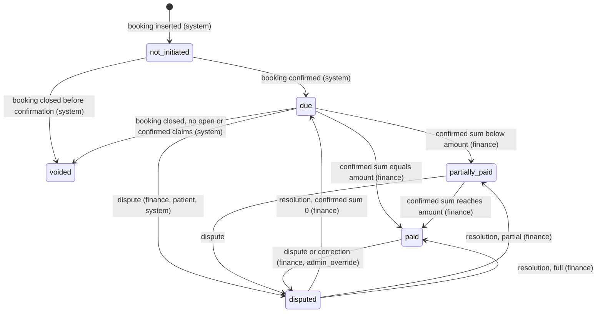
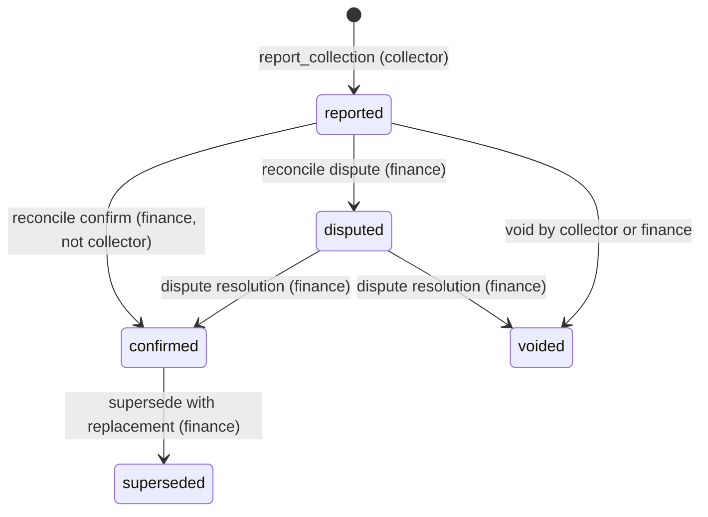

# P01 design: pay-after records, payment test mode, webhooks and reconciliation

**Status:** design only. No migration, code or commit was produced for this document. Nothing here is implemented.
**Ticket:** P01 in `docs/IMPLEMENTATION_TASKS.md` ("Pay-after records, payment test mode, webhooks and reconciliation").
**Author:** Kiro (delegated design). Reviewer and integrator: Claude. Final decisions: project owner.
**Date:** 2026-11-17.

## 0. Sources and fixed constraints

Read for this design:

- `README.md` sections 4 (scope), 7 (architecture, feature flags), 9 (payments), Phase 6 and release gates.
- `docs/S00_DECISION_SHEET.md`: Q03, Q04 and Q12 stay at their safe defaults.
- `docs/CANONICAL_SCHEMA_DRAFT.md`: payments table dictionary, payment state machine, constraints, transaction protocol, API mapping, Q04/Q11.
- `docs/API_CONTRACTS.md`: `payment-order`, Razorpay webhook and `collection` routes.
- `origin/docs/backend-handoff:docs/handoffs/backend/reviews/P01-brief.md` (the friend's brief). Section 15 lists where this design differs from it.
- `origin/task/B01-booking` migrations (read-only) for real object names.
- Razorpay webhook validation docs (`razorpay.com/docs/webhooks/validate-test/`, fetched 2026-11-17): HMAC-SHA256 over the raw body with the webhook secret, `X-Razorpay-Signature`, duplicate deliveries identified by `x-razorpay-event-id`, delivery order not guaranteed.

Constraints this design keeps:

| Source | Constraint | Effect in P01 |
|---|---|---|
| Q03 safe default | No invoices or receipts, no online collection | No invoice, receipt, GST or tax tables or fields. The gateway runs in Razorpay **test mode only** and never collects real money. |
| Q04 safe default | No "paid" state. Collector reports only. | A collector report never changes payment state. `paid` needs a confirmed reconciliation, and the `finance:reconcile` capability is granted to nobody until Q04 is answered. In every deployed environment, nothing can reach `paid`. |
| Q12 | Fixed server-side prices only | The obligation amount is copied from the booking snapshot. No client amount is trusted. |
| AGENTS.md | Integer paise, UTC, idempotency, atomic transitions, version checks, booking and payment state separate, webhook signature + amount + currency + dedupe | Applied in sections 4 to 9. |
| README section 7 | Server-side feature flags, default OFF | Two new flags, both OFF, enforced in the app **and** in the database (section 2). |

## 1. Base, dependencies and ordering

- This worktree is based on `ce23f63` (main: I01 + I01b). That base uses the older `private.` schema names. B01 is **not** merged here. It exists on `origin/task/B01-booking` (`202611170001`..`202611170005`) with `identity_private.*`, `booking_private.*`, `public.idempotency_requests` and `public.notification_outbox`.
- P01 targets the B01 branch names. The implementer must re-read the merged B01 migration and adjust names if B01 changes before merge.
- P01 implementation is **blocked** until B01 is merged and the B01 review findings the brief lists (H1 `is_assigned` time window, H2/H3 cancel and non-doctor paths, M1 clinician definition) are fixed.
- One migration author. File: `supabase/migrations/2026111700NN_p01_payments.sql`, ordered after the B01 migration. P01 adds new objects only. It does not edit earlier migration files.
- Exceptions where P01 must alter an existing object, done in P01's own migration and called out in review:
  1. `public.admin_capabilities` has a CHECK listing allowed capability strings (`provider:verify`, `coverage:verify`, `security:audit`, `membership:admin`). P01 drops and re-adds that CHECK with the three finance capabilities added (section 4.2). No rows change.
  2. Triggers on `public.bookings` (section 5). No B01 function is replaced.
- `public.notification_outbox` cannot be reused: its `event_id` is a NOT NULL FK to `booking_events`. P01 sends no notifications (no approved notification channel exists). Payment events stay in `payment_events`. A later notification ticket can read them.

## 2. Feature flags (default OFF)

Two gates, each enforced in two places. The database check matters because Supabase exposes `public` RPCs to any authenticated JWT through PostgREST, bypassing Next.js.

| Gate | App flag (`src/lib/feature-flags`) | DB gate (`payments_private.settings`) | Controls |
|---|---|---|---|
| Pay-after | `payAfter` -> env `FEATURE_PAY_AFTER` | `pay_after_enabled boolean not null default false` | Collection reporting, reconciliation, disputes, overrides, payment reads |
| Gateway test mode | `paymentsTestMode` -> env `FEATURE_PAYMENTS_TEST_MODE` | `gateway_test_enabled boolean not null default false` | Order creation, checkout callback, webhook ingestion and processing, gateway reconciliation job |

Rules:

- The existing `isEnabled()` already returns true only for the exact string `"true"`. Add the two flags to `FEATURE_FLAGS` and `ENV_NAMES`.
- The obligation trigger (section 5) runs regardless of the gate. It only records what the booking already fixed, and running it always avoids a backfill when the gate opens. It writes no `paid` state.
- Every P01 public RPC calls `payments_private.require_gate('pay_after' | 'gateway_test')` first and raises `55000 feature_unavailable` when closed. Routes return the stable "feature unavailable" error (HTTP 404 or 503, chosen once in the shared error map) and never a success.
- The gateway also refuses to run unless `RAZORPAY_KEY_ID` matches `^rzp_test_`. A live key fails closed at env validation. `livePayments` (`FEATURE_LIVE_PAYMENTS`) is not read by any P01 code path as permission. If it is `"true"`, env validation fails because no live path exists.
- `payments_private.settings` is a single row (`id boolean primary key default true check (id)`). It is changed only by the reviewed migration or owner-run SQL, with an `audit_events` row. There is no RPC to change it.
- The same row holds tunables so nothing is hard-coded: `report_window_hours int not null default 72 check (between 1 and 720)`, `webhook_max_age_hours int not null default 72`, `webhook_future_skew_seconds int not null default 300`, `gateway_attempt_stale_minutes int not null default 30`, `stale_due_days int not null default 7`.

## 3. Money rules

- Every amount is `bigint` paise, `>= 0` for obligations and `> 0` for collections and gateway amounts. Currency is a column fixed by `check (currency = 'INR')`.
- The JSON API carries paise as decimal strings validated by `z.string().regex(/^(0|[1-9][0-9]{0,14})$/)`, then `BigInt()`. Never `Number`. B01 already returns `amount_paise` as a string.
- `payments.amount_paise` is copied once from `bookings.amount_paise` and is immutable (guard trigger). A later price change does not change the obligation.
- `payments.confirmed_paise` is never incremented from input. Every command that changes a collection recomputes it as `sum(amount_paise) where status = 'confirmed'` while holding the payment row lock.
- Hard bounds:
  - `check (confirmed_paise between 0 and amount_paise)` on `payments`.
  - A report is rejected with `22023 over_collection` when `confirmed + reported (open) + new > amount_paise`.
  - Gateway order amount must equal `amount_paise - confirmed_paise` at creation, and the webhook amount must equal the stored order amount exactly.
- No refunds, fees, taxes, discounts or rounding. With no arithmetic beyond sums of bigints bounded by `amount_paise`, overflow is impossible.
- Timestamps are `timestamptz`, set by `clock_timestamp()` in the database. Gateway `created_at` (Unix seconds) is stored as `to_timestamp()` in UTC and used only for freshness checks, never as our event time.

## 4. Tables

All tables: RLS enabled, `revoke all ... from public, anon, authenticated`, SELECT policies only where section 10 says so, no INSERT/UPDATE/DELETE grants. All writes go through `SECURITY DEFINER` functions with `set search_path = ''`. Private helpers live in a new schema `payments_private` (usage revoked from `public, anon, authenticated`).

### 4.1 Core pay-after

**`public.payments`**: one obligation per booking.

| Column | Type / constraint |
|---|---|
| `id` | `uuid pk default gen_random_uuid()` |
| `booking_id` | `uuid not null unique references bookings(id) on delete restrict` |
| `amount_paise` | `bigint not null check (amount_paise >= 0)`, immutable |
| `currency` | `text not null default 'INR' check (currency = 'INR')` |
| `collection_path` | `text not null default 'direct_pay_after' check (collection_path = 'direct_pay_after')`, immutable |
| `state` | `text not null default 'not_initiated' check (state in ('not_initiated','due','partially_paid','paid','disputed','voided'))` |
| `confirmed_paise` | `bigint not null default 0 check (confirmed_paise between 0 and amount_paise)` |
| `version` | `integer not null default 1` |
| `created_at`, `updated_at` | `timestamptz not null default clock_timestamp()` |

Guard trigger `payments_private.guard_payment` (BEFORE UPDATE): rejects changes to `id`, `booking_id`, `amount_paise`, `currency`, `collection_path`, `created_at`. Rejects any `state` change not present in `payment_transitions`. Requires `new.version = old.version + 1`. Rejects DELETE and TRUNCATE.

`processing`, `refunded` and `partially_refunded` from the canonical diagram are not allowed by the CHECK. Adding them is a later migration behind its own gate.

**`public.payment_transitions(from_state, to_state, actor_kind)`**: seeded, primary key on all three, no grants. `actor_kind in ('system','finance','admin_override')`. Rows are listed in section 5.

**`public.payment_collections`**: collector claims. Never deleted.

| Column | Type / constraint |
|---|---|
| `id` | `uuid pk` |
| `payment_id` | `uuid not null references payments(id) on delete restrict` |
| `collector_profile_id` | `uuid not null references profiles(id) on delete restrict` |
| `amount_paise` | `bigint not null check (amount_paise > 0)` |
| `method` | `text not null check (method in ('cash','upi_direct'))` |
| `reference` | `text null`. CHECK: `reference ~ '^[A-Za-z0-9-]{1,64}$'`. CHECK: `method = 'cash'` implies `reference is null`. Trigger: rejects any run of 13 to 19 digits that passes Luhn (card number guard). |
| `reference_norm` | `text generated always as (upper(reference)) stored` |
| `status` | `text not null default 'reported' check (status in ('reported','confirmed','disputed','voided','superseded'))` |
| `request_key` | `uuid not null`, `unique (payment_id, request_key)` (permanent, survives idempotency row cleanup) |
| `superseded_by` | `uuid null references payment_collections(id)` |
| `reason_code` | `text null check (reason_code in ('amount_mismatch','not_received','duplicate','wrong_payee','correction','other'))` |
| `reported_at` | `timestamptz not null default clock_timestamp()` |
| `reconciled_by`, `reconciled_at` | `uuid null references profiles(id)`, `timestamptz null` |

Extra checks:
- `status <> 'reported'` implies `reconciled_by is not null and reconciled_at is not null`.
- `reconciled_by is distinct from collector_profile_id` (no self-confirmation).
- `status = 'superseded'` iff `superseded_by is not null`.
- Guard trigger: `payment_id`, `collector_profile_id`, `amount_paise`, `method`, `reference`, `request_key`, `reported_at` are immutable after insert. `status` moves only along the collection machine in section 5.2. DELETE and TRUNCATE are rejected.
- UPI reference duplicates: non-unique index on `(method, reference_norm) where method = 'upi_direct'`. A duplicate across bookings raises an exception record (section 9). It does not block, because a UTR can legitimately be quoted for split payments. The canonical "unique in payee/method scope" rule waits on Q03 (payee identity).

**`public.payment_events`**: append-only ledger.

| Column | Type / constraint |
|---|---|
| `id` | `uuid pk` |
| `payment_id` | `uuid not null references payments(id)` |
| `collection_id` | `uuid null references payment_collections(id)` |
| `gateway_attempt_id` | `uuid null references payment_gateway_attempts(id)` (create that table first in the migration) |
| `actor_profile_id` | `uuid null references profiles(id)`. Null only when `capability = 'system'`. |
| `capability` | `text not null check (capability in ('collector','finance','admin_override','system','patient'))` |
| `event_type` | `text not null` (closed list: `obligation.created`, `obligation.due`, `obligation.voided`, `collection.reported`, `collection.confirmed`, `collection.disputed`, `collection.voided`, `collection.superseded`, `payment.disputed`, `payment.resolved`, `payment.override`, `gateway.order_created`, `gateway.attempt_updated`, `exception.raised`) |
| `from_state`, `to_state` | `text null` (payment state, when it changed) |
| `payment_version` | `integer not null` |
| `reason_code` | `text not null` |
| `request_key` | `uuid null` |
| `occurred_at` | `timestamptz not null default clock_timestamp()` |

`unique (payment_id, payment_version, event_type)`. Triggers reject UPDATE, DELETE and TRUNCATE for every role, including the table owner (same pattern as I01's `reject_audit_mutation`). No names, phones, addresses, references or gateway payloads.

### 4.2 Capabilities

Added to the `admin_capabilities` CHECK (section 1). All require `aal2` through the existing capability predicate.

| Capability | Scope | Purpose | Granted at launch |
|---|---|---|---|
| `finance:collect` | `org:<uuid>` | Provider-side staff report a collection on behalf of a doctor whose assignment or membership has ended | Nobody (D-10) |
| `finance:reconcile` | `global` | Confirm or dispute a reported collection, resolve disputes | **Nobody** (Q04/D-1) |
| `finance:override` | `global` | Correct a payment state under audit | Nobody (D-8) |

Grants go through the reviewed out-of-band bootstrap path used for I01 capabilities. pgTAP tests insert them directly inside a rolled-back transaction.

Provider-side read access (`finance:read`) is an organization-membership scope, not an admin capability. The implementer must check the org-member capability values I01/B01 actually allow through `identity_private.org_scope` and add `finance:read` in the same way. Until then, provider-side reads are limited to the individual provider owner.

### 4.3 Gateway test mode

These are the canonical P2-listed `payment_attempts` and `gateway_webhook_events`, scoped to Razorpay test mode. They do not change `payments.state` in P01 (section 8.5).

**`public.payment_gateway_attempts`**

| Column | Type / constraint |
|---|---|
| `id` | `uuid pk` (also sent to Razorpay as the order `receipt`) |
| `payment_id` | `uuid not null references payments(id)` |
| `initiated_by` | `uuid not null references profiles(id)` |
| `gateway` | `text not null default 'razorpay' check (gateway = 'razorpay')` |
| `mode` | `text not null default 'test' check (mode = 'test')` |
| `amount_paise` | `bigint not null check (amount_paise > 0)`, immutable |
| `currency` | `text not null default 'INR' check (currency = 'INR')` |
| `gateway_order_id` | `text null unique check (gateway_order_id ~ '^order_[A-Za-z0-9]{1,40}$')` |
| `gateway_payment_id` | `text null unique check (gateway_payment_id ~ '^pay_[A-Za-z0-9]{1,40}$')` |
| `status` | `text not null default 'creating' check (status in ('creating','created','authorized','captured','failed','expired','mismatch'))` |
| `request_key` | `uuid not null`, `unique (payment_id, request_key)` |
| `version` | `integer not null default 1` |
| `created_at`, `updated_at` | `timestamptz` |

Partial unique index: one open attempt per payment, `unique (payment_id) where status in ('creating','created','authorized')`. Status only moves forward along section 5.3. No card, VPA, email, contact, bank or method details are stored.

**`public.gateway_webhook_events`**: durable inbox and dedupe.

| Column | Type / constraint |
|---|---|
| `id` | `uuid pk` |
| `gateway` | `text not null check (gateway = 'razorpay')` |
| `gateway_event_id` | `text not null`, `unique (gateway, gateway_event_id)`. Kept permanently. |
| `event_type` | `text not null` |
| `account_id` | `text null` |
| `gateway_created_at` | `timestamptz not null` |
| `body_sha256` | `text not null check (body_sha256 ~ '^[0-9a-f]{64}$')` |
| `order_id`, `payment_id_ext` | `text null` (format-checked as above) |
| `amount_paise` | `bigint null check (amount_paise > 0)` |
| `currency` | `text null` |
| `gateway_status` | `text null` |
| `processing_status` | `text not null default 'pending' check (processing_status in ('pending','processed','ignored','rejected','exception'))` |
| `processing_note` | `text null check (processing_note in (...closed list of codes...))` |
| `attempts` | `integer not null default 0` |
| `lease_until` | `timestamptz null` |
| `received_at`, `processed_at` | `timestamptz` |

Only the allowlisted fields above are extracted from the payload. The raw body is not stored, because Razorpay payment entities carry email, contact, VPA and card metadata. `body_sha256` keeps a forensic link to the request without that data.

**`public.payment_exceptions`**: reconciliation work queue.

| Column | Type / constraint |
|---|---|
| `id` | `uuid pk` |
| `payment_id` | `uuid null references payments(id)` |
| `kind` | `text not null check (kind in ('stale_due','stale_reported','cancel_with_collections','duplicate_upi_reference','gateway_amount_mismatch','gateway_currency_mismatch','gateway_unknown_order','gateway_capture_after_close','gateway_attempt_stale','gateway_and_direct_both','gateway_api_mismatch'))` |
| `source_id` | `uuid null` (collection, attempt or webhook row) |
| `status` | `text not null default 'open' check (status in ('open','acknowledged','closed'))` |
| `dedupe_key` | `text not null unique` (for example `stale_due:<payment_id>`), so jobs can re-run safely |
| `raised_at`, `closed_at`, `closed_by` | |

Exceptions are flags for humans. Closing one never changes money state by itself.

### 4.4 Reused tables

- `public.idempotency_requests` (B01): actions `payment.collect`, `payment.collection_void`, `payment.reconcile`, `payment.supersede`, `payment.dispute`, `payment.resolve`, `payment.override`, `payment.gateway_order`.
- `public.audit_events` (B01): one row per human command. Its `actor_profile_id` is NOT NULL, so worker actions write `payment_events` only.

### 4.5 Not created

Invoices, receipts, GST/tax fields, refunds, payouts, settlements, subscriptions, card/VPA/bank columns, raw webhook bodies, any client-writable `paid_at`.

## 5. State machines

### 5.1 Payment obligation

`payment_transitions` seed, as `(from, to, actor_kind)`:

- `not_initiated -> due (system)`, `not_initiated -> voided (system)`
- `due -> partially_paid (finance)`, `due -> paid (finance)`, `partially_paid -> paid (finance)`
- `due -> voided (system)`
- `due | partially_paid | paid -> disputed (finance, system, admin_override)`
- `disputed -> due | partially_paid | paid (finance, admin_override)`

Notes:
- `partially_paid -> partially_paid` is a non-transition. Confirming a second partial claim only bumps `version` and `confirmed_paise`.
- `voided` has no outgoing edge.
- The derived state after any recompute is: `sum = 0 -> due`, `0 < sum < amount -> partially_paid`, `sum = amount -> paid`. A command may only move to the derived state or to `disputed`.
- `paid` additionally requires `confirmed_paise = amount_paise and amount_paise > 0`, enforced in the guard trigger, so no path (override included) can write `paid` without confirmed collections.
- A "patient" dispute moves the payment to `disputed` through the `dispute_payment` RPC (section 7). It does not touch collections.

Booking coupling, by triggers on `public.bookings` (`AFTER INSERT` and `AFTER UPDATE OF state`), definer, `search_path = ''`, same transaction as the booking change:

| Booking event | Payment effect |
|---|---|
| Insert | `insert into payments ... on conflict (booking_id) do nothing`, state `not_initiated`, `amount_paise = new.amount_paise`. Event `obligation.created`. |
| State becomes `confirmed` | `not_initiated -> due`. Event `obligation.due`. |
| State becomes `declined`, `expired`, `cancelled`, `no_show` or `interrupted`, with no `reported` or `confirmed` collection | `not_initiated -> voided` or `due -> voided`. Zero charge (Q02 default: no fees). |
| Same, but a `reported` or `confirmed` collection exists | Payment is not voided. It moves to `disputed` (system), and a `cancel_with_collections` exception is raised. |
| `in_progress`, `completed` | No change. `completed` only opens the collector's reporting window. |

The migration backfills idempotently: one `not_initiated` row for every booking without a payment, then `due` for those in `confirmed`, `in_progress` or `completed`, then `voided` for closed ones.

The trigger lock order matches B01: the booking row is already locked by the booking command, and the trigger then locks the payment row. Payment RPCs lock booking first, then payment, so the order is the same everywhere.

### 5.2 Collection claim

`confirmed -> superseded` first moves the payment to `disputed` (if it is not already) and inserts the replacement as `reported`, which then needs its own confirmation by a different finance reviewer than the collector.

### 5.3 Gateway attempt (test mode)

`creating -> created` (order stored) or `creating -> failed` (gateway call failed). `created -> authorized | captured | failed | expired`. `authorized -> captured | failed | expired`. Any open state `-> mismatch` when amount, currency or order do not match. `captured`, `failed`, `expired` and `mismatch` are terminal. Out-of-order webhooks are handled by ignoring any event that would move backward (a late `payment.authorized` after `captured` is stored as `ignored`).

## 6. Idempotency

Pattern follows B01's `create_booking_request`:

1. Every mutating RPC takes `p_request_key uuid`. The route requires an `Idempotency-Key` header that parses as a UUID, else 422.
2. `request_hash = encode(sha256(convert_to(jsonb_build_array(<target id>, <every semantic input>)::text, 'UTF8')), 'hex')`. The target id is always included.
3. Look up `(actor_profile_id, action, request_key)`. Same hash: re-check current authorization, then return the stored `result_id` without writing. Different hash: `40001` with message `idempotency_conflict`. The service maps it to 409 and **does not retry** it (B01 reuses 40001; the message is what tells it apart from a serialization failure).
4. A rolled-back call leaves no idempotency row.
5. Domain uniqueness that does not depend on idempotency row retention:
   - `payment_collections unique (payment_id, request_key)`
   - `payment_gateway_attempts unique (payment_id, request_key)` and one open attempt per payment
   - `gateway_webhook_events unique (gateway, gateway_event_id)`
   - `payments unique (booking_id)`
   Cleaning old `idempotency_requests` rows (Q11) therefore cannot allow a duplicate collection, attempt or webhook effect.
6. A revoked actor replaying an old key is denied at step 3's authorization re-check.

## 7. RPCs (core pay-after)

All: `SECURITY DEFINER`, `set search_path = ''`, `revoke all ... from public, anon`, `grant execute ... to authenticated`. The first statement is `payments_private.require_gate('pay_after')`, then `identity_private.require_actor()`. None takes an actor, role, state, price or paid parameter. Lock order: booking, then payment, then collection. `set local lock_timeout = '3s'` in each.

### `report_collection(p_booking_id uuid, p_amount_paise bigint, p_method text, p_reference text, p_request_key uuid) returns uuid`

- Authorization, re-checked after the locks: `payments_private.is_collector(p_booking_id)` (below) **or** `finance:collect` on the booking's provider org. Profile active. Provider still publishable.
- Booking state `in_progress` or `completed`. If `completed`, `clock_timestamp() <= completed_at + report_window_hours`.
- Payment state `due` or `partially_paid`.
- Bound: `confirmed + open reported + p_amount_paise <= amount_paise`, else `22023 over_collection`.
- Inserts a `reported` collection. Payment `state` and `confirmed_paise` do not change, but `version` increments so concurrent reconcilers see a fresh version.
- Writes `payment_events (collection.reported, capability collector)` and `audit_events`. Duplicate UPI reference check runs here and raises an exception row, not an error.
- Returns the collection id only.

`payments_private.is_collector(booking_id)` differs from B01's `is_assigned`, which drops access once the booking leaves `confirmed`/`in_progress`:
- Caller has a `booking_assignments` row for this booking whose purpose matches the category (`doctor_visit`, `lab_collection`, `caretaker`, `driver`), with `status = 'active'`, or `status = 'ended'` where the end was caused by the booking's own completion. `replaced` (reassignment) always fails.
- Resource is `kind = 'person'` with `person_profile_id = auth.uid()`.
- Booking state `in_progress` or `completed`. Provider active. Membership active when the provider is an organization.

### `void_collection(p_collection_id uuid, p_expected_payment_version int, p_reason_code text, p_request_key uuid)`

The collector may void their own `reported` claim. A `finance:reconcile` holder may void any `reported` or `disputed` claim. Recompute. Event and audit.

### `reconcile_collection(p_collection_id uuid, p_decision text, p_reason_code text, p_expected_payment_version int, p_request_key uuid)`

- `p_decision in ('confirm','dispute')`.
- `finance:reconcile` with `aal2`. Caller is not the collector, not the provider owner, not an active member of the provider org, and has no `patient_access` to the booking's patient.
- Version must match, else `40001 stale_version` (409, no retry in the service). Collection must be `reported`.
- `confirm`: collection `confirmed`, recompute, payment moves to the derived state.
- `dispute`: collection `disputed`, payment -> `disputed`.

### `supersede_collection(p_collection_id uuid, p_amount_paise bigint, p_method text, p_reference text, p_reason_code text, p_expected_payment_version int, p_request_key uuid) returns uuid`

Finance only, `aal2`. For a `confirmed` claim. Marks it `superseded`, inserts the replacement `reported` claim (collector = original collector, recorded by finance), recomputes, and moves the payment to `disputed`. The replacement then needs a normal `reconcile_collection` by someone other than the caller.

### `dispute_payment(p_booking_id uuid, p_reason_code text, p_expected_payment_version int, p_request_key uuid)`

Caller is the patient with booking access (B01's patient booking predicate) or a `finance:reconcile` holder. Payment state `due`, `partially_paid` or `paid`. Moves to `disputed`. No collection changes. Whether patients get this at launch is D-3. Default: yes, dispute only, rate-limited at the route.

### `resolve_dispute(p_payment_id uuid, p_resolution_code text, p_expected_payment_version int, p_request_key uuid)`

Finance only, `aal2`. All collections of the payment must be in `confirmed`, `voided` or `superseded` (no `reported` or `disputed` left). Recompute, then `disputed -> derived state`.

### `override_payment(p_payment_id uuid, p_target_state text, p_reason_code text, p_expected_payment_version int, p_request_key uuid)`

- `finance:override` with `aal2`. `p_reason_code` is required. There is no free-text note: `audit_events` has no note column and the ledger stays free of free text. If finance needs notes, that is a separate decision (D-8).
- Goes through the transition table with `actor_kind = 'admin_override'`. Cannot produce `paid` without matching confirmed sums (guard trigger), cannot change amounts, cannot leave `voided`.
- Writes exactly one `payment_events` row and one `audit_events` row before returning.

### Read functions

- `get_payment_summary(p_booking_id uuid) returns jsonb`
  - Patient: `{ state, amountPaise, confirmedPaise, currency, version }`, paise as strings.
  - Collector and provider finance scope: the same plus each claim's `{ id, amountPaise, method, status, reportedAt }`. The reference is shown only to the claim's collector and to finance.
  - Any other caller, or a random id: `P0002 not_found`, identical in both cases.
- `list_payment_queue(p_limit int, p_after_reported_at timestamptz, p_after_id uuid) returns setof ...`
  - `finance:reconcile` only. Rows: booking `public_ref`, payment id, claim id, amount, method, age, open exception kinds. No patient name, address, contact or collector name. Keyset on `(reported_at, id)`, `p_limit between 1 and 100`.
- `list_payment_exceptions(...)`: same access and pagination.

## 8. Payment test mode (Razorpay sandbox)

### 8.1 Preconditions

All must hold, or every gateway route returns "feature unavailable":
- `FEATURE_PAYMENTS_TEST_MODE === "true"` and DB `gateway_test_enabled = true`.
- `RAZORPAY_KEY_ID` matches `^rzp_test_`. `RAZORPAY_KEY_SECRET`, `RAZORPAY_WEBHOOK_SECRET` and `CRON_SECRET` are set. These are validated by Zod in `src/lib/env`, are server-only, and are never logged. Only the key id may reach the browser.
- Staging or local environment, synthetic data only.

### 8.2 Order creation: `POST /api/bookings/:id/payment-order`

1. Route: session, strict empty body (no amount accepted), `Idempotency-Key` required.
2. RPC `begin_gateway_attempt(p_booking_id, p_request_key) returns (attempt_id, amount_paise)`:
   patient with booking access; booking `confirmed`, `in_progress` or `completed`; payment `due` or `partially_paid`; no `reported` or `confirmed` collections; no open attempt. Inserts `creating` with `amount_paise = amount - confirmed`.
3. Server calls Razorpay Orders API (test key) with `amount = attempt.amount_paise`, `currency = 'INR'`, `receipt = attempt_id`, `notes = { attempt_id }`. No name, phone, email or booking details are sent.
4. RPC `record_gateway_order(p_attempt_id, p_order_id, p_amount_paise, p_currency)` (service-side, `service_role` only): checks the returned amount and currency equal the attempt, stores `gateway_order_id`, moves `creating -> created`. On API failure, `mark_gateway_attempt_failed`.
5. Response: `{ orderId, keyId, amountPaise, currency }`. Nothing implies payment.

The idempotent replay of step 2 returns the same attempt. If it is still `creating` (crash between steps 3 and 4), the reconciliation job resolves it by fetching orders by `receipt`.

### 8.3 Checkout callback

The browser returns `razorpay_order_id`, `razorpay_payment_id` and `razorpay_signature`. The server may verify `HMAC_SHA256(order_id + "|" + payment_id, key_secret)` with a constant-time compare, and only to show "verifying payment". The callback never changes attempt or payment state. Only the webhook or the server-side API fetch in the job does.

### 8.4 Webhook: `POST /api/payments/razorpay/webhook`

Route handler, Node runtime, no session:

1. Gate check. Closed returns 404 or 503 without reading the body.
2. Reject `Content-Length` above 64 KiB (413). Read the body once with `await request.text()`. Do not parse before verifying.
3. Signature: `expected = hmac_sha256_hex(RAZORPAY_WEBHOOK_SECRET, rawBody)`. Compare with `X-Razorpay-Signature` using `crypto.timingSafeEqual` on equal-length buffers (length mismatch is a failure). Failure returns 401 with no detail and logs only `{ reason: 'bad_signature', bodySha256 }`.
4. Parse JSON with a strict Zod schema of the allowlisted fields only (`event`, `account_id`, `created_at`, `payload.payment.entity.{id, order_id, amount, currency, status}`, `payload.order.entity.{id, amount, currency, status}`). Unknown event types are accepted and stored as `ignored`, so Razorpay stops retrying.
5. Replay and freshness checks (in the ingest RPC, using DB time):
   - `x-razorpay-event-id` header required, `^[A-Za-z0-9_-]{1,64}$`.
   - `gateway_created_at` not older than `webhook_max_age_hours` and not more than `webhook_future_skew_seconds` in the future. Outside the window: stored `rejected` (`stale_event`) and answered 200 so it is not retried forever. The window is wider than Razorpay's retry period so honest retries are not rejected; the implementer must confirm the retry period in current Razorpay docs.
   - `account_id` must equal `RAZORPAY_ACCOUNT_ID` when that env var is set.
6. `payments_worker.ingest_webhook(...)` inserts into `gateway_webhook_events ... on conflict (gateway, gateway_event_id) do nothing`. Duplicate: return 200 immediately with no further effect.
7. Processing runs in a separate transaction, inline after ingest and again from the job for anything left `pending`. `payments_worker.process_webhook(p_event_row_id)`:
   - Lease the row (`for update skip locked`, `lease_until`).
   - Find the attempt by `gateway_order_id`. None: `exception` + `gateway_unknown_order`.
   - Amount and currency must equal the attempt. Otherwise attempt `mismatch` + exception.
   - `gateway_payment_id`, once set on an attempt, must match. A second different payment id for the same order raises an exception.
   - Apply forward-only status (5.3). Backward or repeated events are `ignored`.
   - A capture on an attempt whose payment is `voided` or whose booking is closed raises `gateway_capture_after_close`. No rebooking and no refund.
   - Write `payment_events (gateway.attempt_updated, capability system)`.
8. Return 200 for every verified, stored event, including ignored and rejected ones. Return 5xx only when the database is unavailable before the insert commits, so Razorpay retries.

Replay protection, summarized: a valid signature binds the body (including `created_at`) to our secret; the event id is deduplicated permanently; old or future-dated events are refused; the account must match; state moves forward only; and the gateway payment id is unique across attempts. A replayed body with a fresh event id still cannot move state twice, because the attempt's status is already terminal.

### 8.5 Effect on `payments.state`

None in P01. A verified test capture marks the **attempt** `captured` and is shown to the patient and finance as "test payment captured (sandbox, not real money)". `payments.state` stays `due` or `partially_paid`, and `confirmed_paise` ignores gateway captures. This keeps Q03 (no online collection) and Q04 (no `paid` except through a confirmed collector report).

Letting verified captures drive `processing` and `paid` later needs: Q03 answered, a `collection_path` widened beyond `direct_pay_after`, the `processing` and refund states enabled, and a new ticket with its own tests.

### 8.6 Worker access

Worker RPCs live in schema `payments_worker`, with `execute` granted only to `service_role`. The service-role key is used only in the webhook route and the cron route, never in a client bundle. Open question E-1 asks whether to use a dedicated database role instead.

## 9. Reconciliation job

Route `POST /api/internal/payments/reconcile`, called by a scheduler (Vercel cron or equivalent, subject to the hosting approval). Authorized by `Authorization: Bearer <CRON_SECRET>` with a constant-time compare. Bounded: at most 200 rows per pass, every pass idempotent through `payment_exceptions.dedupe_key` and row leases.

Pass A, pay-after (DB only, runs when `pay_after_enabled`):
- `stale_reported`: claims `reported` for more than 48 hours.
- `stale_due`: booking `completed` more than `stale_due_days` ago and payment still `due`. The payment never auto-expires and is never auto-marked paid.
- `cancel_with_collections`: re-check for any the trigger missed.
- `duplicate_upi_reference`: same `reference_norm` on different payments.

Pass B, gateway test mode (runs when `gateway_test_enabled`):
- Re-process `pending` webhook rows whose lease has expired, with `attempts < 10`; after that, `exception`.
- Attempts `creating` older than `gateway_attempt_stale_minutes`: look up the order by `receipt` through the Razorpay API. Found: `record_gateway_order`. Not found: `failed`.
- Attempts `created` or `authorized` older than the threshold: fetch the order's payments from the API. A capture we have no webhook for is applied through the same `process_webhook` checks (source `api_poll`). Amount or status disagreement raises `gateway_api_mismatch`.
- Payments with both a gateway capture and a direct collection: `gateway_and_direct_both`.

The job never confirms a collection, never resolves a dispute and never changes `payments.state`. It writes exceptions and attempt statuses only. Finance works through `list_payment_queue` and `list_payment_exceptions`.

## 10. RLS (SELECT only)

| Table | Who can read | Notes |
|---|---|---|
| `payments` | Patient through B01's patient booking predicate. Provider owner, or org member with `finance:read`, for that provider. `finance:reconcile` / `finance:override` holders. | Clients should prefer `get_payment_summary`. |
| `payment_collections` | The collector (own rows). Provider finance scope for its provider. Finance capability holders. | **Patients: no policy.** They see totals through the summary function only. |
| `payment_events` | Provider finance scope and finance capability holders. | Patients: none. Avoids exposing `actor_profile_id`. |
| `payment_gateway_attempts` | Patient who initiated, finance capability holders. | Status, amount and order id only. |
| `gateway_webhook_events`, `payment_exceptions`, `payment_transitions`, `payments_private.settings` | No policy for `authenticated`. | Reached only through definer functions. |

Every policy also requires `identity_private.active_account()`. No `anon` access anywhere. Admin finance policies never join addresses, contacts, questionnaire or patient identity.

## 11. Audit and logging

- Every human command writes `audit_events (actor_profile_id, action, target_type = 'payment' | 'payment_collection', target_id)` in the same transaction. Actions: `payment.collect`, `payment.collection_void`, `payment.reconcile.confirm`, `payment.reconcile.dispute`, `payment.supersede`, `payment.dispute`, `payment.resolve`, `payment.override`, `payment.gateway_order`.
- `payment_events` is the money ledger. Both tables reject UPDATE, DELETE and TRUNCATE.
- Settings changes write an audit row (owner-run SQL includes the insert).
- Application logs contain ids, codes and `bodySha256` only. Never the raw webhook body, signatures, secrets, references, names, phones or amounts tied to a person.

## 12. API routes

Thin adapters in the B01 pattern (`endpoint`, `session`, strict Zod `input`, `requestKey`), calling one domain service in `src/lib/payments/`.

| Route | RPC | Gate | Notes |
|---|---|---|---|
| `POST /api/bookings/:id/collection` | `report_collection` | pay-after | Body `{ amountPaise: string, method, reference? }`, strict. Response `{ id }`. |
| `POST /api/bookings/:id/collection/:cid/void` | `void_collection` | pay-after | |
| `POST /api/bookings/:id/payment/dispute` | `dispute_payment` | pay-after | Rate-limited. |
| `GET /api/bookings/:id/payment` | `get_payment_summary` | pay-after | |
| `GET /api/admin/payments/queue`, `GET /api/admin/payments/exceptions` | list functions | pay-after | `aal2`. |
| `POST /api/admin/payments/collections/:cid/reconcile` | `reconcile_collection` | pay-after | `aal2`. |
| `POST /api/admin/payments/collections/:cid/supersede` | `supersede_collection` | pay-after | `aal2`. |
| `POST /api/admin/payments/:id/resolve`, `/override` | `resolve_dispute`, `override_payment` | pay-after | `aal2`. |
| `POST /api/bookings/:id/payment-order` | section 8.2 | gateway test | Body must be empty. |
| `POST /api/payments/razorpay/webhook` | section 8.4 | gateway test | No session. Raw body. |
| `POST /api/internal/payments/reconcile` | section 9 | either | `CRON_SECRET`. |

No body anywhere accepts `state`, `status`, `paid`, `actor`, `collectorId`, `amount` on order creation, or `confirmedPaise`. Strict schemas reject unknown keys with 422.

Error map: 401 no session; scoped 403/404 (`42501` and `P0002` both map to 404 for resources the caller cannot see); 409 for `40001` (`stale_version`, `idempotency_conflict`), `55000` state conflicts and `over_collection`. `55000` with message `feature_unavailable` maps to the unavailable error instead, so the service matches on code **and** message, as B01 already does for `40001`; 422 invalid input (`22023` validation); 429 rate limit; feature unavailable as fixed in section 2. The service never retries 409s.

## 13. Negative tests

SQL suites follow the B01 layout: `supabase/tests/p01_payments.sql` (pgTAP) and a two-connection runner like `run_b01_concurrency.py` on a scratch database only. Synthetic data only.

**Structure and grants**
1. RLS on every new table. Zero INSERT/UPDATE/DELETE/TRUNCATE grants to `anon` and `authenticated`. No execute on `payments_private.*` or `payments_worker.*` for `authenticated`. `search_path = ''` on every new function.
2. No column named like `card`, `pan`, `cvv`, `cvc`, `vpa`, `email`, `phone`, `token`, `raw_body`.
3. `collection_path` cannot be anything but `direct_pay_after`. `state` cannot be `processing` or `refunded`. `mode` cannot be `live`.

**Feature gates**
4. With both DB gates false (the migration default), every public P01 RPC raises `55000 feature_unavailable` and writes nothing. The obligation trigger still creates rows.
5. App: with env flags unset, every P01 route returns the unavailable error. With `FEATURE_PAYMENTS_TEST_MODE=true` and a key id not starting with `rzp_test_`, env validation fails. `FEATURE_LIVE_PAYMENTS=true` fails env validation.

**Obligation and coupling**
6. Booking insert creates exactly one `not_initiated` payment. Confirm moves it to `due`. Re-running the backfill creates nothing.
7. Cancel, decline, expire, no-show and interrupt with no claims void it. With a reported claim, it becomes `disputed` and an exception is raised.
8. Changing `amount_paise`, `booking_id` or `collection_path` directly fails, even as table owner.

**Collector authorization (each returns 42501 and writes nothing)**
9. Not assigned. Assignment `replaced` by reassignment. Booking `requested`, `confirmed` (not started), `cancelled`. Provider suspended. Org membership disabled. Wrong provider. Profile disabled. Reporting after the window.
10. Allowed: assigned collector in `in_progress`, and in `completed` within the window.

**Paid-state spoofing**
11. `report_collection` never changes `state` or `confirmed_paise`.
12. `update payments set state = 'paid'` and `insert into payment_collections` fail for `authenticated` (no grant).
13. The collector calling `reconcile_collection` gets 42501. A finance reviewer who is also the collector, a provider org member, the provider owner, or has patient access, gets 42501. Without `aal2`: 42501. An expired or revoked capability: 42501.
14. With `finance:reconcile` held by nobody (the launch state), no sequence of public RPC calls by any role reaches `paid`.
15. `override_payment` to `paid` with `confirmed_paise < amount_paise` fails. Override out of `voided` fails. Override without a valid reason code fails. A successful override writes exactly one `payment_events` and one `audit_events` row.

**Money**
16. Report above the remaining amount: `over_collection`. Direct insert that breaks `confirmed_paise <= amount_paise` (as owner): `23514`.
17. Amount `0`, negative, non-integer string, above 15 digits, or JSON number: 422 at the route, `22023` at the RPC.
18. Zero-amount booking: no report is possible and the state never reaches `paid`.
19. Sequence `due -> partially_paid -> paid` only through confirmed sums. Supersede after `paid` goes through `disputed` and recomputes. The transition guard rejects every edge not in the seed.

**Card data and references**
20. Reference with 13 to 19 Luhn-valid digits, more than 64 characters, spaces, unicode, or any reference on a `cash` claim: rejected.

**Idempotency**
21. Same key, same payload: same id, one row, one event. Same key, different amount: `40001 idempotency_conflict`. Rolled-back call: no key stored. Revoked collector replaying an old key: 42501. Deleting the `idempotency_requests` row and replaying: `unique (payment_id, request_key)` still prevents a second claim.

**Ledger immutability**
22. UPDATE, DELETE and TRUNCATE on `payment_events`, `payment_collections` and `audit_events` fail for every role.

**IDOR and privacy**
23. Patient B reading patient A's payment gets the same `not_found` as a random id. Provider X cannot read provider Y's claims. A patient sees no collector id or reference. The finance queue has no name, address or phone.
24. `payment_events` and exceptions contain no reference, name, phone or address.

**Webhook (route tests with a synthetic secret and synthetic bodies)**
25. Missing signature, wrong signature, signature of a re-serialized (whitespace-changed) body, wrong-length signature: 401, nothing stored.
26. Body over 64 KiB: 413. Gate off: unavailable, body not read.
27. Same event id twice: one row, one state change, both 200.
28. Valid signature, `created_at` older than the window or in the future beyond skew: stored `rejected`, no state change.
29. Wrong `account_id`: rejected. Unknown event type: `ignored`, 200.
30. Amount or currency differing from the attempt: attempt `mismatch` and exception. Unknown order id: exception.
31. `payment.authorized` after `payment.captured` (out of order): attempt stays `captured`.
32. Same body replayed under a new event id: no second effect.
33. Capture for a voided payment: exception, payment state unchanged, no refund row.
34. A verified test capture does not change `payments.state` or `confirmed_paise`.
35. Checkout callback with a valid HMAC does not change any state. With an invalid one, it does not either.

**Order creation**
36. Body with `amount`: 422. Non-patient, other patient, booking not confirmed, payment `voided` or `paid`, an existing open attempt, an existing direct claim: denied. Live key configured: unavailable.

**Concurrency (two real connections, scratch DB)**
37. Two reports that together exceed the amount: exactly one succeeds.
38. Two reconciles of one claim: one wins, the other gets `stale_version`, `confirmed_paise` correct.
39. Reconcile against collector void of the same claim: one wins, totals consistent.
40. Booking cancel against report: never a reported claim on a voided payment.
41. Same idempotency key from two connections: one row.
42. Two webhook deliveries of one event id in parallel: one row, one effect.
43. Two `begin_gateway_attempt` calls: one open attempt.

**Reconciliation job**
44. Wrong or missing `CRON_SECRET`: 401. Two concurrent runs produce no duplicate exceptions. The job never changes `payments.state`.

**Gates for a green run:** `npm run lint`, `npm run typecheck`, `npm run test`, `npm run build`, `npx supabase db reset`, `npx supabase test db`, and the concurrency runner. Pre-existing B01-branch failures (`c01_catalog.sql`, `catalog-http.test.ts` import) must be fixed or explicitly waived by Claude before P01 claims green.

## 14. Open owner questions and safe defaults

Each default keeps the feature off or narrower. None of them blocks building and testing P01 on staging with synthetic data.

| ID | Question | Owner | Safe default used |
|---|---|---|---|
| D-1 (Q04) | Who confirms provider-collected cash/UPI, with what evidence? | Client finance/operations | `finance:reconcile` granted to nobody. Nothing reaches `paid` in any deployed environment. |
| D-2 | Reporting window after completion | Client operations | 72 hours, in `payments_private.settings`. |
| D-3 | May patients dispute? Is patient acknowledgment required for confirmation? | Client | Patients may dispute. Acknowledgment is not collected. |
| D-4 (Q03/Q04) | Over-collection handling | Finance | Reject. |
| D-5 (Q02) | Cancellation, no-show and interruption fees | Client/legal | None. Close without claims voids. Close with claims disputes and flags. |
| D-6 | Zero-amount bookings | Client | Obligation exists at 0, stays `due`, cannot become `paid`. Alternative: a distinct "no charge" state (needs a migration). |
| D-7 (Q03) | Merchant of record, invoice/receipt issuer, GST | Client/legal/finance | No invoices, receipts or tax fields. Gateway is test mode only. |
| D-8 | Two-person approval for overrides or large corrections? | Finance | One `finance:override` holder with `aal2` and a reason. `finance:override` granted to nobody. |
| D-9 (Q11) | Idempotency and webhook inbox retention | Owner/engineering/privacy | Permanent domain uniqueness keeps replays safe. Inbox rows kept (they hold no personal data). |
| D-10 | Which provider staff may report on a doctor's behalf, and who sees amounts in provider lists | Client operations | `finance:collect` granted to nobody. Provider reads limited to the owner until `finance:read` exists. |
| D-11 | May verified test-mode captures ever drive `payments.state` on staging? | Owner | No. Captures only update the attempt (section 8.5). |
| D-12 | Duplicate UPI reference across bookings | Finance | Flag, do not block. |
| E-1 | Worker uses `service_role` or a dedicated DB role? | Owner/engineering | `service_role`, server-only, with execute limited to `payments_worker.*` by grants. |
| E-2 | Scheduler for the reconciliation job | Owner (hosting approval) | None configured. The job can run by hand on staging. |

## 15. Differences from the friend's brief

| Brief | This design | Why |
|---|---|---|
| Covers core pay-after only. Gateway and webhook are a separate task. | Includes the test-mode gateway, webhook and gateway reconciliation, behind their own gate, with no effect on `payments.state`. | The P01 ticket names all four parts. Keeping the gateway as a shadow ledger satisfies Q03/Q04. The implementer may still split it into P01a (core) and P01b (gateway) branches; the schema allows that. |
| Payment created at confirmation as `due`. | Created at booking insert as `not_initiated`, then `due`. | Matches the approved canonical state machine. Gives `not_initiated -> voided` a real meaning. |
| Reconcile and override take free-text `p_reason` (override: 10+ characters). | Reason codes only. | No free text in the money ledger (PII risk). |
| `paid -> disputed` path for corrections described loosely. | Explicit supersede flow, recompute, guard trigger blocks `paid` without matching confirmed sums. | Makes the override rule testable. |
| Reuse `notification_outbox`. | Not reused. | Its `event_id` FK points at `booking_events`. |
| Patients read `payment_events` with actor hidden. | Patients have no policy on events or collections. | Column hiding is not possible with RLS alone; the summary function covers patients. |
| Capabilities added "through the bootstrap path". | Same, plus the needed `admin_capabilities` CHECK change in P01's migration. | The CHECK lists allowed values and would reject the new ones. |
| `no_show`, `interrupted` not covered. | Treated like cancellation. | B01 has both states. Q02 default: no fees. |

## 16. Out of scope

Live payments, refunds, partial refunds, payouts, settlements, subscriptions, recurring billing, invoices, receipts, GST, notification delivery, UI screens. Live mode needs the README release gates: merchant approval, Q03, verified webhook/reconciliation/refund tests and client authorization.

## 17. Handoff for implementation

- Branch `task/P01-pay-after` from merged B01. Exclusive scope: the P01 migration, `supabase/tests/p01_*`, the concurrency runner, `src/lib/payments/**`, the routes in section 12, and the two flag entries in `src/lib/feature-flags/index.ts` plus env schema additions in `src/lib/env/index.ts`.
- Proposed `docs/API_CONTRACTS.md` changes for Claude to apply: add the void, dispute, admin and internal routes from section 12; mark `payment-order` and the webhook as "test mode only, gated".
- After implementation: update `docs/IMPLEMENTATION_TASKS.md` (P01 row), `docs/TEST_EVIDENCE.md` and `tests/rls/README.md` (or the B01 equivalent) with real command output.
