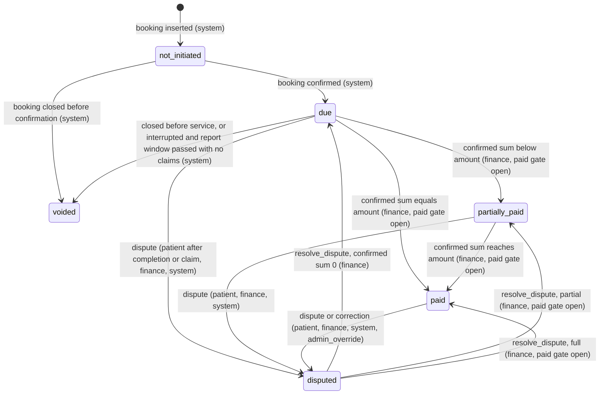
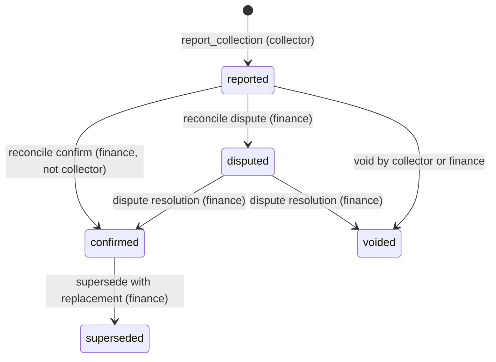

# P01 design: pay-after records, payment test mode, webhooks and reconciliation

**Version:** 1.1
**Status:** design only. No migration or code was produced for this document. Nothing here is implemented.
**Ticket:** P01 in `docs/IMPLEMENTATION_TASKS.md` ("Pay-after records, payment test mode, webhooks and reconciliation").
**Author:** Kiro (delegated design). Reviewer and integrator: Claude. Final decisions: project owner.
**Date:** 2026-11-17 (v1.0), revised 2026-11-18 (v1.1).

**Changelog**
- v1.1 (2026-11-18): resolves adversarial review `review_P01.md` High H1-H5 and Medium M1-M15; fixes Low L1-L9, L12-L15; L10, L11 and I1 are listed in section 18 (Open items). Rebased on the integrated friend stack.
- v1.0 (2026-11-17): first design.

## 0. Sources and fixed constraints

Read for this design:

- `README.md` sections 4 (scope), 7 (architecture, feature flags), 9 (payments), Phase 6 and release gates.
- `docs/S00_DECISION_SHEET.md`: Q03, Q04 and Q12 stay at their safe defaults.
- `docs/CANONICAL_SCHEMA_DRAFT.md`: payments table dictionary, payment state machine, constraints, transaction protocol, API mapping, Q04/Q11.
- `docs/API_CONTRACTS.md`: `payment-order`, Razorpay webhook and `collection` routes.
- `origin/docs/backend-handoff:docs/handoffs/backend/reviews/P01-brief.md` (the friend's brief). Section 15 lists where this design differs from it.
- The integrated friend stack `C:\SURECUREVISIT\.worktrees\kiro-integ-friend` (read-only, HEAD `05ec926`): migrations `202611170001`..`20261117000660` committed, and `20261117001000` (Q06 staff credentials), `20261117001100` (B01 authorization limits) and `20261117001200` (Q06 storage and review scope) present but **uncommitted** on 2026-11-18. Object names below come from that stack.
- Razorpay webhook validation docs (`razorpay.com/docs/webhooks/validate-test/`, fetched 2026-11-17): HMAC-SHA256 over the raw body with the webhook secret, `X-Razorpay-Signature`, duplicate deliveries identified by `x-razorpay-event-id`, delivery order not guaranteed.
- Razorpay webhook best practices and FAQ (fetched 2026-11-18): failed deliveries are retried with exponential backoff for 24 hours from event creation, a response is expected within 5 seconds, and the webhook is disabled after 24 hours of failures.
- Vercel cron docs (fetched 2026-11-18): cron invokes the **production** deployment with an HTTP GET and `Authorization: Bearer <CRON_SECRET>`.

Constraints this design keeps:

| Source | Constraint | Effect in P01 |
|---|---|---|
| Q03 safe default | No invoices or receipts, no online collection | No invoice, receipt, GST or tax tables or fields. The gateway runs in Razorpay **test mode only** and never collects real money. |
| Q04 safe default | No "paid" state. Collector reports only. | A collector report never changes payment state. The database setting `paid_enabled` defaults to `false`, and while it is false the payment guard trigger rejects every transition into `partially_paid` or `paid`, whoever runs the statement (section 2, 4.1). `finance:reconcile` is also granted to nobody until Q04 is answered. Recorded as a Q04 interpretation for `docs/DECISIONS.md` (section 17). |
| Q12 | Fixed server-side prices only | The obligation amount is copied from the booking snapshot. No client amount is trusted. |
| AGENTS.md | Integer paise, UTC, idempotency, atomic transitions, version checks, booking and payment state separate, webhook signature + amount + currency + dedupe | Applied in sections 4 to 9. |
| README section 7 | Server-side feature flags, default OFF | Two new flags, both OFF, enforced in the app **and** in the database (section 2). |
| `CANONICAL_SCHEMA_DRAFT.md` L30, L545-546, L642 | No gateway tables in core; gateway test integration is a separately scoped task | The work is split. **P01a** (core pay-after, sections 2-7, 9 Pass A, 10-13) can proceed. **P01b** (gateway test mode, section 8, 9 Pass B) is **blocked** until the owner approves a dated `docs/DECISIONS.md` entry for this conflict (README section 3). P01a creates no gateway table. |

## 1. Base, dependencies and ordering

- P01 targets the integrated friend stack (`integ/friend-backend`), not `ce23f63` or `origin/task/B01-booking`. Schemas in use there: `identity_private`, `providers_private`, `catalog_private`, `booking_private`. Reused objects: `public.bookings`, `public.booking_events`, `public.booking_assignments`, `public.resources`, `public.audit_events`, `public.idempotency_requests`, `public.organization_members`, `public.admin_capabilities`, `identity_private.has_capability(text, uuid)`, `identity_private.is_assigned(uuid, text)` (as redefined in `20261117001100`), `booking_private.resource_eligible`, `providers_private.person_is_verified`.
- P01 implementation is **blocked** until `20261117001000`, `20261117001100` and `20261117001200` are committed, reviewed and merged with the rest of the friend stack. The B01 findings the brief listed (H1 `is_assigned` time window, H2/H3 cancel and non-doctor paths, M1 clinician definition) appear to be addressed in `20261117001100`; Claude confirms that in review before P01 starts. The implementer re-reads the merged migrations and adjusts names if anything changed.
- One migration author. P01a file: `supabase/migrations/20261117NNNNNN_p01a_payments.sql`, P01b file: `supabase/migrations/20261117NNNNNN_p01b_gateway_test.sql`. Both use the 14-digit prefix and must sort **after** `20261117001200` (string order), so they run after the B01 fixes that redefine `is_assigned` and `guard_booking`. P01 adds new objects only. It does not edit earlier migration files.
- Exceptions where P01a must alter an existing object, done in P01a's own migration and called out in review:
  1. `public.admin_capabilities` CHECK `admin_capabilities_capability_check`. The built value list (from `20261117000660` L13-16) is `provider:verify`, `provider:document_read`, `provider:suspend`, `coverage:verify`, `security:audit`, `membership:admin`. P01a drops and re-adds it with exactly those six values **plus** `finance:reconcile` and `finance:override`. No rows change. A pgTAP test inserts each of the eight values inside a rolled-back transaction.
  2. `public.organization_members` CHECK on `scopes` (built list in `202611170001` L71: `org:read`, `org:edit`, `members:read`, `provider:read`, `provider:manage`, `evidence:manage`, `schedule:manage`, `finance:read`). P01a re-adds it with those eight values plus `finance:collect` (section 4.2). The constraint was created unnamed, so the implementer reads its generated name from `pg_constraint`; the second scopes CHECK (`array_position(scopes, null) is null`) is left alone. The owner-bootstrap insert in `202611170001` L257 is **not** changed, so no existing or new owner receives `finance:collect` automatically.
  3. Triggers on `public.bookings` (section 5). No B01 function is replaced.
- `public.notification_outbox` cannot be reused: its `event_id` is a NOT NULL FK to `booking_events`. P01 sends no notifications (no approved notification channel exists). Payment events stay in `payment_events`. A later notification ticket can read them.

## 2. Feature flags (default OFF)

Two gates, each enforced in two places. The database check matters because Supabase exposes `public` RPCs to any authenticated JWT through PostgREST, bypassing Next.js.

| Gate | App flag (`src/lib/feature-flags`) | DB gate (`payments_private.settings`) | Controls |
|---|---|---|---|
| Pay-after | `payAfter` -> env `FEATURE_PAY_AFTER` | `pay_after_enabled boolean not null default false` | Collection reporting, reconciliation, disputes, overrides, payment reads |
| Gateway test mode (P01b only) | `paymentsTestMode` -> env `FEATURE_PAYMENTS_TEST_MODE` | `gateway_test_enabled boolean not null default false` | Order creation, checkout callback, webhook ingestion and processing, gateway reconciliation job |
| Paid states (Q04) | none (DB only) | `paid_enabled boolean not null default false` | Whether the payment guard trigger allows any transition into `partially_paid` or `paid` |

Rules:

- The existing `isEnabled()` already returns true only for the exact string `"true"`. Add the two flags to `FEATURE_FLAGS` and `ENV_NAMES`.
- The obligation trigger (section 5) runs regardless of the gate. It only records what the booking already fixed, and running it always avoids a backfill when the gate opens. It writes no `paid` state.
- Every P01 public RPC calls `payments_private.require_gate('pay_after' | 'gateway_test')` first and raises `55000 feature_unavailable` when closed. Routes return the stable "feature unavailable" error (HTTP 404 or 503, chosen once in the shared error map) and never a success.
- `paid_enabled` is checked inside `payments_private.guard_payment`, not in the RPCs, so it also binds owner SQL and any `service_role` statement. While it is false, confirmations still move collections to `confirmed` and update `confirmed_paise`, but the payment state stays `due` (or `disputed`). It turns on only after Q04 is answered (D-1, D-13).
- The gateway also refuses to run unless `RAZORPAY_KEY_ID` matches `^rzp_test_`. A live key fails closed at env validation. `livePayments` (`FEATURE_LIVE_PAYMENTS`) is not read by any P01 code path as permission. If it is `"true"`, env validation fails because no live path exists.
- Test mode is refused in production. Env validation fails when `FEATURE_PAYMENTS_TEST_MODE === "true"` and `VERCEL_ENV === "production"` (or, off Vercel, `APP_ENV === "production"`; one of the two must be set whenever test mode is on). The settings row also stores `environment text not null check (environment in ('local','staging'))`, written by the reviewed migration or owner SQL; `require_gate('gateway_test')` fails unless it is set. The migration leaves it at `'local'`.
- `payments_private.settings` is a single row (`id boolean primary key default true check (id)`). It is changed only by the reviewed migration or owner-run SQL. There is no RPC to change it. A trigger on the row appends to `payments_private.settings_events (id uuid pk, changed_by_role text not null default current_user, old_row jsonb not null, new_row jsonb not null, changed_at timestamptz not null default clock_timestamp())`, which rejects UPDATE, DELETE and TRUNCATE. (`audit_events` cannot hold these changes: its `actor_profile_id` and `target_id uuid` are NOT NULL and the settings id is boolean.)
- The same row holds tunables so nothing is hard-coded: `report_window_hours int not null default 72 check (between 1 and 720)`, `patient_dispute_cap int not null default 3 check (between 1 and 10)`, `stale_reported_hours int not null default 48`, `stale_due_days int not null default 7`, and for P01b `webhook_max_age_hours int not null default 48` (Razorpay retries for 24 hours), `webhook_future_skew_seconds int not null default 300`, `gateway_attempt_stale_minutes int not null default 30`.

## 3. Money rules

- Every amount is `bigint` paise, `>= 0` for obligations and `> 0` for collections and gateway amounts. Currency is a column fixed by `check (currency = 'INR')`.
- The JSON API carries paise as decimal strings validated by `z.string().regex(/^(0|[1-9][0-9]{0,14})$/)`, then `BigInt()`. Never `Number`. B01 already returns `amount_paise` as a string.
- `payments.amount_paise` is copied once from `bookings.amount_paise` and is immutable (guard trigger). A later price change does not change the obligation.
- `payments.confirmed_paise` is never incremented from input. Every command that changes a collection recomputes it as `sum(amount_paise) where status = 'confirmed'` while holding the payment row lock. The guard trigger repeats that sum on every UPDATE and rejects the row if the stored value differs (section 4.1), so no statement can set it independently of the collections.
- Hard bounds:
  - `check (confirmed_paise between 0 and amount_paise)` on `payments`.
  - A report is rejected with `22023 over_collection` when `confirmed + open + new > amount_paise`, where `open` is the sum of claims in `reported` **or** `disputed` (a disputed claim can still be confirmed later).
  - P01b: gateway order amount must equal `amount_paise - confirmed_paise` at creation, and the webhook amount must equal the stored order amount exactly.
- No refunds, fees, taxes, discounts or rounding. With no arithmetic beyond sums of bigints bounded by `amount_paise`, overflow is impossible.
- Timestamps are `timestamptz`, set by `clock_timestamp()` in the database. Gateway `created_at` (Unix seconds) is stored as `to_timestamp()` in UTC and used only for freshness checks, never as our event time.

## 4. Tables

All tables: RLS enabled, `revoke all ... from public, anon, authenticated, service_role`, SELECT policies only where section 10 says so, no INSERT/UPDATE/DELETE/TRUNCATE grants to any API role. Supabase default privileges give `service_role` ALL on new `public` tables and `service_role` bypasses RLS, so the explicit revoke is required (same fix as `20261117000610` for `audit_events`). This includes `payments_private.settings` and `payments_private.settings_events`. All writes go through `SECURITY DEFINER` functions owned by `postgres` with `set search_path = ''`. Private helpers live in a new schema `payments_private` (usage revoked from `public, anon, authenticated, service_role`). The worker functions in `payments_worker` (P01a: `reconcile_pay_after`; P01b: `ingest_webhook`, `process_webhook`, `record_gateway_order`, `mark_gateway_attempt_failed`, `reconcile_gateway`) are the only database objects `service_role` can execute (section 8.6).

### 4.1 Core pay-after

**`public.payments`**: one obligation per booking.

| Column | Type / constraint |
|---|---|
| `id` | `uuid pk default gen_random_uuid()` |
| `booking_id` | `uuid not null unique references bookings(id) on delete restrict` |
| `amount_paise` | `bigint not null check (amount_paise >= 0)`, immutable |
| `currency` | `text not null default 'INR' check (currency = 'INR')` |
| `collection_path` | `text not null default 'direct_pay_after' check (collection_path = 'direct_pay_after')`, immutable |
| `state` | `text not null default 'not_initiated' check (state in ('not_initiated','due','partially_paid','paid','disputed','voided'))` |
| `confirmed_paise` | `bigint not null default 0 check (confirmed_paise between 0 and amount_paise)` |
| `version` | `integer not null default 1` |
| `report_deadline` | `timestamptz null`. Set once, by the booking trigger only, when the booking becomes `completed` or `interrupted`: `clock_timestamp() + report_window_hours`. Immutable once set. This is the reporting-window anchor; the built `public.bookings` has no `completed_at` column, and `guard_booking` rejects any change to a booking column other than `state`, `version` and `updated_at`. |
| `created_at`, `updated_at` | `timestamptz not null default clock_timestamp()` |

Guard trigger `payments_private.guard_payment` (BEFORE INSERT OR UPDATE, `SECURITY DEFINER`, `search_path = ''`):
- Rejects changes to `id`, `booking_id`, `amount_paise`, `currency`, `collection_path`, `created_at`, and any change to `report_deadline` once it is non-null.
- Requires `new.version = old.version + 1`.
- Recomputes `select coalesce(sum(amount_paise), 0) from payment_collections where payment_id = new.id and status = 'confirmed'` and raises `23514 confirmed_mismatch` unless it equals `new.confirmed_paise`. A statement therefore cannot set `confirmed_paise` (or `paid`) without matching confirmed collection rows.
- Rejects any `state` change not present in `payment_transitions` (any `actor_kind`).
- Rejects a transition into `partially_paid` or `paid` while `payments_private.settings.paid_enabled` is false.
- `paid` additionally requires `new.confirmed_paise = new.amount_paise and new.amount_paise > 0`; `partially_paid` requires `0 < confirmed_paise < amount_paise`.
- Rejects DELETE and TRUNCATE.

The trigger cannot see who called, so these checks bind every role. They do not stop the table owner from disabling the trigger with `ALTER TABLE`; that path is owner-only DDL and must go through a reviewed migration.

`processing`, `refunded` and `partially_refunded` from the canonical diagram are not allowed by the CHECK. Adding them is a later migration behind its own gate.

**`public.payment_transitions(from_state, to_state, actor_kind)`**: seeded, primary key on all three, no grants. `actor_kind in ('system','patient','finance','admin_override')`. Rows are listed in section 5.

**`public.payment_collections`**: collector claims. Never deleted.

| Column | Type / constraint |
|---|---|
| `id` | `uuid pk` |
| `payment_id` | `uuid not null references payments(id) on delete restrict` |
| `collector_profile_id` | `uuid not null references profiles(id) on delete restrict` (the person who took the money) |
| `reported_by_profile_id` | `uuid not null references profiles(id) on delete restrict` (the person who created this row: the collector for `report_collection`, the finance user for a `supersede_collection` replacement) |
| `amount_paise` | `bigint not null check (amount_paise > 0)` |
| `method` | `text not null check (method in ('cash','upi_direct'))` |
| `reference` | `text null`. CHECK: `(method = 'cash' and reference is null) or (method = 'upi_direct' and reference ~ '^[0-9]{12}$')` (12-digit UPI UTR; any other format needs a finance decision, D-12). Trigger `payments_private.guard_reference` also strips every non-digit character from the input before checking, and rejects any run of 13 to 19 digits that passes Luhn, so hyphens or spaces cannot hide a card number. The route rejects the same inputs before the RPC. |
| `reference_norm` | `text generated always as (reference) stored` (kept as a separate column so a later approved format can normalise) |
| `status` | `text not null default 'reported' check (status in ('reported','confirmed','disputed','voided','superseded'))` |
| `request_key` | `uuid not null`, `unique (payment_id, request_key)` (permanent, survives idempotency row cleanup) |
| `superseded_by` | `uuid null references payment_collections(id)` |
| `reason_code` | `text null check (reason_code in ('amount_mismatch','not_received','duplicate','wrong_payee','correction','other'))` |
| `reported_at` | `timestamptz not null default clock_timestamp()` |
| `reconciled_by`, `reconciled_at` | `uuid null references profiles(id)`, `timestamptz null` |

Extra checks:
- `status <> 'reported'` implies `reconciled_by is not null and reconciled_at is not null`.
- `reconciled_by is distinct from collector_profile_id and reconciled_by is distinct from reported_by_profile_id` (no self-confirmation, and the finance user who recorded a replacement cannot confirm it).
- `reported_by_profile_id = collector_profile_id` unless the row is a supersede replacement (`exists` a row whose `superseded_by` is this id; enforced in the RPC and checked by a deferred constraint trigger).
- `status = 'superseded'` iff `superseded_by is not null`.
- Guard trigger: `payment_id`, `collector_profile_id`, `reported_by_profile_id`, `amount_paise`, `method`, `reference`, `request_key`, `reported_at` are immutable after insert. `status` moves only along the collection machine in section 5.2. DELETE and TRUNCATE are rejected.
- Constraint trigger `payments_private.check_confirmed_sum` (`DEFERRABLE INITIALLY DEFERRED`, AFTER INSERT OR UPDATE): at commit, the parent `payments.confirmed_paise` must equal the sum of that payment's `confirmed` claims. Together with the payment guard this means neither table can be changed alone.
- UPI reference duplicates: non-unique index on `(method, reference_norm) where method = 'upi_direct'`. A duplicate across bookings raises an exception record (section 9). It does not block, because a UTR can legitimately be quoted for split payments. The canonical "unique in payee/method scope" rule waits on Q03 (payee identity).

**`public.payment_events`**: append-only ledger.

| Column | Type / constraint |
|---|---|
| `id` | `uuid pk` |
| `payment_id` | `uuid not null references payments(id)` |
| `collection_id` | `uuid null references payment_collections(id)` |
| `gateway_attempt_id` | P01b only: `uuid null references payment_gateway_attempts(id)`, added by the P01b migration (`alter table ... add column`, a P01-owned table). P01a has no gateway reference. |
| `inbox_event_id` | P01b only: `uuid null references gateway_webhook_events(id)`, added by the P01b migration. |
| `actor_profile_id` | `uuid null references profiles(id)`. Null only when `capability = 'system'`. |
| `capability` | `text not null check (capability in ('collector','finance','admin_override','system','patient'))` |
| `event_type` | `text not null` (closed list: `obligation.created`, `obligation.due`, `obligation.held`, `obligation.voided`, `collection.reported`, `collection.confirmed`, `collection.disputed`, `collection.voided`, `collection.superseded`, `payment.disputed`, `payment.resolved`, `payment.override`, `exception.raised`; P01b adds `gateway.order_created`, `gateway.attempt_updated`, `gateway.payment_updated`) |
| `from_state`, `to_state` | `text null` (payment state, when it changed) |
| `payment_version` | `integer not null` (the payment version after the command; unchanged for events that do not touch the payment row) |
| `reason_code` | `text not null` |
| `request_key` | `uuid null` |
| `occurred_at` | `timestamptz not null default clock_timestamp()` |

Uniqueness. Only events that change the payment row bump `payments.version`, so a single `(payment_id, payment_version, event_type)` key would make the second gateway or exception event at the same payment version fail. The rules are:
- `unique (payment_id, payment_version, event_type) where event_type not in ('exception.raised','gateway.order_created','gateway.attempt_updated','gateway.payment_updated')`: one state-changing event of each type per payment version.
- P01b: `unique (inbox_event_id, event_type) where inbox_event_id is not null`: one effect per stored webhook delivery.
- `exception.raised` rows are deduplicated by `payment_exceptions.dedupe_key` and carry no extra key here.

Triggers reject UPDATE, DELETE and TRUNCATE for every API role and for `service_role` (no grants, plus the triggers). The table owner can still drop a trigger through DDL, which only a reviewed migration may do. Same pattern as I01's `reject_audit_mutation`. No names, phones, addresses, references or gateway payloads.

### 4.2 Capabilities and provider-side scopes

Platform finance staff use `admin_capabilities` rows (added to its CHECK, section 1). Both require `aal2` through the built `identity_private.has_capability(capability, org_id)` (`20261117000610`), which also checks the account, `valid_from`, `expires_at` and `revoked_at`.

| Capability | Scope | Purpose | Granted at launch |
|---|---|---|---|
| `finance:reconcile` | `global` | Confirm or dispute a reported collection, resolve disputes | **Nobody** (Q04/D-1) |
| `finance:override` | `global` | Correct a payment state under audit | Nobody (D-8) |

Grants go through the reviewed out-of-band bootstrap path used for I01 capabilities. pgTAP tests insert them directly inside a rolled-back transaction. The built `public.identity_roles()` returns `admin` only for the six existing capabilities. P01 does not change it: finance routes and RPCs check `identity_private.has_capability('finance:reconcile' | 'finance:override', null)` directly, and the app shows finance screens from that check, not from the `admin` role.

Provider-side scopes live in `organization_members.scopes`, not in `admin_capabilities` (which is for platform staff):

| Scope | Exists today? | P01 use | Who has it |
|---|---|---|---|
| `finance:read` | **Yes**, in the built CHECK (`202611170001` L71), and the org-creation bootstrap gives it to every organization owner (L257) | Provider read functions (`get_payment_summary`, `list_provider_payments`) for org providers, with the fixed projection in section 10 | Every org owner from day one, plus any member an owner grants it to. For individual providers, the individual owner. D-10 can narrow this. |
| `finance:collect` | No, added by P01a (section 1) | The explicit collector grant the canonical P_FINANCE rule requires (`CANONICAL_SCHEMA_DRAFT.md` L333, L353). Needed **in addition to** a current or completed assignment (section 7, `is_collector`). | Nobody by default. An org owner or manager adds it to a member through the existing membership management. Individual providers: the individual owner is their own payee and collector, so the grant is implied for them only when they are also the assigned person. |

The v1.0 idea of a platform `finance:collect` capability for staff reporting "on behalf of" a doctor whose assignment ended is dropped. That case is listed in section 18.

### 4.3 Gateway test mode

These are the canonical P2-listed `payment_attempts` and `gateway_webhook_events`, scoped to Razorpay test mode. **P01b only**: they are created by the P01b migration, which stays blocked until the owner records the decision in section 0. They do not change `payments.state` (section 8.5).

One attempt is one Razorpay **order**. Razorpay lets a customer try several payments against one order until one succeeds, so payments are child rows of the attempt, not a column on it.

**`public.payment_gateway_attempts`** (one per order)

| Column | Type / constraint |
|---|---|
| `id` | `uuid pk` (also sent to Razorpay as the order `receipt`) |
| `payment_id` | `uuid not null references payments(id)` |
| `initiated_by` | `uuid not null references profiles(id)` |
| `gateway` | `text not null default 'razorpay' check (gateway = 'razorpay')` |
| `mode` | `text not null default 'test' check (mode = 'test')` |
| `amount_paise` | `bigint not null check (amount_paise > 0)`, immutable |
| `currency` | `text not null default 'INR' check (currency = 'INR')` |
| `gateway_order_id` | `text null unique check (gateway_order_id ~ '^order_[A-Za-z0-9]{1,40}$')` |
| `status` | `text not null default 'creating' check (status in ('creating','created','paid','failed','expired','mismatch'))`. This is the **order** status. `failed` means the order could not be created; it is never set by a `payment.failed` event. |
| `request_key` | `uuid not null`, `unique (payment_id, request_key)` |
| `version` | `integer not null default 1` |
| `created_at`, `updated_at` | `timestamptz` |

Partial unique index: one open attempt per payment, `unique (payment_id) where status in ('creating','created')`. Status only moves forward along section 5.3. No card, VPA, email, contact, bank or method details are stored.

**`public.payment_gateway_payments`** (zero or more per order)

| Column | Type / constraint |
|---|---|
| `id` | `uuid pk` |
| `attempt_id` | `uuid not null references payment_gateway_attempts(id)` |
| `gateway_payment_id` | `text not null unique check (gateway_payment_id ~ '^pay_[A-Za-z0-9]{1,40}$')` |
| `amount_paise` | `bigint not null check (amount_paise > 0)` |
| `currency` | `text not null check (currency = 'INR')` |
| `status` | `text not null check (status in ('created','authorized','captured','failed'))`, forward only (section 5.3) |
| `version` | `integer not null default 1` |
| `created_at`, `updated_at` | `timestamptz` |

Partial unique index `unique (attempt_id) where status = 'captured'`: at most one captured payment per order. A second capture on the same order is impossible in Razorpay; if one is ever reported it raises `gateway_api_mismatch` instead of a row.

**`public.gateway_webhook_events`**: durable inbox and dedupe.

| Column | Type / constraint |
|---|---|
| `id` | `uuid pk` |
| `gateway` | `text not null check (gateway = 'razorpay')` |
| `gateway_event_id` | `text not null`, `unique (gateway, gateway_event_id)`. Kept permanently. |
| `event_type` | `text not null` |
| `account_id` | `text not null` |
| `gateway_created_at` | `timestamptz not null` |
| `body_sha256` | `text not null check (body_sha256 ~ '^[0-9a-f]{64}$')`, `unique (gateway, body_sha256)`. The `x-razorpay-event-id` header is **not** covered by the signature, so a captured signed body replayed under a new event id is caught here and stores nothing new. |
| `order_id`, `payment_id_ext` | `text null` (format-checked as above) |
| `amount_paise` | `bigint null check (amount_paise > 0)` |
| `currency` | `text null` |
| `gateway_status` | `text null` |
| `source` | `text not null default 'webhook' check (source in ('webhook','api_poll'))` |
| `processing_status` | `text not null default 'pending' check (processing_status in ('pending','processed','ignored','rejected','exception'))` |
| `processing_note` | `text null check (processing_note in (...closed list of codes...))` |
| `attempts` | `integer not null default 0` |
| `lease_until` | `timestamptz null` |
| `received_at`, `processed_at` | `timestamptz` |

Only the allowlisted fields above are extracted from the payload. The raw body is not stored, because Razorpay payment entities carry email, contact, VPA and card metadata. `body_sha256` keeps a forensic link to the request without that data.

**`public.payment_exceptions`**: reconciliation work queue.

| Column | Type / constraint |
|---|---|
| `id` | `uuid pk` |
| `payment_id` | `uuid null references payments(id)` |
| `kind` | `text not null check (kind in (...))`. P01a kinds: `stale_due`, `stale_reported`, `cancel_with_collections`, `duplicate_upi_reference`. P01b re-adds the CHECK with the gateway kinds added: `gateway_amount_mismatch`, `gateway_currency_mismatch`, `gateway_unknown_order`, `gateway_capture_after_close`, `gateway_attempt_stale`, `gateway_and_direct_both`, `gateway_api_mismatch`. |
| `source_id` | `uuid null` (collection, attempt, gateway payment or webhook row) |
| `status` | `text not null default 'open' check (status in ('open','acknowledged','closed'))` |
| `dedupe_key` | `text not null unique` (for example `stale_due:<payment_id>`), so jobs can re-run safely |
| `raised_at`, `closed_at`, `closed_by` | |

Exceptions are flags for humans. Closing one never changes money state by itself.

### 4.4 Reused tables

- `public.idempotency_requests` (I01): actions `payment.collect`, `payment.collection_void`, `payment.reconcile`, `payment.supersede`, `payment.dispute`, `payment.resolve`, `payment.override`, and for P01b `payment.gateway_order`.
- `public.audit_events` (I01): one row per human command. Its `actor_profile_id` is NOT NULL, so worker actions write `payment_events` only. `service_role` has no write grant on it (`20261117000610`), so only `postgres`-owned definer commands write it.

### 4.5 Not created

Invoices, receipts, GST/tax fields, refunds, payouts, settlements, subscriptions, card/VPA/bank columns, raw webhook bodies, any client-writable `paid_at`.

## 5. State machines

### 5.1 Payment obligation

`payment_transitions` seed, as `(from, to, actor_kind)`, with `actor_kind in ('system','patient','finance','admin_override')` (the 4.1 CHECK includes `patient`):

- `not_initiated -> due (system)`, `not_initiated -> voided (system)`
- `due -> partially_paid (finance)`, `due -> paid (finance)`, `partially_paid -> paid (finance)`
- `due -> voided (system)`
- `due | partially_paid | paid -> disputed (patient, finance, system, admin_override)`
- `disputed -> due | partially_paid | paid (finance, admin_override)`

The guard trigger checks that the `(from, to)` pair is seeded for some actor kind. The RPCs check the actor kind and the rules below.

Notes:
- `partially_paid -> partially_paid` is a non-transition. Confirming a second partial claim only bumps `version` and `confirmed_paise`.
- `voided` has no outgoing edge.
- The derived state after any recompute is: `sum = 0 -> due`, `0 < sum < amount -> partially_paid`, `sum = amount -> paid`. While `paid_enabled` is false the derived state is always `due`, whatever the sum (section 2).
- A command may move the payment only to the derived state or to `disputed`, with one exception: **only `resolve_dispute` (or `override_payment`) moves a payment out of `disputed`.** Any other command that changes collections while the payment is `disputed` (confirm, dispute, void, report) updates the claims and `confirmed_paise` and leaves the payment `disputed`.
- `paid` additionally requires `confirmed_paise = amount_paise and amount_paise > 0`, and `confirmed_paise` must equal the sum of confirmed claims (guard trigger, section 4.1). Override cannot bypass either check.
- A patient dispute (section 7, `dispute_payment`) moves the payment to `disputed`. It does not touch collections and does not stop the collector from reporting (section 7, `report_collection`).

Booking coupling, by triggers on `public.bookings` (`AFTER INSERT` and `AFTER UPDATE OF state`), definer, `search_path = ''`, same transaction as the booking change. Built B01 states and edges (`202611170005` L42, L56-64) are the input:

| Booking event | Payment effect |
|---|---|
| Insert (always `draft`, enforced by `guard_booking`) | `insert into payments ... on conflict (booking_id) do nothing`, state `not_initiated`, `amount_paise = new.amount_paise`. Event `obligation.created`. |
| State becomes `confirmed` | `not_initiated -> due`. Event `obligation.due`. |
| State becomes `declined`, `expired`, `cancelled` or `no_show` | All four happen before service starts (B01 `cancel_booking` only accepts `draft`..`confirmed`; `no_show` is a `confirmed` edge). `is_collector` never allows a report before `in_progress`, so no claim can exist. `not_initiated -> voided` or `due -> voided`. Zero charge (Q02 default: no fees). If a claim exists anyway, the payment moves to `disputed` (system) and a `cancel_with_collections` exception is raised. |
| State becomes `interrupted` (from `in_progress`) | Service started, so money may have changed hands. The payment is **not** voided. `report_deadline` is set, event `obligation.held`, and the collector can still report until the deadline. After the deadline, the Pass A job (section 9) voids it with `due -> voided (system)` if no `reported`, `disputed` or `confirmed` claim exists; otherwise it stays for finance. |
| State becomes `completed` | `report_deadline` is set. No state change. |
| `in_progress` | No change. |
| P01b, any closing state | Open gateway attempts for the payment move to `expired`. A later capture on that order raises `gateway_capture_after_close`. |

The migration backfills idempotently: one `not_initiated` row for every booking without a payment, then `due` for those in `confirmed`, `in_progress`, `completed` or `interrupted`, then `voided` for `declined`, `expired`, `cancelled` and `no_show`. For backfilled `completed` and `interrupted` bookings, `report_deadline` is `booking_events.occurred_at` of the event with that `to_state` plus the window.

The trigger lock order matches B01: the booking row is already locked by the booking command (`booking_private.transition` locks it `for update`), and the trigger then locks the payment row. Payment RPCs lock booking first, then payment, then collection, and take no provider, organization or membership locks, so they cannot invert B01's order (booking, provider/org/membership, resources).

### 5.2 Collection claim

`confirmed -> superseded` first moves the payment to `disputed` (if it is not already) and inserts the replacement as `reported`, with `collector_profile_id` = the original collector and `reported_by_profile_id` = the finance caller. It then needs its own `reconcile_collection` by a finance reviewer who is neither the collector nor the person who recorded it (CHECK in section 4.1). Because the payment is `disputed`, that confirmation does not move the payment; `resolve_dispute` does. The UI labels a replacement "recorded by finance", not as a collector report.

### 5.3 Gateway order and gateway payments (P01b, test mode)

Order (`payment_gateway_attempts.status`): `creating -> created` (order stored) or `creating -> failed` (the Orders API call failed). `created -> paid` when a payment on the order is captured (or `order.paid` arrives). `created -> expired` when the job finds the order stale, or the booking closes (section 5.1). Any open state `-> mismatch` when amount, currency or order do not match. `paid`, `failed`, `expired` and `mismatch` are terminal.

Gateway payment (`payment_gateway_payments.status`): `created -> authorized | captured | failed`, `authorized -> captured | failed`. `captured` and `failed` are terminal. A `payment.failed` event closes that **payment row only**. The order stays `created`, so the customer's retry on the same order (normal Razorpay behaviour) is recorded as a new payment row and can still capture.

Out-of-order webhooks are handled by ignoring any event that would move a row backward (a late `payment.authorized` after `captured` is stored as `ignored`). An event for a payment id not yet seen creates its row at the event's status.

## 6. Idempotency

Pattern follows B01's `create_booking_request`:

1. Every mutating RPC takes `p_request_key uuid`. The route requires an `Idempotency-Key` header that parses as a UUID, else 422.
2. `request_hash = encode(sha256(convert_to(jsonb_build_array(<target id>, <every semantic input>)::text, 'UTF8')), 'hex')`. The target id is always included.
3. Look up `(actor_profile_id, action, request_key)`. Same hash: re-check current authorization, then return the stored `result_id` without writing. Different hash: `40001` with message `idempotency_conflict`. The service maps it to 409 and **does not retry** it (B01 reuses 40001; the message is what tells it apart from a serialization failure).
4. A rolled-back call leaves no idempotency row.
5. Domain uniqueness that does not depend on idempotency row retention:
   - `payment_collections unique (payment_id, request_key)`
   - `payment_gateway_attempts unique (payment_id, request_key)` and one open attempt per payment
   - `gateway_webhook_events unique (gateway, gateway_event_id)`
   - `payments unique (booking_id)`
   Cleaning old `idempotency_requests` rows (Q11) therefore cannot allow a duplicate collection, attempt or webhook effect.
6. A revoked actor replaying an old key is denied at step 3's authorization re-check.

## 7. RPCs (core pay-after)

All: `SECURITY DEFINER`, `set search_path = ''`, `revoke all ... from public, anon, service_role`, `grant execute ... to authenticated`. The first statement is `payments_private.require_gate('pay_after')`, then `identity_private.require_actor()` (which also rejects anonymous sessions, `20261117000600`). None takes an actor, role, state, price or paid parameter. Lock order: booking, then payment, then collection; no provider, organization or membership locks. `set local lock_timeout = '3s'` in each.

Every limit below is enforced in the database, because PostgREST lets any authenticated JWT call these functions without going through the Next.js routes. Route rate limits are an extra layer only.

### `report_collection(p_booking_id uuid, p_amount_paise bigint, p_method text, p_reference text, p_request_key uuid) returns uuid`

- Authorization, re-checked after the locks: `payments_private.is_collector(p_booking_id)` (below). Profile active. Provider still publishable (see section 18 for the late-report case).
- Booking state `in_progress`, `completed` or `interrupted`. For `completed` and `interrupted`, `clock_timestamp() < payments.report_deadline`.
- Payment state `due`, `partially_paid` or `disputed`. A patient dispute does not block reporting. When the payment is `disputed`, the claim is recorded as `reported` and the payment stays `disputed`.
- Bound: `confirmed + open (reported + disputed) + p_amount_paise <= amount_paise`, else `22023 over_collection`.
- Inserts a `reported` collection with `collector_profile_id = reported_by_profile_id = auth.uid()`. Payment `state` and `confirmed_paise` do not change, but `version` increments so concurrent reconcilers see a fresh version.
- Writes `payment_events (collection.reported, capability collector)` and `audit_events`. Duplicate UPI reference check runs here and raises an exception row, not an error.
- Returns the collection id only.

`payments_private.is_collector(booking_id)` is the built `identity_private.is_assigned` (`20261117001100` L16-25) with only the state and time window changed, plus the canonical collector grant. All of these must hold:
- `identity_private.active_account()`.
- A `booking_assignments` row `a` for this booking joined to `resources r` with `r.kind = 'person'`, `r.person_profile_id = auth.uid()` **and** `a.assigned_profile_id = auth.uid()`.
- `a.purpose` matches the category exactly as in `is_assigned`: doctor and `doctor_visit`, lab and `lab_collection`, caretaker and `caretaker`, ambulance and `driver` (`vehicle` never qualifies).
- For doctors: `providers_private.person_is_verified(b.provider_id, auth.uid())` (Q06 staff credential).
- `booking_private.resource_eligible(b.provider_id, r.id)` (resource active, account active, and for organizations an active, accepted member with `provider:read` in an active organization).
- `public.provider_is_publishable(b.provider_id)`.
- Assignment state: `a.status = 'active' and a.ended_at is null` while the booking is `in_progress`; or, when the booking is `completed` or `interrupted`, `a.status in ('active','ended')`. B01's `booking_private.release()` ends all active assignments on completion and cancellation alike and records no cause, and no built RPC reaches `interrupted` yet, so the booking state is what proves the end came from completion or interruption. `replaced` always fails.
- Window: `in_progress`, or `clock_timestamp() < payments.report_deadline`. This replaces `is_assigned`'s `end_at + 12 hours` window, which is too short for reporting after a visit.
- Collector grant (`CANONICAL_SCHEMA_DRAFT.md` L333, L353): for an organization provider, `identity_private.org_scope(provider.organization_id, 'finance:collect')`; for an individual provider, `provider.individual_owner_profile_id = auth.uid()`.

### `void_collection(p_collection_id uuid, p_expected_payment_version int, p_reason_code text, p_request_key uuid)`

The collector may void their own `reported` claim while `is_collector` still holds. A `finance:reconcile` holder may void any `reported` or `disputed` claim. Recompute. If the payment is `disputed` it stays `disputed` (section 5.1). Event and audit.

### `reconcile_collection(p_collection_id uuid, p_decision text, p_reason_code text, p_expected_payment_version int, p_request_key uuid)`

- `p_decision in ('confirm','dispute')`.
- `identity_private.has_capability('finance:reconcile', null)` (checks `aal2`). The caller must not be the claim's collector or recorder, not the provider's individual owner, must have **no** `organization_members` row for the provider's organization in any status (same rule as the built `review_provider`, `20261117000660` L56-58), and has no `patient_access` to the booking's patient.
- Version must match, else `40001 stale_version` (409, no retry in the service). Collection must be `reported`.
- `confirm`: collection `confirmed`, recompute `confirmed_paise`. If the payment is `disputed`, it stays `disputed`. Otherwise it moves to the derived state (always `due` while `paid_enabled` is false).
- `dispute`: collection `disputed`, payment -> `disputed`.

### `supersede_collection(p_collection_id uuid, p_amount_paise bigint, p_method text, p_reference text, p_reason_code text, p_expected_payment_version int, p_request_key uuid) returns uuid`

Finance only (`has_capability('finance:reconcile', null)`, same exclusions as `reconcile_collection`). For a `confirmed` claim. Marks it `superseded`, inserts the replacement `reported` claim with `collector_profile_id` = the original collector and `reported_by_profile_id = auth.uid()`, recomputes, and moves the payment to `disputed`. The replacement then needs a normal `reconcile_collection` by someone who is neither the collector nor the caller (CHECK in section 4.1), and the payment leaves `disputed` only through `resolve_dispute`.

### `dispute_payment(p_booking_id uuid, p_reason_code text, p_expected_payment_version int, p_request_key uuid)`

- Caller is the patient (`booking_private.patient(b.patient_id, 'booking:read')`) or a `finance:reconcile` holder.
- `p_reason_code in ('not_received_service','amount_wrong','already_paid','not_paid_but_claimed','other')`.
- Payment state `partially_paid` or `paid`, or `due` **only** when the booking is `completed` or `interrupted` or at least one claim exists. A patient cannot dispute a `due` payment for a booking that has not been delivered, so a dispute cannot be used to block reporting during a visit. (Reporting is not blocked by a dispute anyway, section 7 `report_collection`.)
- Database limits for patient callers: no dispute while the payment is already `disputed`, and at most `patient_dispute_cap` (default 3) patient `payment.disputed` events per payment over its lifetime. Exceeding either raises `55000 dispute_limit`. Counted from `payment_events` under the payment row lock.
- Moves to `disputed`. No collection changes. Whether patients get this at launch is D-3. Default: yes, with the limits above. The route may add a rate limit on top.

### `resolve_dispute(p_payment_id uuid, p_resolution_code text, p_expected_payment_version int, p_request_key uuid)`

Finance only, same exclusions as `reconcile_collection`. All collections of the payment must be in `confirmed`, `voided` or `superseded` (no `reported` or `disputed` left). Recompute, then `disputed -> derived state` (`due` while `paid_enabled` is false). This is the only normal exit from `disputed`.

### `override_payment(p_payment_id uuid, p_target_state text, p_reason_code text, p_expected_payment_version int, p_request_key uuid)`

- `has_capability('finance:override', null)` (checks `aal2`), same exclusions as `reconcile_collection`. `p_reason_code` is required. There is no free-text note: `audit_events` has no note column and the ledger stays free of free text. If finance needs notes, that is a separate decision (D-8).
- Goes through the transition table with `actor_kind = 'admin_override'`. The guard trigger still requires `confirmed_paise` to equal the confirmed claims, `paid` to have the full amount, and `paid_enabled` for any move into `partially_paid` or `paid`. It cannot change amounts and cannot leave `voided`.
- Writes exactly one `payment_events` row and one `audit_events` row before returning.

### Read functions

Provider-side and patient reads use these definer functions only; section 10 gives provider roles no direct table policy.

- `get_payment_summary(p_booking_id uuid) returns jsonb`
  - Patient: `{ state, amountPaise, confirmedPaise, currency, version, noCharge }`, paise as strings. `noCharge` is true when `amount_paise = 0`, and the UI shows "No charge" instead of "Due ₹0".
  - The claim's collector: the same plus their own claims `{ id, amountPaise, method, reference, status, reportedAt, recordedByFinance }`.
  - Provider finance scope (individual owner, or org member with `finance:read`): the same as the patient plus each claim's `{ id, amountPaise, method, status, reportedAt, recordedByFinance }`. **No** `reference`, no `collector_profile_id`, no reviewer or patient profile ids.
  - Finance capability holders: everything above plus `reference` and `collector_profile_id`.
  - Any other caller, or a random id: `P0002 not_found`, identical in both cases.
- `list_provider_payments(p_provider_id uuid, p_limit int, p_after_id uuid) returns setof jsonb`: provider finance scope only, same projection as the provider summary, keyed by booking `public_ref`. `p_limit between 1 and 100`.
- `list_payment_queue(p_limit int, p_after_reported_at timestamptz, p_after_id uuid) returns setof ...`
  - `finance:reconcile` only. Rows: booking `public_ref`, provider `public_reference` (the `SCV-DOC|LAB|AMB|CARE-NNNNNN` value the catalog now exposes instead of `provider_id`, `20261117000620`/`000640`), payment id, claim id, amount, method, age, open exception kinds. No provider uuid, patient name, address, contact or collector name. Keyset on `(reported_at, id)`, `p_limit between 1 and 100`.
- `list_payment_exceptions(...)`: same access, identifiers and pagination.

## 8. Payment test mode (Razorpay sandbox), P01b only

Everything in this section is P01b. It is blocked until the owner approves the `docs/DECISIONS.md` entry for the canonical-schema conflict (section 0), and it ships in its own migration and branch after P01a.

### 8.1 Preconditions

All must hold, or every gateway route returns "feature unavailable":
- `FEATURE_PAYMENTS_TEST_MODE === "true"` and DB `gateway_test_enabled = true`.
- Not production: env validation fails when test mode is on and `VERCEL_ENV === "production"` or `APP_ENV === "production"`, and also fails when neither variable is set. DB `settings.environment` is `local` or `staging` (section 2).
- `RAZORPAY_KEY_ID` matches `^rzp_test_`. `RAZORPAY_KEY_SECRET`, `RAZORPAY_WEBHOOK_SECRET`, `RAZORPAY_ACCOUNT_ID` and `CRON_SECRET` are set (all required in test mode). These are validated by Zod in `src/lib/env`, are server-only, and are never logged. Only the key id may reach the browser.
- Synthetic data only.

### 8.2 Order creation: `POST /api/bookings/:id/payment-order`

1. Route: session, strict empty body (no amount accepted), `Idempotency-Key` required.
2. RPC `begin_gateway_attempt(p_booking_id, p_request_key) returns (attempt_id, amount_paise)`:
   patient with booking access; booking `confirmed`, `in_progress` or `completed`; payment `due` or `partially_paid`; no `reported`, `disputed` or `confirmed` collections; no open attempt (`creating` or `created`). Inserts `creating` with `amount_paise = amount - confirmed`. A cash report made while an order is open is not blocked; the Pass B job flags it as `gateway_and_direct_both` (section 9).
3. Server calls Razorpay Orders API (test key) with `amount = attempt.amount_paise`, `currency = 'INR'`, `receipt = attempt_id`, `notes = { attempt_id }`. No name, phone, email or booking details are sent.
4. RPC `record_gateway_order(p_attempt_id, p_order_id, p_amount_paise, p_currency)` (service-side, `service_role` only): checks the returned amount and currency equal the attempt, stores `gateway_order_id`, moves `creating -> created`. On API failure, `mark_gateway_attempt_failed`.
5. Response: `{ orderId, keyId, amountPaise, currency }`. Nothing implies payment.

The idempotent replay of step 2 returns the same attempt. If it is still `creating` (crash between steps 3 and 4), the reconciliation job resolves it by fetching orders by `receipt`.

### 8.3 Checkout callback

The browser returns `razorpay_order_id`, `razorpay_payment_id` and `razorpay_signature`. The server may verify `HMAC_SHA256(order_id + "|" + payment_id, key_secret)` with a constant-time compare, and only to show "verifying payment". The callback never changes attempt or payment state. Only the webhook or the server-side API fetch in the job does.

### 8.4 Webhook: `POST /api/payments/razorpay/webhook`

Route handler, Node runtime, no session:

1. Gate check. Closed returns 404 or 503 without reading the body. Razorpay disables a webhook after 24 hours of failures, so the operator also unregisters the webhook in the Razorpay test dashboard while the gate is closed.
2. Body limit 64 KiB. Reject at once with 413 when `Content-Length` is larger, and also read the body as a stream with a running byte count, aborting with 413 at 64 KiB, so chunked requests without `Content-Length` are bounded too. Read it once. Do not parse before verifying.
3. Signature: `expected = hmac_sha256_hex(RAZORPAY_WEBHOOK_SECRET, rawBody)`. Compare with `X-Razorpay-Signature` using `crypto.timingSafeEqual` on equal-length buffers (length mismatch is a failure). Failure returns 401 with no detail and logs only `{ reason: 'bad_signature', bodySha256 }`.
4. Parse JSON with a **non-strict** Zod object schema (`z.object(...)`, which strips unknown keys; never `.strict()` or `.passthrough()` here). Razorpay entities carry many fields we do not want, including email, contact, VPA and card metadata, so the schema declares only the allowlisted fields (`event`, `account_id`, `created_at`, `payload.payment.entity.{id, order_id, amount, currency, status}`, `payload.order.entity.{id, amount, currency, status}`) and everything else is dropped before the DB call. Our own API request bodies keep `.strict()`. A body whose allowlisted fields fail validation is stored `rejected` and answered 200. Unknown event types are stored as `ignored`, so Razorpay stops retrying.
5. Replay and freshness checks (in the ingest RPC, using DB time):
   - `x-razorpay-event-id` header required, `^[A-Za-z0-9_-]{1,64}$`.
   - `gateway_created_at` not older than `webhook_max_age_hours` (default 48; Razorpay retries for 24 hours from event creation) and not more than `webhook_future_skew_seconds` in the future. Outside the window: stored `rejected` (`stale_event`) and answered 200 so it is not retried forever.
   - `account_id` must equal `RAZORPAY_ACCOUNT_ID` (required in test mode). Otherwise stored `rejected` (`wrong_account`).
6. `payments_worker.ingest_webhook(...)` inserts into `gateway_webhook_events`. A conflict on `(gateway, gateway_event_id)` **or** on `(gateway, body_sha256)` stores nothing and returns 200 with no further effect. The second key matters because the event-id header is not signed (section 4.3).
7. Reply 200 as soon as the ingest commits. Razorpay expects a response within 5 seconds, so processing does **not** run inline; the job (section 9 Pass B) runs `payments_worker.process_webhook(p_event_row_id)` for `pending` rows:
   - Lease the row (`for update skip locked`, `lease_until`).
   - Find the attempt (order) by `gateway_order_id`. None: `exception` + `gateway_unknown_order`.
   - Order and payment amounts and currency must equal the attempt. Otherwise attempt `mismatch` + exception.
   - Upsert the `payment_gateway_payments` row for `payment_id_ext` and apply forward-only status (5.3). A `payment.failed` event fails that payment row only; the order stays `created`. Backward or repeated events are `ignored`.
   - A capture (or `order.paid`) moves the order to `paid`. A capture on an order that is `expired`, whose payment is `voided`, or whose booking is closed raises `gateway_capture_after_close`. No rebooking and no refund.
   - Write `payment_events (gateway.payment_updated or gateway.attempt_updated, capability system, inbox_event_id)`; uniqueness is per inbox row (section 4.1).
8. Return 200 for every verified, stored event, including ignored and rejected ones. Return 5xx only when the database is unavailable before the insert commits, so Razorpay retries.

Replay protection, summarized: a valid signature binds the body (including `created_at`) to our secret; the event id and the body hash are each deduplicated permanently; old or future-dated events are refused; the account must match; state moves forward only; and each gateway payment id is unique. A replayed body under a fresh event id is stopped by the body-hash key.

### 8.5 Effect on `payments.state`

None. A verified test capture marks the gateway payment `captured` and the order `paid`. Only finance capability holders see it, labelled "test payment captured (sandbox, not real money)". Patients see no gateway status at all; their summary shows only the payment obligation, which stays `due` or `partially_paid` (or `disputed`). `confirmed_paise` ignores gateway captures. This keeps Q03 (no online collection) and Q04 (no `paid` except through a confirmed collector report, behind `paid_enabled`).

Letting verified captures drive `processing` and `paid` later needs: Q03 answered, a `collection_path` widened beyond `direct_pay_after`, the `processing` and refund states enabled, and a new ticket with its own tests.

### 8.6 Worker access

Worker RPCs live in schema `payments_worker`, with `execute` granted only to `service_role`. `service_role` has no table privileges on any P01 table (section 4), so the worker functions are its only write path. `payments_worker` must not be added to the PostgREST exposed schemas. The service-role key is used only in the webhook route and the cron route, never in a client bundle. Open question E-1 asks whether to use a dedicated database role instead.

## 9. Reconciliation job

Route `GET /api/internal/payments/reconcile` (GET because Vercel cron sends GET; a `POST` handler with the same check is allowed for manual runs). Authorized by `Authorization: Bearer <CRON_SECRET>` with a constant-time compare; `CRON_SECRET` is therefore required by P01a too. Vercel cron only calls the production deployment, and test mode never runs there, so on staging the job is run by hand or by another approved scheduler (E-2). Bounded: at most 200 rows per pass, every pass idempotent through `payment_exceptions.dedupe_key` and row leases.

Pass A, pay-after (DB only, runs when `pay_after_enabled`), through `payments_worker.reconcile_pay_after(p_limit)`:
- Interrupted hold: payments whose booking is `interrupted`, `report_deadline < clock_timestamp()`, and with no `reported`, `disputed` or `confirmed` claim move `due -> voided (system)` with event `obligation.voided`. If a claim exists they stay for finance.
- `stale_reported`: claims `reported` for more than `stale_reported_hours`.
- `stale_due`: booking `completed` more than `stale_due_days` ago, payment still `due`, and `amount_paise > 0` (zero-amount bookings are excluded). The payment never auto-expires and is never auto-marked paid.
- `cancel_with_collections`: re-check for any the trigger missed.
- `duplicate_upi_reference`: same `reference_norm` on different payments.

Pass B, gateway test mode (P01b only, runs when `gateway_test_enabled`):
- Process `pending` webhook rows (all processing happens here, section 8.4 step 7), including rows whose lease has expired, with `attempts < 10`; after that, `exception`.
- Orders `creating` older than `gateway_attempt_stale_minutes`: look up the order by `receipt` through the Razorpay API. Found: `record_gateway_order`. Not found: `failed`.
- Orders `created` older than the threshold: fetch the order's payments from the API. Each payment we have no webhook for is stored as an inbox row with `source = 'api_poll'` (event id `poll:<payment id>:<status>`, `body_sha256` of the canonical JSON of the allowlisted fields) and then goes through the same `process_webhook` checks. Amount or status disagreement raises `gateway_api_mismatch`. Orders whose booking has closed move to `expired`.
- Payments with both a gateway capture and a direct collection, or a direct report made while an order was open: `gateway_and_direct_both`.

The job never confirms a collection, never resolves a dispute and never moves a payment into `partially_paid` or `paid`. Its only payment-state change is the interrupted-hold void above. Otherwise it writes exceptions and gateway statuses. Finance works through `list_payment_queue` and `list_payment_exceptions`.

## 10. RLS (SELECT only)

RLS cannot hide columns, so a table policy exposes every column of every visible row. Provider roles therefore get **no** table policy; they read through the definer functions in section 7, which return a fixed projection.

| Table | Who can read directly | Notes |
|---|---|---|
| `payments` | Patient through `booking_private.patient_booking(booking_id)`. `finance:reconcile` / `finance:override` holders. | No provider policy. Clients should prefer `get_payment_summary`. The table has no personal fields. |
| `payment_collections` | The collector, own rows only (`collector_profile_id = auth.uid() and reported_by_profile_id = auth.uid()`). Finance capability holders. | **Patients and provider roles: no policy.** They use `get_payment_summary` / `list_provider_payments`, which omit `reference` and profile ids. |
| `payment_events` | Finance capability holders only. | Holds `actor_profile_id` for patients and reviewers, so no patient or provider policy. |
| `payment_gateway_attempts`, `payment_gateway_payments` (P01b) | Finance capability holders only. | Patients see no gateway status (section 8.5). |
| `gateway_webhook_events`, `payment_exceptions`, `payment_transitions`, `payments_private.settings`, `payments_private.settings_events` | No policy for `authenticated`. | Reached only through definer functions. |

Every policy also requires `identity_private.active_account()`. Finance policies use `identity_private.has_capability(..., null)`. No `anon` or `service_role` access anywhere (section 4). Policy helper functions that RLS calls directly need `execute` for `authenticated`, as `20261117000660` does for `providers_private.admin_reader` and `document_reader_for`; the implementer checks that `booking_private.patient_booking` is callable from a policy and adds a narrow wrapper in `payments_private` with an explicit grant if not. Finance policies never join addresses, contacts, questionnaire or patient identity.

## 11. Audit and logging

- Every human command writes `audit_events (actor_profile_id, action, target_type = 'payment' | 'payment_collection', target_id)` in the same transaction. Actions: `payment.collect`, `payment.collection_void`, `payment.reconcile.confirm`, `payment.reconcile.dispute`, `payment.supersede`, `payment.dispute`, `payment.resolve`, `payment.override`, and for P01b `payment.gateway_order`.
- `payment_events` is the money ledger. Both tables reject UPDATE, DELETE and TRUNCATE from every API role and `service_role`.
- Settings changes are recorded by the trigger into `payments_private.settings_events` (section 2).
- Application logs contain ids, codes and `bodySha256` only. Never the raw webhook body, signatures, secrets, references, names, phones or amounts tied to a person.

## 12. API routes

Thin adapters in the B01 pattern (`endpoint`, `session`, strict Zod `input`, `requestKey`), calling one domain service in `src/lib/payments/`.

| Route | RPC | Gate | Notes |
|---|---|---|---|
| `POST /api/bookings/:id/collection` | `report_collection` | pay-after | Body `{ amountPaise: string, method, reference? }`, strict. Response `{ id }`. |
| `POST /api/bookings/:id/collection/:cid/void` | `void_collection` | pay-after | |
| `POST /api/bookings/:id/payment/dispute` | `dispute_payment` | pay-after | DB limits in section 7; the route may also rate-limit. |
| `GET /api/bookings/:id/payment` | `get_payment_summary` | pay-after | |
| `GET /api/providers/:id/payments` | `list_provider_payments` | pay-after | Provider finance scope. |
| `GET /api/admin/payments/queue`, `GET /api/admin/payments/exceptions` | list functions | pay-after | `has_capability('finance:reconcile', null)`, not `identity_roles()`. |
| `POST /api/admin/payments/collections/:cid/reconcile` | `reconcile_collection` | pay-after | Same. |
| `POST /api/admin/payments/collections/:cid/supersede` | `supersede_collection` | pay-after | Same. |
| `POST /api/admin/payments/:id/resolve`, `/override` | `resolve_dispute`, `override_payment` | pay-after | `finance:reconcile` / `finance:override`. |
| `POST /api/bookings/:id/payment-order` | section 8.2 | gateway test (P01b) | Body must be empty. |
| `POST /api/payments/razorpay/webhook` | section 8.4 | gateway test (P01b) | No session. Raw body, streamed with a 64 KiB cap. |
| `GET` (and `POST`) `/api/internal/payments/reconcile` | section 9 | either | `CRON_SECRET`. |

No body anywhere accepts `state`, `status`, `paid`, `actor`, `collectorId`, `amount` on order creation, or `confirmedPaise`. Strict schemas reject unknown keys with 422. (The webhook is the one non-strict parser, section 8.4.)

Error map: 401 no session; scoped 403/404 (`42501` and `P0002` both map to 404 for resources the caller cannot see); 409 for `40001` (`stale_version`, `idempotency_conflict`), `55000` state conflicts, `55000 dispute_limit` and `22023 over_collection`. `55000` with message `feature_unavailable` maps to the unavailable error instead, so the service matches on code **and** message, as B01 already does for `40001`; 422 other invalid input (`22023` validation); 429 route rate limit; feature unavailable as fixed in section 2. The service never retries 409s.

## 13. Negative tests

SQL suites follow the B01 layout: `supabase/tests/p01_payments.sql` (pgTAP) and a two-connection runner like `run_b01_concurrency.py` on a scratch database only. Synthetic data only.

**Structure and grants**
1. RLS on every new table. Zero INSERT/UPDATE/DELETE/TRUNCATE grants to `anon`, `authenticated` and `service_role`. No execute on `payments_private.*` or `payments_worker.*` for `authenticated`; `service_role` executes only `payments_worker.*`. `search_path = ''` on every new function.
2. No column named like `card`, `pan`, `cvv`, `cvc`, `vpa`, `email`, `phone`, `token`, `raw_body`.
3. `collection_path` cannot be anything but `direct_pay_after`. `state` cannot be `processing` or `refunded`. `mode` cannot be `live`.

**Feature gates**
4. With both DB gates false (the migration default), every public P01 RPC raises `55000 feature_unavailable` and writes nothing. The obligation trigger still creates rows.
5. App: with env flags unset, every P01 route returns the unavailable error. With `FEATURE_PAYMENTS_TEST_MODE=true` and a key id not starting with `rzp_test_`, env validation fails. `FEATURE_LIVE_PAYMENTS=true` fails env validation.

**Obligation and coupling**
6. Booking insert creates exactly one `not_initiated` payment. Confirm moves it to `due`. Re-running the backfill creates nothing.
7. Cancel, decline and no-show with no claims void it (each from every state B01 allows). Interrupt (fixture: assigned actor moves `in_progress -> interrupted`) sets `report_deadline` and keeps it `due`; a report within the window succeeds; after the window with no claim, the Pass A job voids it; with a claim, it stays. Expiry is unreachable on the built stack (`guard_booking` raises for `system`, section 18) and is tested only once B01 adds an expiry path.
8. Changing `amount_paise`, `booking_id`, `collection_path` or a set `report_deadline` fails for every role, including owner-context statements (guard trigger).

**Collector authorization (each returns 42501 and writes nothing)**
9. Not assigned. Assignment `replaced`. Booking `requested`, `confirmed` (not started), `cancelled`. Provider suspended (fixture uses a `provider:suspend` holder through `review_provider`, `20261117000660`). Provider verification `expired` (`000650`). Org membership disabled. Org member assigned but without `finance:collect`. Wrong provider. Profile disabled. Reporting after `report_deadline`. Doctor whose Q06 staff credential is not verified (`person_is_verified` false). Resource `disabled`. `a.assigned_profile_id` differs from the resource's person.
10. Allowed: assigned collector with the collector grant in `in_progress`, in `completed` and `interrupted` before the deadline, and while the payment is `disputed` (claim recorded, payment stays `disputed`).

**Paid-state spoofing**
11. `report_collection` never changes `state` or `confirmed_paise`.
12. `update payments set state = 'paid'`, `update payments set confirmed_paise = ...` and `insert into payment_collections` fail for `authenticated` **and** `service_role` (no grant). pgTAP asserts `has_table_privilege('service_role', t, p)` is false for INSERT, UPDATE, DELETE and TRUNCATE on every P01 table.
13. The collector calling `reconcile_collection` gets 42501. A finance reviewer who is also the collector or the recorder, the provider owner, has **any** `organization_members` row for the provider org (active, invited or disabled), or has patient access, gets 42501. Without `aal2`: 42501. An expired or revoked capability: 42501.
14. With `finance:reconcile` held by nobody (the launch state), no sequence of public RPC calls by any role reaches `partially_paid` or `paid`. With a test grant and `paid_enabled = false`, confirmations still leave the payment `due`. In owner context, `update payments set confirmed_paise = amount_paise, state = 'paid', version = version + 1` with no confirmed claims fails with `confirmed_mismatch`, and with matching confirmed claims fails while `paid_enabled` is false.
15. `override_payment` to `paid` with `confirmed_paise < amount_paise` fails. Override out of `voided` fails. Override without a valid reason code fails. A successful override writes exactly one `payment_events` and one `audit_events` row.

**Money**
16. Report above the remaining amount, counting `reported` and `disputed` claims: `over_collection`. Owner-context update that breaks `confirmed_paise <= amount_paise`: `23514`. Changing a claim to `confirmed` without updating the payment: the deferred `check_confirmed_sum` fails at commit.
17. Amount `0`, negative, non-integer string, above 15 digits, or JSON number: 422 at the route, `22023` at the RPC.
18. Zero-amount booking: no report is possible, the state never reaches `paid`, the summary returns `noCharge: true`, and Pass A raises no `stale_due`.
19. With `paid_enabled = true` (test only): `due -> partially_paid -> paid` only through confirmed sums. Supersede after `paid` goes through `disputed` and recomputes. The transition guard rejects every edge not in the seed.

**Card data and references**
20. Rejected: `4111111111111111`, `4111-1111-1111-1111`, `4111 1111 1111 1111`, a 10-digit mobile number, any non-12-digit or non-digit UPI reference, unicode, and any reference on a `cash` claim. Accepted: a 12-digit UTR on `upi_direct`.

**Idempotency**
21. Same key, same payload: same id, one row, one event. Same key, different amount: `40001 idempotency_conflict`. Rolled-back call: no key stored. Revoked collector replaying an old key: 42501. Deleting the `idempotency_requests` row and replaying: `unique (payment_id, request_key)` still prevents a second claim.

**Ledger immutability**
22. UPDATE, DELETE and TRUNCATE on `payment_events`, `payment_collections`, `payments_private.settings_events` and `audit_events` fail for every API role and `service_role`.

**IDOR and privacy**
23. Patient B reading patient A's payment gets the same `not_found` as a random id. Provider X cannot read provider Y's payments. A patient sees no collector id or reference. A provider-scope caller (owner or `finance:read` member) gets no `reference`, `collector_profile_id`, reviewer id or patient profile id from any function, and a direct `select` on `payment_collections` or `payment_events` returns zero rows. The finance queue has no name, address, phone or provider uuid (only `public_reference`).
24. `payment_events` and exceptions contain no reference, name, phone or address.

**Patient disputes**
25. Patient dispute of a `due` payment while the booking is `in_progress` and no claim exists: `55000`. After completion: allowed. A second dispute while `disputed`: `dispute_limit`. More than `patient_dispute_cap` disputes over the payment's life: `dispute_limit`. Each case is tested by calling the RPC directly through PostgREST with a patient JWT, not through the route.
26. Confirming a claim while the payment is `disputed` leaves it `disputed`. Only `resolve_dispute` exits.
27. A supersede replacement has `reported_by_profile_id` = the finance caller; that caller confirming it gets 42501 (CHECK).

**Migration and capabilities**
28. After P01a, each of the six built `admin_capabilities` values and the two finance values inserts (rolled back). `finance:collect` is accepted in `organization_members.scopes` and is not present on any existing owner row.

**Env and production guard (P01b)**
29. With env flags unset, every P01 route returns the unavailable error. `FEATURE_PAYMENTS_TEST_MODE=true` with a key id not starting with `rzp_test_`, with `VERCEL_ENV=production`, with neither `VERCEL_ENV` nor `APP_ENV` set, or without `RAZORPAY_ACCOUNT_ID`: env validation fails. `FEATURE_LIVE_PAYMENTS=true` fails env validation. DB `environment` other than `local`/`staging` keeps the gate closed.

**Webhook (P01b, route tests with a synthetic secret and synthetic bodies)**
30. Missing signature, wrong signature, signature of a re-serialized (whitespace-changed) body, wrong-length signature: 401, nothing stored.
31. Body over 64 KiB with `Content-Length`: 413. Chunked body over 64 KiB without `Content-Length`: 413 once the cap is passed. Gate off: unavailable, body not read.
32. Same event id twice: one row, one effect, both 200. Same body under a new event id: no new row (body-hash key).
33. Valid signature, `created_at` older than the window or in the future beyond skew: stored `rejected`, no effect.
34. Wrong `account_id`: rejected. Unknown event type: `ignored`, 200.
35. A full Razorpay sample payload with extra fields, including email, contact and VPA, is accepted; only the allowlisted fields reach the ingest call (asserted on the RPC arguments).
36. Amount or currency differing from the order: order `mismatch` and exception. Unknown order id: exception.
37. `payment.failed` for payment A, then `payment.captured` for payment B on the same order: two payment rows, B `captured`, order `paid`.
38. `payment.authorized` after `payment.captured` (out of order): the payment row stays `captured`.
39. Two gateway events at the same payment version (`authorized`, then `captured`) both commit; the ledger has one row per inbox event.
40. Capture for a voided payment or an expired order: exception, payment state unchanged, no refund row.
41. A verified test capture does not change `payments.state` or `confirmed_paise`, and the patient summary contains no gateway field.
42. Checkout callback with a valid HMAC does not change any state. With an invalid one, it does not either.
43. The webhook route replies 200 after ingest without running `process_webhook` inline.

**Order creation (P01b)**
44. Body with `amount`: 422. Non-patient, other patient, booking not confirmed, payment `voided` or `paid`, an existing open order, an existing direct claim: denied. Live key configured: unavailable. Booking cancel moves an open order to `expired`.

**Concurrency (two real connections, scratch DB)**
45. Two reports that together exceed the amount: exactly one succeeds.
46. Two reconciles of one claim: one wins, the other gets `stale_version`, `confirmed_paise` correct.
47. Reconcile against collector void of the same claim: one wins, totals consistent.
48. Booking cancel against report: never a reported claim on a voided payment.
49. Interrupt against report within the window: the claim is recorded and the payment is not voided.
50. Same idempotency key from two connections: one row.
51. P01b: two webhook deliveries of one event id in parallel: one row, one effect. Two `begin_gateway_attempt` calls: one open order.

**Reconciliation job**
52. Wrong or missing `CRON_SECRET`: 401, for both GET and POST. Two concurrent runs produce no duplicate exceptions. The job never moves a payment into `partially_paid` or `paid`; its only state change is the interrupted-hold void.

**Gates for a green run:** `npm run lint`, `npm run typecheck`, `npm run test`, `npm run build`, `npx supabase db reset`, `npx supabase test db`, and the concurrency runner, on the integrated friend stack. Any pre-existing failure on that stack must be fixed or explicitly waived by Claude before P01 claims green.

## 14. Open owner questions and safe defaults

Each default keeps the feature off or narrower. None of them blocks building and testing P01 on staging with synthetic data.

| ID | Question | Owner | Safe default used |
|---|---|---|---|
| D-1 (Q04) | Who confirms provider-collected cash/UPI, with what evidence? | Client finance/operations | `finance:reconcile` granted to nobody and `paid_enabled = false`. No statement can move a payment into `partially_paid` or `paid` until both change. |
| D-2 | Reporting window after completion or interruption | Client operations | 72 hours (`report_window_hours`). |
| D-3 | May patients dispute? Is patient acknowledgment required for confirmation? | Client | Patients may dispute after completion or once a claim exists, at most one open and `patient_dispute_cap` (3) per payment. Acknowledgment is not collected. |
| D-4 (Q03/Q04) | Over-collection handling | Finance | Reject. |
| D-5 (Q02) | Cancellation, no-show and interruption fees | Client/legal | None. Closing before service voids. Interruption holds the obligation for the report window, then voids if no claim exists. Close with claims disputes and flags. |
| D-6 | Zero-amount bookings | Client | Obligation exists at 0, stays `due`, cannot become `paid`, shown as "No charge", excluded from `stale_due`. Alternative: a distinct "no charge" state (needs a migration). |
| D-7 (Q03) | Merchant of record, invoice/receipt issuer, GST | Client/legal/finance | No invoices, receipts or tax fields. Gateway is test mode only (P01b). |
| D-8 | Two-person approval for overrides or large corrections? | Finance | One `finance:override` holder with `aal2` and a reason. `finance:override` granted to nobody. |
| D-9 (Q11) | Idempotency and webhook inbox retention | Owner/engineering/privacy | Permanent domain uniqueness keeps replays safe. Inbox rows kept (they hold no personal data). |
| D-10 | Which provider members may collect (`finance:collect`) and which may read amounts (`finance:read`) | Client operations | `finance:collect` granted to nobody by default; individual owners collect for their own bookings. `finance:read` is already held by every org owner (built bootstrap); provider reads return the fixed projection in section 7 with no references or profile ids. |
| D-11 | May verified test-mode captures ever drive `payments.state` on staging? | Owner | No. Captures only update gateway rows (section 8.5). |
| D-12 | Duplicate UPI reference across bookings; accepted reference formats | Finance | Flag, do not block. Only 12-digit UTRs accepted. |
| D-13 (Q04) | When may `paid_enabled` be turned on, and by whom? | Client finance + owner | Off. Turned on only by a reviewed migration after D-1 is answered. |
| D-14 | Approve P01b (gateway test mode) despite the canonical "no gateway tables in core" rule? | Owner | Not approved. P01b stays blocked; P01a proceeds. |
| E-1 | Worker uses `service_role` or a dedicated DB role? | Owner/engineering | `service_role`, server-only, with execute limited to `payments_worker.*` and no table privileges. |
| E-2 | Scheduler for the reconciliation job | Owner (hosting approval) | None configured. Vercel cron reaches production only, so staging runs the job by hand. |

## 15. Differences from the friend's brief

| Brief | This design | Why |
|---|---|---|
| Covers core pay-after only. Gateway and webhook are a separate task. | Split into P01a (core) and P01b (test-mode gateway, webhook, gateway reconciliation). P01b is designed here but blocked (D-14). | The P01 ticket names all four parts, but the canonical schema keeps gateway tables out of core. The split satisfies both until the owner decides. |
| Payment created at confirmation as `due`. | Created at booking insert as `not_initiated`, then `due`. | Matches the approved canonical state machine. Gives `not_initiated -> voided` a real meaning. |
| Reconcile and override take free-text `p_reason` (override: 10+ characters). | Reason codes only. | No free text in the money ledger (PII risk). |
| `paid -> disputed` path for corrections described loosely. | Explicit supersede flow with `reported_by_profile_id`, recompute, guard trigger checks confirmed sums against the claims and the `paid_enabled` gate. | Makes the override rule testable and keeps Q04 a database fact. |
| Reuse `notification_outbox`. | Not reused. | Its `event_id` FK points at `booking_events`. |
| Patients read `payment_events` with actor hidden. | Patients and provider roles have no policy on events or collections. | Column hiding is not possible with RLS alone; the summary and provider list functions return fixed projections. |
| Capabilities added "through the bootstrap path". | Same, plus rebuilding the `admin_capabilities` CHECK from the six built values plus two finance values, and adding `finance:collect` to the member-scope CHECK. | The CHECKs list allowed values and would reject the new ones; rebuilding from an old list would drop `provider:document_read` and `provider:suspend`. |
| `no_show`, `interrupted` not covered. | `no_show` voids like cancellation (no service started). `interrupted` holds the obligation for the report window. | B01 has both states. Q02 default: no fees. Cash may change hands before an interruption. |

## 16. Out of scope

Live payments, refunds, partial refunds, payouts, settlements, subscriptions, recurring billing, invoices, receipts, GST, notification delivery, UI screens. Live mode needs the README release gates: merchant approval, Q03, verified webhook/reconciliation/refund tests and client authorization.

## 17. Handoff for implementation

- P01a: branch `task/P01a-pay-after` from the merged integrated stack (after `20261117001200` is committed and merged). Exclusive scope: the P01a migration, `supabase/tests/p01a_*`, the concurrency runner, `src/lib/payments/**` (pay-after parts), the pay-after and internal routes in section 12, the `payAfter` flag entry in `src/lib/feature-flags/index.ts`, and `CRON_SECRET` in `src/lib/env/index.ts`.
- P01b: branch `task/P01b-gateway-test` from merged P01a, only after D-14 is approved. Exclusive scope: the P01b migration, `supabase/tests/p01b_*`, the gateway parts of `src/lib/payments/**`, the two gateway routes, the `paymentsTestMode` flag, and the Razorpay and environment-guard entries in `src/lib/env/index.ts`.
- Proposed `docs/DECISIONS.md` entries for Claude to add and the owner to approve: (1) Q04 interpretation: `paid` and `partially_paid` exist in the schema but are blocked by `paid_enabled = false` (D-13); (2) the canonical-schema conflict over gateway tables and the P01a/P01b split (D-14).
- Proposed `docs/API_CONTRACTS.md` changes for Claude to apply: add the void, dispute, provider list, admin and internal routes from section 12; mark `payment-order` and the webhook as "P01b, test mode only, gated, blocked pending D-14".
- After implementation: update `docs/IMPLEMENTATION_TASKS.md` (P01 row), `docs/TEST_EVIDENCE.md` and `tests/rls/README.md` (or the B01 equivalent) with real command output.

## 18. Open items

Findings from the 2026-11-18 review that are not fully closed by this design, and residual risks it introduces.

| ID | Item | Why it stays open | Proposed handling |
|---|---|---|---|
| L10 | A collector cannot report after the provider stops being publishable (suspension, or verification `expired` per `20261117000650`), even for cash taken while it was active. The payment stays `due` and the patient could be chased for money already paid. | Allowing reports from an unpublishable provider weakens the authorization rule; the right exception path depends on D-1 and D-10. | Until decided: Pass A raises `stale_due` for these, and finance handles them by hand. Candidate fix: allow the report if the provider was publishable when the booking reached `completed` or `interrupted` (needs that fact recorded on `payments`), and flag it for finance. |
| L11 | Parts of the test plan need booking paths the built stack lacks: `expired` is unreachable (`guard_booking` raises for `system`), no RPC reaches `no_show` or `interrupted`, and lab, caretaker and ambulance bookings have no `in_progress`/`completed` RPC (only `advance_visit` for doctors). | These are B01 gaps, outside P01's file scope. | Test doctor flows end to end. Reach `no_show` and `interrupted` with owner-context fixtures that set JWT claims for a scheduler or assigned actor (`guard_booking` allows those actors). Skip `expired` and non-doctor collection tests with a recorded reason until B01 adds the paths. |
| I1 | Collection evidence (Q04) is out of scope. | Depends on D-1. | If added, files follow the built 60-second ticket model (`20261117000660`: `authorize_provider_document_read`, ticketed Storage SELECT, one audit row per read, no signed URLs). |
| R1 | A 12-digit Aadhaar number has the same format as a UPI UTR and cannot be rejected by format alone. | No reliable format check separates the two. | Show the collector a warning not to enter identity numbers; finance can void a claim with reason `other` and a corrected supersede. Revisit with D-12. |
| R2 | The v1.0 platform `finance:collect` capability for staff reporting "on behalf of" a collector whose assignment or membership ended was removed. | The canonical rule ties collection reports to the assignment; an on-behalf path needs a policy (D-10). | Such cases go to finance as exceptions until D-10 defines an on-behalf grant. |
| R3 | The table owner can still disable P01 triggers with `ALTER TABLE`. | Owner DDL cannot be blocked from inside the database. | Only reviewed migrations run DDL on shared environments (PERMISSIONS.md). |
