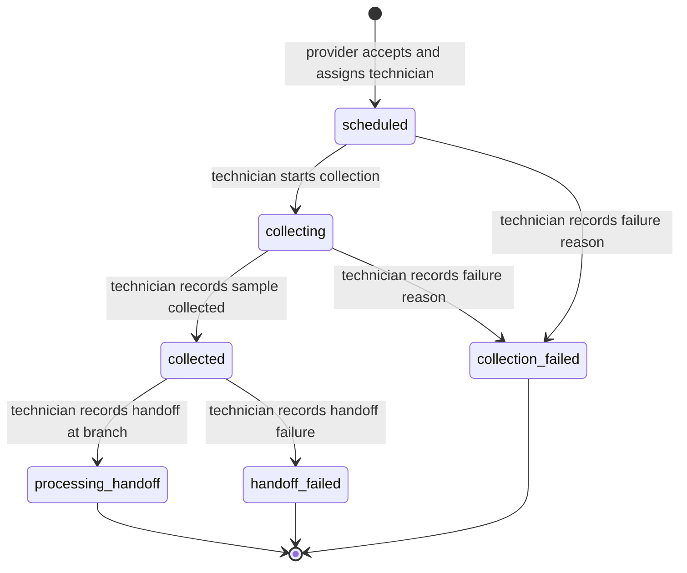
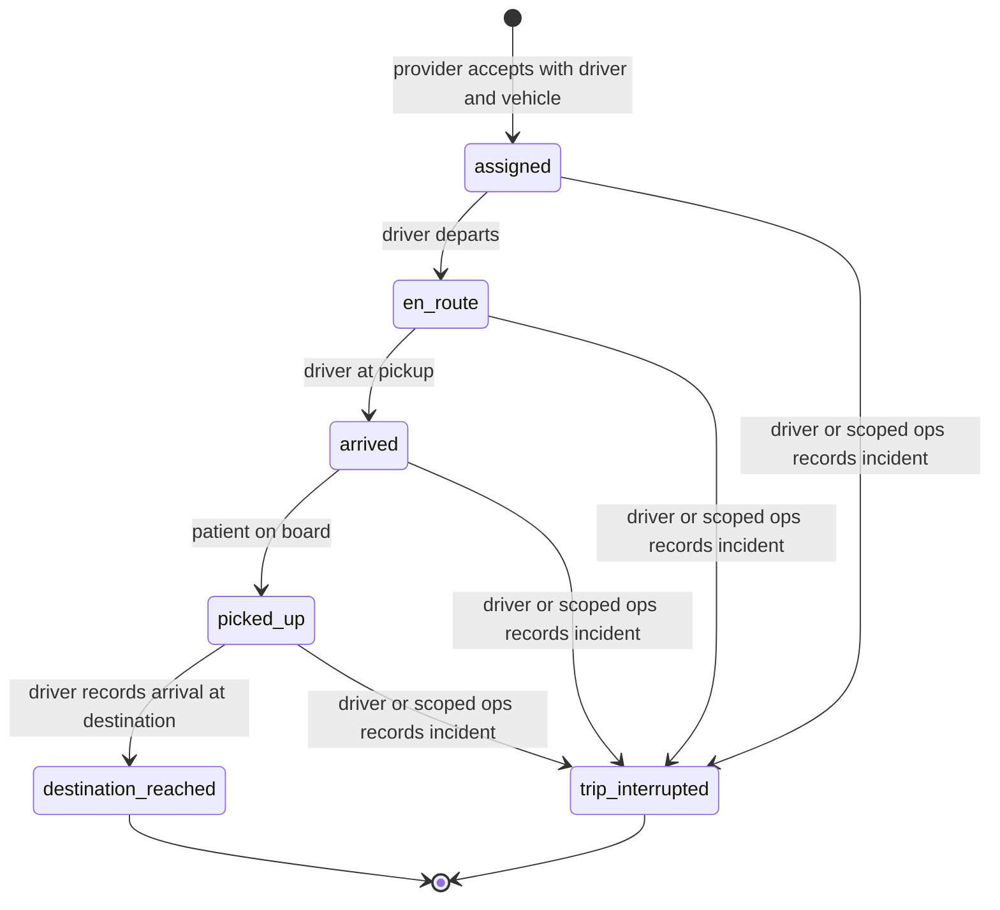
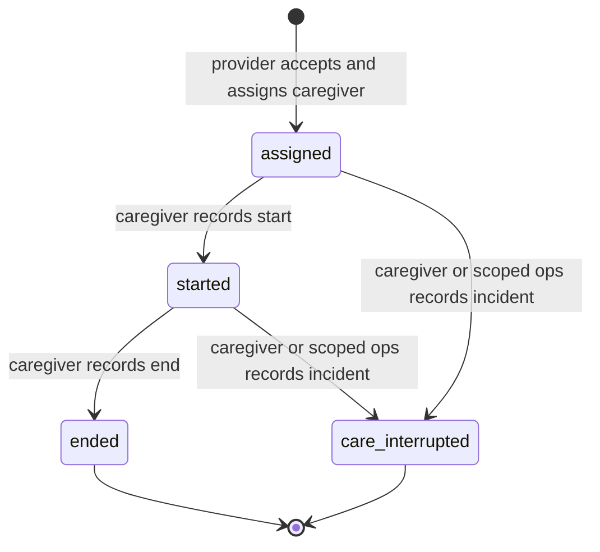

# S01 design: lab, scheduled ambulance and caretaker workflows

_Ticket S01 (category workflows on the shared booking engine) · Design v0.1 · 17 November 2026 · Kiro · Owner review PENDING_

This is a design document. It adds no migration, code, flag or route. Nothing here is implemented or tested. Doctor visits are part of ticket S01 but are not covered here; they need a separate design.

## 1. Sources, scope and non-goals

| Source | What this design takes from it |
|---|---|
| `README.md` §feature flags (line 209) | Server-side flags, default OFF; emergency dispatch and GPS stay OFF. |
| `docs/IMPLEMENTATION_TASKS.md` | S01 depends on B01 (shared booking engine) and I02 (provider verification). Acceptance bar: one database-backed tested journey per enabled category. |
| `docs/S00_DECISION_SHEET.md` | Q06 provider model, Q07 exact PINs and no ETA, Q08 lab completion wording, Q02/Q04/Q05/Q10 safe defaults. |
| `docs/CANONICAL_SCHEMA_DRAFT.md` | Tables `lab_tests`, `lab_orders`, `lab_order_items`, `ambulance_vehicles`, `ambulance_drivers`, `transport_trips`, `care_plans`, `resources`, `booking_assignments`, `resource_reservations`; §5 shared booking state machine and category substates; §8 overlap ledger and atomic commands. |
| `docs/API_CONTRACTS.md` and schema §10 | Error codes (401/403/404/409/422/429, stable unavailable-feature error), idempotency key plus expected version on every mutation, minimal Realtime payload. |
| `docs/PERMISSIONS.md` | Enabling emergency, GPS or live payments needs its own documented gate and owner/client approval. |
| `docs/SOURCE_AUDIT_R01.md` MR-04 to MR-08, CR-02, CR-04 | Lead time/horizon proposal, coverage PIN rule per category, expiry semantics, one open request per patient/category, recurring care deferred, GPS OFF. |

**In scope:** category-specific state, resources, scheduling, data exposure, RLS, audit, negative tests and flags for lab home collection, scheduled (non-emergency) ambulance transfer and single-interval nonclinical care.

**Out of scope, and must stay disabled:** emergency dispatch, live GPS or any location stream, ETAs, lab report upload/review/release (P2), clinical notes of any kind, recurring or multi-shift care (`care_shifts`), online payment, invoices/receipts, support tickets, doctor visits.

### Shared engine assumptions (owned by B01, not redesigned here)

- Booking states, transition authority, idempotency, expected-version checks and the event/audit/outbox-in-one-transaction rule come from schema §5 and §8.
- Acceptance is manual by the provider owner or an active scoped scheduler. It locks the booking and every resource in UUID order, rechecks verification, coverage, price and schedule, and inserts all assignments and reservations in one transaction.
- `resource_reservations` is the only overlap authority (GiST exclusion on `resource_id` and `occupied_period` where `status='active'`). Category tables never carry their own overlap rules.
- Pay-after: `accepted` and `confirmed` are consecutive events in the acceptance transaction and the payment becomes `DUE`. Service progress never depends on payment state.
- S01 adds only category commands, category detail rows, category RLS and category gates on top of that engine.

## 2. Feature flags

The current `src/lib/feature-flags` has seven flags, all for features that must stay OFF. Category workflows need their own gates so that each category can be enabled on staging only after its journey passes.

| Flag (proposed) | Env var (proposed) | Default | Gates |
|---|---|---|---|
| `lab` | `FEATURE_LAB` | OFF | Lab directory listing, lab booking create, accept and all lab milestone commands. |
| `scheduledTransport` | `FEATURE_SCHEDULED_TRANSPORT` | OFF | Ambulance directory listing, trip booking create, accept and trip milestones. |
| `care` | `FEATURE_CARE` | OFF | Caretaker directory listing, care booking create, accept and care milestones. |
| `emergencyDispatch` (existing) | `FEATURE_EMERGENCY_DISPATCH` | OFF | Not read by any S01 code path. S01 must work with it OFF and must not change behaviour when it is ON. |
| `gps` (existing) | `FEATURE_GPS` | OFF | Not read by any S01 code path. No S01 command accepts location input regardless of its value. |

Adding the three flags to `src/lib/feature-flags/index.ts` and `.env.example` is implementation work for the S01 coding tickets, not part of this document.

### Enforcement gap: env flags do not reach the database

`isEnabled()` reads process env in the Next.js server. If category commands are Postgres functions executable by `authenticated` through PostgREST, a user with a valid session can call them directly and skip the server-side env check. Two options:

| Option | Tradeoff |
|---|---|
| A. Small `feature_gates` table (`key` unique, `enabled boolean default false`, `changed_by`, `changed_at`, `version`), writable only through an admin-capability command with audit; every category RPC checks it. Server checks the env flag too; both must be ON. | One new table outside the approved S00 draft, so it needs owner approval. Works for direct RPC calls. |
| B. Category RPCs are not granted to `authenticated`; only the server calls them with a narrow role after the env check. | No new table, but breaks the schema rule that ordinary requests use the user session plus RLS, and widens what the server credential can do. |

**Recommendation:** option A. Until approved, the category RPCs must not be granted EXECUTE to `authenticated` at all, so nothing can run while the gate is unbuilt.

### Behaviour when a flag is OFF

- Directory and provider profile hide that category. `POST /api/bookings` for that category returns the stable unavailable-feature error, never a success or a fake empty result.
- Accept returns the unavailable-feature error for that category.
- Safe default for already accepted bookings (S01-Q01): progress, interruption and cancellation commands still work, so switching a flag off never strands an assigned driver or caregiver and never silently cancels a booking. Switching OFF writes an audit event naming who did it.

## 3. Common rules for all three categories

### Scheduling

- Availability is advisory. It is derived from `availability_rules`, `availability_exceptions` and active reservations for the resources the provider could assign. Only acceptance reserves.
- Booking interval: `[requested_start, requested_start + service duration)` in UTC. Display is `Asia/Kolkata`. Service duration is fixed per service row; the patient cannot set it.
- `occupied_period` = interval widened by the provider's approved before/after buffers. Buffer values are Q07; safe default in synthetic staging is the provider-entered value with a system cap (proposal: 0 to 120 minutes), and no buffer is ever shown to the patient as travel time.
- Lead time and horizon: proposal MR-04 (minimum 2 h, maximum 30 days) is used for synthetic staging only. It is an owner decision (S01-Q02).
- Request expiry stays disabled until Q02 approves a deadline (schema §5). Accept is still rejected server-side if `requested_start` has passed.
- One open `requested` booking per patient per category for overlapping windows (MR-08).
- Blackouts and resource deactivation take the same resource lock as acceptance and never silently cancel accepted work; they create an operations exception (schema §8 step 4).
- Reassignment before start: lock old and new resources, check eligibility, replace assignment and reservation atomically, end the old assignee's access, tell the patient that the assignee changed (no name until the new assignee is accepted). After start, reassignment is an interruption plus a new booking.
- Early finish never shortens the reservation; the reservation is released explicitly when the buffered interval ends (schema §8). Overrun cannot be extended in place; extension is a new booking.

### Coverage and no-ETA rules (Q07)

- Lab and care: the service-address PIN must be an exact active verified `provider_service_areas` PIN. No radius, prefix or nearby-PIN matching.
- Ambulance: the pickup PIN must be covered; the destination is unrestricted but shown to the provider before acceptance (MR-06).
- No ETA anywhere: no "arriving in N minutes", no "on the way, 10 min", no countdowns. The patient sees the booked time window and milestone events only.

### Data minimisation

| Viewer | Before acceptance | After acceptance, inside assignment window | After completion or terminal state |
|---|---|---|---|
| Provider queue (owner/scheduler) | Category, service/test names, requested window, service-address PIN (ambulance: pickup PIN and destination locality), category requirement codes. No name, phone, street address or questionnaire. | Same queue projection plus assignee chosen. Street address and phone stay hidden unless the scheduler is also the assignee. | Queue summary and references only. |
| Assigned person | None (no assignment yet). | Recipient display name, contact phone, address snapshot, category fields listed per category below. | Booking reference, time and own milestones. Address and phone are no longer returned. |
| Patient | Own draft/request. | Own booking, assignee display name and category role, milestone timeline. | Same, permanently, under retention Q05. |

- No category reads `patient_health_facts`. The questionnaire is not exposed to lab technicians, drivers or caregivers in core.
- No free text that can carry medical detail is collected in core. Category needs are structured codes (listed per category). A short logistics note (proposal: 200 characters, for gate codes or landmarks) carries a "do not enter medical information" instruction; whether even that is allowed is S01-Q03.
- Realtime events carry event ID, booking public reference, state, operational substate, version and time only (API_CONTRACTS.md).
- Logs and audit payloads never contain address, phone, test names or care task codes; they carry IDs and outcome only.

### RLS and command pattern

- Category tables get RLS enabled with default deny in the same migration that creates them.
- No INSERT/UPDATE/DELETE grants to `authenticated` on any category table. Category rows are written only by the booking create/accept commands and the milestone commands below.
- Reads go through narrow projections or `security definer` read functions with fixed `search_path`, so column restrictions hold (RLS filters rows, not columns).
- P_ASSIGNED predicate (schema §4): current active `booking_assignments` row for the caller's own person `resources` row, correct purpose, provider verified and active, caller's membership active, booking in `confirmed` or `in_progress`.
- Every milestone command checks: flag ON (or the already-accepted exception), caller is the current assignee for that purpose, booking category matches, current substate is the exact predecessor, expected version matches, idempotency key. Then one transaction updates the category row, advances the booking state where mapped, appends `booking_events`, `audit_events` and an outbox row.

### Audit

Every category command writes one `audit_events` row: actor profile, action, target booking and category row IDs, outcome (success/denied/conflict), correlation ID, time. Denied attempts on assigned-only commands are audited too, without payload. Additional audited events per category are listed below. Assignee detail reads (address/phone) are audited as `operational_detail_viewed` with actor, booking and time only (S01-Q04 on whether this is required in core).

## 4. Lab home sample collection

### Model

- Booking is a basket: `bookings.service_id` and `price_version_id` are null; one or more `lab_order_items` each reference a `lab_tests` service and its current price version from the same provider. Total = sum of item line totals. No basket price version.
- `lab_orders.provider_location_id` is the lab branch that will receive the sample. It must belong to the chosen provider, be active and be a lab branch kind.
- `lab_tests.turnaround` is not shown in core (S01-Q05). A stated turnaround reads as a promise of results, which core cannot deliver because report release is P2.

### Resources

- One collection technician per booking: a person `resources` row, assignment purpose `lab_collection`.
- Eligibility at accept: active membership in the lab's organization (or individual owner of the lab provider), technician evidence verified and unexpired through `provider_documents` with `resource_id` (evidence types are S01-Q06).
- The branch is not a reserved resource in core. Branch processing capacity is S01-Q07; default is no capacity check and no capacity claim to the patient.

### State machine

| Lab substate | Shared booking state | Patient-facing label (EN, proposal) |
|---|---|---|
| `scheduled` | `confirmed` | "Collection scheduled" |
| `collecting` | `in_progress` | "Collection in progress" |
| `collected` | `in_progress` | "Sample collected" |
| `processing_handoff` | `completed` | "Collection/processing done" |
| `collection_failed` | `interrupted` | "Collection could not be completed" |
| `handoff_failed` | `interrupted` | "Sample could not be handed over" |

- Q08: the completed label is "Collection/processing done". Copy, i18n strings, notifications, Realtime state names and emails must never say "report delivered", "report ready", "results available" or similar. Hindi and Telugu translations need the same check.
- Failure reason codes: `patient_unavailable`, `preparation_not_followed` (e.g. fasting), `address_not_found`, `sample_unusable`, `technician_unable`. No automatic patient blame or fee (Q02). Recollection is a new booking, never a reset of a terminal state.
- `handoff_failed` exists because a collected sample that never reaches the branch is a real operational incident. It must route to the operations exception queue; the safe default (S01-Q08) is that support contacts the patient manually, with no automatic rebooking.

### Commands (proposed)

`POST /api/bookings/:id/lab/start-collection`, `.../lab/collected`, `.../lab/handoff`, `.../lab/collection-failed`, `.../lab/handoff-failed`. Each takes `Idempotency-Key`, `expectedVersion` and, for failures, a reason code. `handoff` takes the branch location ID and must match `lab_orders.provider_location_id`. No command accepts file uploads, report data, result values or location coordinates.

### Data exposure

- Technician (in window): recipient display name, phone, address snapshot, test names, quantities and preparation instructions from `lab_tests`, branch name and address.
- Technician never sees prices beyond the amount due (needed only if they hold a P_FINANCE collector grant), questionnaire or prior orders.
- Patient: items, line totals, total, technician display name, milestone timeline, branch name.

### Audit additions

`lab.collection_started`, `lab.sample_collected`, `lab.handoff_recorded` (with branch location ID), `lab.collection_failed` / `lab.handoff_failed` (with reason code), plus assignment and reassignment.

### Negative tests (lab)

| # | Attempt | Expected |
|---|---|---|
| L1 | Create lab booking with `FEATURE_LAB` OFF; and direct RPC call with gate OFF | Unavailable-feature error; no rows written. |
| L2 | Basket with items from two providers, empty basket, zero/negative quantity, stale or other-service price version | 422; no booking. |
| L3 | Client sends total, line price or item price version not current | Server ignores client amount; stale version gives 409 or 422; frozen total equals item sum. |
| L4 | Service-address PIN not an exact covered PIN (prefix match, neighbouring PIN, expired coverage) | Rejected at create and at accept. |
| L5 | Branch from another provider, inactive branch, non-lab location | Rejected at create; handoff to a different branch rejected. |
| L6 | Technician of another org, unverified or expired evidence, suspended membership | Accept rejected; nothing reserved. |
| L7 | Two lab bookings accepted with the same technician in overlapping occupied periods (ten concurrent accepts) | Exactly one commits; others 409 with no detail about the other booking. |
| L8 | Unassigned member of the same lab calls `collected`; patient calls `collected`; reassigned-away technician calls `handoff` | 403/404 scoped; audited denial; no state change. |
| L9 | Skip `collecting` → `processing_handoff`; repeat `collected` after `processing_handoff`; any transition out of `completed` | 409; no event. |
| L10 | Same idempotency key with different reason code | 409; first result unchanged. |
| L11 | Search every user-facing string, notification template and Realtime state for "report delivered/ready", "results" | No match (static test in CI). |
| L12 | Technician reads address/phone after `processing_handoff` or after reassignment | Not returned. |
| L13 | Any lab command with file, result value or lat/lng fields | 422 (strict Zod schema). |
| L14 | Technician reads `patient_health_facts` or another patient's lab order | Denied by RLS. |

## 5. Scheduled ambulance transfer (non-emergency)

### Model and emergency guard

- Only planned transfers (home to hospital, hospital to home, inter-facility, appointment visits). Each ambulance `services` row must be a scheduled transfer service kind; there is no emergency service kind in core.
- Lead time applies (MR-04 proposal: 2 h). Same-hour requests are rejected, which keeps the product from looking like an emergency service.
- Booking pages, confirmation and every trip notification show a fixed notice (proposal, owner to approve wording and number): "Not for emergencies. In an emergency call 112." No in-app emergency button, no "request now", no nearest-ambulance search.
- `transport_trips` holds pickup and destination address snapshots, the transport requirement code and progress. No coordinates, no route, no location history columns.

### Resources

- Every trip needs both a driver and a vehicle. Two assignments (purposes `transport_driver`, `transport_vehicle`) and two reservations with the same `occupied_period`, inserted in one transaction. If either reservation fails the exclusion constraint, neither commits.
- Driver: person `resources` row with an `ambulance_drivers` row; licence verified and unexpired; active membership in the operator org or individual owner of the operator.
- Vehicle: vehicle `resources` row owned by the operator org (or the individual operator) with an `ambulance_vehicles` row; registration, permit, fitness and insurance evidence verified and unexpired (exact evidence list is S01-Q09).
- Eligibility is rechecked at accept and again at `en_route`. Evidence that expired between accept and departure blocks the trip and raises an operations exception instead of letting it run.
- Attendant or paramedic: not offered in core (S01-Q10). Offering one would claim clinical staffing that the core has no verification path for.
- Vehicle type and equipment are verified descriptors only (e.g. basic transport). Oxygen, ventilator or advanced life support are not offered in core because they are clinical claims (S01-Q10).

### Transport requirement codes

Patient chooses one structured code: `seated`, `wheelchair`, `stretcher`. The provider sees it before acceptance so they can decline when the vehicle is unsuitable. No diagnosis, condition or free-text medical detail is collected.

### State machine

| Trip substate | Shared booking state | Patient-facing label (proposal) |
|---|---|---|
| `assigned` | `confirmed` | "Trip scheduled" |
| `en_route` | `confirmed` | "Driver has set off" (no ETA) |
| `arrived` | `confirmed` | "Driver is at the pickup address" |
| `picked_up` | `in_progress` | "Trip in progress" |
| `destination_reached` | `completed` | "Reached destination" |
| `trip_interrupted` | `interrupted` | "Trip could not be completed" |

- Interruption reason codes: `patient_not_present`, `vehicle_breakdown`, `unsafe_conditions`, `requirement_mismatch` (e.g. stretcher needed, wheelchair booked), `medical_emergency_redirected`, `driver_unable`. For `medical_emergency_redirected` the app records only that the trip ended and shows the 112 notice; it does not coordinate the emergency.
- A replacement vehicle after breakdown is a new booking (or a reassignment if before `en_route`), never an in-place swap after pickup.
- `no_show` uses the shared `no_show` state only through support review (schema §5), not a driver button.

### Commands (proposed)

`POST /api/bookings/:id/trip/en-route`, `.../trip/arrived`, `.../trip/picked-up`, `.../trip/destination-reached`, `.../trip/interrupt`. Strict Zod schemas reject any `lat`, `lng`, `location`, `eta` or `coordinates` field with 422, regardless of `FEATURE_GPS`.

### Data exposure

- Driver (in window): recipient display name, phone, pickup and destination snapshots, requirement code, vehicle registration of their own assigned vehicle.
- Operator queue: pickup PIN, destination locality, window, requirement code. No phone or street address by default (schema `transport_trips` principal).
- Patient: window, driver display name, vehicle type label and the plate number of the assigned vehicle after `en_route` only (S01-Q11), milestones. No live location.
- Registration numbers, chassis/VIN and licence numbers are never public.

### Audit additions

`trip.assigned` (driver resource ID, vehicle resource ID), `trip.en_route`, `trip.arrived`, `trip.picked_up`, `trip.destination_reached`, `trip.interrupted` (reason code), `trip.eligibility_blocked` (expired evidence at departure).

### Negative tests (ambulance)

| # | Attempt | Expected |
|---|---|---|
| A1 | Create trip with `FEATURE_SCHEDULED_TRANSPORT` OFF; direct RPC with gate OFF | Unavailable-feature error. |
| A2 | `FEATURE_EMERGENCY_DISPATCH=true` and `FEATURE_GPS=true` | S01 behaviour, responses and DB writes identical to both OFF (test runs the journey under both settings). |
| A3 | Request starting inside the lead time, or with an emergency/immediate service kind | 422. |
| A4 | Accept with driver only, vehicle only, or driver and vehicle from another operator | Rejected; no partial reservation. |
| A5 | Same vehicle on two overlapping trips with different drivers; same driver with two vehicles overlapping | Exactly one trip commits per conflicting resource. |
| A6 | A person who is both a doctor resource and a driver resource booked for overlapping work | Second acceptance fails (one global person resource). |
| A7 | Vehicle evidence expires between accept and `en_route` | `en_route` blocked, exception raised, audited. |
| A8 | Pickup PIN not covered; destination PIN uncovered (allowed) | First rejected, second accepted. |
| A9 | Any trip command with `lat`/`lng`/`eta` | 422. |
| A10 | Skip `arrived`; `destination_reached` before `picked_up`; reverse transitions | 409. |
| A11 | Unassigned driver of the same operator calls `picked_up`; operator manager calls it | Denied unless they are the assigned driver; audited. |
| A12 | Patient or operator queue reads plate/licence numbers of other vehicles or drivers | Not returned. |
| A13 | Any patient-facing string contains a minutes/ETA estimate | Static copy test fails the build. |

## 6. Caretaker (single interval, nonclinical)

### Model

- One booking = one agreed interval. No recurring schedule, no shift series, no renewal (CR-02; `care_shifts` stays deferred).
- Maximum interval length: proposal 12 hours per booking for synthetic staging (S01-Q12). Longer care is a new booking.
- `care_plans` holds the agreed task codes for that interval, the agreed interval, and start/end records.

### Allowed task codes (proposal, S01-Q13)

`companionship`, `mobility_assistance`, `meal_assistance`, `personal_hygiene_assistance`, `light_household_help`, `escort_to_appointment`.

Not allowed in core, and not representable in the data model: medication administration or reminders, injections, wound or catheter care, vital-sign recording, clinical notes, any clinical decision. The API rejects unknown task codes. This follows PRODUCT_REQUIREMENTS: an unqualified caretaker never issues medication orders or clinical notes.

### Resources

- One caregiver per booking: person `resources` row, assignment purpose `care`.
- Eligibility at accept: active membership in the agency or individual owner of the caretaker provider; identity and background evidence verified and unexpired (evidence types S01-Q14); skills on the caretaker profile cover every requested task code.
- Caregiver gender preference is not offered in core (S01-Q15). It is a sensitive attribute and needs a privacy decision before collection.

### State machine

| Care substate | Shared booking state | Patient-facing label (proposal) |
|---|---|---|
| `assigned` | `confirmed` | "Care scheduled" |
| `started` | `in_progress` | "Care in progress" |
| `ended` | `completed` | "Care visit ended" |
| `care_interrupted` | `interrupted` | "Care visit could not be completed" |

- `started` is accepted only from `occupied_period` start onward (no early start beyond the before-buffer). `ended` records the actual end time; it may be earlier than planned, and the reservation is not shortened.
- Ending beyond the planned end is not possible in place; the caregiver records `ended` and an extension is a new booking.
- Patient acknowledgement of the end is optional evidence, not a required step, and the provider cannot record it on the patient's behalf (S01-Q16).
- Interruption reason codes: `patient_unavailable`, `caregiver_unavailable`, `unsafe_conditions`, `scope_mismatch` (requested help outside allowed tasks), `medical_concern_escalated`. The last one ends the visit and shows the 112 notice; the caregiver does not record clinical detail.

### Commands (proposed)

`POST /api/bookings/:id/care/start`, `.../care/end`, `.../care/interrupt`. No command accepts free-text notes, photos, vitals or medication fields.

### Data exposure

- Caregiver (in window): recipient display name, phone, address snapshot, task codes, interval.
- Agency scheduler: queue projection plus task codes and interval; no phone or street address unless they are the assigned caregiver.
- Patient: interval, task codes, caregiver display name, milestones.

### Audit additions

`care.assigned`, `care.started`, `care.ended` (actual end), `care.interrupted` (reason code).

### Negative tests (care)

| # | Attempt | Expected |
|---|---|---|
| C1 | Create care booking with `FEATURE_CARE` OFF; direct RPC with gate OFF | Unavailable-feature error. |
| C2 | Interval longer than the cap, recurring pattern or multiple intervals in one request | 422. |
| C3 | Unknown or clinical task code (`medication`, `injection`, `wound_care`) | 422. |
| C4 | Caregiver whose skills do not cover a requested task; expired background evidence; suspended membership | Accept rejected. |
| C5 | Same caregiver on two overlapping care bookings at different agencies (ten concurrent accepts) | Exactly one commits. |
| C6 | `started` before the occupied period; `ended` before `started`; `started` twice | 409. |
| C7 | After early `ended`, another booking tries to use the freed time before the buffered period ends | Rejected by the active reservation. |
| C8 | Free text, photo, vitals or medication field on any care command | 422. |
| C9 | Agency manager (not assignee) calls `start`; patient calls `end` | Denied; audited. |
| C10 | Caregiver reads `patient_health_facts` or address after `ended` | Not returned. |

## 7. Cross-category negative tests

| # | Attempt | Expected |
|---|---|---|
| X1 | Call a lab command on a trip booking, a trip command on a care booking, and so on | 409 or 422 category mismatch; no change. |
| X2 | Provider of category A accepts a booking of category B | Rejected. |
| X3 | Unverified, suspended or expired provider listed, booked or accepting | Hidden from directory; create and accept rejected. |
| X4 | Patient B reads patient A's booking, category row, assignee or timeline through table, RPC, Realtime or projection | Denied. |
| X5 | Assignee membership revoked mid-window | Next read, command and Realtime subscription denied; ops exception raised. |
| X6 | Forced failure between reservation insert and event insert | Whole transaction rolls back; no orphan reservation, event or outbox row. |
| X7 | Same idempotency key replayed after the caller lost assignment | Authorization rechecked; denied. |
| X8 | Direct `UPDATE` on `lab_orders`, `transport_trips`, `care_plans`, `booking_assignments`, `resource_reservations` with an `authenticated` JWT | Permission denied. |
| X9 | Turn a category flag OFF while bookings are accepted | New create/accept blocked; existing bookings can progress, interrupt and cancel (per S01-Q01 default); audit row for the change. |
| X10 | Realtime payload inspection for each milestone | Only event ID, reference, state, substate, version, time. |
| X11 | Payment state `DUE` or `DISPUTED` | Never blocks or changes any milestone. |

Test layers: pgTAP for RLS, grants, constraints and concurrent accepts against the local Supabase DB; Vitest integration tests for domain commands, Zod rejection and flag behaviour; one Playwright journey per enabled category on synthetic data (request → accept → milestones → completed). The S01 acceptance bar is that journey plus these negative tests passing, per category.

## 8. Owner questions with safe defaults

Each default keeps the feature safe to build on synthetic staging. None enables real patients.

| ID | Question | Safe default until answered | Related |
|---|---|---|---|
| S01-Q01 | When a category flag is turned OFF, what happens to accepted bookings? | New create/accept blocked; accepted bookings can still progress, interrupt and cancel; no automatic cancellation. | Q10 |
| S01-Q02 | Lead time and booking horizon per category. | Synthetic staging uses MR-04 proposal (2 h, 30 days). Not a public policy. | Q02, MR-04 |
| S01-Q03 | Is a short logistics note (gate code, landmark) allowed? | 200-character note with "no medical information" instruction; owner may choose no note at all. | Q05 |
| S01-Q04 | Must assignee reads of address/phone be audited in core? | Yes, ID-only audit row per read. | Q05 |
| S01-Q05 | May labs display test turnaround? | Hidden in core. | Q08 |
| S01-Q06 | Which evidence verifies a collection technician? | Technician cannot be assigned until an evidence type is approved and verified in I02. | Q06, I02 |
| S01-Q07 | Is lab branch processing capacity checked? | No capacity check and no capacity claim to patients. | Q07 |
| S01-Q08 | Who handles a sample that was collected but not handed over? | Operations exception queue; manual contact; no automatic rebooking. | Q10 |
| S01-Q09 | Which vehicle and driver documents are required, and who verifies them? | Vehicle and driver cannot be assigned until evidence types are approved and verified in I02. | Q06, I02 |
| S01-Q10 | Attendant/paramedic or clinical equipment (oxygen, ALS) on scheduled transfers? | Not offered. | Q09 |
| S01-Q11 | When does the patient see the vehicle plate number? | After `en_route`, assigned vehicle only. | Q05 |
| S01-Q12 | Maximum single care interval. | 12 hours in synthetic staging. | Q02 |
| S01-Q13 | Allowed nonclinical care task list. | The six codes in §6; nothing medication- or clinical-related. | Q09 |
| S01-Q14 | Which identity/background evidence verifies a caregiver? | Caregiver cannot be assigned until an evidence type is approved and verified in I02. | Q06, I02 |
| S01-Q15 | Caregiver gender preference. | Not collected or offered. | Q05 |
| S01-Q16 | Is patient acknowledgement of care end required? | Optional evidence only; never recorded by the provider. | Q04 |
| S01-Q17 | Emergency notice wording and number. | "Not for emergencies. In an emergency call 112." on all ambulance and care screens, pending owner/legal wording. | Q10 |
| S01-Q18 | Approve the `feature_gates` table (option A, §2)? | Category RPCs are not granted to `authenticated` until a DB-enforced gate exists. | S00 schema |
| S01-Q19 | Turnaround/travel buffer values per category. | Provider-entered, capped at 120 minutes, never shown as travel time. | Q07 |

## 9. Proposed implementation split (after B01 and I02)

S01 cannot start coding until B01 (shared engine, reservations, idempotency) and I02 (verification, coverage, evidence) are merged. Migration order 5 in schema §9 applies; one migration author at a time.

| Proposed ticket | Scope | Depends on |
|---|---|---|
| S01-L | `lab_tests`, `lab_orders`, `lab_order_items` migration, lab commands, lab RLS, pgTAP and Vitest tests, lab Playwright journey | B01, I02, S01-Q06 answered or synthetic evidence type approved |
| S01-A | `ambulance_vehicles`, `ambulance_drivers`, `transport_trips` migration, trip commands, RLS, tests, journey | B01, I02, S01-Q09 |
| S01-C | `care_plans` migration, care commands, RLS, tests, journey | B01, I02, S01-Q13, S01-Q14 |
| S01-G | `feature_gates` (if approved) plus `lab`, `scheduledTransport`, `care` flags in `src/lib/feature-flags` and `.env.example` | S01-Q18; must merge before any of the above is enabled |

The three category tickets touch disjoint tables and route folders and can run in separate worktrees, but their migrations must be serialized through the single migration author.

## 10. Limitations of this design

- Not reviewed by Claude, Codex or the owner. Not checked against an actual B01 implementation because B01 does not exist yet; command names and RPC shapes may change to fit it.
- Every proposed value (2 h lead time, 30-day horizon, 12 h care cap, 120-minute buffer cap, 200-character note, task codes, reason codes, copy strings, 112 wording) is a proposal for synthetic staging, not an approved policy.
- The `feature_gates` table is a schema addition outside the approved S00 draft.
- No test in this document has been run.
