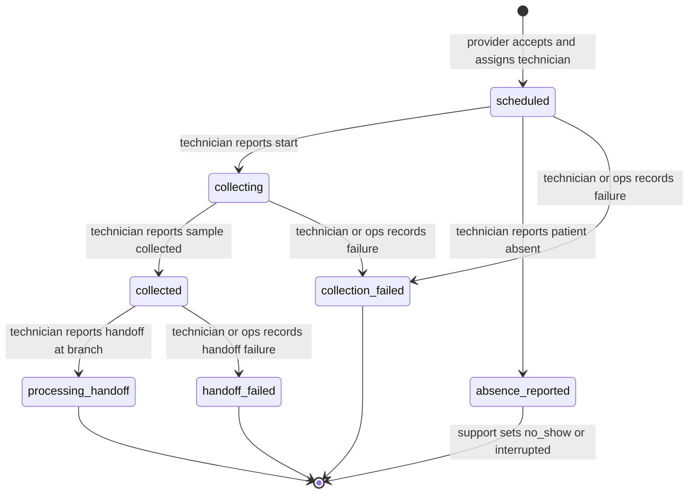
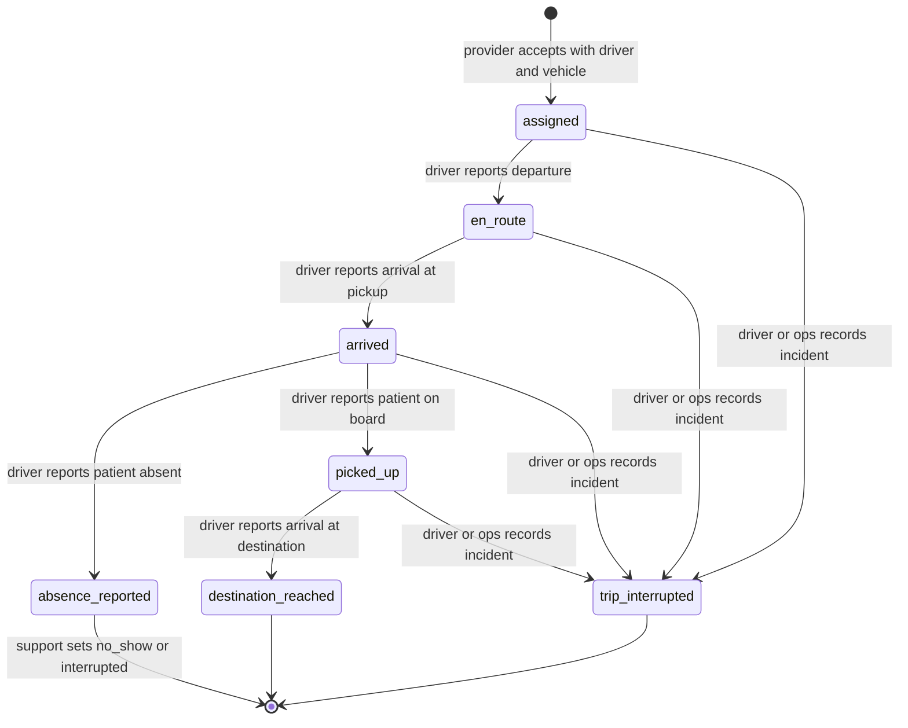
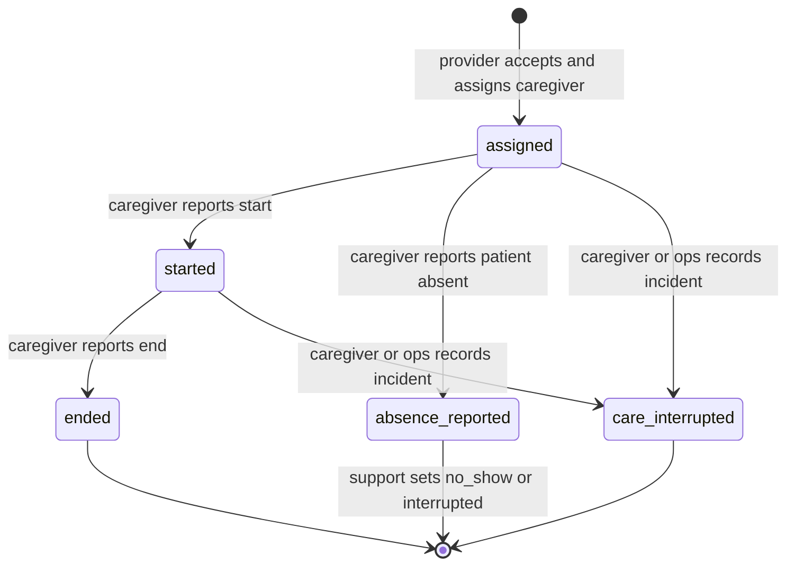

# S01 design: lab, scheduled ambulance and caretaker workflows

_Ticket S01 (category workflows on the shared booking engine) · Design v0.3 · 18 November 2026 · Kiro · Owner review PENDING_

This is a design document. It adds no migration, code, flag or route. Nothing here is implemented or tested. Doctor visits are part of ticket S01 but are not covered here; they need a separate design.

v0.2 resolves the adversarial review `review_S01.md` (findings S01-01 to S01-30) against the actual B01 engine: friend branch `task/B01-booking`, commit `e8a71ed`, file `supabase/migrations/202611170005_b01_booking.sql` (worktree `kiro-integ-friend`). B01 function names below refer to that file. The resolution of every finding is in §11.

v0.3 also accounts for the B01 hardening in progress on `origin/integ/b01-fixes` (WIP commit `f8d5cf3`, migrations `20261117001000` to `20261117001200`) and `origin/integ/friend-backend` (I02 hardening `05ec926`). That work fixes H1 (assignee time check), H2 (zero-fee cancellation), H3 (non-doctor acceptance rejected until S01) and M1/M3 (patient request and address limits), and adds Q06 staff credentials. None of it is merged. §1.1 lists what S01 takes from it; §10 says which S01 change requests it satisfies and which it leaves open.

## 1. Sources, scope and non-goals

| Source | What this design takes from it |
|---|---|
| `README.md` §feature flags | Server-side flags, default OFF; emergency dispatch and GPS stay OFF; 112 visible without login or payment. |
| `docs/IMPLEMENTATION_TASKS.md` | S01 depends on B01 (shared booking engine) and I02 (provider verification). Acceptance bar: one database-backed tested journey per enabled category. |
| `docs/S00_DECISION_SHEET.md` | Q06 provider model, Q07 exact PINs and no ETA, Q08 lab completion wording, Q02/Q04/Q05/Q10 safe defaults. |
| `docs/CANONICAL_SCHEMA_DRAFT.md` | Tables `lab_tests`, `lab_orders`, `lab_order_items`, `ambulance_vehicles`, `ambulance_drivers`, `transport_trips`, `care_plans`, `provider_documents` (optional resource FK); §5 shared state machine; §8 overlap ledger; P_BOOKING ("snapshot address/contact is hidden from queue readers") and P_ASSIGNED predicates. |
| B01 migration `202611170005_b01_booking.sql` at `e8a71ed` | The engine S01 builds on: `bookings`, `booking_transitions`, `booking_events`, `resources`, `booking_assignments`, `resource_reservations`, `create_booking_request`, `accept_booking`, `cancel_booking`, `get_booking`, `list_bookings`, `list_slots`, `transition`, `release`, `is_assigned`, `resource_eligible`. |
| B01 hardening WIP: `origin/integ/b01-fixes` at `f8d5cf3`, `origin/integ/friend-backend` at `05ec926` | H1, H2, H3, M1/M3 and Q06 (§1.1). Read only; not merged. |
| `docs/API_CONTRACTS.md` and schema §10 | Error codes, idempotency key plus expected version on every mutation, minimal Realtime payload. |
| `docs/PERMISSIONS.md` | Enabling emergency, GPS or live payments needs its own documented gate and owner/client approval. |
| `docs/SOURCE_AUDIT_R01.md` MR-04 to MR-08, CR-02, CR-04 | Lead time/horizon proposal, coverage PIN rule, expiry semantics, one open request per patient/category, recurring care deferred, GPS OFF. |

**In scope:** category-specific state, resources, scheduling, data exposure, RLS, audit, negative tests and gates for lab home collection, scheduled (non-emergency) ambulance transfer and single-interval nonclinical care.

**Out of scope, and must stay disabled:** emergency dispatch, live GPS or any location stream, ETAs, lab report upload/review/release (P2), clinical notes of any kind, recurring or multi-shift care (`care_shifts`), online payment, invoices/receipts, support tickets, doctor visits, reassignment (see §3), lab baskets of more than one item (see §4).

### What B01 actually provides, and what S01 needs changed

S01 does not redesign the engine. It does depend on the B01 changes in §10, which the B01 owner (single migration author) must agree before S01 coding starts. What B01 provides today, as read from the SQL:

- States and the `booking_transitions` table match schema §5, except `confirmed -> no_show` is a provider edge and `interrupted` is reachable only from `in_progress` (B01 changes B-4, B-9).
- `accept_booking` is manual by a scheduler (`schedule:manage` scope or individual owner). It locks the booking, provider and resources in UUID order, rechecks publishability, coverage, price version and schedule, and inserts assignments and reservations in one transaction. It does **not** check per-resource evidence: `resource_eligible` accepts any active member with `provider:read` (B-6). Q06 on `integ/b01-fixes` adds a person-credential check for doctor resources only.
- `resource_reservations` is the only overlap authority (GiST exclusion on `resource_id`, `occupied_period` where `status='active'`). Category tables carry no overlap rules.
- `transition()` writes the booking update, `booking_events`, `audit_events` (`action = 'booking.' || reason`) and `notification_outbox` in one transaction.
- `booking_events.reason` is a closed CHECK (B-7). Milestones that do not change state write `from_state = to_state`, as `advance_visit` does for doctor visits.
- Pay-after and payment state are outside this document. Service progress never depends on payment state.

S01 adds category commands, category detail rows, category RLS and category gates on top of B01 plus the changes in §10.

### 1.1 B01 hardening in progress that S01 depends on

Read from `origin/integ/b01-fixes` at `f8d5cf3` (`20261117001100_b01_authorization_limits.sql`, `20261117001000_q06_staff_credentials.sql`, pgTAP suites `011` to `013`). WIP, not run by Kiro, not merged. Every item below is an S01 precondition: S01 coding starts only after it merges to the B01 line S01 builds on.

| ID | What the hardening does | What S01 relies on | What stays open for S01 |
|---|---|---|---|
| H1 | `is_assigned` drops the always-true `a.period @> ... is not null` and uses a fixed window `[start_at - 60 min, end_at + 12 h)` for every category, plus a purpose-to-category match (`lab_collection`, `driver`, `caretaker`), active account, `resource_eligible` and `provider_is_publishable`. `get_booking` applies the same window to its `details` condition. | The outer bound on any assignee read or command. S01 commands and `get_assignment_contact` apply narrower per-category bounds inside it (§3 "Access window"). | The scheduler still receives address and contact from `get_booking` inside the window, and the 12 h tail extends assignee contact while the booking is `confirmed`/`in_progress` (both B-3). Publishability is still required, so the closeout predicate is still needed (B-2). The 60 min head caps the before-buffer at 60 min (S01-Q19). |
| H2 | `cancel_booking`: the patient may cancel until `start_at`, or until a published cutoff if one exists; no fee or payment state. A scheduler, or the assigned doctor, may cancel any `draft`/`requested`/`accepted`/`confirmed` booking at any time, including after `start_at`. Cancellation releases reservations. | No fee is introduced by S01 either (Q02). | The `cancellation_policy_required` block from `e8a71ed` is gone, so cancellation at the door is now possible by default. B-12 (no cancel after a post-initial milestone) becomes mandatory, not optional. Only the doctor assignee may cancel; S01 assignees must not (test X26). |
| H3 | `accept_booking` raises `category_deferred_to_s01` for every non-doctor category (suite `013` covers lab, caretaker, ambulance). | The interim hard block on acceptance (§2). | `create_booking_request` and `list_slots` still serve non-doctor categories, so lab, ambulance and caretaker requests can be created and sit in `requested` with an address and contact snapshot. B-5 must gate create and `list_slots`, and S01-G must replace H3 with the gate check in the same migration (test X28). |
| M1/M3 | `create_booking_request` locks the patient row, replays idempotency before caps, then enforces a 90-day horizon and at most 10 `requested` bookings per patient across all categories. `save_patient_address` caps addresses at 20 under the same lock. | The patient-row lock serialises MR-08 checks (B-10). Replay-before-cap ordering is kept for S01 creates. | The 90-day horizon is wider than the S01 proposal (30 days) and has no lead time; per-category horizon and lead time stay B-11. The 10-request cap is not MR-08 (one open request per patient per category for overlapping windows); B-10 stays. |
| Q06 | Person credential cases (`provider_verification_cases`, `staff_credential_documents` with kinds `registration`, `licence`, `vehicle_permit`, `background_check`) and `providers_private.person_is_verified`. `resource_eligible` requires it for doctor person resources only. | The evidence source for technician, driver and caregiver eligibility (B-6), instead of a new resource FK on `provider_documents`. | Non-doctor person resources still pass with `provider:read` alone. Vehicles have no resource-linked evidence. B-6 extends `resource_eligible` per category and adds vehicle evidence. |

Not yet used by S01: the `integ/friend-backend` I02 hardening adds per-category public profile tables (`lab_profiles`, `ambulance_profiles`, `caretaker_profiles`) and `provider_private_details`. S01 reads none of them; listing copy that uses them belongs to C01/I02.

## 2. Feature gates

Category workflows need their own gates so each category can be enabled on staging only after its journey passes.

| Flag (proposed) | Env var (proposed) | Default | Gates |
|---|---|---|---|
| `lab` | `FEATURE_LAB` | OFF | Lab listing, create, accept, `list_slots` and lab milestone commands. |
| `scheduledTransport` | `FEATURE_SCHEDULED_TRANSPORT` | OFF | Ambulance listing, create, accept, `list_slots` and trip milestones. |
| `caretaker` | `FEATURE_CARETAKER` | OFF | Caretaker listing, create, accept, `list_slots` and caretaker milestones. |
| `emergencyDispatch` (existing) | `FEATURE_EMERGENCY_DISPATCH` | OFF | Not read by any S01 code path. S01 behaves identically with it ON or OFF. |
| `gps` (existing) | `FEATURE_GPS` | OFF | Not read by any S01 code path. No S01 command accepts location input regardless of its value. |

Adding the flags to `src/lib/feature-flags/index.ts` and `.env.example` is S01-G implementation work.

### Enforcement must be in the database, including in B01's generic commands

`isEnabled()` reads process env in the Next.js server. B01's `create_booking_request`, `accept_booking`, `cancel_booking`, `get_booking` and `list_slots` are granted to `authenticated` and already serve `lab`, `ambulance` and `caretaker` with no gate. Today, on a database with a verified ambulance provider, a patient can create and get acceptance for an ambulance booking with no lead time, no destination, no task codes and no category row.

- **Mechanism:** one `feature_gates` table (`key` unique, `state` in `off|on|suspended` default `off`, `changed_by`, `changed_at`, `version`), writable only through an admin-capability command at AAL2 that writes an audit row. One gate table serves S01 and P01; it is recorded once under S00 (S01-Q18). The server checks the env flag too; both must allow.
- **B01 change B-5:** `create_booking_request`, `accept_booking` and `list_slots` reject when `category <> 'doctor' and gate(category) <> 'on'`. `list_slots` returns no rows rather than an error.
- **Interim safe default, until B-5 and S01-G exist:** B01 rejects every non-doctor category in create, accept and `list_slots`. B01 must not reach staging without either this hard block or B-5. H3 (§1.1) covers accept only; create and `list_slots` still need the block.
- When S01-G lands, the same migration replaces H3's `category_deferred_to_s01` check with the gate check. There is never a migration state where H3 is gone and the gate is not checked.
- Non-doctor `requested` bookings created before B-5 exist only as synthetic staging data. The B-5 migration fails if any remain, so they are cleared by a synthetic-data reset before it runs and can never be accepted under a later `on` gate (test X24).
- New S01 category RPCs are not granted EXECUTE to `authenticated` until the gate exists.

### Gate states

| State | Create / accept / `list_slots` | Start milestones (`start-collection`, `en-route`, caretaker `start`) | Closing milestones and interruption |
|---|---|---|---|
| `off` | Unavailable-feature error (slots: empty). | Allowed for already accepted bookings (S01-Q01). | Allowed. |
| `on` | Allowed. | Allowed. | Allowed. |
| `suspended` | Unavailable-feature error. | Rejected; each accepted, not-started booking of that category raises an operations exception. | Allowed, so a patient on board or a sample in custody can always be closed out. |

`suspended` is the halt for a safety or verification problem. Every gate change writes an audit row naming the actor. Provider suspension through I02 is not a substitute: B01's `is_assigned` requires `provider_is_publishable`, so suspending a provider mid-trip would lock the driver out of `destination-reached`. The closeout predicate in §3 therefore does not require publishability.

## 3. Common rules for all three categories

### Scheduling

- Availability is advisory, derived from `availability_rules`, `availability_exceptions` and active reservations. Only acceptance reserves.
- Booking interval: `[start_at, end_at)` in UTC, `end_at = start_at + services.duration_minutes`, fixed at create and immutable (B01 `guard_booking`). Display is `Asia/Kolkata`. The patient cannot set the duration.
- `occupied_period = [start_at - before_buffer, end_at + after_buffer)`. B01 today has one global `booking_policy_versions.buffer_minutes` (0 to 1440) applied on both sides, read as latest-published in `list_slots` and as the booking's snapshot in `accept_booking`. S01 needs separate before/after buffers per category (B-11): the before-buffer covers travel to the address, the lab after-buffer covers travel to the branch. Safe default (S01-Q19): one system value per category in the policy row, before-buffer 0 to 60 minutes (H1's assignee window opens 60 minutes before `start_at`, so a longer before-buffer would block the start milestone), after-buffer 0 to 120 minutes, no provider-entered buffers. The patient never sees a buffer as travel time. A policy published between `list_slots` and accept changes nothing for that booking, because accept uses the booking's snapshot; slots are advisory.
- Lead time and horizon (S01-Q02): synthetic staging uses MR-04 (minimum 2 h, maximum 30 days) for all three categories. B01 at `e8a71ed` checks only `start_at > now()`; M1 (§1.1) adds a 90-day horizon for all categories but no lead time. B-11 enforces lead time and the narrower horizon per category in create, accept and `list_slots`.
- Request expiry stays disabled until Q02 approves a deadline. Accept is rejected if `start_at` has passed (B01 does this).
- One open `requested` booking per patient per category for overlapping windows (MR-08). B01 does not enforce it, and M1's 10-request cap is a different rule (B-10). The check runs after idempotency replay and under M1's patient-row lock.
- Blackouts: B01 `add_booking_blackout` rejects a blackout overlapping an active reservation (`resource_in_use`). Operations path: the operator resolves the affected booking first (cancel within policy, or an ops interruption per §3 "Ending work early"), then adds the blackout.
- Reservations are not released at completion. Completion and interruption end the assignments (access ends) but leave reservations `active`. An active reservation whose period is in the past cannot overlap future work, so the exclusion constraint stays correct and early finish never frees the buffered time (B-8). Only `cancel_booking` releases, as B01 already does, because cancellation happens before work begins (see §3 "Cancellation").
- **No reassignment in core.** B01 has no reassignment command; `reassigned` exists in the reason CHECK but nothing writes it. If an assignee becomes unavailable before start, the booking ends through the pre-start interruption in §3. A reassignment command is future work owned by the B01 engine owner (lock order: booking, provider, then old and new resource UUIDs in order).
- **Overrun guard.** A booking whose closing milestone (`processing_handoff`/`handoff_failed`, `destination_reached`, caretaker `ended`) is not recorded by `upper(occupied_period)` raises an operations exception. Until it is closed, `accept_booking` rejects any new booking that would assign the same person or vehicle (`resource_busy`). This needs a category hook in `accept_booking` (B-6).

### Access window (fixes S01-02)

At `e8a71ed`, B01 `is_assigned` contains `a.period @> clock_timestamp() is not null`. PostgreSQL binds `IS NOT NULL` more loosely than `@>`, so the expression is `(a.period @> now) IS NOT NULL`, which is always true: an assignee sees address and phone at any time while the booking is `confirmed`. Fixing the precedence alone would narrow the window to `[start_at, end_at)`, which blocks `en_route` before `start_at` and lab handoff after `end_at`.

H1 (§1.1) replaces the check with a fixed window `[start_at - 60 min, end_at + 12 h)` computed from the booking, not from `a.period`. That removes the always-true defect and is wide enough for buffered start milestones and late closeout. It is the same for every category and still requires `provider_is_publishable`.

S01 requires (B-2):

1. H1 merged. It is the outer bound: no assignee read or command passes outside it.
2. Inside H1's window, each S01 command and `get_assignment_contact` apply the narrower per-category bounds in the table below (start milestones from `lower(occupied_period)`; contact only in the listed substates). The before-buffer is capped at 60 minutes so `lower(occupied_period)` never falls before H1's window opens (S01-Q19).
3. A separate closeout predicate, used only by closing and interruption commands: active assignment for the caller's person resource and purpose, membership and account active, and the booking in a custody substate (lab `collected`, trip `picked_up`, caretaker `started`). It ignores both H1's window and provider publishability, so work in progress can always be closed, including a trip that runs past `end_at + 12 h` or a provider suspended mid-trip. It never returns contact details.

| Category | Start milestone allowed from | Contact/address returned while | Closing milestone allowed |
|---|---|---|---|
| Lab | `lower(occupied_period)` | Window open and substate `scheduled` or `collecting`. Not after `collected`; the technician then sees branch details only. | `handoff`/`handoff-failed` while `collected`, any time (closeout predicate); after `upper(occupied_period)` the overrun guard applies. |
| Trip | `lower(occupied_period)` (`en-route`) | Window open and substate before `destination_reached`. | `destination-reached`/`interrupt` while `picked_up`, any time; overrun guard after the window. |
| Caretaker | `lower(occupied_period)` (`start`) | Window open and substate `assigned` or `started`. | `end`/`interrupt` while `started`, any time; overrun guard after the window. |

H1 also fixes the doctor path's window. The doctor path's early release at completion (B-8) is flagged to the B01 owner, not designed here.

### Shared state machine changes (fixes S01-04, S01-20)

B01 allows `interrupted` only from `in_progress`, maps it to actor kind `assigned` only, and has no interruption command. Pre-start failures (address not found, vehicle breakdown before pickup, technician unable) happen while the booking is `confirmed`.

Recommended decision (S01-Q21, owner):

- Add `confirmed -> interrupted` for actor kinds `assigned` and a new `ops` actor kind (B-4).
- Patient absence is never an assignee-recorded terminal state. The assignee records `absence_reported` (booking stays `confirmed`, `from_state = to_state`), which raises an operations exception. Support then sets `no_show` (actor `ops`) if the evidence holds, or `interrupted` otherwise. This replaces B01's provider `confirmed -> no_show` edge, which contradicts the canonical rule that support validates no-show evidence (B-9).
- `ops` means a holder of a named admin capability `booking:incident` at AAL2 (P_ADMIN pattern; no generic admin bypass). Ops commands record a reason code and never read clinical data.

Until S01-Q21 is decided and B-4/B-9 merge, S01 failure and absence commands are not built, and S01-L/A/C cannot pass their acceptance bar.

### Ending work early (fixes S01-08)

| Event | Assignments | Reservations | Exception |
|---|---|---|---|
| Completion | Ended. | Stay `active` to `upper(occupied_period)`. | None. |
| Interruption before custody (lab `scheduled`/`collecting`, trip before `picked_up`, caretaker `assigned`) | Ended. | Stay `active` to period end. No automatic trim in core; trimming future occupancy is a later reviewed ops command. | Raised for every interruption. |
| Lab interruption is impossible once `collected` | Technician assignment stays active until `handoff` or `handoff-failed`. | Stays active; overrun guard applies after the period. | `handoff_failed` always raises one. |
| Trip interruption after `picked_up` | Ended in the app. | Stay active; the driver and vehicle stay blocked for new acceptances until ops closes the exception. | Always raised; see §5. |
| Caretaker interruption after `started` | Ended. | Stay active to period end. | Raised. |

Keeping reservations costs capacity, never safety. It cannot double-book.

### Cancellation (fixes S01-19)

At `e8a71ed`, `cancel_booking` lets the patient or a scheduler cancel any `confirmed` booking inside the policy window, regardless of substate; with no policy row seeded, `cancel_window_minutes` is null and cancellation of `confirmed` bookings is blocked (`cancellation_policy_required`). H2 (§1.1) removes that block: with no published cutoff the patient may cancel until `start_at`, and a scheduler or the assigned doctor may cancel a `confirmed` booking at any time, including after `start_at`. Trip `en_route` and `arrived` keep the booking `confirmed`, so under H2 alone a driver at the door can have the trip cancelled under them, and the reservation is released while they are still on the road.

S01 requires (B-12, S01-Q22 tied to Q02): once any milestone after the initial substate is recorded (`collecting`, `en_route`, `arrived`, `picked_up`, `started`, `absence_reported`), `cancel_booking` rejects with `invalid_transition` for every caller, patient and scheduler alike. The only exits are completion, interruption or support. Only H2's doctor assignee may cancel; S01 assignees (technician, driver, caregiver) cannot call `cancel_booking`. Cancel takes the same booking row lock as milestone commands, so a cancel racing a milestone serialises and exactly one wins. S01 adds no cancellation fee (H2 adds none either).

### Coverage and no-ETA rules (Q07)

- Lab and caretaker: the service-address PIN must be an exact approved, currently valid `provider_service_areas` PIN. No radius, prefix or nearby-PIN matching. B01 already checks this at create and accept.
- Ambulance: both the pickup PIN and the destination PIN must be exact covered PINs of the operator. This changes MR-06 ("destination unrestricted") so that a service row's fixed duration bounds a trip within the operator's area, and is the prevention half of the double-booking fix (S01-06). The overrun guard is the detection half.
- No ETA anywhere: no "arriving in N minutes", no countdowns. The patient sees the booked window and milestone reports only.
- 112 notice: "Not for emergencies. In an emergency call 112." with a plain `tel:112` link, on a public unauthenticated page linked from the site header and footer, and on every ambulance and caretaker screen and notification. A `tel:` link is not dispatch. Wording is S01-Q17.

### Data minimisation

| Viewer | Before acceptance | After acceptance | After completion or terminal state |
|---|---|---|---|
| Provider queue (owner/scheduler) | Category, service reference, requested window, service-address PIN (ambulance: pickup PIN and destination PIN only, never a facility name), category requirement codes. Lab: sample/tube and preparation codes, not test names (S01-Q23). No name, phone, street address or questionnaire. | Same, plus assignee chosen. Lab: test names visible to the scheduler. **No street address or phone, even when the scheduler is the assignee, except through the assignee contact function.** | Summary and references only. |
| Assigned person | None. | Through `get_assignment_contact` only, inside the access window (§3): recipient display name, contact phone, address snapshot, category fields listed per category. | Booking reference, time and own milestones. |
| Patient | Own draft/request. | Own booking, assignee display name and role, milestone timeline. | Same, under retention Q05. |

B01 `get_booking` today returns `address_snapshot` and `contact_snapshot` to any scheduler while the booking is `confirmed` or `in_progress`, which contradicts canonical P_BOOKING. H1 only narrows this to its time window; the scheduler still gets contact inside it. S01 requires (B-3): `get_booking` and `list_bookings` return address and contact only to the patient. Assignees get them from a new `get_assignment_contact(booking_id)` function, which is the only audited read (`operational_detail_viewed`, IDs and time only). Lists never return contact data, so refreshes and Realtime refetches create no audit rows (S01-15).

- `get_booking` returns `service_id` to the scheduler; a lab can map it to its own catalog. Hiding test names in the queue is display minimisation inside the lab organisation, not a guarantee. S01-Q23 decides whether that is enough.
- No category reads `patient_health_facts`.
- No free text that can carry medical detail is collected in core. Safe default (S01-Q03): no logistics note at all.
- Realtime: see §3 "Realtime".
- Logs and audit payloads never contain address, phone, test names or task codes; they carry IDs and codes only.

### RLS and command pattern

- Category tables get RLS enabled, all privileges revoked from `public`, `anon` and `authenticated`, in the same migration that creates them (B01 pattern).
- No INSERT/UPDATE/DELETE grants on category tables. Rows are written only by create/accept hooks and the milestone commands.
- Reads go through `security definer` functions with `search_path=''`, so column restrictions hold.
- Every milestone command checks, in order: gate state (§2), caller is the current assignee for that purpose (window predicate or closeout predicate as §3 allows), `category` derived from the booking (never from the request), exact predecessor substate, expected version, idempotency key. Then one `transition()` call updates the category row, the booking state where mapped, `booking_events`, `audit_events` and the outbox.
- Idempotency: S01 commands store keys in `idempotency_requests` with `action` per command (for example `trip.en_route`) and a request hash over booking ID, command and payload. The same key with a different booking ID or payload gives `idempotency_conflict`. B01 `accept_booking`, `cancel_booking` and `advance_visit` take no idempotency key and rely on expected version; that departs from API_CONTRACTS and is noted to the B01 owner, not an S01 dependency.
- Self-dealing (S01-Q24): create rejects when the patient's self profile is the provider's individual owner or an active member of its organisation; accept rejects when a selected person resource is the patient's own profile.

### Audit

- Every successful command writes one `audit_events` row through `transition()`: `actor_profile_id`, `action = 'booking.<reason_code>'`, `target_type = 'booking'`, `target_id`, `occurred_at`. B01 `audit_events` has no outcome or correlation ID column, and S01 adds none.
- Denied attempts cannot be audited in the database: a command denies by raising, which rolls back any audit insert in the same transaction. The route/service layer writes a structured log entry for each denial with actor ID, booking ID, command and error code only.
- `operational_detail_viewed` is written only by `get_assignment_contact` (S01-Q04).

### Realtime (fixes S01-21)

- No category table and not `bookings` is added to the `supabase_realtime` publication. `postgres_changes` sends whole rows filtered by RLS and is not rechecked mid-subscription, so it is not used.
- Events go to private broadcast channels fed from `notification_outbox`, with RLS on `realtime.messages` limiting each topic to the patient and the current assignee.
- Payload: event ID, booking public reference, state, operational substate, version, time.
- Revocation is bounded by access-token expiry or reconnect: a revoked member may receive broadcast events already authorised on the open channel until then. The payload has no contact or health data, and every follow-up read rechecks the database.

## 4. Lab home sample collection

### Model

- **Single item in core.** B01 has `bookings.service_id` and `price_version_id` `NOT NULL`, `guard_booking` requires one price version matching `amount_paise`, and `create_booking_request` takes one service. Safe default (S01-Q20): a lab booking is one `lab_tests` service (a single test or a lab-defined panel published as one service). `lab_orders` and `lab_order_items` are created from day one, with exactly one item whose service and price version equal the booking's. A later basket keeps the same tables and needs B-1 (nullable FKs with `CHECK ((category = 'lab') = (service_id is null and price_version_id is null))` or a basket price version, a basket-aware insert guard, and a lab create command). There is never a second lab model.
- **No partial collection.** Collection is all-or-nothing for the booking; `lab_order_items` has no per-item status in core.
- `lab_orders.provider_location_id` is the receiving branch. It must belong to the chosen provider, be active and be a lab branch. `provider_locations` does not exist in the current migrations; S01-L adds it, or I02 does if the owner assigns it there.
- `lab_tests.turnaround` is not shown in core (S01-Q05).

### Resources

- One collection technician per booking: a person `resources` row, assignment purpose `lab_collection` (B01 name).
- Eligibility at accept, through the category hook (B-6): active membership in the lab's organisation (or individual owner), and a verified, unexpired Q06 person credential case for the technician (`providers_private.person_is_verified`, §1.1), with the evidence kind S01-Q06 approves. Q06 already separates person evidence from organisation evidence, so S01 adds no resource FK on `provider_documents`. A member with only `provider:read` and no verified case cannot be assigned.
- The branch is not a reserved resource. No capacity check or claim (S01-Q07).

### State machine

| Lab substate | Shared booking state | Patient-facing label (EN, proposal) |
|---|---|---|
| `scheduled` | `confirmed` | "Collection scheduled" |
| `absence_reported` | `confirmed` (then `no_show` or `interrupted` by support) | "Technician reports you were not available. Support will contact you." |
| `collecting` | `in_progress` | "Technician reports collection started" |
| `collected` | `in_progress` | "Technician reports sample collected" |
| `processing_handoff` | `completed` | "Collection/processing done" |
| `collection_failed` | `interrupted` | "Collection could not be completed" |
| `handoff_failed` | `interrupted` | "Sample could not be handed over" |

- Q08: the completed label is "Collection/processing done". No copy, i18n string, notification, Realtime state name or email says "report delivered", "report ready", "results available" or similar, in English, Hindi or Telugu.
- `scheduled -> collection_failed` needs the `confirmed -> interrupted` edge (B-4).
- Failure reason codes: `preparation_not_followed`, `address_not_found`, `sample_unusable`, `technician_unable`. Patient absence uses `absence_reported`, not a failure code. No automatic blame or fee (Q02). Recollection is a new booking.
- Custody: once `collected`, the only exits are `handoff` and `handoff-failed`. A technician who becomes unavailable while holding a sample records `handoff-failed` with `technician_unable`, or ops records it. There is no custody transfer in core. `handoff_failed` always raises an operations exception; support contacts the patient manually, no automatic rebooking (S01-Q08). The lab after-buffer must cover travel to the branch (S01-Q19).

### Commands (proposed)

`POST /api/bookings/:id/lab/start-collection`, `.../lab/absence`, `.../lab/collected`, `.../lab/handoff`, `.../lab/collection-failed`, `.../lab/handoff-failed`. Each takes `Idempotency-Key`, `expectedVersion` and, for failures, a reason code. `handoff` takes the branch location ID, which must equal `lab_orders.provider_location_id`. Strict Zod: unknown fields, file uploads, result values, `category` and location fields are rejected with 422.

### Data exposure

- Technician, through `get_assignment_contact` in the window and before `collected`: recipient display name, phone, address snapshot, sample-type and tube codes, quantities, preparation instructions, branch name and address. **Not** test names (S01-Q23). After `collected`: branch details only.
- Technician never sees prices or the amount due in core; collector authorisation for pay-after belongs to P01 and is not assumed here. No questionnaire or prior orders.
- Patient: item, line total, total, technician display name, milestone timeline, branch name.

### Reason codes (added to the `booking_events.reason` CHECK, B-7)

`collection_started`, `absence_reported`, `sample_collected`, `handoff_recorded`, `collection_failed`, `handoff_failed`, plus the failure codes above. Audit actions follow as `booking.<code>`.

### Negative tests (lab)

| # | Attempt | Expected |
|---|---|---|
| L1 | Create, accept and `list_slots` for lab with gate `off`; env ON with DB gate `off`; env OFF with DB gate `on`; direct RPC to B01 `create_booking_request` and `accept_booking` | Unavailable-feature error (slots empty); no rows written. |
| L2 | More than one item; zero/negative quantity; item service not equal to booking service; stale or other-service price version; unpublished test | 422; no booking. |
| L3 | Client sends total, line price or item price version | Ignored or 422; stored total equals the item line; a price version change between create and accept gives `offer_changed`. |
| L4 | Service-address PIN not an exact covered PIN (prefix, neighbour, expired coverage) | Rejected at create and accept. |
| L5 | Branch from another provider, inactive branch, non-lab location; handoff to a different branch | Rejected. |
| L6 | Technician of another org; member with only `provider:read` and no evidence; unverified or expired evidence; suspended membership | Accept rejected; nothing reserved. |
| L7 | Two lab bookings, same technician, overlapping occupied periods, ten concurrent accepts | Exactly one commits; others 409 with no detail about the other booking. |
| L8 | Unassigned member of the same lab calls `collected`; patient calls `collected`; technician whose membership was revoked calls `handoff` | 403/404; denial log entry with IDs and code only; no audit row expected; no state change. |
| L9 | Skip `collecting`; `processing_handoff` from `scheduled`; repeat `collected`; any transition out of `completed` | 409; no event. |
| L10 | Same idempotency key with a different reason code, or for a different booking ID | `idempotency_conflict`; first result unchanged. |
| L11 | Static copy test (see X16) | No match. |
| L12 | Technician calls `start-collection` before `lower(occupied_period)`; reads contact before the window, after `collected`, and after `processing_handoff` | Command 409; contact not returned. |
| L13 | Technician calls `handoff` after `upper(occupied_period)` while `collected` | Accepted through the closeout predicate; overrun exception raised; new accepts for that technician rejected until resolved. |
| L14 | Any lab command with file, result value, `category` or lat/lng fields | 422. |
| L15 | Technician reads `patient_health_facts`, test names, or another patient's lab order | Denied or not returned. |
| L16 | Reservation after early `processing_handoff`; another booking for that technician in the freed buffered time | Reservation still `active`; second accept rejected. |
| L17 | Interruption after `collected` | Rejected; only `handoff` or `handoff-failed` allowed. |
| L18 | Cancel racing `start-collection` on two connections; two `collected` calls on the same version | Exactly one wins; the loser gets 409. After `collecting`, cancel by the patient or a scheduler is rejected. |

## 5. Scheduled ambulance transfer (non-emergency)

### Model and emergency guard

- Only planned transfers (home to hospital, hospital to home, inter-facility, appointment visits). Each ambulance `services` row is a scheduled transfer kind; there is no emergency kind in core.
- Lead time is enforced in the database at create, at accept and in `list_slots` (B-11; MR-04 proposal: 2 h). B01's `list_slots` today offers any 15-minute slot after `now()`, which would show an ambulance 15 minutes away; that is the defect B-11 removes.
- The public 112 notice from §3 applies. No in-app emergency button, no "request now", no nearest-ambulance search.
- `transport_trips` holds pickup and destination address snapshots (destination PIN must be covered, §3), the requirement code and the substate. No coordinates, route or location history.

### Resources

- Every trip needs a driver and a vehicle: B01 purposes `driver` and `vehicle`, two reservations with the same `occupied_period` in one transaction. B01 already requires exactly two resources, one person and one vehicle; if either reservation fails the exclusion constraint, neither commits.
- Driver: person resource with an `ambulance_drivers` row; a verified, unexpired Q06 person credential case with a `licence` document; active membership in the operator org or individual owner.
- Vehicle: vehicle resource owned by the operator org or individual operator (B01 checks ownership) with an `ambulance_vehicles` row; registration, permit, fitness and insurance evidence verified and unexpired (S01-Q09). Q06 cases are per person, so its `vehicle_permit` kind cannot attach to a vehicle resource. S01-A adds vehicle evidence linked to the vehicle resource (`vehicle_documents(resource_id, kind, status, expires_at)`, private storage, scoped reviewer), unless the owner extends Q06 to vehicle subjects. B01 checks none of this evidence today; the category hook does (B-6).
- Eligibility is rechecked at accept and at `en-route`. Evidence expired between them blocks `en-route` and raises an operations exception.
- No attendant or paramedic, no clinical equipment claims (S01-Q10).

### Transport requirement codes

One structured code: `seated`, `wheelchair`, `stretcher`. The provider sees it before acceptance. No diagnosis or free text.

### State machine

| Trip substate | Shared booking state | Patient-facing label (proposal) |
|---|---|---|
| `assigned` | `confirmed` | "Trip scheduled" |
| `en_route` | `confirmed` | "Driver reports setting off" (no ETA) |
| `arrived` | `confirmed` | "Driver reports arrival at the pickup address" |
| `absence_reported` | `confirmed` (then support) | "Driver reports you were not at the pickup. Support will contact you." |
| `picked_up` | `in_progress` | "Trip in progress" |
| `destination_reached` | `completed` | "Driver reports reaching the destination" |
| `trip_interrupted` | `interrupted` | "Trip could not be completed" |

- `en_route` and `arrived` keep the booking `confirmed`; their events have `from_state = to_state`. Interruption from `assigned`, `en_route` or `arrived` needs B-4.
- Interruption reason codes: `vehicle_breakdown`, `unsafe_conditions`, `requirement_mismatch`, `ended_for_emergency`, `driver_unable`. For `ended_for_emergency` the app records only that the trip ended and shows the 112 notice; it does not coordinate anything.
- **After pickup, the app arranges nothing.** A replacement vehicle cannot be booked in the app (lead time and pickup-PIN coverage cannot be met at the roadside). Continuation after `picked_up` is the operator's human responsibility outside the app. Every interruption after `picked_up` raises an operations exception, the patient sees the 112 notice, and the driver and vehicle stay blocked for new acceptances until ops closes it. The operator's duty of care is S01-Q25.
- Before pickup, a failed trip ends by interruption; a new trip is a new booking.

### Commands (proposed)

`POST /api/bookings/:id/trip/en-route`, `.../trip/arrived`, `.../trip/absence`, `.../trip/picked-up`, `.../trip/destination-reached`, `.../trip/interrupt`. Strict Zod rejects `lat`, `lng`, `location`, `eta`, `coordinates`, `category` and unknown fields with 422, regardless of `FEATURE_GPS`.

### Data exposure

- Driver, through `get_assignment_contact` in the window: recipient display name, phone, pickup and destination snapshots, requirement code, own assigned vehicle's registration.
- Operator queue: pickup PIN, destination PIN, window, requirement code. No facility name, phone or street address (S01-25).
- Patient: window, driver display name, vehicle type label, plate of the assigned vehicle after `en_route` only (S01-Q11), milestones. No live location.
- Registration, chassis/VIN and licence numbers are never public.

### Reason codes (B-7)

`en_route` and `arrived` (already in B01's CHECK), `absence_reported`, `picked_up`, `destination_reached`, `trip_interrupted`, `eligibility_blocked`, plus the interruption codes above.

### Negative tests (ambulance)

| # | Attempt | Expected |
|---|---|---|
| A1 | Create, accept, `list_slots` with gate `off` and the env/DB combinations in L1; direct RPC to B01 commands | Unavailable-feature error (slots empty). |
| A2 | `FEATURE_EMERGENCY_DISPATCH=true` and `FEATURE_GPS=true` | Behaviour, responses and DB writes identical to both OFF. |
| A3 | Create or accept starting inside the lead time; `list_slots` for today | Create/accept 422; no slot inside the lead time is returned. |
| A4 | Accept with driver only, vehicle only, or either from another operator | Rejected; no partial reservation. |
| A5 | Same vehicle on two overlapping trips; same driver with two vehicles overlapping | Exactly one commits per conflicting resource. |
| A6 | One person who is both a doctor resource and a driver, booked for overlapping work | Second acceptance fails (one global person resource). |
| A7 | Vehicle evidence expires between accept and `en-route` | `en-route` blocked, exception raised. |
| A8 | Pickup PIN not covered; destination PIN not covered | Both rejected at create and accept. |
| A9 | Any trip command with `lat`/`lng`/`eta` | 422. |
| A10 | Skip `arrived`; `destination_reached` before `picked_up`; reverse transitions | 409. |
| A11 | Unassigned driver of the same operator calls `picked-up`; operator manager (scheduler, not assignee) calls it | Denied; denial log entry; no audit row. |
| A12 | Patient or operator queue reads plate/licence of other vehicles or drivers; queue reads destination street or facility name | Not returned. |
| A13 | Static copy test (see X16) | No match. |
| A14 | `en-route` before `lower(occupied_period)` | 409. |
| A15 | Trip passes `upper(occupied_period)` while `picked_up` | Exception raised; new accepts for that driver and vehicle rejected; `destination-reached` still accepted through the closeout predicate. |
| A16 | Interruption with `vehicle_breakdown` after `picked_up` | Booking `interrupted`; exception raised; driver and vehicle blocked until ops closes it. |
| A17 | Cancel racing `en-route`; patient cancel after `en_route` with no published cutoff and `start_at` still in the future (allowed by H2 alone); scheduler cancel after `arrived` and after `start_at` (allowed by H2 alone); cancel after `picked_up` | Race: exactly one wins. Every other case: rejected; reservations stay active. |
| A18 | Reservation after `destination_reached` before the buffered period ends | Still `active`; overlapping accept rejected. |
| A19 | Blackout added on a vehicle during an accepted trip | `resource_in_use` (B01); documented path: ops resolves the booking first. |

## 6. Caretaker (single interval, nonclinical)

### Model

- One booking = one agreed interval. No recurring schedule, shift series or renewal (CR-02).
- Maximum interval: proposal 12 hours (S01-Q12). Longer care is a new booking.
- `care_plans` holds the task codes, the agreed interval, and start/end records.

### Allowed task codes (proposal, S01-Q13)

`companionship`, `mobility_assistance`, `meal_assistance`, `personal_hygiene_assistance`, `light_household_help`, `escort_to_appointment`.

Not allowed in core and not representable: medication administration or reminders, injections, wound or catheter care, vital signs, clinical notes, clinical decisions. Unknown codes are rejected.

### Resources

- One caregiver per booking: person resource, B01 purpose `caretaker`, category `caretaker`.
- Eligibility at accept through the category hook (B-6): active membership or individual owner; a verified, unexpired Q06 person credential case with identity and `background_check` evidence (S01-Q14); profile skills cover every requested task code.
- No gender preference in core (S01-Q15).

### State machine

| Caretaker substate | Shared booking state | Patient-facing label (proposal) |
|---|---|---|
| `assigned` | `confirmed` | "Care scheduled" |
| `absence_reported` | `confirmed` (then support) | "Caregiver reports you were not available. Support will contact you." |
| `started` | `in_progress` | "Caregiver reports care started" |
| `ended` | `completed` | "Caregiver reports care visit ended" |
| `care_interrupted` | `interrupted` | "Care visit could not be completed" |

- `start` is accepted from `lower(occupied_period)`. `end` records the actual end; it may be early, and the reservation is not shortened. An end after `upper(occupied_period)` goes through the closeout predicate and raises the overrun exception. Extension is a new booking.
- Patient acknowledgement of the end is optional evidence, never recorded by the provider (S01-Q16).
- Interruption reason codes: `caregiver_unavailable`, `unsafe_conditions`, `scope_mismatch`, `ended_for_emergency`. The last ends the visit and shows the 112 notice; no clinical detail is recorded. `assigned -> care_interrupted` needs B-4.

### Commands (proposed)

`POST /api/bookings/:id/caretaker/start`, `.../caretaker/absence`, `.../caretaker/end`, `.../caretaker/interrupt`. No free text, photos, vitals, medication or `category` fields.

### Data exposure

- Caregiver, through `get_assignment_contact` in the window: recipient display name, phone, address snapshot, task codes, interval.
- Agency scheduler: queue projection plus task codes and interval; never phone or street address.
- Patient: interval, task codes, caregiver display name, milestones.

### Reason codes (B-7)

`care_started`, `absence_reported`, `care_ended`, `care_interrupted`, plus the interruption codes above.

### Negative tests (caretaker)

| # | Attempt | Expected |
|---|---|---|
| C1 | Create, accept, `list_slots` with gate `off` and the env/DB combinations in L1; direct RPC to B01 commands | Unavailable-feature error (slots empty). |
| C2 | Interval longer than the cap; recurring pattern; multiple intervals | 422. |
| C3 | Unknown or clinical task code (`medication`, `injection`, `wound_care`) | 422. |
| C4 | Caregiver whose skills miss a task; member with only `provider:read`; expired evidence; suspended membership | Accept rejected. |
| C5 | Same caregiver on two overlapping bookings at different agencies, ten concurrent accepts | Exactly one commits. |
| C6 | `start` before `lower(occupied_period)`; `end` before `start`; `start` twice | 409. |
| C7 | After early `end`, another booking uses the freed buffered time | Rejected by the still-active reservation. |
| C8 | Free text, photo, vitals or medication field | 422. |
| C9 | Agency scheduler (not assignee) calls `start`; patient calls `end` | Denied; denial log entry; no audit row. |
| C10 | Caregiver reads `patient_health_facts`, or contact before the window or after `ended` | Not returned. |
| C11 | `end` after `upper(occupied_period)` while `started` | Accepted via closeout; overrun exception; new accepts for that caregiver rejected until resolved. |
| C12 | Cancel after `started`; cancel racing `start` | Rejected; race has exactly one winner. |

## 7. Cross-category negative tests

| # | Attempt | Expected |
|---|---|---|
| X1 | Lab command on a trip booking, trip command on a caretaker booking, and so on | 409 or 422 category mismatch; no change. |
| X2 | Provider of category A accepts a booking of category B | Rejected. |
| X3 | Unverified, suspended or expired provider listed, booked or accepting | Hidden; create and accept rejected. |
| X4 | Patient B reads patient A's booking, category row, assignee or timeline through table, RPC, Realtime or projection | Denied. |
| X5 | Assignee membership revoked mid-window | Next read and command denied; open broadcast channel limited per §3 "Realtime"; ops exception raised. |
| X6 | Forced failure between reservation insert and event insert | Whole transaction rolls back; no orphan rows. |
| X7 | Same idempotency key replayed after the caller's membership was revoked | Authorisation rechecked; denied. |
| X8 | Direct `UPDATE` on category tables, `booking_assignments` or `resource_reservations` with an `authenticated` JWT | Permission denied. |
| X9 | Gate set to `off` with accepted bookings | New create/accept/slots blocked; accepted bookings progress, interrupt and close (S01-Q01); audit row for the change. |
| X10 | Realtime payload inspection per milestone | Only event ID, reference, state, substate, version, time. |
| X11 | Payment state `DUE` or `DISPUTED` | Never blocks or changes a milestone. |
| X12 | Non-assignee scheduler calls `get_booking` and `list_bookings` on a `confirmed` and an `in_progress` booking | No `address_snapshot`, `contact_snapshot` or `patient_id`. |
| X13 | Scheduler who is also the assignee calls `get_booking` | No contact; contact only via `get_assignment_contact`, which writes `operational_detail_viewed`. |
| X14 | `list_bookings` with 50 rows, refreshed twice | Zero `operational_detail_viewed` rows. |
| X15 | Read `pg_publication_tables` for `supabase_realtime` | No `bookings` and no category table. |
| X16 | Static copy test across EN, Hindi and Telugu strings, notification templates and Realtime names for all three categories | No ETA/minutes estimate; no "report"/"results" wording; failing match fails CI. |
| X17 | Gate set to `suspended` with one not-started and one `picked_up` booking | Start milestones rejected and exception raised for the first; `destination-reached` accepted for the second. |
| X18 | Provider (scheduler) sets `no_show` directly | Rejected; only `ops` after `absence_reported`. |
| X19 | Second open `requested` booking by the same patient, same category, overlapping window | Rejected (MR-08). |
| X20 | Request body names a different `category` than the service | 422 (strict Zod); stored category always comes from the service. |
| X21 | Patient who is the provider's owner or member books it; scheduler assigns the patient's own person resource | Rejected at create; rejected at accept (S01-Q24). |
| X22 | Denied command | Structured log entry with actor ID, booking ID, command, code; no address, phone or test name in it. |
| X23 | Pre-start interruption by an `ops` actor without AAL2 or without `booking:incident` | Denied. |
| X24 | B-5 migration run while a non-doctor `requested` booking exists (created through ungated create under H3) | Migration fails; after a synthetic reset it applies; a lab request created before the gate turned `on` cannot exist. |
| X25 | Assignee calls a start milestone or `get_assignment_contact` at `start_at - 61 min` (outside H1) and at `start_at - 45 min` with a 30 min before-buffer (inside H1, before `lower(occupied_period)`) | Both rejected; no contact returned. At `lower(occupied_period)` the start milestone is accepted. |
| X26 | Technician, driver or caregiver calls `cancel_booking` on their own assigned booking | 403; only H2's doctor assignee may cancel. |
| X27 | Patient with 10 `requested` bookings across categories creates an 11th; replays the key of an earlier request; creates a second overlapping request in the same category while under the cap | 11th: `pending_booking_limit`. Replay: original booking ID, no new row. Overlap: rejected by MR-08 (B-10), separately from the M1 cap. |
| X28 | After S01-G replaces H3: accept for lab, ambulance and caretaker with the DB gate `off`, then `on`; check the migration for any state where H3 is removed and the gate check is absent | `off`: unavailable-feature error, no assignment. `on`: proceeds to the category hook. No such intermediate state. |
| X29 | Trip still `picked_up` at `end_at + 12 h + 1 min` (outside H1); provider suspended while a trip is `picked_up` | `destination-reached` and `interrupt` accepted through the closeout predicate; `get_booking` and `get_assignment_contact` return no contact to the driver. |
| X30 | Driver whose Q06 licence case is revoked or expired; vehicle whose vehicle evidence is expired; caregiver with no `background_check` evidence | Accept rejected; if it lapses after accept, the start milestone is blocked and an exception raised. |

Test layers: pgTAP for RLS, grants, constraints, publication contents and concurrent accepts and races (two connections) against the local Supabase DB; Vitest integration tests for domain commands, Zod rejection, gate behaviour and denial logs; one Playwright journey per enabled category on synthetic data, plus a Playwright check that the 112 notice renders on a public page with no session. The acceptance bar per category is its journey plus these tests passing.

## 8. Owner questions with safe defaults

Each default keeps the feature safe on synthetic staging. None enables real patients.

| ID | Question | Safe default until answered | Related |
|---|---|---|---|
| S01-Q01 | When a gate is `off`, what happens to accepted bookings? | Progress, interruption and closeout continue; no automatic cancellation. `suspended` is the halt. | Q10 |
| S01-Q02 | Lead time and horizon per category. | 2 h and 30 days in synthetic staging, enforced in create, accept and `list_slots`. | Q02, MR-04 |
| S01-Q03 | Is a short logistics note allowed? | No note at all. | Q05 |
| S01-Q04 | Must assignee contact reads be audited? | Yes, one ID-only row per `get_assignment_contact` call; lists never audited because they never return contact. | Q05 |
| S01-Q05 | May labs display test turnaround? | Hidden. | Q08 |
| S01-Q06 | Which evidence verifies a collection technician? | Technician cannot be assigned until an evidence type is approved and a Q06 person case is verified. | Q06, I02 |
| S01-Q07 | Is branch processing capacity checked? | No check and no claim. | Q07 |
| S01-Q08 | Who handles a collected sample that was not handed over? | Operations exception; manual contact; no automatic rebooking. | Q10 |
| S01-Q09 | Which vehicle and driver documents are required, and does vehicle evidence extend Q06 or use its own table? | Not assignable until evidence types are approved and verified; vehicle evidence in a separate resource-linked table. | Q06, I02 |
| S01-Q10 | Attendant/paramedic or clinical equipment? | Not offered. | Q09 |
| S01-Q11 | When does the patient see the plate? | After `en_route`, assigned vehicle only. | Q05 |
| S01-Q12 | Maximum care interval. | 12 hours. | Q02 |
| S01-Q13 | Allowed care task list. | The six codes in §6. | Q09 |
| S01-Q14 | Caregiver evidence types. | Not assignable until approved and verified. | Q06, I02 |
| S01-Q15 | Caregiver gender preference. | Not collected. | Q05 |
| S01-Q16 | Is patient acknowledgement of care end required? | Optional; never recorded by the provider. | Q04 |
| S01-Q17 | Emergency notice wording and number. | "Not for emergencies. In an emergency call 112." with `tel:112`, public page plus all ambulance and caretaker screens. | Q10 |
| S01-Q18 | Approve one `feature_gates` table shared with P01, recorded under S00? | Until it exists, B01 hard-blocks non-doctor categories and S01 RPCs are not granted. | S00 schema |
| S01-Q19 | Before/after buffer values per category. | One system value per side per category; before-buffer 0 to 60 minutes (inside H1's window), after-buffer 0 to 120 minutes; lab after-buffer covers branch travel; never shown as travel time. | Q07 |
| S01-Q20 | Lab baskets in core? | One item per booking on the basket tables; multi-item needs B-1. | Q02 |
| S01-Q21 | How do pre-start failures and absence end? | Recommended: `confirmed -> interrupted` for `assigned`/`ops`; absence via `absence_reported` then support. Failure commands not built until decided. | Schema §5 |
| S01-Q22 | Can a booking be cancelled after a milestone? | No; after the first milestone only completion, interruption or support. This overrides H2's "scheduler may cancel any time" for S01 categories. | Q02 |
| S01-Q23 | Who may see lab test names? | Not the technician; not the queue before acceptance; the scheduler after acceptance. | Q05, D-PRIV |
| S01-Q24 | Self-dealing policy. | Rejected at create and accept. | Q06 |
| S01-Q25 | Operator duty of care after an interruption with the patient on board. | Operator's human responsibility outside the app; exception raised; 112 shown; app arranges nothing. | Q10 |

## 9. Proposed implementation split

S01 cannot start coding until B01 with the §1.1 hardening (H1, H2, H3, M1/M3, Q06) and the §10 changes and I02 (verification, coverage, evidence) are merged, and S01-Q21 is decided. One migration author at a time.

| Proposed ticket | Scope | Depends on |
|---|---|---|
| S01-G | `feature_gates` (shared with P01) plus `lab`, `scheduledTransport`, `caretaker` flags; gate checks inside B01 create, accept, `list_slots`; replaces H3's accept block in the same migration | H3, S01-Q18; must merge before or with B01 reaching staging |
| S01-L | `lab_tests`, `lab_orders`, `lab_order_items`, `provider_locations` (unless I02 owns it), lab commands, RLS, tests, journey | B01 + §1.1 + §10, I02, S01-G, S01-Q06, S01-Q21 |
| S01-A | `ambulance_vehicles`, `ambulance_drivers`, `transport_trips`, vehicle evidence, trip commands, RLS, tests, journey | B01 + §1.1 + §10, I02, S01-G, S01-Q09, S01-Q21 |
| S01-C | `care_plans`, caretaker commands, RLS, tests, journey | B01 + §1.1 + §10, I02, S01-G, S01-Q13, S01-Q14, S01-Q21 |

The category tickets touch disjoint tables and route folders and can run in separate worktrees; migrations are serialised through the single migration author.

## 10. B01 changes S01 depends on

Each item is a change to `202611170005_b01_booking.sql` through a forward migration by the single B01 migration author, numbered after the last hardening migration (`20261117001200`). S01 coding is blocked until the B01 owner accepts or rejects each one. The "After hardening" column states what the WIP on `integ/b01-fixes` at `f8d5cf3` already covers; it is not merged, so every item stays open until it is.

| ID | Change | Why | After hardening (§1.1) | Findings |
|---|---|---|---|---|
| B-1 | Lab basket support: nullable `service_id`/`price_version_id` with a lab-only CHECK, basket-aware `guard_booking` insert check, lab create command. **Deferred**: not needed for the single-item default (S01-Q20). | `NOT NULL` FKs and the one-price guard allow single-service bookings only. | Unchanged; H-series `guard_booking` keeps the one-price insert check. | S01-01 |
| B-2 | Closeout predicate for custody substates that ignores H1's window and publishability; `guard_booking` accepts it for `completed` and `interrupted`. S01 commands apply per-category bounds inside H1. | The window was always true; H1's fixed window still ends at `end_at + 12 h` and still requires publishability. | Window defect fixed by H1. Closeout predicate still open. The earlier request to set `booking_assignments.period` to `occupied_period` is dropped: H1 no longer reads `a.period`. | S01-02, S01-22 |
| B-3 | `get_booking`/`list_bookings`: return `address_snapshot`, `contact_snapshot` and `patient_id` only to the patient. Add `get_assignment_contact` (window- and substate-checked, audited). | Schedulers receive contact while `confirmed`/`in_progress`; lists would multiply read audits. | Still open: H1 only adds the time window to the scheduler's `details` condition. | S01-03, S01-15 |
| B-4 | Add `confirmed -> interrupted` for `assigned` and a new `ops` actor kind; add `ops` to `booking_transitions.actor_kind`; add an interruption command path used by category commands. | Pre-start failures have no edge; B01 has no interruption command. | Unchanged. | S01-04, S01-08 |
| B-5 | Gate check in `create_booking_request`, `accept_booking`, `list_slots` (`category = 'doctor' or gate = 'on'`); interim hard block of non-doctor categories; migration fails if non-doctor `requested` rows exist. | Generic commands serve all categories ungated today. | Accept covered by H3 (`category_deferred_to_s01`). Create and `list_slots` still ungated. | S01-09 |
| B-6 | Per-category hook in `accept_booking`: Q06 person credentials for technician, driver and caregiver; vehicle evidence; category skills; self-dealing; `resource_busy` while a resource has an open overrun exception. Rechecked at the start milestone. | `resource_eligible` accepts any `provider:read` member; vehicles need only ownership. | Q06 adds `person_is_verified`, used for doctors only. Non-doctor and vehicle checks still open. | S01-06, S01-10 |
| B-7 | Extend the `booking_events.reason` CHECK with the S01 codes in §§4-6 and `absence_reported`, `ended_for_emergency`. Purpose names stay B01's (`lab_collection`, `driver`, `vehicle`, `caretaker`). | Closed CHECK rejects every S01 milestone. | Unchanged. H1 already matches purposes to categories with these names. | S01-11, S01-12 |
| B-8 | Do not release reservations at completion (`advance_visit` and S01 completions end assignments only). `upsert_booking_resource` and `set_booking_availability` must test `resource_in_use` with `upper(occupied_period) > clock_timestamp()`, or past reservations block resource edits forever. | `release()` at `service_completed` frees the after-buffer. | Unchanged: the hardened `advance_visit` still calls `release()` at `service_completed`. | S01-07 |
| B-9 | Remove the provider `confirmed -> no_show` edge; add `confirmed -> no_show` for `ops` only. | Contradicts the canonical support-review rule. | Unchanged: hardened `guard_booking` still maps `no_show` to `provider`. | S01-20 |
| B-10 | Enforce MR-08 in `create_booking_request` after idempotency replay, under M1's patient-row lock. | Not enforced. | M1 adds the lock and a 10-request cap, which is a different rule. MR-08 still open. | S01-29 |
| B-11 | Policy per category: separate before/after buffers (before-buffer at most 60 min), lead time and horizon, used by create, accept and `list_slots`. | One global symmetric buffer; lead time not enforced; ambulance slots 15 minutes away. | M1 adds a global 90-day horizon only. Lead time, per-category horizon and buffers still open. | S01-13, S01-16 |
| B-12 | `cancel_booking` calls a category hook that rejects, for every caller, once a post-initial milestone is recorded. S01 assignees are never cancel actors. | Cancellation at the door. | More urgent: H2 lets the patient cancel until `start_at` with no cutoff and lets a scheduler cancel `confirmed` bookings after `start_at`. | S01-19 |

Noted to the B01 owner, not S01 dependencies: the doctor path shares the B-8 release defect; `accept_booking`, `cancel_booking` and `advance_visit` take no idempotency key. H1 fixes the doctor window.

## 11. Review resolution

| Finding | Resolution |
|---|---|
| S01-01 Lab basket on B01 | Fixed: single item per booking on the basket tables (S01-Q20); basket deferred as B-1; no second lab model. |
| S01-02 Assignee window | Fixed: H1 is the outer window (`[start_at - 60 min, end_at + 12 h)`); per-category bounds inside it and a closeout predicate outside it (§3); before-buffer capped at 60 min; B-2; tests L12, L13, A14, A15, C6, C11, X25, X29. The review's suggested `occupied_period`-based `is_assigned` is not requested: H1 already chose a fixed window, and S01's narrower checks give the same result. |
| S01-03 Scheduler sees contact | Fixed: B-3; contact only via `get_assignment_contact`; tests X12, X13. |
| S01-04 No pre-start failure edge | Fixed as a recommendation pending S01-Q21: `confirmed -> interrupted` for `assigned`/`ops`; `ops` defined (`booking:incident`, AAL2); B-4; test X23. |
| S01-05 Mid-trip stranding | Fixed: app arranges nothing after pickup; exception and 112; S01-Q25; test A16. |
| S01-06 Fixed duration, open destination | Fixed: destination PIN must be covered (prevention) plus overrun guard (detection); tests A8, A15. |
| S01-07 Early release at completion | Fixed: reservations stay active; B-8 including the `resource_in_use` checks; tests L16, A18, C7. Doctor path flagged. |
| S01-08 No interruption release rule | Fixed: §3 "Ending work early" table; reservations kept, no automatic trim. |
| S01-09 Generic commands ungated | Fixed: gate inside B01 commands (B-5) with interim hard block; H3 covers accept, create and `list_slots` stay on B-5; H3 replaced by the gate in one migration; tests L1, A1, C1, X24, X28. |
| S01-10 Weak eligibility | Fixed: Q06 person credential cases for technician, driver and caregiver; separate vehicle evidence; `provider_locations` listed; category hook B-6; §1 claim corrected; tests L6, C4, X30. The review's resource FK on `provider_documents` is rejected: Q06 already keeps person evidence apart from organisation evidence, and a second person-evidence path would duplicate it. |
| S01-11 Name mismatch | Fixed: B01 purpose and category names used; flag renamed `caretaker`. |
| S01-12 Reason CHECK | Fixed: B-7; codes listed per category; `from_state = to_state` for `en_route`/`arrived`. |
| S01-13 Emergency guard unenforced | Fixed: lead time in create/accept/`list_slots` (B-11; M1's 90-day horizon does not cover it); public 112 page; tests A3, Playwright public check. |
| S01-14 Denial audit impossible | Fixed: denials go to structured logs; outcome/correlation columns dropped; tests L8, A11, C9, X22. |
| S01-15 Unbounded read audit | Fixed: audit only in `get_assignment_contact`; lists never return contact; test X14. |
| S01-16 Buffer model | Fixed: per-category before/after system values (B-11, S01-Q19); provider-entered buffers dropped. |
| S01-17 Reassignment missing | Fixed: removed from core; tests depending on it rewritten (L8, X7). |
| S01-18 Sample custody | Fixed: no partial collection; custody exits only via handoff/handoff-failed; after-buffer covers branch travel; tests L13, L17. |
| S01-19 Cancel after milestones | Fixed: B-12 for every caller, S01-Q22; S01 assignees are never cancel actors; H2's wider cancellation called out; tests L18, A17, C12, X26. |
| S01-20 `no_show` inconsistent | Fixed: single path `absence_reported` then support; B-9; test X18. |
| S01-21 Realtime revocation | Fixed: no publication, private broadcast with RLS, revocation bound stated; tests X5, X15. |
| S01-22 OFF cannot halt | Fixed: `suspended` gate state; closeout predicate ignores publishability; test X17. |
| S01-23 Test names exposed | Fixed: technician sees tube/sample codes; queue before acceptance shows no test names (S01-Q23). Limitation stated: `service_id` stays mappable by the lab. |
| S01-24 `medical_emergency_redirected` | Fixed: `ended_for_emergency` for trips and caretaker. |
| S01-25 Destination reveals health info | Fixed: queue sees destination PIN only, never facility name; test A12. |
| S01-26 Milestones as fact | Fixed: labels say "reports"; timing guard via access window. The Q08 completed label "Collection/processing done" is kept as approved. |
| S01-27 Gate duplicates P01 | Accepted: one shared `feature_gates` table recorded under S00 (S01-Q18). The P01 design is not in this worktree, so its `payments_private.settings` proposal was not checked here. |
| S01-28 Stale statements | Fixed: §1 and §10 rewritten against `e8a71ed`, then against the hardening WIP `f8d5cf3` (§1.1, "After hardening" column); stale `cancellation_policy_required` claim corrected for H2; technician amount-due claim removed (P01 owns collector authorisation). |
| S01-29 MR-08 unenforced | Fixed: B-10 under M1's patient-row lock, after replay; test X19, X27. |
| S01-30 Free-text note | Fixed: safe default is no note (S01-Q03). |
| Missing negative tests 1-19 | Added: 1 → X12; 2 → L12, A14, C6; 3 → L1, A1, C1; 4 → A3; 5 → Playwright public 112 check; 6 → L16, A18, C7; 7 → L17, §3 table; 8 → A15; 9 → L18, A17, C12; 10 → X18; 11 → X15; 12 → L2, L3 (adapted to single item); 13 → X21; 14 → L10; 15 → X20; 16 → X16; 17 → X22; 18 → L6, C4; 19 → A19. |
| B01 hardening H1/H2/H3/M1/M3/Q06 (not a review finding) | Listed as S01 preconditions in §1.1 and §9; §10 states per item what the hardening covers; new tests X24 to X30. |

## 12. Limitations of this design

- Checked against B01 at `e8a71ed` and the hardening WIP at `f8d5cf3` (`integ/b01-fixes`) and `05ec926` (`integ/friend-backend`) by reading the SQL only. Nothing was run. The hardening is WIP and may change before merge; §1.1 and §10 must be rechecked against the merged version.
- Not reviewed by Claude, Codex or the owner after v0.3. The §10 changes are requests to the B01 owner, not agreed work.
- Every proposed value (2 h lead time, 30-day horizon, 12 h care cap, 0-60 minute before-buffer, 0-120 minute after-buffer, task codes, reason codes, copy strings, 112 wording) is a synthetic-staging proposal, not approved policy. H1's 60 min / 12 h window and M1's limits come from the hardening, not from this design.
- `feature_gates`, `get_assignment_contact`, the `ops` actor kind, the `booking:incident` capability and vehicle evidence are additions outside the approved S00 draft.
- Keeping reservations after early completion or interruption reduces bookable capacity; no trim command exists in core.
- Realtime revocation is bounded by token expiry or reconnect, not immediate.
- No test in this document has been run.
