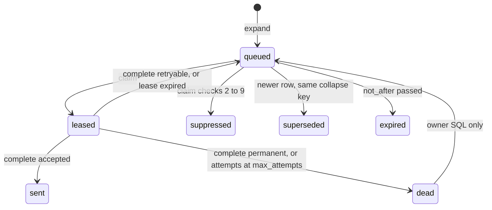

# N01 design: notifications (in-app inbox, outbox, channel adapters)

_Ticket N01 · design v1.0 · 19 November 2026 · Kiro · branch `docs/N01-notifications-design`, base `integ/all` at `f549ad3` · Owner review PENDING_

This document designs notifications for SureCure Visit: which booking, visit, payment and verification events notify whom, how a transactional outbox fed by the existing event ledgers carries them, the recipient-only in-app inbox, and the gated, provider-agnostic path to SMS, email and WhatsApp.

It is a design document. It contains no SQL file and no code, and nothing in it has been run. No database, Docker or vendor command was used. Every statement about built objects comes from reading the migrations on `f549ad3`, whose inventory ends at `20261117001500_review_findings.sql`. Objects from the P5 shared contract and P01 are designed but not built; N01 depends on them where §14 says so.

Where a call belongs to the owner it is marked **OWNER-DECISION** with the default this design uses until the owner answers. §17 collects them. Coordination questions for Claude are in §18.

## 0. Sources

| Alias | Source |
|---|---|
| MB | `docs/MASTER_BLUEPRINT.md` §4 ("Durable notifications/retries use an outbox, not in-memory timers") |
| BR | `docs/BUSINESS_RULES_AND_APPROVAL_MATRIX.md` (shared support, no unsupported 24/7 promise) |
| PG | `docs/PRIVACY_AND_OPERATIONS_GATES.md` ("WhatsApp/SMS patient notifications must be opt-in where required, contain minimal detail and be reviewed for sender/templating/India DLT constraints") |
| DEC | `docs/DECISIONS.md` (OTP/email/SMS vendor and costs: pending; D-PRIV open) |
| README | root `README.md` §8 stack table ("Approved email/SMS provider; click-to-chat WhatsApp first"), §9 ("Do not include medical payloads in notification text"; Meta Cloud API only after approval), §i18n (`en`, `te`, `hi`) |
| S | `docs/specs/P5_shared_engine_contract.md` v1.0 (manifest §2, gates §10, reasons §9, exceptions §6, OD-1 to OD-9) |
| D, L, A, C | `docs/specs/P5_doctor_flow_design.md`, `P5_lab_flow_design.md`, `P5_ambulance_flow_design.md`, `P5_care_flow_design.md` |
| P01 | `docs/specs/P01_payments_design_v1.2.md` (`payment_events`, capabilities, D-1, E-1, E-2) |
| CS | `docs/CANONICAL_SCHEMA_DRAFT.md` L310-311, L578, L599 (outbox/attempts dictionary) |
| M01 | `supabase/migrations/202611170001_i01_identity.sql` |
| M02 | `supabase/migrations/202611170002_i02_provider_onboarding.sql` |
| M04 | `supabase/migrations/202611170004_c01_catalog.sql` |
| M05 | `supabase/migrations/202611170005_b01_booking.sql` |
| M0610, M0650, M0670 | `20261117000610_i02h_audit_hardening.sql`, `20261117000650_i02h_expired_state.sql`, `20261117000670_i02h_cr_fixes.sql` |
| M10, M11, M12, M15 | `20261117001000_q06_staff_credentials.sql`, `20261117001100_b01_authorization_limits.sql`, `20261117001200_q06_storage_and_review_scope.sql`, `20261117001500_review_findings.sql` |

### 0.1 Built facts this design depends on

| Fact | Where |
|---|---|
| `public.notification_outbox(id, booking_id, event_id unique FK booking_events, payload jsonb, created_at)`. No recipient, channel, status, attempt or lease column. | M05 L120-124 |
| `booking_private.transition()` writes the booking update, one `booking_events` row, one `audit_events` row and one `notification_outbox` row with payload `{booking_id, event: reason, version}` in the caller's transaction. Every state or substate change goes through it. | M05 L207-217 |
| `booking_events(booking_id, actor_profile_id, from_state, to_state, aggregate_version, reason, request_key, occurred_at default now())`, immutable by trigger. Same-state milestones write `from_state = to_state`. | M05 L65-70, L173-174 |
| `accept_booking` inserts assignments and reservations, then writes `accepted` and `confirmed` in one transaction. `cancel_booking` writes the `cancelled` event, then `release()` sets `ended_at = clock_timestamp()` on assignments. | M11 L160-168, L195-196; M05 L218-221 |
| `booking_assignments(booking_id, resource_id, purpose, assigned_profile_id, period, status active/replaced/ended, ended_at)`. No `created_at`. | M05 L97-104 |
| `notification_outbox` and `booking_events` had privileges revoked from `public, anon, authenticated` only. `service_role` keeps Supabase default table privileges on both. | M05 L553-558 |
| `profiles.locale` is `en`, `te` or `hi`, default `en`. `profiles` holds no phone or email. Patient booking contact is a snapshot in `bookings.contact_snapshot`; provider phone is `provider_private_details.private_phone`. | M01 L13-19; M05 L26, L41; I02h `000640` L65 |
| `audit_events.actor_profile_id` may be null only for `provider.expired` (CHECK `audit_events_system_actor`). Worker actions therefore cannot write `audit_events` without a CHECK change. | M0650 L24-26 |
| `booking_private.scheduler(provider)` = individual owner, or an active, accepted member of an active organisation with scope `schedule:manage`. It reads `auth.uid()`. | M05 L134-140 |
| `provider_verification_events.to_state` takes `under_review`, `approved`, `rejected`, `suspended` (review), `submitted` (submit) and `expired` (system, actor null). `reason` is reviewer free text; `public_reason` is fixed text. | M0670 L80-104, L131-133 |
| `staff_credential_events.to_state` takes `submitted`, `approved`, `rejected`, `suspended`; `reason` is free text. Review needs `provider:verify` or `provider:suspend` per decision. | M10 L34-41, M12 L9-29 |
| `coverage_review_events(area_id, from_status, to_status, reason free text)`. | M04 L67-73 |
| pg_cron is used, guarded by `cron.database_name`. | M15 L17-22 |
| `src/lib/feature-flags/index.ts`: `isEnabled` is true only for the exact string `"true"`. No notification flag exists. No file under `src/` reads `notification_outbox`. | `src/lib/feature-flags/index.ts` |

## 1. Scope

In scope:
- Event catalogue for booking, visit (doctor, lab, ambulance, caretaker milestones), booking exception, payment (P01a) and verification (provider, staff, coverage) events.
- A notification pipeline fed from the existing ledgers: intake, expansion into recipients, in-app inbox, external delivery queue with retry, backoff and dead-letter.
- In-app inbox with recipient-only RLS. Preferences, channel consent, quiet hours, rate limits, audit.
- A provider-agnostic channel adapter contract for SMS, email and WhatsApp, behind flags that stay off.
- Template and content rules: no PHI or clinical data in SMS, email or WhatsApp bodies; `en`, `te`, `hi`.
- Migration and test block proposal, test plan, owner decisions.

Out of scope: choosing or integrating a vendor; push notifications (web push, FCM/APNs); Realtime channels; inbound SMS/WhatsApp (STOP keywords, replies); delivery receipts (DLR webhooks); marketing messages of any kind; emergency dispatch alerts; reminders before a visit (designed in §5.6 but off); UI screens (the friend's frontend work consumes §12).

Nothing here enables a channel. Until a vendor is approved, the only working channel is in-app, and a patient sees a message only when they open the app (§19).

## 2. Decisions in one place

1. **Feed from ledgers, not from commands.** AFTER INSERT triggers on the existing ledgers (`notification_outbox`, `booking_exceptions`, `payment_events`, `provider_verification_events`, `staff_credential_events`, `coverage_review_events`) write one intake row each, in the domain transaction. No domain command is replaced. This is the transactional outbox: the intent commits or rolls back with the change.
2. **The built `notification_outbox` stays as is.** It remains the booking-event intent B01 writes. N01 neither alters nor drains it; it adds a trigger on it.
3. **Expansion is asynchronous and in the database.** A pg_cron job resolves recipients and writes inbox rows and delivery rows. External sending runs in the app worker, outside any transaction, through an adapter. A notification bug therefore cannot abort a booking transaction except through the intake insert itself, which has no failure path other than a defect (§7).
4. **In-app first.** The inbox stores template keys and an allowlisted set of ids and codes, never rendered text. The client renders in the viewer's locale.
5. **External bodies are content-free.** SMS, email and WhatsApp carry the brand, the booking `public_ref`, a fixed generic phrase and a link to the app. No name, category, service, address, time, amount, reason or clinical word (§11).
6. **Safety class is never suppressed.** Opt-out, quiet hours, collapse, rate limits and cost caps never drop or delay a safety message (§4, §9). Channel consent that a platform requires (WhatsApp opt-in) still applies.
7. **External channels are opt-in.** No external message other than safety is sent without a recorded opt-in (OD-N6).
8. **Every channel has two keys.** A database gate row and a server env flag, both default off (§13).
9. **At-least-once delivery.** Dedupe keys make enqueueing exactly-once per (event, recipient, channel, template). Sending is at-least-once; the adapter passes the delivery id as the vendor idempotency key where the vendor supports one.

## 3. Pipeline

```mermaid
flowchart LR
    accTitle: N01 notification pipeline
    accDescr: Domain commands write their ledgers in one transaction. An intake trigger on each ledger records one intake event in the same transaction. A pg_cron job expands intake events into in-app inbox rows and external delivery rows. The app dispatcher claims external deliveries, sends through a channel adapter and records each attempt. Failed deliveries retry with backoff and end as dead letters.
    cmd[Domain command] --> led[(Source ledger<br/>notification_outbox, payment_events,<br/>verification events, booking_exceptions)]
    led -- AFTER INSERT trigger, same tx --> ev[(notify_private.events<br/>pending)]
    ev -- pg_cron expand, every minute --> inbox[(public.notifications<br/>in-app inbox)]
    ev -- pg_cron expand --> del[(notify_private.deliveries<br/>queued)]
    del -- app dispatcher claim, lease --> ad[Channel adapter<br/>log / vendor]
    ad -- complete --> att[(notify_private.delivery_attempts)]
    att -. retryable .-> del
    att -. max attempts or permanent .-> dead[(deliveries status dead)]
```



## 4. Priority classes

| Class | Meaning | Opt-out | Quiet hours | Collapse | Rate limit and cost cap | External without opt-in |
|---|---|---|---|---|---|---|
| `safety` | The recipient may be left without care they are relying on, or a safety event happened during a visit. | ignored | ignored | never | never suppresses; alarm above `safety_alarm_per_day` | SMS and email yes (OD-N5); WhatsApp no |
| `transactional` | A change the recipient must act on or would expect to be told about. | honoured | deferred, unless the rule is `quiet_exempt` | yes | suppresses external; in-app still written | no |
| `routine` | Informational progress. | honoured | deferred | yes | suppresses external | no |

`safety` for a patient is, exactly:
- `cancelled` from `confirmed` when the actor is not the patient;
- `interrupted` with any reason except the transactional list in §5.1 rule B14;
- ambulance `interrupted` with any reason (a patient may be away from home without transport).

`safety` for staff: an open `interrupted_after_pickup` exception (ops inbox only).

In-app, every safety message for an `interrupted` booking whose reason is `ended_for_emergency` or `unsafe_conditions`, and every ambulance interruption, carries the fixed 112 notice; the one external safety template (`ext.not_going_ahead`) always carries it ("In an emergency call 112"), consistent with A §6.4 and C §5.3. The notice never says the platform called anyone.

**OWNER-DECISION OD-N4:** is this the right safety set? Default: as listed.

## 5. Event catalogue

Notation: **P** patient (`patients.self_profile_id` of `bookings.patient_id`); **S** schedulers of the booking's provider; **A** assignees (person purpose of the category); **O** ops (`booking:incident` holders, S OD-2); **F** finance (`finance:reconcile` holders, P01 D-1); **M** provider managers; **V** verifiers; **Sub** the staff case subject. Audiences are resolved by §8. The event's actor is always removed from the audience. "Ext" is the external template (§11.2) or `none` for in-app only. A row that lists several audiences is seeded as one `rules` row per audience (for example `B05-S`, `B05-A`). Rules B09, B10 and B18 are `quiet_exempt`: the message is only useful at the time it happens. Topics drive preferences (§9.2): `booking`, `payment`, `verification`.

### 5.1 Booking and visit events (source `booking_event`, from `notification_outbox`)

Match is on `booking_events.reason` and, where stated, `from_state`, `to_state`, category, or whether the actor is the patient.

| Rule | Match | Cat. | Audience: priority | In-app key | Ext | TTL |
|---|---|---|---|---|---|---|
| B01 | `requested` | all | S: transactional | `booking.request_received` | `ext.action_needed` | until `start_at` |
| B02 | `accepted` | all | none (always followed by `confirmed` in the same transaction, M11 L167-168) | | | |
| B03 | `confirmed` | all | P: transactional; A: transactional | P `booking.confirmed`; A `booking.assigned` | `ext.booking_update` | until `start_at` |
| B04 | to `declined` | all | P: transactional | `booking.declined` | `ext.booking_update` | 24 h |
| B05 | to `cancelled`, actor is patient | all | S, A: transactional | `booking.cancelled_by_patient` | `ext.booking_update` (S only) | until `end_at` |
| B06 | to `cancelled`, actor not patient, from `requested` or `accepted` | all | P: transactional; S, A: transactional | P `booking.cancelled_by_provider`; S/A `booking.cancelled` | P `ext.booking_update` | until `end_at` |
| B07 | to `cancelled`, actor not patient, from `confirmed` | all | P: **safety**; S, A: transactional | P `booking.cancelled_confirmed`; S/A `booking.cancelled` | P `ext.not_going_ahead` | until `end_at` |
| B08 | to `expired` (system; no satisfiable edge today) | all | P: transactional; S: routine | `booking.expired` | P `ext.booking_update` | 24 h |
| B09 | `en_route` | doctor, ambulance | P: transactional | `visit.en_route` | `ext.booking_update` | `arrival_ttl_minutes` (30) and `end_at` |
| B10 | `arrived` | doctor, ambulance | P: transactional | `visit.arrived` | `ext.booking_update` | `arrival_ttl_minutes` and `end_at` |
| B11 | `service_started`, `collection_started`, `picked_up` | doctor, care; lab; ambulance | P: routine | `visit.started` | none | |
| B12 | `sample_collected` | lab | P: routine | `visit.sample_collected` | none | |
| B13 | to `completed` (`service_completed`, `sample_handed_over`, `destination_reached`) | all | P: routine; S: routine | `visit.completed` | none | |
| B14 | to `interrupted`, reason in `patient_request`, `patient_requested_stop`, `declined_at_door`, `collection_failed`, `handoff_failed`, `ops_closeout`, `provider_did_not_attend`, `absence_disputed`; not ambulance | doctor, lab, care | P: transactional; S, A: transactional | P `visit.ended_early`; S/A `visit.interrupted_staff` | P `ext.booking_update` | 24 h |
| B15 | to `interrupted`, any other reason, or any ambulance reason | all | P: **safety**; S, A: transactional | P `visit.interrupted` (with 112 notice per §4); S/A `visit.interrupted_staff` | P `ext.not_going_ahead` | 24 h |
| B16 | `absence_reported` | doctor, lab, ambulance | P: transactional; S: transactional; O: transactional | P `visit.absence_reported`; S/O `visit.absence_reported_staff` | P `ext.booking_update` | 24 h |
| B17 | to `no_show` (`no_show_confirmed`) | doctor, lab, ambulance | P: transactional; S: transactional | `visit.no_show` | P `ext.booking_update` | 24 h |
| B18 | `eligibility_blocked` | ambulance | S: transactional; P: transactional | S `trip.blocked_staff`; P `trip.problem` | S `ext.action_needed`; P `ext.booking_update` | until `start_at` |
| B19 | `reassigned` | | none (no category pair, S §9.3) | | | |
| B20 | any reason not matched above | | none, and expansion writes `unmatched_rule` on the intake event so suite 103 fails | | | |

Notes:
- `requester_profile_id` equals the patient's own profile in the built model (self access only), so P covers both. If family or guardian access is added later, notifying a grantee is a new rule under its own consent review (PG: family relationships never imply blanket access).
- An individual provider owner who is both S and A receives one inbox row per rule row; expansion removes duplicates by (event, recipient, template key), and for S and A of the same template key keeps one.
- B09/B10 TTL: an "on the way" SMS that arrives after the visit is confusing, so the delivery expires.
- Doctor, lab, ambulance and care in-app labels reuse the category label tables (D §3.1, L §6, A §6.4, C §5.3). External bodies never do (§11).

### 5.2 Booking exceptions (source `booking_exception`, from S `public.booking_exceptions`)

| Rule | Match | Audience: priority | In-app key | Ext |
|---|---|---|---|---|
| X01 | insert, kind `interrupted_after_pickup` | O: **safety** | `ops.exception_opened` | none |
| X02 | insert, any other kind | O: transactional | `ops.exception_opened` | none |
| X03 | resolve (`open -> resolved`) | none | | |

Exceptions are fed by an AFTER INSERT trigger only. Until an ops holder exists (S OD-2), O is empty and X01/X02 notify nobody.

### 5.3 Payment events (source `payment_event`, from P01a `public.payment_events`)

No payment notification is sent externally (OD-N9). No template says "paid", "payment successful" or "received by SureCure Visit". Gateway events (`gateway.*`, P01b, test mode) notify nobody.

| Rule | Match `event_type` | Audience: priority | In-app key | Params |
|---|---|---|---|---|
| Y01 | `collection.reported` | P: transactional | `payment.collection_recorded` | `public_ref`, `amount_paise` |
| Y02 | `collection.confirmed` | P: routine | `payment.collection_confirmed` | `public_ref`, `amount_paise` |
| Y03 | `collection.disputed` | collector (`payment_collections.collector_profile_id`): transactional | `payment.collection_disputed` | `public_ref` |
| Y04 | `payment.disputed` | F: transactional; M with `finance:read`: transactional | `payment.disputed` | `public_ref` |
| Y05 | `payment.resolved` | P, collector: transactional | `payment.resolved` | `public_ref` |
| Y06 | `exception.raised` | F: transactional | `payment.exception` | `public_ref` |
| Y07 | `obligation.voided` | P: routine | `payment.nothing_due` | `public_ref` |
| Y08 | every other type | none | | |

Y01 copy is "The provider recorded receiving ₹X. If this is wrong, open the booking." It never says the payment is complete (P01 Q04).

### 5.4 Verification events

Source `provider_verification` (from `provider_verification_events`), `staff_credential` (from `staff_credential_events`), `coverage_review` (from `coverage_review_events`). All in-app only by default; email for M on `approved`, `rejected`, `suspended`, `expired` if the email channel exists and M opted in to `verification` (`ext.account_update`). Free-text `reason` and `public_reason` are never copied; the provider page shows them through its own projection.

| Rule | Match | Audience: priority | In-app key |
|---|---|---|---|
| V01 | provider `to_state = 'submitted'` | V (`provider:verify`, global or `org:<id>`): transactional | `verification.provider_submitted` |
| V02 | provider `under_review` | M: routine | `verification.under_review` |
| V03 | provider `approved` | M: transactional | `verification.approved` |
| V04 | provider `rejected` | M: transactional | `verification.rejected` |
| V05 | provider `suspended` | M: transactional | `verification.suspended` |
| V06 | provider `expired` (actor null) | M: transactional | `verification.expired` |
| V07 | staff `submitted` | V: transactional | `verification.staff_submitted` |
| V08 | staff `approved`, `rejected`, `suspended` | Sub: transactional; M: transactional | `verification.staff_<to_state>` |
| V09 | coverage `to_status = 'proposed'` | holders of `coverage:verify`: transactional | `verification.coverage_proposed` |
| V10 | coverage `approved`, `rejected`, `revoked` | M: transactional | `verification.coverage_<to_status>` |
| V11 | coverage `withdrawn`, any other | none | |

### 5.5 Recipients that resolve to nobody today

O (S OD-2), F (P01 D-1) and `finance:read` M with no approved collector model resolve to empty sets by default. Rules that target only them write nothing. Suite 103 asserts that an empty audience marks the intake event `expanded` with zero rows, not `failed`.

### 5.6 Reminders (designed, off)

A pg_cron scan could enqueue one reminder per confirmed booking at `start_at - reminder_lead` (source `reminder`, dedupe key `(booking_id, lead)`), suppressed if the booking is not `confirmed` at send time. **OWNER-DECISION OD-N10:** enable reminders, and at which lead? Default: off; no reminder rule is seeded.

## 6. Data model

New schemas: `notify_private` (tables and helpers) and `notify_worker` (functions the worker may execute). Usage on both is revoked from `public, anon, authenticated, service_role`; `notify_worker` usage is granted to `service_role` only. Every table: RLS enabled, `revoke all ... from public, anon, authenticated, service_role`. Only `public.notifications` and `public.notification_preferences` get a SELECT grant (§12). All writes go through `postgres`-owned `security definer` functions with `set search_path = ''` (S §1 rule 2-3).

### 6.1 `notify_private.events` (intake)

| Column | Type / constraint |
|---|---|
| `id` | `uuid pk default gen_random_uuid()` |
| `source_kind` | `text not null check (source_kind in ('booking_event','booking_exception','payment_event','provider_verification','staff_credential','coverage_review','reminder'))` |
| `source_id` | `uuid not null` (the ledger row id; for `booking_event` the `booking_events.id`) |
| `booking_id` | `uuid null references public.bookings(id)` |
| `occurred_at` | `timestamptz not null` (copied from the source row) |
| `status` | `text not null default 'pending' check (status in ('pending','expanded','skipped','failed','dead'))` |
| `skip_reason` | `text null check (skip_reason in ('gate_off','stale','unmatched_rule'))` |
| `attempts` | `integer not null default 0 check (attempts between 0 and 10)` |
| `error_code` | `text null` (SQLSTATE only, no message text) |
| `expanded_at`, `created_at` | `timestamptz` |
| | `unique (source_kind, source_id)`; index `(status, created_at) where status in ('pending','failed')` |

No payload column. Expansion reads the source row by id, so the intake row carries nothing a reader of this table could misuse. Guard trigger: only `status`, `skip_reason`, `attempts`, `error_code`, `expanded_at` change; DELETE and TRUNCATE raise.

### 6.2 `notify_private.rules` (catalogue)

Seeded by migration from §5; never written at runtime.

| Column | Type / constraint |
|---|---|
| `id` | `text pk` (`B01`, `V08`, ...) |
| `source_kind` | as above |
| `match_code` | `text not null` (reason, `event_type`, `to_state`, or exception kind) |
| `match_from_state`, `match_to_state` | `text null` |
| `match_categories` | `text[] null` (null = all) |
| `match_actor` | `text null check (match_actor in ('patient','not_patient'))` |
| `audience` | `text not null check (audience in ('patient','schedulers','assignees','ops','finance','provider_managers','provider_finance_readers','verifiers','coverage_verifiers','staff_subject','collector'))` |
| `priority` | `text not null check (priority in ('safety','transactional','routine'))` |
| `topic` | `text not null check (topic in ('booking','payment','verification'))` |
| `inapp_key` | `text not null check (inapp_key ~ '^[a-z][a-z_]*\.[a-z][a-z0-9_]*$')` |
| `ext_key` | `text null check (ext_key in ('ext.booking_update','ext.action_needed','ext.not_going_ahead','ext.account_update'))` |
| `emergency_notice` | `boolean not null default false` |
| `quiet_exempt` | `boolean not null default false` |
| `ttl` | `text not null check (ttl in ('until_start','until_end','arrival','h24'))` |
| | `unique nulls not distinct (source_kind, match_code, match_from_state, match_to_state, match_categories, match_actor, audience)`. A rule that lists several codes ("any other reason" in B15, the three codes in B11 and B13) is seeded as one row per code from S §9.4. |

`booking_event` rules' `match_code` references `booking_private.reason_codes(code)` (S §9), so a rule for an unknown code fails at migration time.

### 6.3 `public.notifications` (in-app inbox)

| Column | Type / constraint |
|---|---|
| `id` | `uuid pk default gen_random_uuid()` |
| `recipient_profile_id` | `uuid not null references public.profiles(id)` |
| `event_id` | `uuid not null references notify_private.events(id)` |
| `rule_id` | `text not null references notify_private.rules(id)` |
| `template_key` | `text not null` |
| `template_version` | `integer not null check (template_version > 0)` |
| `priority` | as above |
| `booking_id` | `uuid null references public.bookings(id)` |
| `params` | `jsonb not null default '{}'` with `check (jsonb_typeof(params) = 'object' and (params - array['public_ref','category','state','reason','start_at','amount_paise','emergency_notice']) = '{}'::jsonb)` |
| `created_at` | `timestamptz not null default clock_timestamp()` |
| `read_at` | `timestamptz null` |
| | `unique (event_id, recipient_profile_id, template_key)`; index `(recipient_profile_id, created_at desc, id desc)`; partial index `(recipient_profile_id) where read_at is null` |

`params` may hold `category`, `start_at` and `amount_paise` because the inbox is authenticated and recipient-only; never names, address, contact, service or test titles, reasons in free text, or clinical data. `amount_paise` is a decimal string and appears only for Y01/Y02.

Guard trigger (BEFORE UPDATE OR DELETE, BEFORE TRUNCATE): UPDATE may only change `read_at` from null to a value no later than `clock_timestamp()`; DELETE and TRUNCATE raise `55000 immutable_notification` (retention is OD-N12).

### 6.4 `public.notification_preferences` and `notify_private.channel_consent_events`

`public.notification_preferences`: `profile_id uuid references profiles(id)`, `channel text check (channel in ('sms','email','whatsapp'))`, `topic text check (topic in ('booking','payment','verification'))`, `enabled boolean not null`, `version integer not null default 1`, `updated_at timestamptz`, `primary key (profile_id, channel, topic)`. No row means "off". In-app has no preference: it cannot be turned off.

`notify_private.channel_consent_events`: append-only (`booking_private.immutable()` on UPDATE, DELETE, TRUNCATE). `id`, `profile_id`, `channel`, `topic`, `decision text check (decision in ('granted','withdrawn'))`, `notice_version text not null check (char_length(btrim(notice_version)) between 1 and 80)`, `source text check (source in ('settings','vendor_opt_out'))`, `occurred_at`. The latest row per `(profile_id, channel, topic)` is the consent of record; the preference row is its projection and both are written in one transaction.

### 6.5 `notify_private.deliveries` (external outbox)

| Column | Type / constraint |
|---|---|
| `id` | `uuid pk` (also the vendor idempotency key) |
| `event_id` | `uuid not null references notify_private.events(id)` |
| `rule_id` | `text not null references notify_private.rules(id)` |
| `recipient_profile_id` | `uuid not null references public.profiles(id)` |
| `booking_id` | `uuid null references public.bookings(id)` |
| `channel` | `text not null check (channel in ('sms','email','whatsapp'))` |
| `template_key`, `template_version` | external template and version at enqueue |
| `locale` | `text not null check (locale in ('en','te','hi'))`, snapshotted from `profiles.locale` at enqueue |
| `priority`, `topic` | copied from the rule |
| `dedupe_key` | `text not null unique`: `event_id || ':' || recipient_profile_id || ':' || channel || ':' || template_key || ':' || template_version` |
| `collapse_key` | `text null`: `recipient_profile_id || ':' || channel || ':' || booking_id`, null for `safety` |
| `status` | `text not null default 'queued' check (status in ('queued','leased','sent','suppressed','superseded','expired','dead'))` |
| `suppress_reason` | `text null check (suppress_reason in ('preference_off','consent_missing','no_destination','recipient_ineligible','rate_limited','global_cap','booking_moved_on'))` |
| `not_before` | `timestamptz not null` (quiet hours and backoff) |
| `not_after` | `timestamptz not null` (TTL from the rule) |
| `attempts` | `integer not null default 0 check (attempts between 0 and 20)` |
| `lease_until` | `timestamptz null` |
| `last_error_code` | `text null` (closed list, §10.2) |
| `vendor_ref` | `text null check (char_length(vendor_ref) <= 128)` |
| `sent_at`, `created_at`, `updated_at` | `timestamptz` |
| `version` | `integer not null default 1` |
| | `check ((status = 'suppressed') = (suppress_reason is not null))`, `check ((status = 'leased') = (lease_until is not null))`, `check ((status = 'sent') = (sent_at is not null))`; indexes `(channel, status, not_before) where status = 'queued'`, `(recipient_profile_id, channel, sent_at) where status = 'sent'`, `(collapse_key) where status = 'queued'` |

No destination, rendered text or vendor payload is stored. Guard trigger: `id`, `event_id`, `rule_id`, `recipient_profile_id`, `booking_id`, `channel`, `template_*`, `locale`, `priority`, `topic`, `dedupe_key`, `collapse_key`, `created_at` immutable; `version = old.version + 1`; status moves only along §10.1; DELETE and TRUNCATE raise. Every status change appends to `notify_private.delivery_transitions`.

### 6.6 `notify_private.delivery_attempts` and `notify_private.delivery_transitions`

`delivery_attempts`: `delivery_id`, `attempt_no integer check (attempt_no > 0)`, `adapter text` (`log`, or a vendor name later), `started_at`, `finished_at`, `outcome text check (outcome in ('accepted','retryable','permanent','lease_expired'))`, `error_code text null` (closed list), `primary key (delivery_id, attempt_no)`. Insert-only (immutable trigger).

`delivery_transitions`: `id`, `delivery_id`, `from_status`, `to_status`, `reason text null`, `db_role text not null default current_user`, `occurred_at default clock_timestamp()`. Insert-only, written by the deliveries guard trigger. This is the audit trail for worker and owner actions, since `audit_events` cannot take a null actor (§0.1).

### 6.7 `notify_private.settings` and gates

Single row (`id boolean primary key default true check (id)`), changed only by reviewed migration or recorded owner SQL; an AFTER UPDATE trigger appends to `notify_private.settings_events(old_row jsonb, new_row jsonb, db_role, changed_at)`, which is immutable (P01 §2 pattern). Columns and defaults:

| Setting | Default |
|---|---|
| `max_event_age_minutes` | 1440 (events older than this at expansion are `skipped stale`) |
| `max_audience` | 50 recipients per (event, rule) |
| `quiet_start`, `quiet_end`, `quiet_tz` | `21:00`, `08:00`, `Asia/Kolkata` (OD-N7) |
| `per_recipient_hour`, `per_recipient_day` | 5, 20 per channel, non-safety (OD-N8) |
| `safety_alarm_per_day` | 10 per recipient |
| `daily_cap_sms`, `daily_cap_email`, `daily_cap_whatsapp` | 0, 0, 0 (non-safety external sends per day; 0 means none until the owner sets a budget, OD-N8) |
| `max_attempts` | 6 |
| `backoff_base_seconds`, `backoff_cap_seconds` | 30, 1800 |
| `lease_seconds` | 60 |
| `arrival_ttl_minutes` | 30 |

Gates reuse the shared registry `booking_private.feature_gates` (S §3; "P01 may insert its own key" applies equally): N01 inserts `notify_inapp`, `notify_sms`, `notify_email`, `notify_whatsapp`, all `off`. Gate changes are logged by the built `feature_gate_events` trigger and follow S OD-6 (reviewed migration or recorded owner SQL).

## 7. Intake triggers

One `AFTER INSERT ... FOR EACH ROW` trigger per source ledger. Each is `security definer`, `search_path = ''`, and does exactly:

```text
insert into notify_private.events(source_kind, source_id, booking_id, occurred_at)
values (<kind>, new.<id column>, <booking id or null>, <event time>)
on conflict (source_kind, source_id) do nothing;
```

| Ledger | Trigger name | `source_id` | `booking_id` | `occurred_at` | Built or designed |
|---|---|---|---|---|---|
| `public.notification_outbox` | `n01_intake_booking` | `new.event_id` | `new.booking_id` | `new.created_at` | built (M05) |
| `public.booking_exceptions` | `n01_intake_exception` | `new.id` | `new.booking_id` | `new.opened_at` | designed (S `001570`) |
| `public.payment_events` | `n01_intake_payment` | `new.id` | booking of `new.payment_id` | `new.occurred_at` | designed (P01a) |
| `public.provider_verification_events` | `n01_intake_provider_verification` | `new.id` | null | `new.occurred_at` | built |
| `public.staff_credential_events` | `n01_intake_staff` | `new.id` | null | `new.occurred_at` | built |
| `public.coverage_review_events` | `n01_intake_coverage` | `new.id` | null | `new.occurred_at` | built |

Rules:
- The trigger never reads gates, rules or audiences, never raises on purpose, and takes no lock beyond the FK check on `booking_id`. Its cost is one indexed insert per ledger row.
- Rows that existed before the migration get no intake row. N01 sends nothing about history.
- The `booking_exceptions` resolve path is an UPDATE and has no trigger (X03).
- The booking trigger sits on `notification_outbox`, not `booking_events`, so the B01 rule "every transition writes one outbox row" stays the single definition of a notifiable booking event.
- Forged rows: `service_role` can still insert into `notification_outbox` and `booking_events` (§0.1). Expansion re-reads the `booking_events` row and requires `notification_outbox.payload->>'event' = booking_events.reason` and `payload->>'version' = aggregate_version`, which catches a mismatched forgery but not a consistent one. The fix is the shared `service_role` write revoke on B01 tables (S §2.5, A E-9). External channels must not be turned on before it lands (§18 Q3).

## 8. Expansion and audience resolution

`notify_worker.expand(p_limit integer) returns integer` runs from pg_cron every minute as `postgres` (job `n01-expand`, scheduled under the same `cron.database_name` guard as M15). It is not granted to any API role.

Per call:
1. Claim up to `p_limit` events `where status in ('pending','failed') and attempts < 5 order by created_at for update skip locked`.
2. For each event, inside a `begin ... exception` block (one failing event does not stop the batch):
   1. `notify_inapp` gate not `on`: `skipped gate_off`.
   2. `occurred_at < clock_timestamp() - max_event_age_minutes`: `skipped stale`.
   3. Load the source row and, for bookings, the booking (category, patient, provider, `public_ref`, `start_at`, `end_at`, `state`). Verify the outbox/event consistency in §7.
   4. Select matching rules. None: `skipped unmatched_rule`.
   5. Resolve each rule's audience (table below), remove the event actor, cap at `max_audience` ordered by profile id (excess is counted in `error_code = 'audience_capped'` on the event, not dropped silently), and drop profiles whose `profiles.status <> 'active'`.
   6. Insert inbox rows `on conflict do nothing`.
   7. For each rule with `ext_key`, each external channel whose gate is `on` or `suspended`, and each recipient: insert a delivery `on conflict (dedupe_key) do nothing` with `not_before = clock_timestamp()`, `not_after` from the rule TTL, and locale from `profiles.locale`. Then mark older `queued` deliveries with the same `collapse_key` `superseded` (non-safety only).
   8. `expanded`.
   On exception: `attempts + 1`, `failed`, `error_code = SQLSTATE`; at 5 attempts, `dead`.
3. Return the number of events processed.

Audience resolvers are `notify_private` SQL functions that take ids, never `auth.uid()`, because the job has no JWT. Each mirrors a built predicate; suite 104 proves parity by evaluating both for every fixture profile.

| Audience | Resolver | Mirrors |
|---|---|---|
| `patient` | `patients.self_profile_id` of the booking | `booking_private.patient(..., 'booking:read')` with self access |
| `schedulers` | individual owner, or active accepted members with `schedule:manage` of an active organisation | `booking_private.scheduler` (M05 L134) |
| `assignees` | `booking_assignments.assigned_profile_id` where `purpose = booking_private.person_purpose(category)` and (`status = 'active'` or `ended_at >= event.occurred_at`) | assignment at event time. Cancellation ends assignments with `clock_timestamp()` after the event's `now()` (M11 L195-196), so the assignee of a just-cancelled booking is included. |
| `ops` | unexpired, unrevoked `booking:incident` holders scoped `global` or `org:<provider org>`, excluding every conflict `booking_private.ops_actor` excludes (owner, member, patient, requester, assignee) | S §6.2 |
| `finance` | `finance:reconcile` holders, scope as P01 | P01 §4.2 |
| `provider_managers` | individual owner, or active accepted members with `provider:manage` | I02 manager predicate |
| `provider_finance_readers` | individual owner, or active accepted members with `finance:read` | P01 §4.2 provider reads |
| `verifiers` | `provider:verify` holders, scope `global` or `org:<org>`, not members of that organisation | M0670 review predicate |
| `coverage_verifiers` | `coverage:verify` holders, same scope rule | M04 `catalog_private.verifier` |
| `staff_subject` | `provider_verification_cases.subject_profile_id` | M10 |
| `collector` | `payment_collections.collector_profile_id` | P01 §4.1 |

AAL2 is a session property and cannot be checked offline. Capability holders receive the inbox row; acting on it still needs AAL2 through the normal RPC. The inbox row reveals only a `public_ref` and a code.

## 9. Delivery policy (external channels)

### 9.1 Order of checks at claim

`notify_worker.claim(p_channel text, p_limit integer) returns setof jsonb` (granted to `service_role` only). It locks `queued` rows of `p_channel` with `not_before <= now < not_after` `for update skip locked`, ordered by priority (`safety` first) then `created_at`, and evaluates each in this order. The first failing check decides.

| # | Check | Non-safety result | Safety result |
|---|---|---|---|
| 1 | Channel gate `on` (not `suspended`) | row not claimed, stays `queued` | same |
| 2 | Recipient still eligible: `profiles.status = 'active'`; for S/A/M/O/F audiences, the resolver of §8 still returns the profile | `suppressed recipient_ineligible` | same |
| 3 | Booking moved on: B09/B10 and booking is no longer `confirmed`; B01 and booking is no longer `requested` | `suppressed booking_moved_on` | not applied |
| 4 | Destination: verified phone (`auth.users.phone` with `phone_confirmed_at`) for SMS/WhatsApp, verified email (`email_confirmed_at`) for email | `suppressed no_destination` | same |
| 5 | Consent: latest `channel_consent_events` for (profile, channel, topic) is `granted` | `suppressed consent_missing` | SMS, email: not applied (OD-N5). WhatsApp: applied. |
| 6 | Preference `enabled` | `suppressed preference_off` | not applied |
| 7 | Quiet hours, unless the rule is `quiet_exempt`: now in `[quiet_start, quiet_end)` in `quiet_tz` | `not_before` moved to the next `quiet_end`, row released; if that is after `not_after` the row later expires | not applied |
| 8 | Per-recipient caps: sent non-safety count in the last hour and day | `suppressed rate_limited` | not applied; above `safety_alarm_per_day` the worker logs alarm code `safety_volume` |
| 9 | Channel daily cap | `suppressed global_cap` | not applied |
| 10 | Lease: `leased`, `lease_until = now + lease_seconds`, `attempts + 1` | | |

The returned object is exactly `{delivery_id, attempt_no, channel, locale, template_key, template_version, params, destination}`. `params` contains only `public_ref` and the link locale; `destination` is the phone or email read at claim time. The function result is held in worker memory for one send and never logged.

Booking contact snapshots (`bookings.contact_snapshot`) and provider private phones are never used as destinations: the contact may be a relative who never consented, and the provider phone is verification data (OD-N13).

### 9.2 Preferences and consent

- In-app: always on, no preference.
- External, non-safety: off until the user opts in for a (channel, topic). Opt-in shows the notice version and writes a `granted` consent event.
- Withdrawal takes effect at the next claim (check 5).
- Safety SMS and email go to the account's verified phone or email without opt-in once the channel is enabled (OD-N5). WhatsApp safety still requires opt-in.
- A vendor-reported opt-out (`destination_opted_out`, §10.2) writes a `withdrawn` consent event with `source = 'vendor_opt_out'` for that channel and every topic.

### 9.3 Rate limits on user commands

`set_notification_preference` at most 20 calls per actor per hour (`53300 rate_limited`). `mark_notifications_read` at most 100 ids per call.

## 10. Retry, backoff and dead-letter

### 10.1 Delivery state machine



The guard trigger allows `dead -> queued` only when `current_user = 'postgres'`, and the transition row records `db_role`. **OWNER-DECISION OD-N11:** requeue via reviewed SQL only (default) or an AAL2 RPC later.

### 10.2 Completion

`notify_worker.complete(p_delivery_id uuid, p_attempt_no integer, p_outcome text, p_error_code text, p_vendor_ref text) returns void` (`service_role` only):
- Raises `40001 stale_lease` unless the row is `leased` and `attempts = p_attempt_no`. A late completion after lease expiry is rejected; the message may have been sent twice (§19).
- Inserts one `delivery_attempts` row.
- `accepted`: `sent`, `sent_at`, `vendor_ref`.
- `retryable`: if `attempts >= max_attempts`, `dead`; else `queued`, `not_before = now + least(backoff_cap_seconds, backoff_base_seconds * 2^(attempts-1)) * (1 + random() * 0.2)`. Defaults give 30 s, 60 s, 2 min, 4 min, 8 min, then dead.
- `permanent`: `dead`.
- `last_error_code` set from a closed list: retryable `timeout`, `network`, `vendor_throttled`, `vendor_5xx`, `config_error`; permanent `invalid_destination`, `template_rejected`, `destination_opted_out`, `content_rejected`.

`notify_worker.sweep()` (pg_cron every minute, job `n01-sweep`): leased rows with `lease_until < now` get a `lease_expired` attempt row and go back to `queued` (or `dead` at `max_attempts`); queued rows with `not_after <= now` become `expired`. Safety rows that expire or die are counted in a `safety_undelivered` alarm.

### 10.3 Dead-letter visibility

`public.list_notification_failures(p_limit integer default 50, p_after uuid default null) returns setof jsonb` for holders of `security:audit` (global, AAL2 through `has_capability`). Returns `{delivery_id, event_id, rule_id, channel, priority, status, attempts, last_error_code, created_at, updated_at}` for `dead`, `expired` and safety `suppressed` rows. No recipient id, booking id or destination. Each call writes `audit_events(actor, 'notification.failures_viewed', 'profile', actor)`.

## 11. Templates, content rules and locale

### 11.1 In-app templates

Keys from §5, rendered by the client from `src/lib/notifications/templates/{en,te,hi}.ts` with `params`. Lab, ambulance, care and doctor copy reuses the category label tables. Template versions are integers in code; the inbox stores the version for audit, and the client renders the current copy of the key (a copy fix applies to old rows).

### 11.2 External templates

Exactly four, so each needs one DLT registration per locale per vendor. Placeholders are exactly `{ref}` (the `public_ref`, `SCV-` plus 12 digits) and `{link}`.

| Key | EN proposal | Used by |
|---|---|---|
| `ext.booking_update` | "SureCure Visit: booking {ref} has an update. Open {link} to see it." | patient transactional |
| `ext.action_needed` | "SureCure Visit: booking {ref} needs your response. Open {link}." | provider-side transactional |
| `ext.not_going_ahead` | "SureCure Visit: booking {ref} will not go ahead as planned. Open {link} now. In an emergency call 112." | safety |
| `ext.account_update` | "SureCure Visit: your provider account has an update. Open {link}." | verification |

Email uses the same text as the body and "SureCure Visit: update for {ref}" (or "account update") as the subject, plain text plus minimal HTML, no images, no open or click tracking.

`{link}` is `APP_ORIGIN + '/' + locale + <path>`, where the path is the authenticated booking or provider page that the frontend owns. Own origin only, no shortener, no query parameters. The page applies normal authorization; the link reveals nothing to someone without the account.

### 11.3 Content rules (enforced by tests, §16.3)

External bodies and subjects never contain:
- names of patient, provider, doctor, technician, driver or caregiver; address, PIN, locality, phone, email;
- provider category words or service, test, vehicle or care task names;
- date, time, amount, reason codes, state names, OTPs (OTP belongs to Auth, not N01);
- clinical or health words: "medicine", "medication", "diagnos", "prescri", "treatment", "symptom", "test", "sample", "report", "result", "ready" (L Q08), and their Hindi and Telugu equivalents;
- time estimates: "ETA", "minutes away", "arriving in", "on the way" (the A §11.3 list plus "on the way"), and equivalents;
- "emergency" except inside the fixed 112 sentence;
- "paid", "payment successful", "refund".

In-app copy follows the category rules: no ETA wording, milestone labels phrased as the assignee's claim (S01-26), no clinical wording, lab copy never says "result" or "ready".

**OWNER-DECISION OD-N3:** may external bodies include the booking date and time? Default: no.

### 11.4 Locale

- Inbox renders in the viewer's UI locale. Delivery locale is `profiles.locale` at enqueue.
- Every in-app and external key must exist in `en`, `te` and `hi`. Each locale file carries `reviewed: boolean` per key. Telugu and Hindi need human review (README i18n, D §3, C V6); this design writes no Telugu or Hindi strings.
- A missing or unreviewed in-app key falls back to `en`.
- Env validation fails if an external channel flag is `"true"` while any external template for that channel has `reviewed: false` in any locale. No external message is ever sent in an unreviewed translation.
- SMS segment budget: `en` is GSM-7, at most 160 characters with a 15-character `{ref}` and a link of at most 40 characters. `te` and `hi` are UCS-2 (70 characters per segment); the test caps them at 2 segments.

## 12. In-app inbox: RLS and RPCs

Grants and policies:
- `grant select on public.notifications to authenticated;` policy `n01_inbox_recipient for select to authenticated using (recipient_profile_id = auth.uid() and identity_private.active_account())`. Every column is safe for the recipient; no other policy exists. `anon` and `service_role` have no privilege.
- `grant select on public.notification_preferences to authenticated;` policy `n01_prefs_self ... using (profile_id = auth.uid() and identity_private.active_account())`.
- No INSERT, UPDATE or DELETE grant on either table to any API role.

RPCs (definer, `search_path = ''`, `identity_private.require_actor()` first, revoke from `public, anon, authenticated, service_role`, grant `authenticated`):

| Function | Contract |
|---|---|
| `public.mark_notifications_read(p_ids uuid[]) returns integer` | `cardinality` 1 to 100 else `22023`. Updates `read_at = clock_timestamp()` where `id = any(p_ids) and recipient_profile_id = actor and read_at is null`. Returns the count. Ids that are not the caller's are ignored silently (no existence oracle). |
| `public.mark_all_notifications_read(p_before timestamptz) returns integer` | Same, for the caller's rows with `created_at <= p_before`. |
| `public.set_notification_preference(p_channel text, p_topic text, p_enabled boolean, p_notice_version text, p_expected_version integer) returns integer` | Validates inputs; rate limit §9.3; upserts the preference with version check (`40001 stale_version`), writes a consent event and `audit_events(actor, 'notification.preference_changed', 'profile', actor)`. Returns the new version. `whatsapp` raises `55000 feature_unavailable` while its gate is `off`. |

HTTP routes (new files, thin adapters in the B01 pattern):

| Route | Calls |
|---|---|
| `GET /api/notifications?before=` | `select` on `notifications`, keyset pagination, 20 per page |
| `GET /api/notifications/unread-count` | `select count(*) ... where read_at is null` |
| `POST /api/notifications/read` | `mark_notifications_read` or `mark_all_notifications_read` |
| `GET /api/notifications/preferences`, `PUT /api/notifications/preferences` | `select`, `set_notification_preference` |
| `POST /api/internal/notifications/dispatch` (and `GET` for cron) | worker, §13.2 |

No Realtime (S/D: no table in `supabase_realtime`). The client refetches the unread count on navigation and every 60 seconds while visible. **OWNER-DECISION OD-N14:** Realtime private broadcast later? Default: no.

## 13. Gates, flags and the worker

### 13.1 Two keys per channel

| Channel | DB gate (`feature_gates`) | Env flag | Adapter env |
|---|---|---|---|
| in-app | `notify_inapp` | none (DB only, like the doctor gate) | none |
| SMS | `notify_sms` | `FEATURE_NOTIFY_SMS` | `NOTIFY_SMS_ADAPTER` = `log` (default) or an approved vendor |
| email | `notify_email` | `FEATURE_NOTIFY_EMAIL` | `NOTIFY_EMAIL_ADAPTER` |
| WhatsApp | `notify_whatsapp` | `FEATURE_NOTIFY_WHATSAPP` | `NOTIFY_WHATSAPP_ADAPTER` |

Gate semantics: `off` creates no rows for that channel; `suspended` (external only) creates rows but nothing is claimed, so they expire by TTL; `on` creates and sends. Env flags are added to `FEATURE_FLAGS`/`ENV_NAMES` and `.env.example` by the implementation ticket, default off, `"true"` only. Env validation fails when a flag is on and its adapter is unset, unknown, or a vendor adapter has no credentials, and when `FEATURE_NOTIFY_WHATSAPP` is on at all until the Meta decision exists (README §9).

### 13.2 Dispatcher

`src/lib/notifications/dispatch.ts`, called by `/api/internal/notifications/dispatch`, authorized by `Authorization: Bearer <CRON_SECRET>` with a constant-time compare (P01 §9 pattern). For each channel whose env flag is on: `claim(channel, 50)`, render, `adapter.send` with a 10-second timeout, `complete`. It uses a server-only Supabase client with `service_role`, whose only database rights in N01 are `execute` on `notify_worker.claim`, `notify_worker.complete` (P01 E-1 pattern). Route returns counts only.

**OWNER-DECISION OD-N15:** scheduler for the dispatcher. Default: none configured (Vercel cron reaches production only and plan limits apply; P01 E-2). In-app needs no app scheduler because pg_cron expands it.

### 13.3 Adapter contract

```ts
export type Channel = "sms" | "email" | "whatsapp";
export type OutboundMessage = {
  deliveryId: string;          // also the vendor idempotency key
  attemptNo: number;
  channel: Channel;
  to: string;                  // never logged
  locale: "en" | "te" | "hi";
  templateKey: "ext.booking_update" | "ext.action_needed" | "ext.not_going_ahead" | "ext.account_update";
  templateVersion: number;
  text: string;                // rendered from the reviewed template
  subject?: string;            // email only
};
export type SendResult =
  | { kind: "accepted"; vendorRef: string }
  | { kind: "retryable"; code: "timeout" | "network" | "vendor_throttled" | "vendor_5xx" | "config_error" }
  | { kind: "permanent"; code: "invalid_destination" | "template_rejected" | "destination_opted_out" | "content_rejected" };
export interface ChannelAdapter {
  readonly channel: Channel;
  readonly name: string;       // recorded in delivery_attempts.adapter
  send(msg: OutboundMessage, signal: AbortSignal): Promise<SendResult>;
}
```

N01 implements only the `log` adapter: it sends nothing, returns `accepted` with `vendorRef = "log:" + deliveryId`, and logs `{deliveryId, channel, templateKey, locale}`. A vendor adapter is a later ticket after the vendor decision (DEC) and maps vendor responses onto the closed codes, DLT template ids by `(templateKey, templateVersion, locale)`, and sender ids from config. A thrown error is treated as `retryable network`.

## 14. Audit and logging

| What | Where |
|---|---|
| Domain change that caused a notification | existing ledger and `audit_events` (unchanged) |
| Intake, expansion outcome | `notify_private.events` status, `skip_reason`, `error_code` |
| Every delivery status change, including owner requeue | `notify_private.delivery_transitions` (with `db_role`) |
| Every send attempt | `notify_private.delivery_attempts` |
| Preference and consent change | `channel_consent_events` and `audit_events` `notification.preference_changed` |
| Failure-queue read | `audit_events` `notification.failures_viewed` |
| Settings and gate changes | `notify_private.settings_events`, `booking_private.feature_gate_events` |

Inbox reads and mark-read write no audit (the recipient's own data). Application logs carry delivery ids, channel, template key, outcome and error codes only; never destination, rendered text, vendor request or response bodies, or booking details. A Vitest spy asserts this (§16.3).

Retention: **OWNER-DECISION OD-N12.** Default: keep everything; no purge job until D-PRIV sets retention. Inbox rows, deliveries and attempts hold ids and codes, not contact data.

## 15. Migrations and dependencies

### 15.1 Block

N01 owns `20261117002100` to `20261117002199` and suites `100` to `109`, as assigned. Version `20261117002100` itself is **not used** because P01 v1.2 §1 and its D-14 option B reserve `20261117002100_p01b_gateway_test.sql`, and P01 v1.2 claims `002000`-`002999` while S §2.2 limits P01 to `002000`-`002099` (§18 Q1).

| Version | File | Contents | Requires |
|---|---|---|---|
| `20261117002110` | `n01_core.sql` | schemas, `events`, `rules` (table only), `settings`, `settings_events`, `notifications`, `notification_preferences`, `channel_consent_events`, `deliveries`, `delivery_attempts`, `delivery_transitions`, guard triggers, gate rows, grants, RLS | S `001550` (`feature_gates`, `reason_codes`) |
| `20261117002120` | `n01_booking_sources.sql` | intake trigger on `notification_outbox`; B rules; intake trigger on `booking_exceptions`; X rules | S `001570` (`booking_exceptions`, `person_purpose`); category blocks for category reason codes |
| `20261117002130` | `n01_verification_sources.sql` | intake triggers on the three verification ledgers; V rules | built only |
| `20261117002140` | `n01_worker.sql` | audience resolvers, `expand`, `claim`, `complete`, `sweep`, pg_cron jobs under the M15 guard, `service_role` grants on `notify_worker` | `002110` to `002130` |
| `20261117002150` | `n01_user_rpcs.sql` | `mark_*`, `set_notification_preference`, `list_notification_failures` | `002110` |
| `20261117002160` | `n01_payment_sources.sql` | intake trigger on `payment_events`; Y rules. Preflight raises if `to_regclass('public.payment_events') is null`. Merged only after P01a. | P01a `20261117002000` |
| `20261117002170` to `002199` | fixes | | |

Each file starts with a preflight that raises if a required object is missing (S §2.2 pattern). N01 replaces no function, policy or constraint owned by another block; it adds triggers and inserts gate rows (S §1 rule 1). Authoring order: after the shared block, the four category blocks and P01a, one migration author at a time (AGENTS.md).

### 15.2 App files (implementation ticket, new files only, except the flag list)

`src/lib/notifications/{templates/en.ts,templates/te.ts,templates/hi.ts,render.ts,dispatch.ts,adapters/log.ts,adapters/types.ts,schemas.ts}`, the routes in §12, and additions to `src/lib/feature-flags/index.ts` and `.env.example`.

## 16. Test plan

All data synthetic. Fixture `supabase/tests/_n01_fixture.inc` extends `_b01_fixture.inc` and `_p5s_fixture.inc`, never edits them, turns `notify_inapp` on and seeds one patient, one individual doctor, one lab organisation with two schedulers and one technician, one ambulance operator, one caretaker agency, one `provider:verify` holder, and synthetic auth phone/email rows with and without confirmation.

### 16.1 pgTAP suites

| Suite | Asserts |
|---|---|
| `100_n01_schema_grants` | RLS on every N01 table; `has_table_privilege` false for `anon`, `authenticated`, `service_role` on every table except SELECT on `notifications` and `notification_preferences` for `authenticated`; `notify_private` and `notify_worker` usage; `notify_worker.*` executable by `service_role` only and not by `authenticated`; `expand`/`sweep` not executable by `service_role`; user RPCs executable by `authenticated` only; `params` CHECK rejects a `name`, `address`, `phone` or `service_id` key; four gate rows exist and are `off` in a fresh migration. |
| `101_n01_intake_booking` | Each built command (create, accept, decline, cancel, `advance_visit`) and each category command writes exactly one intake row per outbox row, in the same transaction; a rolled-back command leaves none; the outbox payload is unchanged; pre-existing outbox rows have no intake row; the trigger fires for every role that can insert. |
| `102_n01_intake_other` | Provider submit, review (four decisions), `expire_due_providers`, staff submit and review, coverage propose, review, revoke and withdraw, and `booking_exceptions` insert each write one intake row; resolve writes none. |
| `103_n01_expansion_catalogue` | For every rule in §5, a fixture event yields inbox rows for exactly the expected recipients with the expected key and priority; the actor is never a recipient; S and A both being the owner yields one row; empty audiences give `expanded` with zero rows; `accepted` and `reassigned` produce nothing; a reason with no rule gives `skipped unmatched_rule`; gate off gives `skipped gate_off`; events older than `max_event_age_minutes` give `skipped stale`; running `expand` twice creates no duplicate; a forced failure in one event marks it `failed` and the rest of the batch expands; `count(*)` of `rules` equals the number of (rule, audience) pairs in §5. A scan of every inbox row and delivery written by the suite finds no address line, locality, phone, contact name, service title or free-text reason. |
| `104_n01_audience_parity` | For every fixture profile and provider: `profile in schedulers_of(p)` iff `booking_private.scheduler(p)` under that profile's JWT; same for managers, verifiers and assignees (`is_assigned`/`closeout_assignee` at event time); a revoked membership, disabled account or expired capability drops the profile. |
| `105_n01_inbox_rls` | Recipient sees own rows only; another patient, a scheduler of another provider, `anon` and `service_role` see none; direct UPDATE/DELETE is `42501`; `mark_notifications_read` with another user's id changes nothing and returns 0; guard trigger rejects changes to any column but `read_at` and rejects clearing `read_at`; a disabled account sees nothing. |
| `106_n01_preferences_consent` | No row means off; set writes preference, consent event and one audit row in one transaction; stale version `40001`; 21st call in an hour `53300`; WhatsApp `feature_unavailable` while gated; consent events immutable. |
| `107_n01_delivery_policy` | With a channel `on`: routine opted-out recipient `suppressed preference_off`; safety opted-out recipient claimed; WhatsApp safety without consent `consent_missing`; routine and transactional inside quiet hours deferred to `quiet_end` (boundaries 20:59, 21:00, 07:59, 08:00 IST); `quiet_exempt` rules and safety inside quiet hours claimed; a deferral past `not_after` ends `expired`; sixth non-safety SMS in an hour `rate_limited`, safety not; daily cap 0 suppresses non-safety, not safety; newer B09 supersedes queued B09 for the same booking, safety never superseded; B09 after the booking leaves `confirmed` `booking_moved_on`; TTL passed gives `expired`; unconfirmed phone gives `no_destination`; gate `suspended` claims nothing; gate `off` creates no rows. |
| `108_n01_worker_retry` | `claim` leases and increments attempts; `complete` with the wrong attempt number `40001 stale_lease`; retryable backoff ranges per attempt; `max_attempts` reached gives `dead`; permanent gives `dead`; `destination_opted_out` writes a `vendor_opt_out` withdrawal; sweep returns expired leases with a `lease_expired` attempt; `dead -> queued` rejected for `service_role` and allowed for `postgres` with a transition row; attempts and transitions immutable; `list_notification_failures` denied without AAL2 `security:audit`, returns no recipient or booking id, writes one audit row. |
| `109_n01_payment_sources` | After P01a: Y01 to Y08 recipients and keys; no external deliveries for any payment rule; gateway events produce nothing; `amount_paise` appears only in Y01/Y02 params. |

### 16.2 Concurrency (`tests/rls/run_n01_concurrency.py`, imports `run_b01_concurrency.py` helpers)

Two `claim` calls on one channel return disjoint rows; two `expand` calls produce no duplicate inbox rows or deliveries; a lease that expires while the first worker is still sending is reclaimed by a second worker, and the first worker's late `complete` gets `stale_lease` (documents the duplicate-send case); a booking command and `expand` racing on the same booking keep intake consistent (the intake row is visible only after the command commits).

### 16.3 Vitest (`tests/unit/notifications/*.test.ts`)

- Templates: every in-app and external key exists in `en`, `te`, `hi`; external placeholders are exactly `{ref}` and `{link}`; forbidden-term scan from §11.3 in all three locales (Hindi and Telugu term lists need human review); `ext.not_going_ahead` contains the 112 sentence and no other template uses "emergency"; segment budget per locale.
- Render: rejects any param other than `ref` and `link`; `ref` must match `^SCV-[0-9]{12}$`; link uses `APP_ORIGIN` only, no query string.
- Env validation: external flag on with unreviewed templates, missing adapter or WhatsApp flag on fails; `isEnabled` true only for `"true"`.
- Dispatcher: with the `rpc` mock, claim, send, complete in order; thrown adapter error maps to `retryable network`; timeout maps to `timeout`; channel flag off means no `claim` call; a logger spy never receives the destination or rendered text.
- Route: missing or wrong `CRON_SECRET` gives 401 with no RPC call; comparison is constant-time.
- Quiet hours helper: IST boundaries; `Asia/Kolkata` has no DST.

### 16.4 Playwright (synthetic staging)

Provider accepts a synthetic booking; within two pg_cron cycles the patient's unread badge shows 1 and the inbox shows the confirmed item in the selected locale; mark read clears the badge; a second synthetic patient never sees it; the preferences page shows external channels as unavailable while gates are off.

### 16.5 Done means

Lint, typecheck, Vitest, pgTAP `100`-`109` (109 after P01a), the concurrency runner and the Playwright path, with real output in `docs/TEST_EVIDENCE.md`, plus changed-file review, migration notes and the limitations in §19.

## 17. Owner decisions

| ID | Question | Default in this design | Section |
|---|---|---|---|
| OD-N1 | When is `notify_inapp` turned on? | Off at migration. Turn it on in the same owner step that turns any booking gate on; release checklist item. | §6.7, §13 |
| OD-N2 | Which SMS, email and WhatsApp vendors? | None. All external gates off; only the `log` adapter exists. WhatsApp stays click-to-chat (README §9). | §13 |
| OD-N3 | May external bodies include date and time? | No. Reference, generic phrase and link only. | §11.3 |
| OD-N4 | Safety-critical set. | §4 list. | §4 |
| OD-N5 | May safety SMS and email go without opt-in to the verified account phone or email? | Yes, once the channel is enabled, subject to legal review of TRAI/DLT service-message rules. WhatsApp never without opt-in. | §9.2 |
| OD-N6 | Default for non-safety external messages. | Opt-in, off. | §9.2 |
| OD-N7 | Quiet hours. | 21:00 to 08:00 Asia/Kolkata for non-safety external messages, except arrival and trip-problem rules (B09, B10, B18); no per-user setting. | §9.1 |
| OD-N8 | Rate limits and daily cost caps. | 5 per hour and 20 per day per recipient per channel (non-safety); daily channel cap 0 until a budget is set. | §6.7 |
| OD-N9 | Payment messages on external channels. | None. In-app only. | §5.3 |
| OD-N10 | Visit reminders. | Off. | §5.6 |
| OD-N11 | Dead-letter requeue. | Reviewed owner SQL only. | §10.1 |
| OD-N12 | Retention of inbox, deliveries and attempts. | Keep until D-PRIV retention is set. | §14 |
| OD-N13 | Destination source. | Verified Auth phone or email of the recipient's own account. Never booking contact snapshots or provider private phones. | §9.1 |
| OD-N14 | Realtime for the inbox. | No; polling. | §12 |
| OD-N15 | Scheduler for the external dispatcher. | None configured. | §13.2 |
| (S OD-2) | Who holds `booking:incident`. | Unchanged: nobody, so ops rules notify nobody. | §5.5 |
| (P01 D-1) | Who holds `finance:reconcile`. | Unchanged: nobody. | §5.3 |

## 18. Coordination questions for Claude

1. **Migration number collision.** P01 v1.2 reserves `20261117002100_p01b_gateway_test.sql` and claims `002000`-`002999`; S §2.2 gives P01 `002000`-`002099`; this ticket assigns N01 `002100`-`002199`. N01 avoids version `002100`. Please confirm, and ask P01 to move P01b into `002000`-`002099` (for example `002050`) and narrow its claim.
2. **Lab wording.** L §6 forbids "report" in copy (Q08) but its labels use "Technician reports ...". N01 external templates avoid both "report" and category words, so they are unaffected. In-app lab keys inherit whichever lab wording is approved.
3. **`service_role` on B01 ledgers.** External channels must not go on until the shared revoke of `service_role` writes on `notification_outbox` and `booking_events` (S §2.5, A E-9) lands; otherwise a leaked service key can enqueue a consistent forged notification.
4. **Ordering.** N01 SQL needs the shared block (`001550`, `001570`) and the category reason codes before `002120`, and P01a before `002160`. Confirm N01 is authored after those merge.

## 19. Limitations

- Written by reading migrations on `f549ad3` and the P5 and P01 designs. No SQL or code was written or run. Every signature, SQLSTATE and default is a contract for the implementer, not tested behaviour. Not reviewed by Claude, Codex or the owner.
- Until a vendor is approved, the only channel is in-app. A patient learns of a cancelled or interrupted visit only when they open the app. No copy, page or support script may say the platform will alert, text or call anyone, and no 24/7 promise is made (BR).
- In-app latency is the pg_cron cadence (up to about one minute plus processing).
- Sending is at-least-once. A crash or lease expiry between a vendor accepting a message and `complete` can send it twice; the vendor idempotency key reduces this only where the vendor honours it.
- "Sent" means the vendor accepted the message. Delivery receipts, inbound replies and STOP keywords are not designed.
- Audiences are resolved at expansion, up to `max_event_age_minutes` after the event. A membership revoked in between drops the recipient; one granted in between adds them.
- Ops and finance audiences are empty until S OD-2 and P01 D-1 are answered, so exceptions and payment disputes notify nobody but the patient-side and provider-side recipients in §5.
- Hindi and Telugu strings and forbidden-term lists need human review; none are written here.
- This document does not decide India DLT registration, sender ids, DPDP processor terms with a vendor, or TRAI classification of the safety messages. Those need the client's legal review before any external channel is enabled.
- The task ledger (`docs/IMPLEMENTATION_TASKS.md`) and handoff docs were not edited; this ticket's file scope is this document only.
