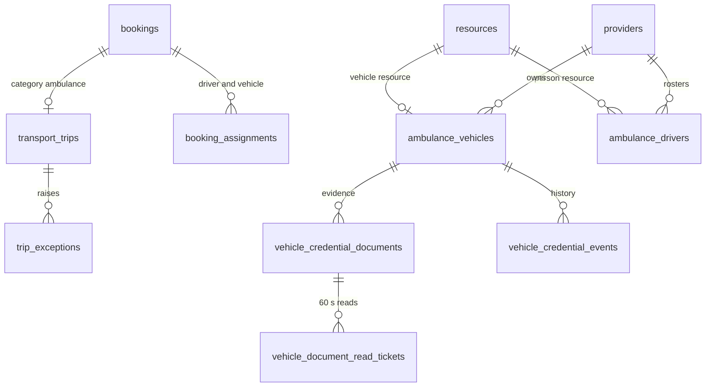
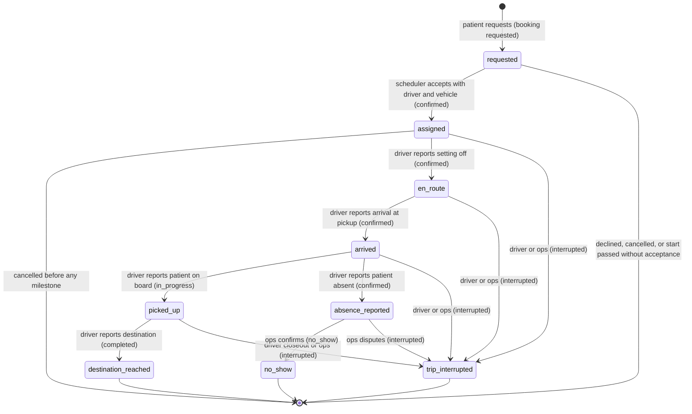

# P5 design: scheduled ambulance transfer flow

_Phase 5 (canonical migration order 5, "scheduled fleet/drivers/trips") · ticket S01-A · Design v0.1 · 19 November 2026 · Kiro · branch `task/P5-ambulance-design` from `integ/all` at `a7c14a1` · Owner review PENDING_

This is a design document. It adds no migration, code, flag, route or test, and nothing in it has been run. It turns the ambulance section of the S01 design (`docs/S01_DESIGN.md` v0.3 §5 on `task/S01-design`, commit `e2abee9`) into an implementable plan against the stack that is now committed on `integ/all`: I01, I02, C01, B01, the I02 hardening `20261117000600` to `000670`, and the B01/Q06 fixes `20261117001000` to `001200`. Where this document departs from S01 v0.3 it says so and why.

Emergency dispatch, live GPS, ETAs, online payment, clinical data and real patient data stay out of scope and disabled.

## 0. Decisions in one place

- Ambulance gets its own create, accept, slot and progress commands. The generic B01 `create_booking_request`, `accept_booking` and `list_slots` keep refusing ambulance, permanently. A trip needs a destination, a requirement code, a driver and a vehicle, and the generic signatures carry none of them.
- The trip shares the B01 engine for price snapshot, state, events, audit, outbox, assignments and the reservation exclusion. It does not copy that logic. The B01 owner extracts private cores that the ambulance commands call (§3.2, E-2).
- Pickup and destination are both saved patient addresses. Both PINs must be exact approved coverage PINs of the operator.
- Driver evidence is a driving licence. Vehicle evidence is a separate vehicle case with four document kinds. Eligibility is recomputed from the evidence rows every time, never read from a cached flag.
- No ETA, no location input, no emergency path. A `tel:112` notice on every ambulance screen.
- Every guarantee is enforced in the database. The Next.js route is not a security boundary, because PostgREST lets any signed-in JWT call a granted RPC directly.

## 1. What the built stack does today (read from SQL at `a7c14a1`)

| Fact | Where | Effect on ambulance |
|---|---|---|
| `accept_booking` raises `category_deferred_to_s01` (55000) for every non-doctor booking. | `20261117001100` (H3) | No ambulance booking can be accepted today. Suite `013_b01_categories` asserts this. |
| `create_booking_request` and `list_slots` serve ambulance with no gate, no lead time and no destination. | `202611170005`, `001100` | A patient can create an ambulance request 15 minutes ahead that sits in `requested` holding an address and phone. Must be closed (E-1). |
| `accept_booking` requires exactly two resources for ambulance, one person and one vehicle, and writes purposes `driver` and `vehicle`. | `001100` L145-161 | The two-resource rule and purpose names are reused as they are. |
| `is_assigned(booking,'driver')` allows `[start_at - 60 min, end_at + 12 h)`, `confirmed`/`in_progress`, active assignment of the caller's own person resource, `provider_is_publishable` and `resource_eligible`. | `001100` L16-26 | Outer bound for every driver read and command. It also fails for a suspended provider, so it cannot be the only path for closing a trip with a patient on board (E-5). |
| `resource_eligible` requires `person_is_verified` only when `p.category = 'doctor'`. A vehicle needs only ownership. | `001100` L5-14 | Any `provider:read` member can be assigned as a driver, and any owned vehicle can be assigned, with no licence or vehicle papers. |
| `staff_evidence_ready` requires a document of `required_kind(p.category)`, and `required_kind('ambulance') = 'vehicle_permit'`. | `001000`, `202611170002` L99-103 | A Q06 staff case for a driver can only be submitted with a vehicle permit, which is the wrong evidence for a person. Needs E-11. |
| `person_is_verified` returns true for the individual owner without any staff case. | `001000` | An individual operator who drives their own vehicle is never asked for a driving licence. §5.5 closes this for ambulance. |
| `resources.vehicle_key` is `^[A-Z0-9]{6,20}$` and globally unique. One person row per profile globally. | `202611170005` L72-81 | The registration number is the `vehicle_key`; it is not stored twice. A doctor who is also a driver shares one person resource, so the exclusion catches overlap. |
| `in_schedule` requires the occupied period to fit inside one local-day rule, and `local_end < '24:00'`. | `202611170005` L222-230 | No trip can cross midnight IST. Recorded as a limitation and owner question (AMB-Q12). |
| `services.duration_minutes` allows 1 to 10080. | `202611170004` L25 | The ambulance commands cap duration (AMB-Q02). |
| `ambulance_profiles.fleet_types <@ {basic, patient_transfer}`, `scheduled_only` CHECK true. | `20261117000640` | Vehicle types reuse these two labels. No BLS/ALS claim. |
| `guard_booking` rejects every `who = 'system'` transition. | `001100` L52 | No request expiry exists. Stale requests stay `requested` (AMB-Q13). |
| Patient cancel allowed until `start_at`; scheduler cancel at any time in `draft`/`requested`/`accepted`/`confirmed`; only the doctor assignee may cancel as an assignee. | `001100` L173-198 | A scheduler could cancel a trip while the driver is at the door. Needs E-6. |
| `booking_events.reason` is a closed CHECK of 12 codes; `en_route` and `arrived` are in it. | `202611170005` L69 | Every other trip code is rejected. Needs E-3. |
| `booking_transitions.actor_kind` is `patient/provider/assigned/system`; `confirmed -> interrupted` does not exist; `confirmed -> no_show` is a provider edge. | `202611170005` L52-64 | Needs E-4. |
| B01 revokes table privileges from `public, anon, authenticated` only. | `202611170005` L554-559 | `service_role` keeps Supabase default privileges on B01 tables. Ambulance tables revoke it too (§9.1); B01 is flagged (E-9). |
| `i02_objects_guard` is a restrictive policy on `storage.objects` for every bucket. `001200` widens its WITH CHECK for Q06 uploads; `20261117001400` on `fix/storage-upload-readback` (`674fec0`, not merged) widens USING for upload read-back. | `202611170002` L287, `001200`, `001400` | Vehicle documents need the same guard edited again (§3.3, migration `001810`). |
| `get_booking` returns raw `provider_id` and, inside the window, address and phone to any scheduler. | `001100` L225-245 | Ambulance screens use `get_trip`, which returns `providers.public_reference` and no contact to schedulers. E-7 closes `get_booking`. |
| `idempotency_requests` is unique on `(actor_profile_id, action, request_key)` with a uuid `result_id`; `booking_events.request_key` exists. | `202611170001` L112-117, `202611170005` L66-71 | Milestone replay returns the version from the event row that carries the key. |
| `notification_outbox` payload is `{booking_id, event, version}`. | `202611170005` L215 | No plate, name or address ever reaches the outbox. |

## 2. Scope

**In:** planned, non-emergency transfers (home to hospital, hospital to home, inter-facility, appointment visits) by a verified operator, with one driver and one vehicle per trip, fixed price per service, manual acceptance, trip milestones reported by the driver, operations handling of absence and incidents, and fleet evidence review.

**Out, and stays disabled:** emergency dispatch, "request now", nearest-vehicle search, live location, route or distance capture, ETAs, attendant or paramedic crew, clinical equipment claims, distance-based pricing, round trips as one booking, reassignment of driver or vehicle, reschedule (B01 raises `reschedule_policy_required`), online payment, driver cash collection (P01 owns collector rules), support tickets.

## 3. Migrations

### 3.1 Number block

The task brief gives the doctor, lab, care and ambulance P5 designs the same starting point, `20261117001600`. To keep files from colliding, this design assumes one block per category in the order the blueprint lists them: doctor `0016xx`, lab `0017xx`, ambulance `0018xx`, care `0019xx`. The coordinator must confirm this before anyone writes SQL (AMB-Q15). No migration file currently exists in any branch between `20261117001400` and `20261117002000`.

### 3.2 Shared prerequisites (not in the ambulance block)

These change B01, Q06 or storage objects that every category touches. They belong to the single B01 migration author and must merge before the ambulance block runs. Each one maps to a change request in S01 v0.3 §10 where one exists. The ambulance migrations start with a guard that raises if any prerequisite object is missing, so they fail cleanly on an older base.

| ID | Change | S01 ref | Why ambulance needs it |
|---|---|---|---|
| E-1 | `feature_gates` (`key` unique, `state` in `off`, `on`, `suspended`, default `off`, versioned, written only by an AAL2 admin command that audits) and `booking_private.gate(category)`. Generic `create_booking_request`, `accept_booking`, `list_slots` reject ambulance always with 55000 `use_category_command` (`list_slots` returns no rows). The migration fails if any ambulance `requested` booking exists. | B-5 | Closes the ungated create path. Keeps 55000, so suite `013` stays valid. |
| E-2 | Extract `booking_private.create_core`, `accept_core` and `slots_core` from the public bodies, with explicit lead time, horizon and before/after buffer arguments. Doctor behaviour unchanged. | new | Lets ambulance commands reuse snapshot, idempotency, coverage, lock order, reservation and exclusion logic instead of copying it. |
| E-3 | Replace the `booking_events.reason` CHECK with an FK to `booking_private.event_reasons(code)`, seeded with the current 12 codes. Add `booking_private.cancel_blocking_reasons(category, code)`. | B-7 | Category migrations insert rows instead of rewriting one shared CHECK, which is the P01 H1 failure mode when four designs edit it in parallel. |
| E-4 | Add `ops` to `actor_kind`; add `booking:incident` to `admin_capabilities` (CHECK rebuilt from the current six values plus the new one); transitions `confirmed -> interrupted` (`assigned`, `ops`), `in_progress -> interrupted` (`ops`), `confirmed -> no_show` (`ops`); remove `confirmed -> no_show` (`provider`); `guard_booking` maps `who = 'ops'` from `has_capability('booking:incident', org)`. | B-4, B-9 | Pre-pickup failures and support-validated absence. |
| E-5 | `booking_private.closeout_assignee(booking, purpose)`: active assignment of the caller's person resource, `assigned_profile_id = auth.uid()`, account active, membership active or individual owner. No time window, no publishability, no credential check. `guard_booking` accepts it for `in_progress -> completed` and `in_progress -> interrupted`. | B-2 | A driver with a patient on board can always close the trip, including after `end_at + 12 h` or after the operator is suspended. |
| E-6 | `cancel_booking` rejects with 55000 `invalid_transition` for every caller when an event exists whose `(category, reason)` is in `cancel_blocking_reasons`. | B-12 | No cancellation after the driver sets off. |
| E-7 | `get_booking`/`list_bookings` return address, contact and `patient_id` only to the patient. | B-3 | Removes the scheduler contact leak for all categories. |
| E-8 | `booking_private.end_assignments(booking)` ends assignments and leaves reservations active. `upsert_booking_resource`/`set_booking_availability` test `resource_in_use` only for `upper(occupied_period) > clock_timestamp()`. | B-8 | Early completion never frees the buffered time; past reservations do not block resource edits forever. |
| E-9 | Revoke all on B01 tables from `service_role` (flag only; ambulance does not depend on it). | new | Same defect as P01 H2. |
| E-10 | Not needed: ambulance enforces one overlapping open request per patient inside `request_transport` (§7.2). | B-10 | |
| E-11 | Q06 owner: `providers_private.required_staff_kind(category)` with `ambulance -> 'licence'`, used by `staff_evidence_ready`. `required_kind` stays `vehicle_permit` for organisation evidence. | new | A driver case must hold a driving licence, not a vehicle permit. |

### 3.3 Ambulance block

All forward-only, one transaction each, RLS and grants in the same file as the objects they protect.

| File | Contents | Depends on |
|---|---|---|
| `20261117001800_amb_fleet.sql` | Schema `ambulance_private`; tables `ambulance_vehicles`, `vehicle_credential_documents`, `vehicle_credential_events`, `ambulance_drivers`, `ambulance_private.vehicle_document_read_tickets`; predicates `driver_eligible`, `vehicle_eligible`; fleet and vehicle-review commands (§7.1); RLS, grants, `service_role` revokes. | E-4 (capability CHECK unchanged here), E-11 |
| `20261117001810_amb_fleet_storage.sql` | Rebuild `i02_objects_guard` USING and WITH CHECK from the expression current at authoring time (`001200`, plus `001400` if merged) with added vehicle clauses: upload by an evidence editor for a pending vehicle document, upload read-back while `storage.operation() = 'storage.object.upload'`, and download only with a live vehicle read ticket. Separate file because it edits a shared policy; the storage owner reviews it. | 001800, 001400 decision |
| `20261117001820_amb_trips.sql` | `transport_trips`, `trip_exceptions`, `ambulance_private.policy()`; reason rows and cancel-blocking rows (`on conflict do nothing`, since lab and care may add the same shared codes); trip, read and ops commands (§7.2 to §7.4); RLS, grants, `service_role` revokes. | E-1 to E-8, 001800 |
| `20261117001830` | Reserved for review fixes. | |

Rollback is a forward correction plus setting the `ambulance` gate to `off` or `suspended`. No down script drops evidence, events or trips.

## 4. User journeys

**Operator manager (individual owner, or org owner/manager with `provider:manage`).**
1. Gets the ambulance provider approved through I02 (org evidence `vehicle_permit`), coverage PINs approved through C01, and one published service per transfer kind with a price version.
2. Creates a vehicle resource with `upsert_booking_resource(kind='vehicle', vehicle_key=<registration>)`, then `register_ambulance_vehicle` with vehicle type and supported requirement codes.
3. Uploads the four vehicle documents (`evidence:manage` or owner) and submits the vehicle case.
4. Adds drivers: each driver is an accepted org member with `provider:read` and a Q06 case holding a verified licence (after E-11). An individual operator who drives uploads a `licence` provider document at I02 review time. `set_ambulance_driver` puts the person on the roster.
5. Sets availability rules for each driver and vehicle (B01 `set_booking_availability`).

**Verifier (`provider:document_read` and `provider:verify`, AAL2, not linked to the operator).** Opens each pending vehicle document through a 60-second read ticket, then approves, rejects (with reason) or later suspends (`provider:suspend`) the vehicle case.

**Patient (self, completed onboarding).**
1. Saves the pickup and destination as addresses. The pickup contact is the person to call at pickup.
2. Searches ambulance operators by pickup PIN; sees price, fleet type labels and "Not for emergencies. In an emergency call 112."
3. Picks a service, requirement code (`seated`, `wheelchair`, `stretcher`) and date; sees advisory slots at least 2 hours ahead.
4. Requests the trip. Sees "Requested". Can cancel until the driver sets off.
5. After acceptance sees "Trip scheduled", the driver's display name and vehicle type; after "Driver reports setting off" also the plate. Never a location or arrival estimate.

**Scheduler (`schedule:manage` or individual owner).** Sees the queue with window, pickup PIN, destination PIN and requirement code only. Accepts by choosing one eligible driver and one eligible vehicle that supports the requirement, or declines with a reason, or cancels before the first milestone.

**Driver (assigned person).** Sees own trips. From 60 minutes before start reads the contact and both addresses through an audited call. Reports, in order: set off, arrived at pickup, patient on board (or patient absent), reached destination; or an interruption with a reason code.

**Ops (`booking:incident`, AAL2, not linked to the operator).** Works a queue of absence reports, interruptions after pickup, eligibility lapses, overruns and trips never started. Confirms or rejects absence, records an ops interruption, and closes blocking exceptions.

## 5. Data model

### 5.1 `public.transport_trips`

| Column | Type and constraint |
|---|---|
| `booking_id` | `uuid primary key references public.bookings(id)` |
| `destination_snapshot` | `jsonb not null`, object with exactly `line1`, `locality`, `pin_code` copied from the patient address. No contact fields. |
| `destination_pin` | `text not null check (~ '^[1-9][0-9]{5}$')`, `check (destination_snapshot->>'pin_code' = destination_pin)` |
| `requirement_code` | `text not null check (in ('seated','wheelchair','stretcher'))` |
| `substate` | `text not null default 'requested' check (in ('requested','assigned','en_route','arrived','absence_reported','picked_up','destination_reached','trip_interrupted','no_show'))` |
| `version` | `integer not null default 1 check (> 0)` |
| `created_at`, `updated_at` | `timestamptz not null default now()` |

- Pickup address and pickup contact are the booking's existing `address_snapshot` and `contact_snapshot`. They are not copied.
- **No driver or vehicle columns.** The canonical draft puts nullable vehicle/driver FKs on the trip. This design reads them from `booking_assignments` (purposes `driver`, `vehicle`), which is the ledger the exclusion and `is_assigned` already use. Two copies could disagree, which is the P01 H3 failure mode. Deviation to record in `docs/DECISIONS.md`.
- Guard trigger `amb_trip_guard` (definer): INSERT only for a booking with `category = 'ambulance'` and `state = 'requested'`; UPDATE may change only `substate`, `version` (+1) and `updated_at`; the new `(substate, bookings.state)` pair must be in the mapping of §6.2, read from the booking row at trigger time, not trusted from the caller; DELETE and TRUNCATE raise.

### 5.2 `public.trip_exceptions`

| Column | Type and constraint |
|---|---|
| `id` | `uuid primary key` |
| `booking_id` | `uuid not null references public.transport_trips(booking_id)` |
| `kind` | `text not null check (in ('absence_reported','interrupted_after_pickup','eligibility_lapsed'))` |
| `opened_by_profile_id`, `opened_at` | `not null` |
| `closed_by_profile_id`, `closed_at`, `resolution` | all null or all set; `resolution in ('no_show_confirmed','absence_disputed','resolved')`; `closed_by_profile_id <> opened_by_profile_id` |
| `version` | `integer not null default 1` |

- Partial unique index `(booking_id, kind) where closed_at is null`.
- Only `interrupted_after_pickup` blocks the trip's driver and vehicle for new acceptances.
- Overruns and trips never started are not stored. They are computed when read (§7.4), so no cron job is needed to detect them, and the accept-time block (§5.5 `resource_busy`) is computed the same way.
- If the B01 owner later adds one shared exceptions table for all categories, ambulance moves to it in a forward migration.

### 5.3 `public.ambulance_vehicles`

| Column | Type and constraint |
|---|---|
| `resource_id` | `uuid primary key references public.resources(id)` |
| `provider_id`, `category` | `category text not null default 'ambulance' check (= 'ambulance')`; `foreign key (provider_id, category) references public.providers(id, category)` |
| `vehicle_type` | `text not null check (in ('basic','patient_transfer'))`, must be in the provider's `ambulance_profiles.fleet_types` at registration |
| `supports` | `text[] not null`, non-empty, no nulls, `<@ array['seated','wheelchair','stretcher']` |
| `case_state` | `text not null default 'draft' check (in ('draft','submitted','approved','rejected','suspended'))` |
| `submitted_at`, `verified_until`, `decided_by_profile_id` | `approved` requires `verified_until` and `decided_by_profile_id`; `submitted` requires `submitted_at` |
| `version`, `created_at`, `updated_at` | as usual |

- Guard trigger: the resource is `kind = 'vehicle'`, owned by the provider's organisation or individual owner (same rule as `resource_eligible`); `resource_id` and `provider_id` are immutable; `vehicle_type` and `supports` change only in `draft` or `rejected`.
- The registration number is `resources.vehicle_key`. No chassis/VIN in core.

### 5.4 Vehicle evidence

- `public.vehicle_credential_documents`: `id`, `vehicle_resource_id` (FK `ambulance_vehicles`), `uploaded_by_profile_id`, `kind in ('registration_certificate','fitness_certificate','permit','insurance')`, `bucket_id = 'provider-verification'`, `object_name` unique and equal to `'vehicle/'||vehicle_resource_id||'/'||id||<ext>`, `content_type in (pdf, jpeg, png)`, `status in ('pending','verified','rejected','superseded')`, `expires_at` finite, `created_at`. Same shape as Q06 `staff_credential_documents`.
- `public.vehicle_credential_events`: immutable ledger (`booking_private.immutable` triggers for UPDATE, DELETE, TRUNCATE), `unique (vehicle_resource_id, aggregate_version)`.
- `ambulance_private.vehicle_document_read_tickets`: copy of the `000660` ticket model, `expires_at = created_at + 60 s`, purposes `owner_view` and `admin_review`, immutable. No signed URLs (the I02 signing ban stays).
- Required set: all four kinds (AMB-Q05). `ambulance_private.required_vehicle_kinds()` is an immutable function so the rule lives in one place.

### 5.5 `public.ambulance_drivers` and eligibility

`ambulance_drivers`: `provider_id`, `resource_id` (person resource), `category = 'ambulance'` with the composite FK, `status in ('active','disabled')`, `version`, timestamps; primary key `(provider_id, resource_id)`. Guard trigger: the person is the provider's individual owner or a `providers_private.staff_member` of it.

Predicates in `ambulance_private`, all `security definer`, `search_path = ''`, never granted to clients except where RLS needs them:

- `driver_eligible(provider, resource, until)`: resource active and `kind = 'person'`; profile active; roster row active; and either (a) the person is the individual owner and a `provider_documents` row of kind `licence` is `verified`, expires after `until` and has its storage object, or (b) the person is a `staff_member`, has an `approved` Q06 case with `verified_until > until`, and `staff_evidence_ready(case, true)` holds with the licence kind from E-11. It does not use `person_is_verified`, because that short-circuits for individual owners.
- `vehicle_eligible(provider, resource, requirement, until)`: resource active, `resource_eligible(provider, resource)`; vehicle row for this provider in `approved`; and every required kind has a `verified` document with `expires_at > until` and a storage object. `verified_until` is display data only; the check recomputes from documents (P01 H3 lesson). `requirement = any(supports)`.
- `resource_busy(resource)`: an open `interrupted_after_pickup` exception exists on a trip that used this resource, or a trip using it is in `en_route`, `arrived` or `picked_up` while `upper(occupied_period) < clock_timestamp()` (overrun).

`until` is the booking's `end_at`, so papers that expire mid-trip block acceptance up front.

### 5.6 Policy values

`ambulance_private.policy()` is an immutable function returning the synthetic-staging defaults below. Changing a value needs a reviewed migration, which gives the change a git history without a settings table (P01 L8 lesson).

| Value | Default | Owner question |
|---|---|---|
| Create lead time | 120 min | AMB-Q01 |
| Accept lead time | 60 min | AMB-Q01 |
| Horizon | 30 days | AMB-Q01 |
| Before-buffer / after-buffer | 30 / 30 min (before-buffer at most 60, H1's window) | AMB-Q03 |
| Maximum service duration | 360 min | AMB-Q02 |

The booking still snapshots `booking_policy_versions` (terms, cancel window). Ambulance buffers come from this function at accept time and are fixed in `resource_reservations.occupied_period`.

## 6. State machine

### 6.1 Trip substates

### 6.2 Mapping, authority and timing

| Step | From substate | To substate | Booking state | Actor | Time rule | Event reason |
|---|---|---|---|---|---|---|
| request | none | `requested` | `requested` | patient | start ≥ now + 120 min, ≤ now + 30 days | `requested` |
| accept | `requested` | `assigned` | `confirmed` | scheduler | start ≥ now + 60 min | `accepted`, `confirmed` |
| decline / cancel | `requested`/`assigned` | unchanged | `declined`/`cancelled` | B01 rules plus E-6 | B01 | B01 codes |
| en-route | `assigned` | `en_route` | `confirmed` | driver (`is_assigned`) | now ≥ `lower(occupied_period)` | `en_route` |
| eligibility block | `assigned` | `assigned` | `confirmed` | driver at en-route | same | `eligibility_blocked` |
| arrived | `en_route` | `arrived` | `confirmed` | driver (`is_assigned`) | H1 window | `arrived` |
| absence | `arrived` | `absence_reported` | `confirmed` | driver (`is_assigned`) | H1 window | `absence_reported` |
| picked-up | `arrived` | `picked_up` | `in_progress` | driver (`is_assigned`) | H1 window | `picked_up` |
| destination | `picked_up` | `destination_reached` | `completed` | driver (`closeout_assignee`) | any time | `destination_reached` |
| interrupt | `assigned`/`en_route`/`arrived` | `trip_interrupted` | `interrupted` | driver (`is_assigned`) or ops | H1 window for the driver | reason code |
| interrupt on board | `picked_up` | `trip_interrupted` | `interrupted` | driver (`closeout_assignee`) or ops | any time | reason code |
| resolve absence | `absence_reported` | `no_show` / `trip_interrupted` | `no_show` / `interrupted` | ops | any time | `no_show_confirmed` / `absence_disputed` |

- `en_route`, `arrived`, `absence_reported` and `eligibility_blocked` keep the booking `confirmed`; their events have `from_state = to_state`, as `advance_visit` already does.
- Driver interruption codes: `vehicle_breakdown`, `unsafe_conditions`, `requirement_mismatch`, `ended_for_emergency`, `driver_unable`. Ops codes: `provider_did_not_attend`, `unsafe_conditions`, `ops_closeout`.
- Cancel-blocking codes for ambulance (E-3/E-6): `en_route`, `arrived`, `absence_reported`, `picked_up`. `eligibility_blocked` does not block, so the operator can cancel a trip whose papers lapsed.
- Completion and every interruption call `end_assignments` (E-8). Reservations stay active to `upper(occupied_period)`. Only cancellation releases them, which B01 already does.
- After `picked_up` the app arranges nothing. Any interruption on board raises `interrupted_after_pickup`, shows the 112 notice to the patient, and blocks the driver and vehicle until ops closes it (S01-Q25).

### 6.3 Gate states (`feature_gates.key = 'ambulance'` and `FEATURE_SCHEDULED_TRANSPORT`)

| Gate | Slots, request, accept | en-route, arrived, picked-up | absence, destination, interrupt, ops commands, decline, cancel |
|---|---|---|---|
| `off` | 55000 `feature_unavailable` (slots: no rows) | allowed for already accepted trips (S01-Q01) | allowed |
| `on` | allowed if the env flag is also `true` | allowed | allowed |
| `suspended` | `feature_unavailable` | 55000 `feature_suspended` | allowed |

The env flag is checked by the route before the database call; the database gate is checked inside every command. Both must allow. `FEATURE_EMERGENCY_DISPATCH` and `FEATURE_GPS` are read by no ambulance code path.

### 6.4 Patient-facing labels (EN proposal; Hindi and Telugu go through the same copy test)

| Substate / state | Label |
|---|---|
| `requested` | "Requested. Waiting for the operator to accept." |
| `requested`, start passed | "Not accepted in time" (display only; state stays `requested`) |
| `assigned` | "Trip scheduled" |
| `en_route` | "Driver reports setting off" |
| `arrived` | "Driver reports arrival at the pickup address" |
| `absence_reported` | "Driver reports you were not at the pickup. Support will contact you." |
| `picked_up` | "Trip in progress" |
| `destination_reached` | "Driver reports reaching the destination" |
| `trip_interrupted` | "Trip could not be completed" plus the 112 notice |
| `no_show` | "Marked as not available at pickup" |

Labels say "reports" because milestones are the driver's assertions (S01-26).

## 7. RPC contracts

All functions are `security definer`, `set search_path = ''`, start with `identity_private.require_actor()`, derive category from the stored booking or service (never from input), and return stable SQLSTATEs: 42501 `forbidden`, P0002 `not_found`, 40001 `stale_version` / `idempotency_conflict` / `offer_changed` / `schedule_changed`, 23P01 on exclusion conflict, 55000 for state, gate and timing errors, 22023 `invalid_input`, 53300 limits.

**Lock order** for every trip command, matching B01 `accept_booking`, `cancel_booking` and `advance_visit`: booking row, organisation then provider (`booking_private.lock_provider`), resources in UUID order, `transport_trips` row, then `trip_exceptions` rows. Fleet commands: organisation, provider, resource, vehicle row, documents. Authorization is checked before and again after the locks.

### 7.1 Fleet and evidence

| Function | Caller | Checks | Writes / returns |
|---|---|---|---|
| `register_ambulance_vehicle(p_provider_id, p_resource_id, p_vehicle_type, p_supports text[], p_expected_version)` | individual owner, or `org_admin(org,'provider:manage')` | provider category `ambulance`; vehicle resource owned by the provider; type in `ambulance_profiles.fleet_types`; `supports` valid; version 0 inserts, otherwise update in `draft`/`rejected` with matching version | row; audit `ambulance.vehicle_saved`; returns version |
| `add_vehicle_document(p_resource_id, p_kind, p_content_type, p_expires_at, p_expected_version)` | individual owner, or `org_admin(org,'evidence:manage')` | case `draft`/`rejected`; expiry in the future and within 5 years; at most 50 documents per vehicle (53300) | supersedes pending of same kind; returns `{id, bucket_id, object_name, version}` |
| `submit_vehicle_case(p_resource_id, p_expected_version)` | same as above | one pending, unexpired document with a storage object for every required kind | `submitted`, `submitted_at`; event; audit |
| `authorize_vehicle_document_read(p_document_id, p_purpose)` | `owner_view`: owner or `evidence:manage`; `admin_review`: `provider:document_read` (AAL2, scoped), case `submitted`, not the individual owner, no `organization_members` row of any status in the org, not the uploader | object exists | ticket; audit `ambulance.vehicle_document_read_<purpose>`; returns `(bucket, object_path, ticket_expires_at)` |
| `review_vehicle_case(p_resource_id, p_decision, p_reason, p_expected_version)` | `approved`/`rejected`: `provider:verify`; `suspended`: `provider:suspend`; same exclusions as above; capability row locked `for share` as in `review_provider` | `submitted -> approved/rejected`, `approved -> suspended`; reason 1-500 chars; approval requires an `admin_review` ticket created after `submitted_at` for every pending document (AMB-Q16) and evidence still ready | documents `verified`/`rejected`; `verified_until = min(expires_at)`; event; audit |
| `set_ambulance_driver(p_provider_id, p_resource_id, p_status, p_expected_version)` | individual owner, or `org_admin(org,'provider:manage')` | person is owner or `staff_member`; disabling with a future active `driver` reservation raises 40001 `resource_in_use` | roster row; audit |
| `get_fleet(p_provider_id)` | owner, `provider:manage`, or scheduler | | vehicles (`resource_id`, `vehicle_key`, type, supports, case state, `verified_until`, eligible now) and drivers (`resource_id`, display name, roster status, eligible now, licence valid until). No document content. |

A suspended vehicle or driver keeps any trip already `picked_up` closable (closeout ignores credentials) but blocks `en-route` on every other trip.

### 7.2 Request and accept

**`list_transport_slots(p_provider_id, p_service_id, p_date, p_requirement)`** returns `(start_at, end_at, advisory)`. Gate `on` or no rows. Calls `slots_core` with ambulance lead time, horizon and buffers, counting only drivers that pass `driver_eligible` and vehicles that pass `vehicle_eligible` for the requirement, excluding `resource_busy`. A slot needs one free driver and one free vehicle. Advisory only.

**`request_transport(p_patient_id, p_service_id, p_pickup_address_id, p_destination_address_id, p_requirement_code, p_start_at, p_request_key)`** returns booking uuid.
1. `booking_private.patient(p_patient_id,'booking:create')`; lock the patient row (M1 order); recheck.
2. Inputs non-null; requirement in the enum; both addresses belong to the patient; pickup id ≠ destination id.
3. Idempotency replay under action `transport.create`, hash over all seven inputs except the key. Replay returns the original id before any cap is checked.
4. Gate `on` (55000 `feature_unavailable`).
5. Service is `ambulance`, `published`, duration ≤ policy maximum.
6. Self-dealing: the patient's self profile is not the provider's individual owner and has no active membership in its organisation (S01-Q24).
7. Destination PIN is an approved, currently valid `provider_service_areas` PIN of the provider (AMB-Q04). Pickup PIN is checked by `create_core`.
8. At least one roster driver and one vehicle supporting the requirement are eligible for the requested end time. Otherwise 55000 `requirement_unavailable`.
9. No other `requested` or `confirmed` ambulance booking of this patient whose interval overlaps (MR-08 for ambulance). 55000 `overlapping_request`.
10. `create_core` with lead 120 min and horizon 30 days. It snapshots price, terms, pickup address and contact, writes the booking, the `requested` event, audit, outbox and the idempotency row, and keeps M1's 10-request cap.
11. Insert `transport_trips` with the destination snapshot and requirement.

**`accept_transport(p_booking_id, p_expected_version, p_driver_resource_id, p_vehicle_resource_id)`** returns version.
1. `booking_private.scheduler(provider)`, checked before and after locks; booking category `ambulance` (else P0002).
2. Gate `on`; state `requested`; expected version; start ≥ now + 60 min.
3. Destination PIN still covered (else 40001 `offer_changed`).
4. `driver_eligible(provider, driver, end_at)`, `vehicle_eligible(provider, vehicle, requirement, end_at)`, neither `resource_busy` (40001 `resource_busy`), driver's profile is not the patient's self profile. All after the resource locks.
5. `accept_core(booking, [driver, vehicle], 30, 30)`: rechecks publishability, coverage, price version, schedule, inserts the two assignments and reservations (the exclusion makes one of ten concurrent accepts win), writes `accepted` and `confirmed`.
6. Trip `requested -> assigned`.

### 7.3 Trip progress

**`advance_trip(p_booking_id, p_step, p_expected_version, p_request_key, p_reason default null)`** returns `jsonb {version, substate, blocked}`. Steps: `en_route`, `arrived`, `absence`, `picked_up`, `destination_reached`, `interrupt`.
1. Step and key non-null; `p_reason` only for `interrupt` and only from the driver code list.
2. Booking category `ambulance`, else P0002. Caller passes `is_assigned(booking,'driver')`, or, for `destination_reached` and for `interrupt` while `picked_up`, `closeout_assignee(booking,'driver')`. Else 42501. A trip with nobody on board is never interrupted outside the H1 window by the driver; ops can do it.
3. Replay under action `trip.advance`, hash over booking id, step and reason. Same key, different hash: 40001 `idempotency_conflict`. Same hash: return the version from the `booking_events` row carrying that `request_key` and the substate its reason maps to.
4. Locks in the order above; recheck step 2; expected version.
5. Gate rule from §6.3; predecessor substate from §6.2; for `en_route`, now ≥ `lower(occupied_period)` of the driver reservation (55000 `too_early`).
6. `en_route` only: recheck `driver_eligible` and `vehicle_eligible` against `end_at`. On failure the command does not raise, because a raise would roll back the record of the failure. It writes the `eligibility_blocked` event, opens an `eligibility_lapsed` exception, stores the idempotency row and returns `blocked = 'eligibility_blocked'`. The route answers 409 with that code.
7. One `booking_private.transition()` call per step (state per §6.2), then the trip substate update, then exceptions (`absence_reported`, `interrupted_after_pickup`), then `end_assignments` for `destination_reached` and `interrupt`, then the idempotency row.

### 7.4 Reads and ops

| Function | Caller | Returns |
|---|---|---|
| `get_trip(p_booking_id)` | patient (`booking:read`), scheduler, driver (`is_assigned` or `closeout_assignee`), else P0002 | Patient: booking `public_ref`, `providers.public_reference`, service title, window, state, substate, requirement, own pickup and destination snapshots, driver display name (fallback "Driver"), vehicle type, plate only while `en_route`/`arrived`/`picked_up`, timeline of `{reason, occurred_at}`. Scheduler and driver: ref, window, state, substate, pickup PIN, destination PIN, requirement, assigned driver display name, vehicle key, timeline. No street, phone, patient name or `patient_id` for non-patients. No actor ids for anyone. |
| `get_trip_contact(p_booking_id)` | driver with `is_assigned` and substate in `assigned`/`en_route`/`arrived`/`picked_up`; or `booking:incident` holder while an exception on the trip is open | contact name and phone, pickup and destination line1/locality/PIN, requirement. Writes audit `trip.contact_viewed` (or `trip.contact_viewed_ops`) with ids only. Volatile; the server calls it with POST even behind a GET route, because PostgREST runs GET RPCs read-only. |
| `list_trip_queue(p_provider_id, p_limit, p_after)` | scheduler | scheduler projection rows, 1-50, keyset on booking id. No audit, because no contact is returned. |
| `list_driver_trips(p_limit, p_after)` | any signed-in person | own driver assignments, active or ended in the last 7 days; scheduler projection fields. |
| `list_trip_exceptions(p_limit, p_after)` | `booking:incident` (global, or scoped to the operator org) | open stored exceptions plus computed `overrun` (in `en_route`/`arrived`/`picked_up` past `upper(occupied_period)`) and `not_started` (`assigned` past `end_at`); booking ref, provider reference, kind, opened time, substate. |
| `ops_interrupt_trip(p_booking_id, p_reason, p_expected_version, p_request_key)` | `booking:incident` AAL2; not the individual owner; no `organization_members` row of any status in the operator org | from `assigned`/`en_route`/`arrived`/`picked_up`; reasons `provider_did_not_attend`, `unsafe_conditions`, `ops_closeout`; ends assignments. |
| `resolve_trip_absence(p_booking_id, p_decision, p_expected_version, p_request_key)` | same as above, and not the driver who reported | `absence_reported` to `no_show` or `trip_interrupted`; closes the exception with `no_show_confirmed` or `absence_disputed`; ends assignments. No fee. |
| `close_trip_exception(p_exception_id, p_expected_version)` | same as above | closes `interrupted_after_pickup` or `eligibility_lapsed` with `resolved`; this unblocks the resources. |

Ops routes check `has_capability('booking:incident', org)` directly. `identity_roles()` does not return `admin` for this capability unless E-4 adds it (P01 L13).

## 8. HTTP API

Routes follow the existing pattern in `src/app/api/bookings/[id]/accept/route.ts`: `endpoint`, `session`, `input` (16 KiB streamed cap), strict Zod, `Cache-Control: private, no-store`. Mutations take the `Idempotency-Key` header through `requestKey(request)`. A new `src/lib/ambulance/service.ts` wraps `db.rpc` like `bookingCommand`, and also maps the messages `feature_unavailable` (404), `feature_suspended`, `resource_busy`, `eligibility_blocked`, `too_early`, `requirement_unavailable`, `overlapping_request` (409) to stable error codes.

| Method and path | Body / query (strict Zod) | RPC |
|---|---|---|
| `GET /api/bookings/transport/slots` | `provider`, `service`, `date` (ISO date), `requirement` | `list_transport_slots` |
| `POST /api/bookings/transport` | `patientId`, `serviceId`, `pickupAddressId`, `destinationAddressId`, `requirement`, `startAt` | `request_transport` → 201 `{id}` |
| `GET /api/bookings/:id/trip` | | `get_trip` |
| `GET /api/bookings/:id/trip/contact` | | `get_trip_contact` |
| `POST /api/bookings/:id/trip/accept` | `expectedVersion`, `driverResourceId`, `vehicleResourceId` | `accept_transport` |
| `POST /api/bookings/:id/trip/{en-route,arrived,absence,picked-up,destination-reached}` | `expectedVersion` | `advance_trip` |
| `POST /api/bookings/:id/trip/interrupt` | `expectedVersion`, `reason` (driver enum) | `advance_trip` |
| `POST /api/bookings/:id/decline`, `/cancel` | existing B01 routes | `decline_booking`, `cancel_booking` |
| `GET /api/provider/ambulance/queue` | `providerId`, `limit`, `cursor` | `list_trip_queue` |
| `GET /api/driver/trips` | `limit`, `cursor` | `list_driver_trips` |
| `GET /api/provider/ambulance/fleet` | `providerId` | `get_fleet` |
| `POST /api/provider/ambulance/vehicles` | `providerId`, `resourceId`, `vehicleType`, `supports`, `expectedVersion` | `register_ambulance_vehicle` |
| `POST /api/provider/ambulance/vehicles/:resourceId/documents` | `kind`, `contentType`, `expiresAt`, `expectedVersion` | `add_vehicle_document` |
| `POST /api/provider/ambulance/vehicles/:resourceId/submit` | `expectedVersion` | `submit_vehicle_case` |
| `POST /api/provider/ambulance/drivers` | `providerId`, `resourceId`, `status`, `expectedVersion` | `set_ambulance_driver` |
| `POST /api/ambulance/vehicle-documents/:id/read-ticket` | `purpose` | `authorize_vehicle_document_read` |
| `POST /api/admin/ambulance/vehicles/:resourceId/review` | `decision`, `reason`, `expectedVersion` | `review_vehicle_case` |
| `GET /api/ops/ambulance/exceptions` | `limit`, `cursor` | `list_trip_exceptions` |
| `POST /api/ops/ambulance/trips/:id/interrupt` | `expectedVersion`, `reason` (ops enum) | `ops_interrupt_trip` |
| `POST /api/ops/ambulance/trips/:id/resolve-absence` | `expectedVersion`, `decision` | `resolve_trip_absence` |
| `POST /api/ops/ambulance/exceptions/:id/close` | `expectedVersion` | `close_trip_exception` |

- Every trip body rejects `lat`, `lng`, `location`, `coordinates`, `eta`, `distance`, `category`, `price`, `amount` and any unknown key with 422, whatever `FEATURE_GPS` says. Strict Zod is correct here because these are our own request bodies (P01 M5 concerned third-party webhook payloads).
- The env flag `scheduledTransport` (`FEATURE_SCHEDULED_TRANSPORT`) is added to `src/lib/feature-flags/index.ts` and `.env.example` by the implementer. Off means 404 `feature_unavailable` before any DB call, except decline, cancel, closing steps and ops routes, which must keep working for trips already accepted.
- Realtime: no ambulance table and not `bookings` in `supabase_realtime`. Status events go to private broadcast topics fed from `notification_outbox` (S01 §3 "Realtime"). Payload: event id, booking `public_ref`, state, substate, version, time.

## 9. RLS, grants and capabilities

### 9.1 Tables

| Table | RLS | Grants to `anon`, `authenticated`, `service_role` | Read path |
|---|---|---|---|
| `transport_trips` | on, no policy | none | `get_trip`, `list_*` |
| `trip_exceptions` | on, no policy | none | `list_trip_exceptions` |
| `ambulance_vehicles` | on, no policy | none | `get_fleet`, `get_trip` |
| `ambulance_drivers` | on, no policy | none | `get_fleet` |
| `vehicle_credential_documents` | on, no policy | none | `get_fleet` (metadata only), read tickets |
| `vehicle_credential_events` | on, no policy | none | none in core |
| `ambulance_private.vehicle_document_read_tickets` | on | none; schema `ambulance_private` has no usage for `anon` or `service_role` | storage guard |

Because no client role has any table privilege, column exposure is decided only by the definer projections (P01 M7). `service_role` is revoked explicitly on every table (P01 H2); no worker writes ambulance tables. The real guarantee covers application roles and `service_role`; the table owner and trigger-disabling superusers are outside it (P01 L12).

### 9.2 Functions

- Every function in `ambulance_private`: `revoke all from public, anon, authenticated, service_role`. No RLS policy calls them, so none needs a grant.
- Public RPCs in §7: `revoke all from public, anon, service_role; grant execute to authenticated`. The existing gate inside each command keeps them closed while the gate is `off`.
- `register_*`, `add_*`, `submit_*`, `review_*` and ops RPCs check AAL2 through `has_capability` where a capability is involved; provider-side commands use org scopes as I02 and C01 do.

### 9.3 Who can do what

| Actor | Predicate | Can | Cannot |
|---|---|---|---|
| Patient | `booking_private.patient(patient,'booking:create'/'booking:read')` | request, read own trip, cancel before first milestone | see driver phone, other trips, plate before `en_route` |
| Scheduler | `booking_private.scheduler(provider)` | queue, accept, decline, cancel before first milestone, fleet view | street address, phone, patient name; milestones; cancel after `en_route` |
| Fleet manager | individual owner or `org_admin(org,'provider:manage')` | register vehicles, roster drivers | approve own evidence |
| Evidence editor | individual owner or `org_admin(org,'evidence:manage')` | upload and submit vehicle papers, `owner_view` tickets | review |
| Driver | `is_assigned(booking,'driver')`; `closeout_assignee` for closing steps | own trip, audited contact, milestones | other trips, cancel, prices, patient health data |
| Document reader | `provider:document_read`, AAL2, unlinked to the org | `admin_review` tickets | decide |
| Verifier / suspender | `provider:verify` / `provider:suspend`, AAL2, unlinked | approve, reject / suspend vehicle cases | read files without a ticket |
| Ops | `booking:incident`, AAL2, unlinked (E-4) | exceptions, ops interruption, absence decision, audited contact while an exception is open | clinical data, prices, booking creation |

"Unlinked" means not the individual owner, no `organization_members` row of any status in the organisation, and not the uploader (P01 L1).

### 9.4 What each viewer sees

| Field | Patient | Scheduler | Driver | Ops |
|---|---|---|---|---|
| Pickup and destination street lines | own | no | `get_trip_contact` only | `get_trip_contact` while exception open |
| Pickup and destination PIN | yes | yes | yes | yes |
| Contact name and phone | own | no | `get_trip_contact` only | as above |
| Requirement code | yes | yes | yes | yes |
| Driver display name | after accept | yes | own | yes |
| Plate (`vehicle_key`) | `en_route` to `picked_up` | yes | own vehicle | yes |
| Licence numbers, document files | no | no | no | no (document reader only) |
| Provider id | `public_reference` only | own | `public_reference` | `public_reference` |

Logs, audit rows and outbox payloads carry ids and codes only.

## 10. Edge cases

| # | Case | Handling |
|---|---|---|
| 1 | Request starts 30 minutes from now | Rejected at create (lead time); no slot offered; patient sees the 112 notice. |
| 2 | Pickup or destination PIN outside coverage | Rejected at create; destination rechecked at accept (`offer_changed`). Coverage revoked after acceptance does not stop the trip (B01 behaviour). |
| 3 | Same address for pickup and destination | 22023. Two different addresses in one PIN are allowed. |
| 4 | Hospital to home trip | The patient saves the hospital as an address with the pickup contact. No facility directory in core. |
| 5 | Ten schedulers accept trips on one vehicle at once | Exactly one commits through the exclusion; others get 409 with no detail about the other booking. |
| 6 | A doctor who also drives for an ambulance org, overlapping work | One global person resource; second acceptance fails. |
| 7 | Driver licence or vehicle paper expires before `end_at` | Accept rejected. If it lapses after acceptance (suspension), en-route returns `eligibility_blocked`, opens an exception, and the operator can still cancel. |
| 8 | Provider suspended with a patient on board | Closeout predicate ignores publishability; `destination_reached` and `interrupt` still work. No contact is returned. |
| 9 | Driver account disabled or membership removed on board | Closeout fails; ops records `ops_closeout` after confirming with the operator by phone. |
| 10 | Trip runs past `upper(occupied_period)` | Shown to ops as `overrun`; driver and vehicle refused for new acceptances until closed; closeout still accepted. |
| 11 | Trip past `end_at + 12 h` while on board | H1 window closed; closeout predicate still accepts the closing steps. |
| 12 | Driver never sets off | Shown as `not_started` after `end_at`; ops interrupts with `provider_did_not_attend`. |
| 13 | Patient not at pickup | Driver reports absence; booking stays `confirmed`; ops decides `no_show` or `interrupted`. Never decided by the operator. |
| 14 | Medical emergency during the trip | Driver interrupts with `ended_for_emergency`; patient sees 112. The app does not dispatch or coordinate. |
| 15 | Vehicle breaks down before pickup | Driver interrupts with `vehicle_breakdown`; a new trip is a new booking, subject to lead time. |
| 16 | Cancel races en-route | Both lock the booking row; one wins; after `en_route` exists, cancel is rejected for every caller. |
| 17 | Same milestone sent twice | Same key: replay. New key: 409 `invalid_transition`. |
| 18 | Same key reused on another booking | 40001 `idempotency_conflict`. |
| 19 | Overnight trip (crosses midnight IST) | Cannot be accepted, because `in_schedule` checks one local day (AMB-Q12). |
| 20 | Request never accepted | Stays `requested`; shown as "Not accepted in time"; patient cannot cancel after `start_at` under H2 and it counts toward M1's 10-request cap (AMB-Q13, B01 owner). |
| 21 | Patient is a driver or member of the operator | Rejected at create; a driver whose profile is the patient is rejected at accept. |
| 22 | Vehicle disabled with a future accepted trip | `resource_in_use` (B01, with E-8's future-only test). Ops resolves the trip first. |
| 23 | Blackout added on a reserved vehicle | `resource_in_use` (B01). |
| 24 | Gate set to `suspended` mid-day | New starts blocked; trips on board can close; exceptions list shows affected trips. |
| 25 | `FEATURE_EMERGENCY_DISPATCH=true`, `FEATURE_GPS=true` | No change in behaviour, responses or writes. |
| 26 | Price version changes between request and accept | `offer_changed` from `accept_core`. |
| 27 | Two operators in one organisation | Not possible: one ambulance provider per organisation (`providers_org_category_idx`). |
| 28 | Driver on two operators' rosters | Allowed; the global person resource prevents overlap. |
| 29 | Ops holder is an operator member | Rejected by the unlinked rule. |
| 30 | Zero-price service | Allowed by C01; ambulance adds nothing; P01 owns how zero amounts display. |

## 11. Test plan

None of these exist yet. All ambulance suites need E-1 to E-8 and E-11 merged; until then they cannot run on the built stack (P01 L11). Fixtures are synthetic and rollback-only, following `supabase/tests/_b01_fixture.inc` and `_tap_helpers.inc` (`pg_temp.expect_state`, `pg_temp.assert_true`). Proposed suite numbers `030`-`034` need the same coordinator check as the migration block.

### 11.1 pgTAP

**`030_amb_fleet.test.sql`**
1. `register_ambulance_vehicle` rejects a person resource, a vehicle owned by another org, a non-ambulance provider, a type not in `fleet_types`, an empty or unknown `supports`.
2. Submit fails with a missing kind, an expired document, or a document with no storage object.
3. Review by the individual owner, any member (including `invited` and `disabled`), the uploader, a non-AAL2 session, or a reviewer without `provider:verify`: 42501.
4. Approval without an `admin_review` ticket for each pending document after `submitted_at`: rejected. With tickets: approved, `verified_until = min(expires_at)`.
5. `vehicle_eligible` false after one verified document expires, even though `case_state = 'approved'` and `verified_until` is in the future (owner-context update of `verified_until` cannot make it true).
6. Driver eligibility: staff with no Q06 case, with a case holding only `vehicle_permit`, with a suspended or expired case, not on the roster, roster `disabled`: false. Staff with a verified licence case: true. Individual owner with no `licence` provider document: false; with one: true.
7. Disabling a roster driver with a future reservation: `resource_in_use`; with only past reservations: allowed.
8. `admin_capabilities` still accepts all six earlier values and `booking:incident` (E-4 CHECK rebuild).
9. `has_table_privilege` is false for `anon`, `authenticated` and `service_role` on every §9.1 table for SELECT, INSERT, UPDATE, DELETE, TRUNCATE; RLS is enabled on each.
10. Event ledger: UPDATE, DELETE, TRUNCATE on `vehicle_credential_events` raise.

**`031_amb_storage.test.sql`** (after `001810`)
1. Evidence editor uploads a pending vehicle object; upload read-back works only under `storage.operation() = 'storage.object.upload'`.
2. Download without a ticket, with an expired ticket, or with a ticket after the reader's capability is revoked: denied.
3. Provider-document upload and Q06 staff upload still pass, and their read-back from `001400` (if merged) still passes.
4. No signed URL can be created for a vehicle object.

**`032_amb_request_accept.test.sql`**
1. Generic `create_booking_request`, `accept_booking` and `list_slots` for an ambulance service: 55000 / no rows, gate on or off (suite `013` keeps passing).
2. `request_transport` with gate `off` and `suspended`: `feature_unavailable`; no rows in `bookings` or `transport_trips`.
3. Start at now + 119 min and now + 31 days: 22023. Duration above the cap: rejected.
4. Destination PIN uncovered, by prefix match, or with expired coverage: rejected. Pickup uncovered: rejected.
5. Same address twice; another patient's address: rejected.
6. Requirement `stretcher` with no eligible stretcher vehicle: `requirement_unavailable`.
7. Second overlapping ambulance request by the same patient: `overlapping_request`. Non-overlapping: allowed. Replay of the first key after the cap fills: original id, no new rows.
8. Self-dealing at create and at accept.
9. Accept with a driver from another operator, a vehicle from another operator, two persons, two vehicles, a non-roster driver, an unapproved vehicle, a vehicle without the requirement: rejected, nothing reserved.
10. Accept at start − 59 min: rejected. Accept with the destination coverage revoked since request: `offer_changed`.
11. Accept creates exactly two active assignments (`driver`, `vehicle`) and two reservations with `occupied_period = [start − 30 min, end + 30 min)`, events `accepted` and `confirmed`, trip `assigned`.
12. `resource_busy`: a vehicle with an open `interrupted_after_pickup` exception, and a driver on an overrunning trip, cannot be accepted.

**`033_amb_progress.test.sql`**
1. Full journey: en-route, arrived, picked-up, destination: booking `completed`, assignments `ended`, reservations still `active`, six events in order, outbox rows with only `booking_id`, `event`, `version`.
2. Each step out of order (skip `arrived`, destination before pickup, any step after a terminal state): 55000; no event.
3. En-route at `lower(occupied_period) − 1 min`: `too_early`. At `lower(occupied_period)`: accepted.
4. Unassigned driver of the same operator, the scheduler, the patient, and a driver of another booking calling each step: 42501 or P0002; no state change.
5. Gate `suspended`: en-route, arrived and picked-up rejected; destination and interrupt accepted. Gate `off`: all steps accepted for an already accepted trip.
6. Vehicle suspended after acceptance: en-route returns `blocked`, booking version bumped by one, `eligibility_blocked` event and open exception persist; scheduler cancel then succeeds.
7. Cancel after `en_route`, after `arrived`, after `absence_reported` by patient and scheduler: rejected. Cancel after `eligibility_blocked`: allowed.
8. Interrupt from `assigned`/`en_route`/`arrived`: `interrupted`, no blocking exception. From `picked_up`: `interrupted` plus `interrupted_after_pickup`; resources busy until `close_trip_exception`.
9. Provider suspended while `picked_up`: destination accepted; `get_trip_contact` denied. Clock past `end_at + 12 h` while `picked_up`: destination accepted.
10. Absence: booking stays `confirmed`; operator cannot set `no_show`; ops without AAL2, without `booking:incident`, or with any membership row: denied; ops `no_show`: booking `no_show`, exception closed `no_show_confirmed`.
11. Replay: same key returns the same version and substate (including a replay of a blocked en-route); same key with another step: `idempotency_conflict`; new key for a repeated step: `invalid_transition`.
12. Driver interrupt with an ops-only reason, or with no reason: 22023.

**`034_amb_privacy.test.sql`**
1. `get_trip` as scheduler and driver contains no `line1`, `locality` of either address, no phone, no contact name, no `patient_id`, no raw `provider_id`.
2. Patient `get_trip` has no plate in `assigned`, has it in `en_route`, has none after `destination_reached`.
3. `get_trip_contact` by the scheduler who is not the driver, by the driver before the H1 window, after `destination_reached`, after interruption: denied, no audit row. Allowed call writes exactly one `trip.contact_viewed` audit row with ids only.
4. `list_trip_queue` with 50 rows refreshed twice: zero contact audit rows.
5. `pg_publication_tables` for `supabase_realtime` has no `bookings` and no ambulance table.
6. No ambulance function is executable by `anon` or `service_role` (`has_function_privilege`).
7. `get_booking` (after E-7) returns no address or contact to the scheduler of an ambulance booking.

### 11.2 Concurrency (two or more real connections)

Extend the `tests/rls/run_b01_concurrency.py` pattern with `run_amb_concurrency.py`:
1. Ten concurrent `accept_transport` calls for ten bookings sharing one vehicle and overlapping periods: exactly one commits.
2. `cancel_booking` racing `advance_trip(en_route)` on the same version: exactly one wins; the loser gets 40001 or 55000.
3. Two `advance_trip(picked_up)` calls on the same version with different keys: one wins.
4. `review_vehicle_case(suspended)` racing `accept_transport` using that vehicle: either the accept commits before the suspension, or it is rejected; never an accepted trip on a vehicle suspended before the accept's lock.
5. `set_ambulance_driver(disabled)` racing `accept_transport` with that driver: same rule.
No deadlock appears in any pair, given the lock order in §7.

### 11.3 Vitest

- `tests/unit/ambulance-validation.test.ts`: each schema in §8 rejects unknown keys, `lat`, `lng`, `location`, `coordinates`, `eta`, `distance`, `category`, `price`, `amount`; requirement and reason enums; uuid and ISO formats; body over 16 KiB.
- `tests/unit/ambulance-http.test.ts`: route-to-RPC argument mapping with a stub `rpc`; SQLSTATE and message mapping to HTTP codes; `Idempotency-Key` required on mutations; env flag off gives 404 `feature_unavailable` before any `rpc` call for slots, request and accept, and does not block decline, cancel, closing steps or ops routes.
- `tests/unit/feature-flags.test.ts`: `scheduledTransport` defaults OFF and turns on only for the exact string `"true"`.
- `tests/unit/ambulance-isolation.test.ts`: static check that no file under `src/lib/ambulance` or `src/app/api/**/trip` reads `emergencyDispatch` or `gps`.
- `tests/unit/ambulance-copy.test.ts`: scan EN, HI, TE strings and notification templates for ambulance; fail on minute or time estimates ("arriving in", "minutes away", "ETA" and the Hindi and Telugu equivalents), "emergency" outside the 112 notice, and missing 112 notice keys.

### 11.4 Playwright (acceptance bar, synthetic data)

One journey: verified operator with an approved vehicle and driver, patient request, accept, four driver milestones, patient timeline; plus a check that the 112 notice renders on a public page with no session.

## 12. Owner questions

Each default keeps synthetic staging safe. None enables real patients or a public launch.

| ID | Question | Safe default | Related |
|---|---|---|---|
| AMB-Q01 | Lead time at request and at accept; booking horizon. | 120 min / 60 min / 30 days. | S01-Q02, MR-04 |
| AMB-Q02 | Longest allowed trip. | 360 min per service. | Q07 |
| AMB-Q03 | Before/after buffers. | 30 / 30 min; before-buffer never above 60. | S01-Q19 |
| AMB-Q04 | Must the destination PIN be in the operator's coverage? This changes MR-06 ("destination unrestricted"). | Yes. | S01-06 |
| AMB-Q05 | Which vehicle papers are required? Is a pollution certificate needed? | Registration, fitness, permit, insurance; no PUC. Vehicle not assignable until all four are verified. | S01-Q09 |
| AMB-Q06 | Driver evidence: driving licence only, or also badge/background check? | Licence through Q06 (E-11); individual operators upload a `licence` provider document. | S01-Q09, Q06 |
| AMB-Q07 | Requirement codes and their mapping to `basic`/`patient_transfer`. | `seated`, `wheelchair`, `stretcher`; operator declares per vehicle. | S01-Q10 |
| AMB-Q08 | When does the patient see the plate? | From `en_route` until pickup is complete. | S01-Q11 |
| AMB-Q09 | Can a companion ride along, and is it recorded? | Not recorded; operator policy outside the app. | Q05 |
| AMB-Q10 | Operator duty of care after an interruption with the patient on board. | Operator's responsibility outside the app; exception, 112 shown, nothing arranged. | S01-Q25 |
| AMB-Q11 | Who holds `booking:incident`, and in which hours? | Gate stays `off` in any environment without a named holder. No 24/7 claim. | Q10 |
| AMB-Q12 | Overnight trips crossing midnight IST. | Not supported until B01 `in_schedule` handles multi-day rules. | Q07 |
| AMB-Q13 | Stale requests: may the patient cancel after `start_at`, and should they count toward the 10-request cap? | B01 owner decision; ambulance ignores past requests in its overlap rule. | Q02 |
| AMB-Q14 | 112 notice wording and placement. | "Not for emergencies. In an emergency call 112." with `tel:112` on every ambulance screen and a public page. | S01-Q17 |
| AMB-Q15 | Migration and suite number blocks across the four P5 designs. | Ambulance `0018xx`, suites `030`-`034`. | coordination |
| AMB-Q16 | Must every vehicle document be opened through a read ticket before approval? I02 provider review has no such rule. | Yes for vehicles; same rule recommended for Q06 staff cases once they get a read path. | I02, Q06 |
| AMB-Q17 | Distance-based pricing ("base/distance policy" in PRODUCT_REQUIREMENTS). | Fixed price per service; no distance input. | Q02 |
| AMB-Q18 | Should vehicle cases become a generalised Q06 subject instead of their own tables? | Own tables now; merge later by forward migration if Q06 is generalised. | Q06 |
| AMB-Q19 | Does the driver collect pay-after money? | Not assumed; P01 decides collector rules. | Q04, P01 |
| AMB-Q20 | Can the patient contact the driver in the app? | No; contact runs one way (driver to patient) through `get_trip_contact`. | Q05 |

## 13. How earlier review findings shaped this design

| Finding | Applied here |
|---|---|
| P01 H1 (CHECK rebuilt from a stale list) | E-3 moves reasons to a lookup table; E-4 rebuilds the capability CHECK from the current six values; test 030-8. |
| P01 H2 (`service_role` writes) | Explicit `service_role` revokes; tests 030-9, 034-6; E-9 flags B01. |
| P01 H3 (trusting a cached column) | Eligibility recomputed from documents; driver and vehicle read from assignments; trip/booking state pair checked in the trigger; test 030-5. |
| P01 H4 (direct RPC bypasses route limits) | Every limit (overlap, lead time, gate, cap) lives in SQL. |
| P01 H5 (dropping built assignment hardening) | Driver commands use the built `is_assigned`; only closing steps use the narrower E-5 predicate. |
| P01 M7 (RLS cannot hide columns) | No table grants; definer projections only. |
| P01 M9 (non-existent columns) | Every B01 column referenced was read in `a7c14a1`. Completion time comes from `booking_events`. |
| P01 M13 (stale migration names) | 14-digit names after `001400`; base is `integ/all`. |
| P01 L1 (only active members excluded) | "Unlinked" excludes any membership row. |
| P01 L11 (tests that cannot run) | §11 states the E-items each suite needs. |
| P01 L12 (overstated guarantees) | §9.1 states the guarantee covers application roles and `service_role` only. |
| P01 L13, L14 | Ops checks `has_capability` directly; projections use `public_reference`. |
| S01-05, 06, 13, 19, 20, 22, 24, 25, 26 | Nothing arranged after pickup; destination coverage plus overrun block; DB lead time; cancel blocked after first milestone; support-only no-show; `suspended` gate with closeout; `ended_for_emergency`; destination PIN only for the queue; "reports" labels. |
| S01-14 (denials cannot be audited in DB) | Denials go to structured route logs; the only persisted failure is `eligibility_blocked`, which returns normally instead of raising. |

## 14. Limitations

- Written by reading SQL on `integ/all` at `a7c14a1`, S01 v0.3 at `e2abee9` and `001400` at `674fec0`. Nothing was run. Every SQLSTATE and message is a proposal.
- The design depends on E-1 to E-8 and E-11, which nobody has agreed yet. Without them, ambulance acceptance stays blocked by H3, which is the safe state.
- The doctor, lab and care P5 designs are being written in parallel from the same base. Shared codes (`absence_reported`, `unsafe_conditions`, `ended_for_emergency`) and the E-items must be reconciled across all four before the B01 author starts.
- `feature_gates`, `booking:incident`, the `ops` actor, vehicle evidence tables, `transport_trips` without driver/vehicle columns and destination coverage are outside or different from the approved S00 draft. Each needs a dated `docs/DECISIONS.md` entry with an approver.
- Kept reservations after early completion or interruption reduce capacity. There is no trim command in core.
- Overrun and not-started detection is computed when read. Nobody is notified unless someone looks at the ops queue; a notifier needs an approved worker and a staffed ops role (AMB-Q11).
- Realtime revocation is bounded by token expiry or reconnect.
- All values, codes and copy strings are synthetic-staging proposals, not approved policy.
