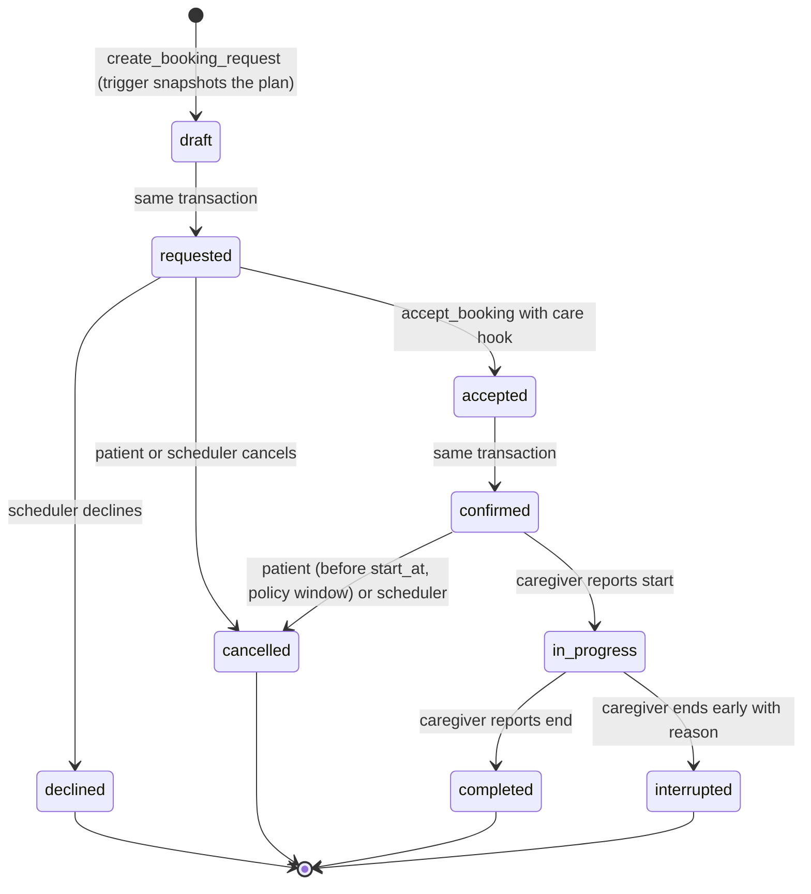

# P5-care: nonclinical caretaker flow design

- Task: Phase 5, caretaker category ("Nonclinical caretaker service and assignment", README Phase 5).
- Author: Kiro. Date: 2026-11-19. Branch `task/P5-care-design`, base `integ/all` at `a7c14a1`.
- Status: **DESIGN ONLY.** No migration, code, test or database run is part of this task. Nothing here is approved policy.
- Built stack this design targets: migrations `202611170001` .. `20261117001200` and pgTAP suites `001`-`014` on `integ/all`. Line numbers refer to those files.
- Inputs: `README.md` Phase 5 and §9 (L330-334), `docs/MASTER_BLUEPRINT.md`, `docs/BUSINESS_RULES_AND_APPROVAL_MATRIX.md`, `docs/API_CONTRACTS.md`, `docs/DECISIONS.md`, `docs/S00_DECISION_SHEET.md`, `docs/CANONICAL_SCHEMA_DRAFT.md` (L184-205, L302, L357, L386-425), `docs/SCHEMA_RECONCILIATION.md` (Care row), `docs/specs/PRODUCT_REQUIREMENTS.md` (Caretakers and agencies), `docs/ACCEPTANCE_AND_TEST_MATRIX.md` (Caretaker row), and the reviews of the P01 and S01 designs (`C:\tmp\scv_logs\review_P01.md`, `review_S01.md`).

## 0. Summary

A patient books one bounded, nonclinical care session (for example four hours of companionship and mobility support) from a verified caretaker provider. The provider manually accepts and assigns one verified caregiver. The caregiver reports the start and the end of the session; the patient may then confirm or dispute that it happened. That is the whole core flow. Recurring shifts, multi-day plans, reassignment, payments and any clinical task stay out (`docs/SCHEMA_RECONCILIATION.md` Care row and canonical L539 put `care_shifts` and `care_shift_events` in LATER).

The design adds three care-owned tables, one trigger on `public.bookings`, and six public care RPCs in migrations `20261117001900`..`001920`. It reuses the B01 engine for request, accept, cancel, decline, reservations, events, audit and outbox. It needs two small changes to shared B01 functions (`accept_booking`, `is_assigned`/`resource_eligible`). Those must be written once, by the single engine migration author, together with the doctor, lab and ambulance P5 changes (§9). Without them care cannot be accepted, and an unverified agency caregiver would see the patient's address.

Safety defaults:
- The care category is OFF in the database by default (`care_private.gate.enabled = false`). While it is off, no caretaker booking can be created or accepted through any path.
- Task scope is a closed, nonclinical list enforced by a CHECK. There is no free-text instruction field.
- No ETA, GPS, OTP, attendance proof, clinical record, medication task, payment state or rating.
- Every caregiver claim is labelled as a report ("Caregiver reports the session started"), never as a verified fact.

## 1. What the built stack does today for caretakers

| Area | Built behaviour (file, line) | Consequence for care |
|---|---|---|
| Request | `create_booking_request` (`001100` L80-121) accepts any published service of any category with no category gate. | Today a patient can create a caretaker request with no agreed scope. §4.2 closes this with a gate trigger. |
| Accept | `accept_booking` raises `category_deferred_to_s01` for every non-doctor booking (`001100` L135). Suite `013` asserts this. | No caretaker booking can be accepted. Needs dependency SH-1. |
| Purpose | `booking_assignments.purpose` already allows `caretaker` (`0005` L99). `accept_booking` maps category `caretaker` to that purpose (`001100` L161). | No schema change needed for assignments. |
| Eligibility | `resource_eligible` requires a Q06 verified person only when `p.category = 'doctor'` (`001100` L8). `is_assigned` adds `person_is_verified` only for the doctor branch (`001100` L24-25). | Any active org member with `provider:read` can be assigned as a caregiver and then read the patient's address and phone through `get_booking`. Needs SH-2. |
| Staff evidence | Q06 cases work for every category. `required_kind('caretaker') = 'background_check'` (`0002` L102). `person_is_verified` (`001000` L73-82) checks an approved, unexpired case for org staff and accepts the individual owner. | Care can reuse Q06 unchanged. |
| Window | `is_assigned` allows `start_at - 60 min` to `end_at + 12 h` (`001100` L21-22). | Care commands run inside this window. §6.3 adds care-specific start bounds. |
| Transitions | `confirmed -> in_progress`, `in_progress -> completed`, `in_progress -> interrupted` exist for actor kind `assigned` (`0005` L56-64). `guard_booking` maps those states to `assigned` and accepts any purpose (`001100` L42-52). | Care progress needs no new edge. |
| Event reasons | `booking_events.reason` is a closed CHECK (`0005` L69) containing `service_started`, `service_completed`, `patient_request`, `provider_unavailable`, `unable_to_service`, `other`. | Care maps every transition to these codes and keeps the specific care reason in `care_plans` (§5.3). The shared CHECK is not rebuilt. |
| Scheduling | `in_schedule` requires the occupied period inside one local-day availability rule, and `local_end < 24:00` (`0005` L87, L222-229). `services.duration_minutes` allows up to 10080 (`0004` L25). | A care session cannot cross midnight or exceed one rule window. A 7-day care service can be listed but never accepted. §4.2 rejects it at request time. |
| Pricing | `bookings.amount_paise` is the price version amount, whatever the unit (`0005` L35, `001100` L114-115). Units include `hour` and `day` (`0004` L13). | A service priced "₹300 per hour" with a 240-minute duration books for ₹300. §4.2 accepts only unit `visit` for care. |
| Release | `cancel_booking` and the doctor completion release reservations at once (`001100` L194-196, L221). | Care does the same on end and interruption (§6.4). |
| Profile | `caretaker_profiles` holds public `skills` and `languages` labels only (`000640` L52-59). | Task scope is not stored there (§4.1 explains why). |

## 2. User journeys

### 2.1 Patient

1. Browses caretaker providers by PIN (`search_providers`, category `caretaker`). Each result shows the provider reference `SCV-CARE-NNNNNN`, the published profile and the service price.
2. Opens a service and sees its task list (`get_care_service_tasks`), its fixed price for the whole session, its duration and the line "Caregivers do not give medicines, injections, wound care or any medical treatment. In an emergency call 112."
3. Picks a slot (`list_slots`, advisory only) and an address, and confirms. `create_booking_request` creates the request. The trigger in §4.2 copies the service task list into `care_plans` in the same transaction.
4. Waits for manual acceptance. The provider may decline. The patient may cancel under B01 rules.
5. After acceptance the booking is `confirmed`. The patient sees "Caregiver assigned" with no caregiver identity beyond what the provider projection already returns (§7.3).
6. On the day, sees "Caregiver reports the session started" and later "Caregiver reports the session ended" (or "Session ended early").
7. Within 7 days after the end may confirm or dispute that the session happened (`attest_care`). A dispute is recorded only. It changes no booking or payment state, and support handling stays open (Q-CARE-09).

### 2.2 Provider (individual caretaker or agency)

1. A manager with `provider:manage` (or the individual owner) sets the task list of each care service (`set_care_service_tasks`). The service must use price unit `visit` and a duration of at most 720 minutes.
2. A scheduler with `schedule:manage` sees requests in the queue (`get_provider_queue`) with the locality PIN, time and task codes, and accepts with one caregiver resource (`accept_booking`) or declines.
3. If the caregiver becomes unavailable before the start, the scheduler cancels with `provider_unavailable`. Reassignment does not exist in B01 and is not added here (Q-CARE-13).
4. If the patient is not at home, the scheduler cancels with `unable_to_service`. The provider `no_show` edge is not used for care (§6.5).

### 2.3 Caregiver (assigned person)

1. Must be the individual owner of the provider, or an org member with an approved, unexpired Q06 `background_check` case for that provider.
2. Inside the assignment window sees the address and contact (`get_booking`) and the task codes (`get_care_plan`). Sees no questionnaire, clinical, document or payment data.
3. Reports the start (`advance_care` step `started`) no earlier than 30 minutes before `start_at` and before `end_at`.
4. Reports the end (`advance_care` step `ended`), or ends early with a reason (`interrupt_care`). For a health emergency the caregiver calls 112 and records `ended_for_emergency`. The app never claims that it dispatched help.

## 3. Scope

In scope: one session per booking, closed task list, provider task configuration, accept hook, caregiver start/end/interrupt, patient attestation, read projections, DB gate, RLS, tests.

Out of scope, with the reason:

| Item | Reason |
|---|---|
| Recurring shifts, multi-day plans, overnight sessions | Schema reconciliation Care row, canonical L539 (LATER). `in_schedule` cannot span midnight. Q-CARE-02. |
| Hourly or daily pricing | Q12: fixed server prices only; quotes later. Q-CARE-03. |
| Reassignment | No B01 command exists (S01-17). Shared engine work. Q-CARE-13. |
| Pay-after collection by the caregiver | P01 is not merged; its `is_collector` would need the `caretaker` purpose. Q-CARE-16. |
| Free-text instructions, preferences (gender, language) | Free text can carry phone numbers or health detail (S01-30). Preferences need an owner policy. Q-CARE-11, Q-CARE-12. |
| Check-in OTP, GPS, photos, attendance proof | Canonical L418 ("No OTP claim in core"), GPS gate, Q05. |
| Medication reminders or any clinical task | PRODUCT_REQUIREMENTS L49; acceptance matrix "Nonclinical only". Q-CARE-01. |
| Realtime | No care table joins `supabase_realtime` (S01-21). Clients refetch. |

## 4. Data model changes (care range only)

### 4.0 Migration numbers

All four P5 task briefs say "from `20261117001600` up". To avoid collisions this design proposes one hundred-block per category in README category order: doctor `0016xx`, lab `0017xx`, ambulance `0018xx`, caretaker `0019xx`. Claude must confirm the allocation (Q-CARE-15). If it changes, only the numbers change.

| Version | File | Contents |
|---|---|---|
| `20261117001900` | `20261117001900_p5c_care_scope.sql` | `care_private` schema, `care_private.gate`, `care_private.valid_tasks()`, `public.care_service_tasks`, `set_care_service_tasks`, `get_care_service_tasks`, grants and `service_role` revokes. |
| `20261117001910` | `20261117001910_p5c_care_plans.sql` | `public.care_plans`, the request trigger on `public.bookings`, the `care_plans` guard trigger, grants and revokes. |
| `20261117001920` | `20261117001920_p5c_care_commands.sql` | `care_private.accept_check`, `care_private.after_accept`, `care_private.is_caregiver`, `advance_care`, `interrupt_care`, `attest_care`, `get_care_plan`, grants, `notify pgrst, 'reload schema'`. |

All three are forward-only, wrap in `begin; ... commit;`, use `security definer set search_path = ''`, revoke `all` on every new function from `public, anon, authenticated`, and grant execute only where §7 says so. The 14-digit versions all start with `202611170019`, which is above `202611170005`, so the ordering rule in `tests/rls/README.md` holds.

The shared dependencies SH-1 and SH-2 (§9) must apply before `20261117001920`. They are not in the care range.

### 4.1 `20261117001900`: scope

**`care_private` schema.** `revoke all on schema care_private from public, anon, authenticated`. No usage grant: nothing in it is called by clients.

**`care_private.gate`** (single row)

| Column | Type | Rule |
|---|---|---|
| `id` | boolean | primary key, default `true`, `check (id)` |
| `enabled` | boolean | not null, default `false` |
| `changed_at` | timestamptz | not null, default `now()` |

Seeded with one row, `enabled = false`. No RPC changes it. Turning it on is a separate reviewed migration or an owner SQL step recorded in `docs/DECISIONS.md` and `docs/SESSION_LOG.md` (the approval matrix row "Scheduled doctor/lab/ambulance/care bookings"). `care_private.enabled()` returns `coalesce((select enabled from care_private.gate), false)`. If Claude lands one shared gate table for all categories first (S01-27), care uses its `caretaker` row instead and this table is dropped from the plan.

**`care_private.valid_tasks(p text[]) returns boolean`** (immutable). True only when the array is non-null, has 1 to 6 elements, has no null or duplicate element, and every element is in this closed list:

| Code | Patient label (en) | Covers | Never covers |
|---|---|---|---|
| `companionship` | Companionship | Conversation, reading aloud, supervision for safety | Monitoring of symptoms or vital signs |
| `mobility_support` | Help with walking and moving | Steadying while walking, help in and out of a chair or bed without lifting equipment | Physiotherapy exercises, hoist or transfer equipment |
| `personal_care_support` | Help with washing and dressing | Bathing, grooming, dressing, toilet assistance | Catheter, stoma or skin-wound care |
| `meal_support` | Help with meals | Preparing simple meals, help with eating and drinking by mouth | Tube feeding, special clinical diets |
| `light_household` | Light household help | Tidying the patient's room, the patient's laundry | General housekeeping for the household |
| `escort_walk` | Accompany on a walk | Walking outdoors with the patient nearby | Driving or transport |

Excluded from the list on purpose: medication giving or reminders, injections, wound or dressing care, catheter or stoma care, tube or assisted feeding, vital signs, oxygen adjustment, physiotherapy, any assessment, diagnosis or note. Adding a code is a migration plus an owner decision (Q-CARE-01). The list is also mirrored as a TypeScript enum; a Vitest parity test reads the migration file (§10.3, V2).

Why task scope lives on the service and not on `caretaker_profiles`: putting it on the profile means rewriting the shared I02 functions `set_provider_details` and `build_public_snapshot` (`000640`), which every category edits. A service-level list keeps care self-contained. Every code is nonclinical by construction, so no task needs clinical verification. Whether some tasks also need a competence check is Q-CARE-10.

**`public.care_service_tasks`**

| Column | Type | Rule |
|---|---|---|
| `service_id` | uuid | primary key, FK `public.services(id)` on delete restrict |
| `task_codes` | text[] | not null, `check (care_private.valid_tasks(task_codes))` |
| `version` | integer | not null default 1, `check (version > 0)` |
| `updated_at` | timestamptz | not null default `now()` |

The category is checked in the only write path (`set_care_service_tasks`) because `services` has no `unique (id, category)` to reference, and adding one is a C01 change. RLS enabled; `revoke all ... from public, anon, authenticated`; `revoke insert, update, delete, truncate, trigger, references ... from service_role` (P01 review H2, `000610` L7-8). No SELECT policy. Reads go through `get_care_service_tasks`.

### 4.2 `20261117001910`: plans and the request trigger

**`public.care_plans`** (one row per caretaker booking; canonical L302)

| Column | Type | Rule |
|---|---|---|
| `booking_id` | uuid | primary key, FK `public.bookings(id)` |
| `task_codes` | text[] | not null, `check (care_private.valid_tasks(task_codes))`; copied from the service at request time; immutable |
| `service_tasks_version` | integer | not null; `care_service_tasks.version` at request time; immutable |
| `assignment_id` | uuid | null until acceptance; FK `(assignment_id, booking_id)` to `booking_assignments(id, booking_id)` (the same pattern as `doctor_visits`, `0005` L115-119); set once |
| `substate` | text | not null default `pending`, `check (substate in ('pending','assigned','started','ended'))` |
| `started_at`, `ended_at` | timestamptz | null; server `clock_timestamp()` only; `check (ended_at is null or (started_at is not null and ended_at >= started_at))` |
| `end_outcome` | text | null, `check (end_outcome in ('completed','interrupted'))` |
| `interruption_reason` | text | null, `check (interruption_reason in ('patient_request_end','caregiver_unwell','unsafe_environment','ended_for_emergency','other'))` |
| `attestation` | text | null, `check (attestation in ('confirmed','disputed'))` |
| `attested_at` | timestamptz | null |
| `version` | integer | not null default 1, `check (version > 0)` |
| `created_at`, `updated_at` | timestamptz | not null default `now()` |

Row-shape CHECKs: `substate = 'pending'` iff `assignment_id is null`; `substate in ('started','ended')` iff `started_at is not null`; `substate = 'ended'` iff `ended_at is not null` iff `end_outcome is not null`; `interruption_reason is not null` iff `end_outcome = 'interrupted'`; `attestation is null` or (`substate = 'ended'` and `attested_at is not null`).

The booking state stays the single source of truth for the lifecycle. A cancelled or declined booking keeps its plan at `pending` or `assigned`; the plan is not rewritten.

**Request trigger `p5c_care_plan_on_request`**: `after insert on public.bookings for each row when (new.category = 'caretaker') execute function care_private.snapshot_plan()` (security definer). It raises, and so rolls back the whole `create_booking_request` call, when:

| Check | Error |
|---|---|
| `not care_private.enabled()` | `55000 category_disabled` |
| no `care_service_tasks` row for `new.service_id` | `55000 care_scope_required` |
| `(select unit from service_price_versions where id = new.price_version_id) <> 'visit'` | `55000 care_unit_unsupported` |
| `new.end_at - new.start_at > interval '720 minutes'` | `55000 care_duration_unsupported` |

Otherwise it inserts `care_plans(booking_id, task_codes, service_tasks_version)` from the service row, read `for share`, and writes `audit_events(actor, 'care.plan_snapshotted', 'booking', new.id)`. The trigger means care needs no change to `create_booking_request`, and every insert path into `bookings` gets a plan or fails. Other categories can add their own `after insert ... when (new.category = ...)` triggers without conflict.

**Guard trigger `p5c_care_plan_guard`**: `before update or delete on public.care_plans`, plus `before truncate` using `booking_private.immutable()`. It rejects (`55000`):
- any DELETE (`immutable_care_plan`);
- a change to `booking_id`, `task_codes`, `service_tasks_version` or `created_at` (`immutable_snapshot`);
- `assignment_id` changing once set;
- a substate move other than `pending -> assigned`, `assigned -> started`, `started -> ended` (`invalid_transition`);
- `started_at`, `ended_at`, `end_outcome`, `interruption_reason` changing once set;
- `attestation` changing once set;
- `new.version <> old.version + 1` (`40001 stale_version`).

The guard holds for application roles and for `service_role`. The table owner can disable triggers, so this is not a claim about the owner (P01 review L12).

RLS enabled on `care_plans`; `revoke all ... from public, anon, authenticated`; the same `service_role` revoke as §4.1. No policies. Reads go through `get_care_plan`.

Existing data: a caretaker booking created before this migration has no plan. `accept_check` rejects it with `55000 care_plan_missing`; the provider declines it. The stack holds synthetic data only, so no backfill is proposed.

## 5. State machines

### 5.1 Booking states used by care

Care uses only edges that already exist in `booking_transitions`. It adds none.

Not used for care: `requested -> expired` (no approved expiry, Q02; `guard_booking` rejects `system`), `confirmed -> no_show` (§6.5), `draft -> cancelled` (drafts never survive the create transaction).

### 5.2 Care substate (`care_plans.substate`)

Canonical L425: `assigned -> started -> ended`, plus `pending` before acceptance.

| From | To | Command | Booking change | Booking event reason |
|---|---|---|---|---|
| (none) | `pending` | request trigger | `draft -> requested` (B01) | `requested` |
| `pending` | `assigned` | `accept_booking` hook | `requested -> accepted -> confirmed` (B01) | `accepted`, `confirmed` |
| `assigned` | `started` | `advance_care('started')` | `confirmed -> in_progress` | `service_started` |
| `started` | `ended` (`completed`) | `advance_care('ended')` | `in_progress -> completed` | `service_completed` |
| `started` | `ended` (`interrupted`) | `interrupt_care(reason)` | `in_progress -> interrupted` | mapped, §5.3 |

Skips, reversals and repeats raise `55000 invalid_transition`. A stale `p_expected_version` raises `40001 stale_version` before the substate check.

### 5.3 Interruption reasons

| `interruption_reason` | Booking event reason (existing CHECK) | Patient label (en) |
|---|---|---|
| `patient_request_end` | `patient_request` | Session ended early at your request |
| `caregiver_unwell` | `provider_unavailable` | Session ended early: the caregiver could not continue |
| `unsafe_environment` | `unable_to_service` | Session ended early: the caregiver could not continue safely |
| `ended_for_emergency` | `unable_to_service` | Session ended early. In an emergency call 112. |
| `other` | `other` | Session ended early |

`ended_for_emergency` records that the session stopped. It does not say the platform called anyone (S01-24). Mapping onto the existing reasons avoids rebuilding the shared `booking_events.reason` CHECK, which the other P5 categories also touch (P01 review H1 shows what goes wrong when two migrations rebuild one CHECK). The precise reason stays in `care_plans` and in the audit action `care.interrupted`.

## 6. RPC and API contracts

### 6.1 Conventions

- Every public RPC is `security definer set search_path = ''`, calls `identity_private.require_actor()` (anonymous sessions rejected, `000600`) except `get_care_service_tasks`, and accepts no actor, role, price, state, time or caregiver identity from the caller.
- Error codes follow B01: `42501` forbidden, `P0002` not found, `40001` stale or changed offer, `55000` invalid state or closed gate, `22023` invalid input. The route maps them through the B01 status table (`src/lib/booking/service.ts`).
- Lock order matches `advance_visit` (`001100` L200-208): booking `for update`, then `booking_private.lock_provider` (org, then provider), then active assignment resources ordered by id `for update`, then `care_plans` `for update`. Authorization is checked before and again after the locks.
- Mutations carry `p_expected_version`. A retry after success gets `40001` and the client refetches, the same as `advance_visit`. Only `create_booking_request` takes an idempotency key (B01).
- Denied attempts are not written to `audit_events` because the exception rolls the insert back (S01-14). The route logs IDs and the error code only.

### 6.2 Provider task configuration

**`public.set_care_service_tasks(p_service_id uuid, p_task_codes text[], p_expected_version integer) returns integer`** (authenticated)
1. Load the service; `catalog_private.lock_manager(s.provider_id)` (owner or `provider:manage`; rejects suspended providers; `0004` L90-99). Lock the service row `for update`.
2. `s.category <> 'caretaker'` raises `22023 invalid_input`.
3. `not care_private.valid_tasks(p_task_codes)` raises `22023 invalid_input`.
4. The service's current price version unit is not `visit`, or `s.duration_minutes > 720`, raises `22023 care_offer_unsupported`. Bookings re-check both, because services and prices can change later.
5. `p_expected_version = 0` inserts the row. Otherwise update `where version = p_expected_version`, or raise `40001 stale_version`.
6. Audit `care.service_tasks_set` on target `service`. Return the new version.

Lock order is provider, then service, then `care_service_tasks`. `accept_booking` takes the provider lock before reading `care_service_tasks`, so the two serialize.

**`public.get_care_service_tasks(p_service_id uuid) returns jsonb`** (anon, authenticated)
Returns `{"service_id", "task_codes", "version", "bookable"}` when the service is `published`, its category is `caretaker`, `identity_private.provider_publicly_bookable(provider)` is true and a task row exists. `bookable` is `care_private.enabled()`, so the UI can hide the booking button while the gate is off. Otherwise raises `P0002 not_found`. No provider UUID or staff data.

### 6.3 Booking commands

**Request.** Unchanged `POST /api/bookings` and `create_booking_request`. The trigger in §4.2 adds the plan or rejects the call.

**Accept.** Unchanged `POST /api/bookings/:id/accept` and `accept_booking`, once SH-1 lands. The hook calls, after the offer re-check and resource validation and before reservations:

`care_private.accept_check(b public.bookings, p_resource_ids uuid[])`
1. `care_private.enabled()` or raise `55000 category_disabled`.
2. Lock `care_plans` row `for update`; missing raises `55000 care_plan_missing`; `substate <> 'pending'` raises `55000 invalid_transition`.
3. `care_service_tasks` row read `for share`; missing, or `version <> plan.service_tasks_version`, raises `40001 offer_changed`.
4. The single person resource: `providers_private.person_is_verified(b.provider_id, r.person_profile_id)` or raise `42501 forbidden`. This duplicates SH-2 on purpose, so accept stays safe if SH-2 is late.
5. `r.person_profile_id` equal to `b.requester_profile_id` or to the patient's `self_profile_id` raises `42501 self_assignment`. Care for oneself is not a marketplace booking.

After the `confirmed` transition, `care_private.after_accept(p_booking_id uuid, p_assignment_id uuid)` sets `assignment_id`, `substate = 'assigned'`, `version + 1`.

**Cancel and decline.** Unchanged B01 commands. The patient can cancel `requested`, `accepted` or `confirmed` before `start_at` and inside the published policy window; the scheduler can cancel or decline. `cancel_booking` releases reservations. The plan is not touched.

**`public.advance_care(p_booking_id uuid, p_step text, p_expected_version integer) returns integer`** (authenticated; returns the new booking version)
1. `care_private.is_caregiver(b.id)` or raise `42501 forbidden`. Definition: `identity_private.is_assigned(b.id, 'caretaker') and providers_private.person_is_verified(b.provider_id, auth.uid())`.
2. Locks (§6.1); re-check step 1; version check.
3. `p_step = 'started'`: requires booking `confirmed` and plan `assigned`. `clock_timestamp() < b.start_at - interval '30 minutes'` raises `55000 care_too_early`. `clock_timestamp() >= b.end_at` raises `55000 care_window_closed`. Then `booking_private.transition(b.id, 'in_progress', 'service_started')` and set `started_at`, `substate = 'started'`.
4. `p_step = 'ended'`: requires booking `in_progress` and plan `started`. No lower time bound (early ends are allowed and shown). The upper bound is the `is_assigned` window (`end_at + 12 h`). Then `transition(b.id, 'completed', 'service_completed')`, set `ended_at`, `end_outcome = 'completed'`, `substate = 'ended'`, then `booking_private.release(b.id)`.
5. Any other `p_step` raises `22023 invalid_input`.

The gate is not checked here. Turning the gate off stops new requests and acceptances, and lets sessions already running close honestly. To halt unsafe work, suspend the provider or the caregiver's Q06 case; `is_caregiver` then fails at once (S01-22). §8 lists the resulting stuck state.

**`public.interrupt_care(p_booking_id uuid, p_reason text, p_expected_version integer) returns integer`** (authenticated)
Same authorization and locks as `advance_care`. Requires booking `in_progress` and plan `started`. `p_reason` not in the §5.3 list raises `22023 invalid_reason`. Transition to `interrupted` with the mapped reason, set `ended_at`, `end_outcome = 'interrupted'`, `interruption_reason`, `substate = 'ended'`, audit `care.interrupted`, release reservations.

Before the start there is no interruption: `interrupted` is reachable only from `in_progress` (S01-04, option b). A caregiver who cannot come tells the scheduler, who cancels.

**`public.attest_care(p_booking_id uuid, p_decision text, p_expected_version integer) returns integer`** (authenticated; `p_expected_version` is the plan version; returns the new plan version)
1. `booking_private.patient(b.patient_id, 'booking:create')` or raise `42501 forbidden` (the mutation scope, as in `cancel_booking`).
2. Lock the booking `for share`, the plan `for update`; plan version check.
3. Requires booking `completed` or `interrupted`, plan `ended`, `attestation is null`, and `clock_timestamp() < ended_at + interval '7 days'`; else `55000 invalid_transition`.
4. `p_decision` not in (`confirmed`, `disputed`) raises `22023`.
5. Set `attestation`, `attested_at`; audit `care.attested` on target `booking`. Do not touch `bookings`, `booking_events` or any payment row.

Attestation is a second party's statement. It is not proof of attendance and is never labelled as verified.

### 6.4 Reads

**`public.get_care_plan(p_booking_id uuid) returns jsonb`** (authenticated)

| Caller | Allowed when | Fields |
|---|---|---|
| Patient (`booking:read` self grant) | always | `booking_id`, `booking_version`, `plan_version`, `task_codes`, `substate`, `started_at`, `ended_at`, `end_outcome`, `interruption_reason`, `attestation`, `attested_at` |
| Scheduler (`booking_private.scheduler`) | always | the same fields. Attestation is included for first-line support (shared support model). |
| Caregiver (`care_private.is_caregiver`) | inside the `is_assigned` window | `booking_id`, `booking_version`, `plan_version`, `task_codes`, `substate`, `started_at`, `ended_at` |
| Anyone else | never | raises `P0002 not_found`, the same as `get_booking` |

No address, contact, patient id, caregiver identity or provider UUID. Address and contact come only from `get_booking` (`001100` L225-244).

`get_booking`, `list_bookings` and `get_provider_queue` are unchanged. They do not include care fields. The UI calls `get_care_plan` for the detail view only, which keeps list refreshes cheap (S01-15).

### 6.5 Patient absence and no-show

The B01 edge `confirmed -> no_show` (provider) is not exposed for care. Canonical L402 says support validates no-show evidence, and Q02 forbids inventing penalties. A caregiver who finds nobody home does not start the session; the scheduler cancels with `unable_to_service`. No fee, no blame label (Q-CARE-08).

### 6.6 HTTP routes (new files only)

All bodies use `z.strictObject`. Versions use `versionSchema` from `src/lib/validation/booking.ts`. Responses never echo database messages except the allowlisted codes below.

| Method and path | Body | RPC | Success |
|---|---|---|---|
| `GET /api/care/services/:serviceId/tasks` | none, no session | `get_care_service_tasks` | `{ serviceId, taskCodes, version, bookable }` |
| `PUT /api/provider/services/:id/care-tasks` | `{ taskCodes: CareTask[] (1..6, unique), expectedVersion: 0..max }` | `set_care_service_tasks` | `{ version }` |
| `GET /api/care/bookings/:id` | none | `get_care_plan` | `{ carePlan }` |
| `POST /api/care/bookings/:id/start` | `{ expectedVersion }` | `advance_care` step `started` | `{ version }` |
| `POST /api/care/bookings/:id/end` | `{ expectedVersion }` | `advance_care` step `ended` | `{ version }` |
| `POST /api/care/bookings/:id/interrupt` | `{ expectedVersion, reason: CareInterruptReason }` | `interrupt_care` | `{ version }` |
| `POST /api/care/bookings/:id/attest` | `{ expectedVersion, decision: "confirmed" \| "disputed" }` | `attest_care` | `{ version }` |

Existing routes used unchanged: `POST /api/bookings`, `GET /api/bookings/:id`, `POST /api/bookings/:id/accept`, `/decline`, `/cancel`. The existing `/start` and `/complete` routes call `advance_visit` and stay doctor-only.

Status mapping: the B01 table (403, 404, 409, 422, 429, 503). The care routes pass through only these error codes as `{ error: <code> }` with status 409: `category_disabled`, `care_too_early`, `care_window_closed`, `offer_changed`, `care_plan_missing`. Every other error keeps the generic B01 body. New files: `src/app/api/care/...`, `src/app/api/provider/services/[id]/care-tasks/route.ts`, `src/lib/care/service.ts`, `src/lib/care/labels.ts`, `src/lib/validation/care.ts`. The only shared edit is exporting the B01 status table from `src/lib/booking/service.ts` so care does not copy it.

## 7. RLS, grants and capability rules

### 7.1 Tables

| Object | anon | authenticated | service_role | Policies |
|---|---|---|---|---|
| `care_private.gate` | none | none (no schema usage) | no write | none |
| `public.care_service_tasks` | none | none | SELECT only (default), INSERT/UPDATE/DELETE/TRUNCATE revoked | RLS on, no policy |
| `public.care_plans` | none | none | SELECT only (default), INSERT/UPDATE/DELETE/TRUNCATE revoked | RLS on, no policy |

All writes go through the definer functions, which run as the migration owner. Base-table SELECT is not granted, because RLS cannot hide columns and the projections differ by caller (P01 review M7).

### 7.2 Functions

| Function | Execute granted to |
|---|---|
| `get_care_service_tasks` | anon, authenticated |
| `set_care_service_tasks`, `get_care_plan`, `advance_care`, `interrupt_care`, `attest_care` | authenticated |
| `care_private.*` (`enabled`, `valid_tasks`, `snapshot_plan`, `guard_plan`, `accept_check`, `after_accept`, `is_caregiver`) | nobody; called only from definer code and CHECKs |

`valid_tasks` is used in CHECK constraints. It needs no grant because every write runs inside a definer function owned by the migration owner, the same pattern as `providers_private.valid_labels` in `000640`.

### 7.3 Who can do what

| Actor | Read | Mutate |
|---|---|---|
| Guest | Service task list of a bookable care service | nothing |
| Patient (self grant) | Own plan, own booking (B01) | Request, cancel (B01); attest once after the end |
| Individual owner (also the caregiver) | Own queue; plans of own bookings | Set tasks; accept, decline, cancel; start, end, interrupt as assignee |
| Org manager with `provider:manage` | nothing care-specific beyond the scheduler view if also scheduler | Set tasks |
| Org scheduler with `schedule:manage` | Queue (B01); plans of the provider's bookings | Accept with a verified caregiver; decline; cancel |
| Assigned caregiver (verified, in window) | Address and contact (B01 `get_booking`); task codes and substate | Start, end, interrupt |
| Other org staff, unverified or suspended caregiver | nothing | nothing |
| Verifier, suspender, auditor admins | nothing care-specific; global `security:audit` reads `audit_events` (`000610`) | Q06 case review and provider suspension (existing) |
| Worker / system | nothing | nothing; there is no system actor in care |

No new admin capability and no new membership scope. The `admin_capabilities` and `organization_members.scopes` CHECKs are untouched (P01 review H1). The membership role `caregiver` from `ROLE_ONBOARDING_AND_PERMISSIONS.md` L27 is not added; the built roles are `owner, manager, staff, billing` (`0001` L65), and a caregiver is a `staff` member with `provider:read` plus an approved Q06 case.

### 7.4 Data minimization

- No care table holds address, phone, name, health, questionnaire or free text. Task codes are coarse. Some still hint at a condition (for example `personal_care_support`). The scheduler must see them to decide whether to accept. That trade-off is part of Q-CARE-01.
- The caregiver loses all care and booking access when the booking leaves `confirmed`/`in_progress`, when the `is_assigned` window closes, or when the Q06 case or provider stops being verified (needs SH-2 for `get_booking`).
- The B01 scheduler projection returns the exact address and phone for confirmed bookings inside the window (`001100` L237-241; S01-03). For agencies this may be needed to coordinate. Q-CARE-06 asks the owner; SH-3 is the recommended fix if the answer is "assignee only".

## 8. Edge cases

| # | Case | Behaviour |
|---|---|---|
| E1 | Gate off | Request fails `category_disabled` through any path; accept fails the same. Running sessions can still end. `list_slots` still returns advisory caretaker slots; the UI hides them using `bookable` (§6.2). |
| E2 | Service has no task list | Request fails `care_scope_required`. Search still lists the service (C01); the UI shows "Not bookable yet". |
| E3 | Price unit `hour` or `day`, or duration over 720 minutes | Request fails (`care_unit_unsupported`, `care_duration_unsupported`); `set_care_service_tasks` refuses such services. Prevents a ₹/hour label on a whole-session price. |
| E4 | Session crosses midnight or exceeds one availability rule | `in_schedule` fails at accept with `schedule_changed` (B01). Overnight care is out of scope (Q-CARE-02). |
| E5 | Provider edits the task list after the request | Accept fails `offer_changed`; booking stays `requested`; the scheduler declines and the patient rebooks. |
| E6 | Caregiver has no approved Q06 case, it is suspended, or `verified_until` passed | Accept fails `forbidden`. After acceptance, start/end/interrupt fail and, with SH-2, `get_booking` hides address and contact. |
| E7 | Provider suspended or verification expires during `confirmed` | `is_assigned` fails (`provider_is_publishable`); nobody can start. The scheduler can still cancel, since `cancel_booking` only needs `scheduler`. |
| E8 | Provider suspended, or caregiver case suspended, during `in_progress` | Nobody can record the end. The booking stays `in_progress`. There is no ops or system actor to close it (guard rejects `system`). Listed for Q-CARE-07; the test (T19) documents it. |
| E9 | Caregiver never records the end | After `end_at + 12 h` nobody can. Same as E8. The scheduler sees it in the queue as `in_progress` after `end_at`. |
| E10 | Start too early / too late | `care_too_early` before `start_at - 30 min`; `care_window_closed` at or after `end_at`. |
| E11 | Early end | Allowed. Shown as "Caregiver reports the session ended at 13:10" with the scheduled end beside it. Reservations are released, which frees the caregiver for real work; the next booking's own buffer still applies. |
| E12 | Patient not home | Caregiver does not start; scheduler cancels `unable_to_service`. No `no_show`, no fee. |
| E13 | Patient cancels while the caregiver is starting | Both lock the booking row. The first wins; the second gets `40001 stale_version` or `55000`. Patient cancel is also closed at `start_at` (`001100` L187). |
| E14 | End and interrupt sent together | Same lock and version; exactly one succeeds. |
| E15 | Same caregiver booked by two providers or categories at overlapping times | One canonical person resource and the reservation exclusion (`0005` L108-114) reject the second acceptance (`23P01`). |
| E16 | Provider owner books care for themselves or assigns the patient | `self_assignment`. |
| E17 | Health emergency during the session | Caregiver calls 112, then records `ended_for_emergency`. The patient view shows 112. No ETA, no "help is on the way". |
| E18 | Patient asks for a clinical task | There is no field to record it. Caregiver copy: "Caregivers cannot give medicines or medical care. Ask your doctor or call 112 in an emergency." |
| E19 | Patient disputes the session | Recorded with time; no booking or payment change. Who follows up is open (Q-CARE-09, Q10). |
| E20 | Booking created before migration 001910 | No plan; accept fails `care_plan_missing`; the scheduler declines. |
| E21 | Replay of a successful start | `40001`; client refetches `get_care_plan`. |
| E22 | Client sends times, actor, task codes or state to a command | Strict Zod rejects them; the RPCs have no such parameters. |
| E23 | Address or contact after the session | `get_booking` stops returning them once the booking is `completed`/`interrupted` (`details` needs `confirmed`/`in_progress`). The patient keeps them. |

## 9. Shared engine dependencies (not in the care range)

These edit functions that the doctor, lab and ambulance P5 designs also touch. If each category migration runs `create or replace` on them, the last one wins and silently removes the others' rules. Claude should assign them to the single engine migration author as one migration, numbered before `20261117001900`.

| ID | Change | Needed for | Blocking |
|---|---|---|---|
| SH-1 | In `accept_booking` (`001100` L124-171), replace the `category <> 'doctor'` rejection with a per-category dispatch: before the reservation loop call `booking_private.category_accept_check(b, p_resource_ids)`, and after the `confirmed` transition call `booking_private.category_after_accept(b.id, person_assignment)`. The dispatcher calls `care_private.accept_check` / `after_accept` for `caretaker` and keeps raising `category_deferred_to_s01` for categories whose hook is not installed. | Any care acceptance | Yes |
| SH-2 | In `resource_eligible` (`001100` L5-14) change `p.category <> 'doctor'` to `p.category not in ('doctor','caretaker')`. In `is_assigned` (`001100` L16-26) add `providers_private.person_is_verified(b.provider_id, auth.uid())` to the `caretaker` branch. | Unverified or suspended caregivers must not be assignable or see address and phone | Yes |
| SH-3 | In `get_booking` (`001100` L237-240), drop `booking_private.scheduler` from `details` for `caretaker` (or for every category, per S01-03). | Address and phone limited to the assignee | Only if Q-CARE-06 says so |
| SH-4 | Make `list_slots` return nothing for a category whose gate is off. | Cosmetic; the UI already hides slots | No |

Not needed, on purpose: no change to `create_booking_request` (the trigger covers it), to `booking_transitions`, to the `booking_events.reason` CHECK, to `admin_capabilities` or to `organization_members.scopes`.

Suite `013_b01_categories` asserts `55000` for caretaker acceptance. After SH-1 plus the care migrations, its caretaker block still passes while the gate is off (`category_disabled` is also `55000`) and with no plan. Keep it as the gate-off regression.

## 10. Test plan

Synthetic data only, rollback-only fixtures, no real names or phones (`+919999999999` style as in `_b01_fixture.inc`).

### 10.1 pgTAP: `supabase/tests/019_p5_care.test.sql`

Follows the existing suites: `\ir _tap_helpers.inc` and `_b01_fixture.inc`, `pg_temp.expect_state` / `pg_temp.assert_true`, one TAP line, `rollback`. The fixture adds an org caretaker provider with an owner, a scheduler (`schedule:manage`), a manager (`provider:manage`), a verified caregiver (approved Q06 `background_check` case with a stored object), an unverified staff member, a care service (unit `visit`, 240 min), a task list and a second caretaker provider for cross-provider tests. The gate is turned on with owner SQL inside the transaction, except where a test says off.

| ID | Assertion |
|---|---|
| T01 | Gate off: `create_booking_request` on the care service raises `55000`; no `bookings` or `care_plans` row exists. |
| T02 | Gate on, service without a task row: `55000`. |
| T03 | `set_care_service_tasks` rejects `{medication_reminder}`, `{wound_care}`, `{vitals}`, `{}`, a null element, a duplicate, seven codes, and an empty string (`22023`). |
| T04 | `set_care_service_tasks`: outsider, `provider:read` staff and scheduler-only member get `42501`; manager succeeds; stale version `40001`; doctor service `22023`; suspended provider `42501`. |
| T05 | Unit `hour` price and a 721-minute service: request raises `55000`; the setter raises `22023`. |
| T06 | Request on a valid service: plan exists with the service's codes and version, substate `pending`, audit `care.plan_snapshotted`. |
| T07 | Manager changes tasks after the request: accept raises `40001`; booking stays `requested`. |
| T08 | Accept with the unverified staff member: `42501`. With a suspended case, an expired case, and a case whose evidence object is missing: `42501`. With the verified caregiver: booking `confirmed`, plan `assigned` with the active `caretaker` assignment. |
| T09 | Accept assigning the patient's own profile as the caregiver: `42501`. |
| T10 | Two care bookings from two providers for the same caregiver with overlapping occupied periods: the second accept raises `23P01`; that booking stays `requested`. |
| T11 | Owner SQL `update public.care_plans set task_codes = ...`, a substate move back to `assigned`, a second attestation, a `delete` and a `truncate`: each raises `55000`. |
| T12 | Start at `start_at - 31 min` raises `55000`; at or after `end_at` raises `55000`. Times are shifted with the existing fixture pattern (`005` L86-89, `011` L18-20): owner disables `b01_booking_guard`, moves `start_at`/`end_at`, re-enables it, then every command runs with all guards on. |
| T13 | Start by the patient, the scheduler, the manager, the unverified staff member and an outsider: `42501`. |
| T14 | Start by the caregiver: booking `in_progress`; one `booking_events` row with reason `service_started` and the next aggregate version; one `audit_events` row; one `notification_outbox` row whose payload has only `booking_id`, `event`, `version`; plan `started_at` set. |
| T15 | End: booking `completed`, event `service_completed`, assignment `ended`, reservation `released`, plan `ended`/`completed`. |
| T16 | End before start, start twice, interrupt before start: `55000`. Stale version: `40001`. |
| T17 | Interrupt with each of the five reasons (each in its own booking): booking `interrupted`; event reason as in §5.3; plan reason stored; reservation released. `p_reason = 'clinical'` raises `22023`. |
| T18 | Suspend the caregiver's Q06 case after acceptance: start raises `42501`; `get_booking` as the caregiver raises `P0002` and returns no `address_snapshot` or `contact_snapshot` (requires SH-2). |
| T19 | Suspend the provider during `in_progress`: end raises `42501`; the booking stays `in_progress` (documents E8). |
| T20 | As `authenticated`: `select`, `insert`, `update`, `delete` on `care_plans` and `care_service_tasks`, and any access to `care_private.gate`, raise `42501`. |
| T21 | `has_table_privilege('service_role', t, p)` is false for INSERT, UPDATE, DELETE, TRUNCATE on both public care tables and on `care_private.gate`. |
| T22 | `has_function_privilege('authenticated', f, 'execute')` is false for every `care_private` function; `anon` can execute only `get_care_service_tasks`. |
| T23 | `get_care_plan`: patient sees all fields; scheduler sees all fields; caregiver sees only the caregiver field list and only inside the window; second patient, outsider and unverified staff get `P0002`; no result contains `address`, `phone`, `patient_id` or a provider UUID. |
| T24 | `get_care_service_tasks` as anon: works for a bookable published service and reports `bookable`; `P0002` for a draft service, a non-caretaker service and a non-bookable provider. |
| T25 | `select count(*) from pg_publication_tables where pubname = 'supabase_realtime' and tablename in ('care_plans','care_service_tasks','bookings')` is 0. |
| T26 | Attest: before the end `55000`; by the scheduler or caregiver `42501`; by the patient after the end succeeds; a second attempt `55000`; an attempt on a plan whose `ended_at` is shifted 8 days back (same fixture pattern, with `p5c_care_plan_guard` disabled only for the shift) `55000`; a dispute leaves `bookings.state` and `bookings.version` unchanged. |
| T27 | Patient cancels a confirmed care booking before `start_at`: `cancelled`, reservation released, plan still `assigned`. After start: `55000`. |
| T28 | Regression: suites `005` and `010`-`014` still pass after the care migrations and SH-1/SH-2. |

### 10.2 Concurrency: `tests/rls/run_p5_care_concurrency.py`

Same harness as `run_b01_concurrency.py`: two connections, a barrier, JWT claims set per connection, synthetic fixtures committed in a throwaway schema state and removed after.

| ID | Race | Expected |
|---|---|---|
| C1 | Caregiver start vs patient cancel on the same version | Exactly one commits; the other gets `40001` or `55000`. |
| C2 | End vs interrupt | Exactly one commits. |
| C3 | Two accepts for the same caregiver, overlapping, two providers | One commits; the other gets `23P01` or a lock-order `40P01` retried once by the client. |
| C4 | `set_care_service_tasks` vs `accept_booking` | Accept either commits with the plan version matching the old task version, or fails `offer_changed`. Never commits after the task version changed. |
| C5 | Q06 case suspension vs caregiver start | If suspension commits first, start fails `42501`. |

### 10.3 Vitest: `tests/unit/care.test.ts`

| ID | Assertion |
|---|---|
| V1 | Start, end, interrupt, attest and care-task schemas are strict: extra keys (`state`, `startedAt`, `endedAt`, `actorId`, `notes`, `taskCodes` on start, `amountPaise`) fail; `expectedVersion` 0 fails for commands and passes for the first task-list save; unknown reason, decision and task codes fail; 7 task codes and duplicates fail. |
| V2 | The TypeScript `CARE_TASKS` and `CARE_INTERRUPT_REASONS` arrays equal the SQL lists parsed from `supabase/migrations/20261117001900_p5c_care_scope.sql` and `20261117001910_p5c_care_plans.sql`. |
| V3 | Error mapping: each allowlisted code returns 409 with `{ error: code }`; any other message (for example "private data") never appears in the body; status table equals the B01 table. |
| V4 | With a mocked `db.rpc`, each route calls the exact RPC with the exact argument names (`advance_care` with `p_step: "started"` or `"ended"`), and never passes a time, actor or task list. |
| V5 | `GET /api/care/services/:id/tasks` works with no session; every other care route returns 401 with no session. |
| V6 | `src/lib/care/labels.ts` strings in en, te and hi contain no ETA wording ("minutes away", "arriving in", "ETA"), no clinical wording ("medicine", "medication", "diagnos", "prescri", "treatment" outside the fixed disclaimer), and every caregiver milestone label starts with the "reports" phrasing. Telugu and Hindi strings need human review before release; the test checks only that each key exists in every locale. |

### 10.4 Gates before "done"

`npm run lint`, `npm run typecheck`, `npx vitest --run`, `npm run build`, `supabase test db` for `001`-`019` on Stack A under the shared DB lock, the concurrency runner, and a review of the actual diff. Playwright only once a care UI exists (U01).

## 11. How the P01 and S01 review findings are handled

| Finding | Handling here |
|---|---|
| P01 H1 (CHECK rebuild drops values) | No shared CHECK is rebuilt; reasons map onto existing codes (§5.3); no capability or scope added. |
| P01 H2 (`service_role` writes) | Write privileges revoked on every care table; test T21. |
| P01 H3 / L12 (trigger trusts columns; overstated guarantees) | `care_plans` guard enforces shape and forward-only moves; the guarantee is stated for application roles and `service_role`. |
| P01 H5 (drops `is_assigned` hardening) | `is_caregiver` = built `is_assigned` plus Q06 verification; no new predicate. |
| P01 M7 (RLS exposes hidden columns) | No base-table SELECT; caller-specific projections. |
| P01 M9 (non-existent columns) | Uses only built columns; care times live in `care_plans`. |
| P01 M13 (stale migration names and base) | 14-digit versions after `20261117001200`; base `a7c14a1`. |
| S01-02 (window) | Built window (`001100`) plus care start bounds; tests T12, T18. |
| S01-03 (scheduler sees address) | Recorded as Q-CARE-06 with fix SH-3. |
| S01-04 (no pre-start interruption edge) | Option b: pre-start failures are cancellations; `interrupted` only from `in_progress`. |
| S01-07 / S01-08 (release timing, termination) | Release on end and on interruption, with the reason in §8 E11. |
| S01-09 (no category gate) | DB gate in the request trigger and accept hook; test T01. |
| S01-10 (weak eligibility) | Q06 verification at accept and on every caregiver action; SH-2; tests T08, T18. |
| S01-11 / S01-12 (names, reason CHECK) | Uses `caretaker` purpose and category; no CHECK change. |
| S01-14 / S01-15 (denial audit, list audit) | No denial audit rows; no audit on reads. |
| S01-20 (`no_show`) | Not used for care (§6.5). |
| S01-21 (Realtime) | No care table in the publication; test T25. |
| S01-22 (flag off cannot halt work) | Halt through provider or Q06 suspension; stuck state documented (E8). |
| S01-24 / S01-26 (wording) | `ended_for_emergency`; "reports" labels; V6. |
| S01-30 (free text) | No free text. |

## 12. Open owner questions

| ID | Question | Safe default in this design |
|---|---|---|
| Q-CARE-01 | Approve the six task codes and their limits. Include verbal medication reminders? | Six codes; no medication task of any kind. |
| Q-CARE-02 | Maximum session length; is overnight care (crossing midnight) needed in core? | 720 minutes; no overnight (B01 cannot schedule it). |
| Q-CARE-03 | Are hourly or daily rates needed, or is one fixed price per session acceptable (Q12)? | Unit `visit` only. |
| Q-CARE-04 | Start window (30 minutes before `start_at`) and the end-recording deadline (`end_at + 12 h`, from B01). | As stated. |
| Q-CARE-05 | Should the caregiver's address/contact window be narrower than B01's `start - 60 min` to `end + 12 h`? | Keep the B01 window (shared). |
| Q-CARE-06 | May agency schedulers see the exact address and phone (current B01), or only the assigned caregiver? | Current B01 behaviour until answered; SH-3 ready. |
| Q-CARE-07 | Who closes a session stuck in `in_progress` (E8, E9)? This needs an ops capability and a system or support actor that do not exist. | Stays `in_progress`; visible in the queue. |
| Q-CARE-08 | How is patient absence handled (Q02)? | Scheduler cancels with `unable_to_service`; no fee, no `no_show`. |
| Q-CARE-09 | Attestation window and who handles a dispute (Q10). | 7 days; recorded only. |
| Q-CARE-10 | Is the Q06 `background_check` case enough for agency caregivers? Do any tasks need a competence record? What validity period? | Q06 case only; validity from the document `expires_at`. |
| Q-CARE-11 | Caregiver language or gender preference at booking? | Not offered. |
| Q-CARE-12 | Any free-text care note, with what limits and who may read it? | None. |
| Q-CARE-13 | Is pre-start reassignment needed for agencies (shared engine command)? | Cancel and rebook. |
| Q-CARE-14 | Who approves turning the care gate on in staging (approval matrix: product owner + provider operations)? | Off until a dated `docs/DECISIONS.md` entry. |
| Q-CARE-15 | Confirm the migration and suite allocation: care `0019xx` and suite `019`, given that all four P5 briefs start at `001600`. | `0019xx`. |
| Q-CARE-16 | Will caregivers report pay-after collections once P01 lands (P01 `is_collector` with purpose `caretaker`)? | No collection in care. |

## 13. Known limitations

- Care cannot be accepted until SH-1 lands, and SH-2 is required before any staging use with agency staff.
- Sessions that cannot be closed (E8, E9) have no resolution path in core.
- Task codes still reveal some personal-care needs to the provider's scheduler.
- Caregiver start and end are self-reported. Patient attestation is the only second-party signal, and it is optional.
- The Telugu and Hindi labels and the disclaimer text need human and owner review; none are written here.
