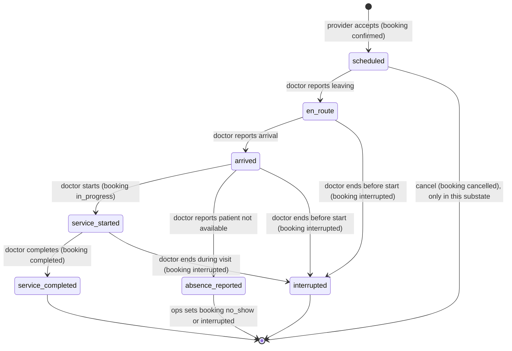

# P5 design: doctor scheduled home visit flow

_Ticket P5-doctor (README §13 Phase 5, "Doctor scheduled home visits") · Design v0.1 · 19 November 2026 · Kiro · Owner review PENDING_

This is a design document. It adds no migration, code, flag, route or seed. Nothing in it is implemented or tested, and no database was started or queried to write it. Every statement about the built system comes from reading the SQL and TypeScript on the base commit below.

## 0. Base and sources

- **Branch and base:** `task/P5-doctor-design`, created from `origin/integ/all` at `a7c14a1` (merge of `integ/b01-fixes` `1c3afca` into `integ/friend-backend` `b4918db`).
- **Migrations on the base:** `202611170001` to `202611170005`, `20261117000600` to `20261117000670`, `20261117001000`, `20261117001100`, `20261117001200`. File and line references below are to these files.
- **Seen in other worktrees, not on the base:** `20261117001300_availability_by_reference.sql` (worktree `kiro-avail`, `list_slots` by provider reference), `20261117001400_m1_storage_upload_readback.sql` (branch `fix/storage-upload-readback`), `20261117001500_review_findings.sql` (worktree `kiro-fixes`, `get_booking` returns `provider_reference` instead of the provider UUID, and `service_role` loses writes on the Q06 tables). This design assumes the `001500` `get_booking` change lands. It does not depend on `001300` or `001400`.
- **Sibling designs this one must stay consistent with:** S01 design v0.3 (`origin/task/S01-design`, `e2abee9`), which defines the shared engine change list B-1 to B-12, the `ops` actor kind, the `booking:incident` capability, `feature_gates`, `get_assignment_contact` and the closeout predicate. P01 design v1.1 (`origin/task/P01-design`, `a1c32fb`), which couples payment obligations to booking states. Reviews `review_P01.md` and `review_S01.md` (§14 maps their findings to this design).

| Source | What this design takes from it |
|---|---|
| `README.md` §13 Phase 5 and Phase 7 | Phase 5 is the scheduled home visit. Arrival OTP and all clinical capabilities (DC02, DC04 to DC14) are Phase 7. |
| `docs/MASTER_BLUEPRINT.md` §5 | No fabricated ETAs, payment success or credentials. Booking and payment states separate. Patient chooses, provider manually accepts. |
| `docs/BUSINESS_RULES_AND_APPROVAL_MATRIX.md` | "Scheduled doctor bookings" need product owner and provider operations sign-off. Default until then: synthetic staging only. Hybrid cancellation mechanics are not approved. |
| `docs/API_CONTRACTS.md` | Doctor routes `en-route`, `arrive`; `verify-arrival` (OTP) is left to DC02. Stable 401/403/404/409/422/429 errors. Minimal status events with no patient name, phone or notes. |
| `docs/DECISIONS.md`, `docs/S00_DECISION_SHEET.md` | Core booking first, then DC01 to DC14. Q02 (no expiry, no penalties invented), Q04 (collector reports only), Q06 (only individually verified clinicians are assigned), Q07 (exact PINs, no ETA), Q09 (no clinical activation), Q10 (no 24/7 support promise). |
| `docs/CANONICAL_SCHEMA_DRAFT.md` §5 | `doctor_visits` holds travel and attendance only. Substates `scheduled -> en_route -> arrived -> service_started -> service_completed`. `no_show` is set by support after evidence review. Interruption ends the visit; continuation is a new booking. |
| `docs/specs/BOOKING_AND_CONSULTATION.md` | Arrival is a doctor claim; the patient checks identity in person. Emergencies never wait on the app. Payment stays independent of visit completion. |

## 1. Scope

**In scope:** what happens to a doctor home visit from acceptance to a terminal state. That covers the doctor's milestones, patient absence, ending a visit early, operations review, the doctor's own visit list, the patient's visit view, contact privacy, reservation handling at close, timing guards, and the tests for all of these.

**Out of scope, and stays off:**
- Arrival OTP (DC02) and the `verify-arrival` route. P5 arrival is the doctor's report only.
- Realtime push (DC03). P5 uses refetch. No table joins the `supabase_realtime` publication.
- All clinical capabilities (DC04 to DC14): vitals, notes, prescriptions, records, PDFs, photos, QR proof.
- Payments and collection (P01). This design only states the coupling (§13 CQ-4).
- Reassignment to another doctor, reschedule (`request_reschedule` stays disabled), support tickets, notification vendors, GPS, ETAs, emergency dispatch, teleconsultation.

Completion is the doctor's operational report that the visit ended. It is not a clinical certification and the UI must not present it as one.

### 1.1 What the built doctor path does today

Read from the base commit.

1. `accept_booking` (`001100` L124) accepts doctor bookings only. Other categories raise `category_deferred_to_s01`. It inserts one person assignment, one reservation and a `doctor_visits` row in `scheduled`.
2. `advance_visit` (`001100` L200) enforces the substate order. `en_route` and `arrived` write a `booking_events` row with `from_state = to_state = 'confirmed'`. `service_started` moves the booking to `in_progress`, `service_completed` to `completed`. At `service_completed` it calls `booking_private.release()` (L221), which releases the reservation and the after-buffer with it. It has no replay handling: a retried tap with the same version fails with `stale_version`.
3. `identity_private.is_assigned` (`001100` L16-26) opens a fixed window `[start_at - 60 min, end_at + 12 h)`, and requires a publishable provider, `resource_eligible` and, for doctors, `providers_private.person_is_verified`.
4. `cancel_booking` (`001100` L173) lets the patient cancel until `start_at`. A scheduler or the assigned doctor may cancel any `draft`, `requested`, `accepted` or `confirmed` booking at any time. The doctor substate is ignored, so a visit can be cancelled after the doctor reported arrival.
5. `get_booking` (`001100` L225) returns `address_snapshot` and `contact_snapshot` to a scheduler inside the window, not only to the assignee (S01-03 is still open).
6. No command produces `interrupted` or `no_show`. `booking_transitions` still has the provider edge `confirmed -> no_show` (`202611170005` L56-64).
7. Patient RLS on `booking_events` (`202611170005` L563) returns `actor_profile_id`, which identifies the doctor and the scheduler. The `doctor_visits` policy (L573) returns `assignment_id`.
8. An organization's staff doctor has no way to list their own visits. `list_bookings` serves the patient or a scheduler only, and the `b01_assignment_self` policy (L569) shows the assignment only inside the window.
9. A `requested` booking whose `start_at` has passed can never leave `requested`. `accept_booking` rejects past starts, the patient's cancel raises `cancellation_window_closed` once `clock_timestamp() >= start_at` (`001100` L187), and there is no expiry. These rows also count against the 10-request cap (`001100` L100), so stale requests can lock a patient out of booking.
10. No SQL suite drives `advance_visit` past `en_route`. Suites `005`, `010`, `011` and `012` cover only the denials.

## 2. Dependencies and migration numbering

### 2.1 Shared engine changes this design needs

The doctor flow runs on the shared engine. These changes belong to the single B01 migration author, not to the doctor range. B-numbers are S01's. B-13 to B-15 are new requests from this design.

| ID | Change | Doctor-specific content | Needed by |
|---|---|---|---|
| B-2 | Closeout predicate that ignores the H1 window and provider publishability, accepted by `guard_booking` for `completed` and `interrupted`. | Doctor custody substate is `service_started`. | §7.1 completion, §7.3 in-visit interruption |
| B-3 | `get_booking`/`list_bookings` return address, contact and `patient_id` only to the patient. Assignees read contact through `get_assignment_contact`. | Doctor contact while the window is open and substate is `scheduled`, `en_route`, `arrived` or `service_started`. | §6, §7 |
| B-4 | `confirmed -> interrupted` for `assigned` and `ops`; `ops` actor kind; `in_progress -> interrupted` for `ops`. | Pre-start doctor problems (§4). | §7.3, §7.5 |
| B-5 | `feature_gates` and gate checks in create, accept and `list_slots`. | Amendment: add a `doctor` gate row instead of S01's `category = 'doctor'` exemption (DQ-01). | Production safety |
| B-6 | Per-category accept hook. | Doctor: reject when the person resource's profile is the patient's `self_profile_id` (self-dealing), and `resource_busy` while that person has an overdue doctor visit (§9). | §9, tests D30, D31 |
| B-7 | Extend the `booking_events.reason` CHECK. | Doctor codes in §5.3. | Every doctor command |
| B-8 | Completion ends assignments but keeps reservations. `upsert_booking_resource` and `set_booking_availability` test `resource_in_use` with `upper(occupied_period) > clock_timestamp()`. | Without the second half, kept reservations block the doctor's availability edits forever. | §7.1, §9 |
| B-9 | Remove provider `confirmed -> no_show`; add it for `ops` only. | Absence path (§4). | §7.4 |
| B-11 | Lead time, horizon and before/after buffers per category. | Doctor proposal in §9 (DQ-02, DQ-03). | §9 |
| B-12 | `cancel_booking` rejects for every caller once a post-initial milestone exists. | Doctor: cancel only while substate is `scheduled`. | §4, test D20 |
| **B-13** | Stale requests: the patient may cancel a `requested` booking after `start_at` (no resource is held), and the pending cap counts only `requested` rows with `start_at > clock_timestamp()`. | Surfaced by the doctor journey; applies to every category. | Edge case E-14 |
| **B-14** | Patient column grants: `booking_events` without `actor_profile_id` and `request_key`; `doctor_visits` without `assignment_id`. Implemented as `revoke select` then column-level `grant select`. | Staff identities and internal ids stay out of the patient's reach. | §8, test D41 |
| **B-15** | One rebuild of `admin_capabilities_capability_check` from the six built values (`000660` L13-16) plus `booking:incident`, plus P01's finance values if they are approved in the same window. | Ops review. Only one migration may rebuild this CHECK at a time (P01 H1). | §7.4 to §7.6 |

S01 also lists B-1 (lab baskets) and B-10 (one open request per category). The doctor flow does not need them.

### 2.2 Proposed numbering

The brief gives every P5 category the same starting point (`20261117001600`). To keep the four designs from colliding, this design proposes ranges in README Phase 5 order. Claude must confirm or replace them (CQ-1).

| Range | Owner |
|---|---|
| `20261117001600` to `20261117001609` | Reserved for the B01 author's shared engine changes in §2.1, if they are not already numbered below `001600`. Not written by the doctor ticket. |
| `20261117001610` to `20261117001699` | Doctor (this design). |
| `0017xx`, `0018xx`, `0019xx` | Proposed for lab, ambulance and caretaker. |

All names use the 14-digit prefix and sort after `20261117001500` (P01 M13).

| File (proposed) | Contents | Depends on |
|---|---|---|
| `20261117001610_p5d_visit_model.sql` | Schema `doctor_private`; `doctor_visits.substate` CHECK widened; `doctor_private.guard_visit` trigger; table `doctor_visit_exceptions` with its guard trigger, revokes and RLS. | `001100`, B-14 |
| `20261117001620_p5d_visit_commands.sql` | `advance_visit` replaced (same signature); `report_patient_absent`; `interrupt_doctor_visit`; helper `doctor_private.end_assignments`. | B-2, B-4, B-7, B-8, B-12 |
| `20261117001630_p5d_ops_review.sql` | `resolve_doctor_visit_exception`, `close_overdue_doctor_visit`, `list_doctor_visit_exceptions`. | B-4, B-9, B-15 |
| `20261117001640_p5d_projections.sql` | `list_my_doctor_visits`, `get_doctor_visit`. | B-3, `001500` |

The doctor files run only after the §2.1 changes are merged. If the B01 author rejects one, the dependent doctor command is not built (see the "Needed by" column).

## 3. User journeys

All data is synthetic. Copy strings are proposals for review in English, Hindi and Telugu. None of them promises an arrival time.

### 3.1 Patient

1. Searches by PIN, opens a verified doctor (public `provider_reference`), sees advisory slots and the fixed price, and requests a slot. The request shows "Waiting for the doctor to accept. This is not a confirmed visit."
2. The provider accepts manually. The patient's visit page (`GET /api/bookings/:id/visit`) shows the booked window, the provider's published name and reference, and the assigned doctor's name with a credential status (§7.7). No phone number of the doctor is shown.
3. During the visit the page refetches the visit state (§8.5) and shows the milestone labels in §4.2. At `arrived` it adds: "Check the doctor's identity before letting them in. SureCure Visit never asks for a code over the phone." In P5 there is no arrival code.
4. After completion the page shows "Doctor reports the visit is complete." Payment status, when P01 exists, is a separate block and never changes this label (DC10).
5. If the doctor reports absence or ends the visit early, the page says what was recorded and that it is under review (§4.2). If the reason is `ended_for_emergency`, it shows "In an emergency call 112" with a `tel:112` link. The app does not dispatch anything.
6. The patient can cancel only while the substate is `scheduled` (B-12, DQ-05).

Every booking page and the public footer carry the line "Not for emergencies. In an emergency call 112." (S01-13).

### 3.2 Doctor

There are two kinds of doctor. An **individual owner-doctor** owns the provider row, is its scheduler and is the assigned person. An **organization staff doctor** is an active member with `provider:read` and an approved Q06 credential case, assigned by a scheduler.

1. Opens "My visits" (`GET /api/doctor/visits`). Each row shows reference, window, PIN, state, substate, whether the doctor can act now, and whether their credential is currently valid. It shows no address or phone.
2. Inside the window (`start_at - 60 min` onward), opens the visit. Address and phone come from `get_assignment_contact` (B-3), one audited read.
3. Taps "On my way", "Arrived", "Start visit", "Visit complete" in that order. Each tap sends the version the screen holds. A retried tap returns the same result (§7.0).
4. At the door with nobody there: "Patient not available" (`report_patient_absent`). Contact access ends.
5. A problem before starting (address not found, unsafe situation, patient declines at the door, doctor unwell) or during the visit (patient asks to stop, emergency): "End visit" with a reason code (`interrupt_doctor_visit`).
6. Before leaving (substate `scheduled`) the doctor may still cancel with `provider_unavailable` (built H2 path, narrowed by B-12).

### 3.3 Provider scheduler

Accepts or declines requests and picks the doctor resource (built). Sees no address or phone (B-3). Can cancel only while the substate is `scheduled` (B-12). Sees the substate in the queue projection. A doctor with an overdue visit cannot be chosen for new acceptances until ops closes it (B-6, §9).

### 3.4 Operations (ops)

A holder of `booking:incident` at AAL2 for the provider's organization, or a global grant (B-15). Ops is never a member of the provider's organization, its owner, the patient or the person who raised the exception. Ops works a queue (`GET /api/ops/doctor-visits`) of open exceptions and overdue visits, and closes each with a coded decision. Ops never reads address, phone or clinical data. Until someone holds this capability, exceptions stay open and the patient sees "recorded for review" (DQ-08).

## 4. State machine

### 4.1 Booking states and doctor substates

Booking states are the built ones. The doctor substate lives in `doctor_visits.substate`. Two substates are added: `absence_reported` and `interrupted`.

`scheduled -> interrupted` is not offered. Before leaving, the doctor cancels instead, which releases the reservation like any pre-start cancellation. Ops can also close an overdue visit from any non-terminal substate (§7.5).

### 4.2 Transition table

| From substate | To substate | Booking change | Actor and predicate | Command | Event reason | Patient label |
|---|---|---|---|---|---|---|
| (accept) | `scheduled` | `requested -> accepted -> confirmed` | Scheduler (built) | `accept_booking` | `accepted`, `confirmed` | "Visit confirmed for <window>" |
| `scheduled` | `en_route` | none (`confirmed`) | Assignee (`is_assigned`) | `advance_visit` | `en_route` | "Doctor reports they are on the way" |
| `en_route` | `arrived` | none | Assignee | `advance_visit` | `arrived` | "Doctor reports arrival. Check their identity before letting them in." |
| `arrived` | `service_started` | `confirmed -> in_progress` | Assignee | `advance_visit` | `service_started` | "Doctor reports the visit has started" |
| `service_started` | `service_completed` | `in_progress -> completed` | Closeout (B-2) | `advance_visit` | `service_completed` | "Doctor reports the visit is complete" |
| `arrived` | `absence_reported` | none | Assignee | `report_patient_absent` | `absence_reported` | "The doctor reports they could not meet you at the address. This has been recorded for review." |
| `en_route`, `arrived` | `interrupted` | `confirmed -> interrupted` (B-4) | Assignee | `interrupt_doctor_visit` | the reason code | "The visit did not go ahead. Reason: <label>." |
| `service_started` | `interrupted` | `in_progress -> interrupted` (built edge) | Closeout (B-2) | `interrupt_doctor_visit` | the reason code | "The visit ended early. Reason: <label>." |
| `absence_reported` | unchanged | `confirmed -> no_show` (B-9) | Ops | `resolve_doctor_visit_exception` | `no_show_confirmed` | "Marked as not attended after review. No fee is charged by this app." |
| `absence_reported` | unchanged | `confirmed -> interrupted` (B-4) | Ops | `resolve_doctor_visit_exception` | `ops_interrupted` | "The visit did not go ahead." |
| any non-terminal | unchanged | `confirmed` or `in_progress -> interrupted` | Ops, visit overdue (§9) | `close_overdue_doctor_visit` | `visit_not_recorded` | "This visit was closed because it was not recorded as completed." |
| `scheduled` | unchanged | `confirmed -> cancelled` | Patient, scheduler or assignee (B-12) | `cancel_booking` | built codes | "Visit cancelled" |

The "No fee is charged by this app" line stays only while Q02 has no approved no-show policy.

### 4.3 Enforcement in the database

`doctor_private.guard_visit` is a `BEFORE UPDATE OR DELETE` trigger on `doctor_visits` (and `BEFORE TRUNCATE` per statement). Following P01 H3, it does not trust the commands:

- Rejects DELETE and TRUNCATE, and any change to `booking_id` or `assignment_id`.
- Allows only the substate edges in the diagram.
- Checks the new substate against the booking state at that moment: `en_route`, `arrived` and `absence_reported` require `confirmed`; `service_started` requires `in_progress`; `service_completed` requires `completed`; `interrupted` requires `interrupted`.
- Requires a `booking_events` row for this booking with `aggregate_version = bookings.version` and the reason that belongs to the new substate (`en_route`, `arrived`, `service_started`, `service_completed`, `absence_reported`, or one of the interruption codes for `interrupted`). Each command calls `booking_private.transition()` before it updates the substate, so the row exists; a substate write without a matching transition fails.

This holds for application roles. The table owner can disable triggers, as the existing tests do to move times (`011` L18-20), so the guarantee is stated for `authenticated` and `service_role` only (P01 L12).

## 5. Data model changes

### 5.1 `public.doctor_visits` (built table, doctor-owned)

- Widen the substate CHECK to `('scheduled','en_route','arrived','service_started','service_completed','absence_reported','interrupted')`.
- Add the `guard_visit` trigger (§4.3).
- No new columns. Milestone times come from `booking_events.occurred_at` (set with `now()`, the transaction start). P01 reads completion time the same way (P01 M9). `bookings` gets no columns: `guard_booking` makes every column except `state`, `version` and `updated_at` immutable.

### 5.2 `public.doctor_visit_exceptions` (new)

| Column | Type and rule |
|---|---|
| `id` | `uuid primary key default gen_random_uuid()` |
| `booking_id` | `uuid not null references public.bookings(id)` |
| `kind` | `text not null check (kind in ('absence_reported','interrupted','closed_while_ineligible'))` |
| `reason` | `text not null`, CHECK by kind: `absence_reported` for `absence_reported`; an interruption code from §5.3 for `interrupted`; `service_completed` or an interruption code for `closed_while_ineligible` |
| `opened_by_profile_id` | `uuid not null references public.profiles(id)` (the doctor) |
| `opened_at` | `timestamptz not null default now()` |
| `status` | `text not null default 'open' check (status in ('open','resolved'))` |
| `resolution` | `text`, `null` while open; `no_show` or `interrupted` for `absence_reported`; `acknowledged` for the other kinds (CHECK) |
| `resolved_by_profile_id` | `uuid references public.profiles(id)`, CHECK distinct from `opened_by_profile_id` |
| `resolved_at` | `timestamptz` |
| `version` | `integer not null default 1 check (version > 0)` |

- CHECK: `status = 'open'` iff `resolution`, `resolved_by_profile_id` and `resolved_at` are all null.
- Partial unique index on `(booking_id) where status = 'open'`: at most one open exception per visit.
- Guard trigger: no DELETE or TRUNCATE; UPDATE only from `open` to `resolved` with `version = old.version + 1`; every other column immutable.
- No free-text column. Reasons and resolutions are codes only (S01-30).
- RLS enabled, no policies. `revoke all ... from public, anon, authenticated, service_role` (P01 H2). Reads go through `get_doctor_visit` and `list_doctor_visit_exceptions`.

S01 refers to "operations exceptions" without defining a table. If Claude wants one shared `booking_exceptions` table for all four categories, this table maps to it column for column (CQ-2).

### 5.3 Reason codes added to `booking_events.reason` (B-7)

| Code | Written by | Exception kind |
|---|---|---|
| `absence_reported` | `report_patient_absent` | `absence_reported` |
| `address_not_found` | `interrupt_doctor_visit` before start | `interrupted` |
| `declined_at_door` | `interrupt_doctor_visit` before start | `interrupted` |
| `unsafe_conditions` | `interrupt_doctor_visit`, before or during | `interrupted` |
| `doctor_unable` | `interrupt_doctor_visit`, before or during | `interrupted` |
| `patient_requested_stop` | `interrupt_doctor_visit` during | `interrupted` |
| `ended_for_emergency` | `interrupt_doctor_visit`, before or during | `interrupted` |
| `no_show_confirmed` | ops resolution | none |
| `ops_interrupted` | ops resolution | none |
| `visit_not_recorded` | `close_overdue_doctor_visit` | none |

`absence_reported`, `unsafe_conditions` and `ended_for_emergency` are the same strings S01 uses. `doctor_unable` follows S01's `driver_unable`/`technician_unable`. Audit actions follow the built rule `'booking.' || reason`.

### 5.4 Not created

No OTP table, no location or ETA columns, no notes, no photo or document tables, no `completed_at` column, no gateway or payment tables, no reassignment table.

## 6. Access predicates

| Predicate | Definition | Used for |
|---|---|---|
| Assignee | Built `identity_private.is_assigned(booking, 'doctor_visit')` (`001100` L16-26): window, active assignment for `auth.uid()`, publishable provider, `resource_eligible`, `person_is_verified`. | `en_route`, `arrived`, `service_started`, absence, interruption before start. |
| Closeout (B-2) | Active account; active `doctor_visit` assignment whose `assigned_profile_id` and resource person are `auth.uid()`; booking `in_progress`; substate `service_started`; the caller is still the individual owner or an active member with `provider:read`. Ignores the window, publishability and `person_is_verified`. | `service_completed` and interruption during the visit. |
| Ops | `coalesce(identity_private.has_capability('booking:incident', provider.organization_id), false)` (AAL2 inside), and the caller has no `organization_members` row of any status for that organization (P01 L1), is not `individual_owner_profile_id`, is not the patient's `self_profile_id`, and is not `opened_by_profile_id`. The capability row is locked `for share` during the decision, as `001200` does for review. | §7.4 to §7.6 |
| Patient | Built `booking_private.patient(patient_id, 'booking:read')`. | `get_doctor_visit` |
| Contact (B-3) | Assignee predicate and substate in `scheduled`, `en_route`, `arrived`, `service_started`. | `get_assignment_contact` |

When closeout passes but the assignee predicate would fail (credential expired, provider suspended or window closed), the command still records the close and opens a `closed_while_ineligible` exception. A doctor already in the patient's home can always record that the visit ended (DQ-10).

## 7. RPC contracts

### 7.0 Rules for every doctor command

- `SECURITY DEFINER`, `set search_path = ''`, first statement `identity_private.require_actor()`. `revoke all on function ... from public, anon, authenticated, service_role`, then `grant execute ... to authenticated`.
- Reject unless `bookings.category = 'doctor'` (`55000 invalid_transition`). Category always comes from the booking, never from input.
- Lock order, same as the built `advance_visit`: booking `for update`, `booking_private.lock_provider(provider)`, active assignment resources `order by id for update`, then `doctor_visits` `for update`, then the open exception if any. Authorization is checked before the locks and again after them.
- Optimistic concurrency: `p_expected_version` must equal `bookings.version`, else `40001 stale_version`.
- **Replay:** before taking locks, read the latest `booking_events` row. If `aggregate_version = p_expected_version + 1`, `actor_profile_id = auth.uid()` and `reason` is the code this call would write, return `p_expected_version + 1` without changing anything. Events are immutable, so the read is stable. This makes double taps and network retries safe without adding a request key or changing the built `advance_visit` signature. Any other mismatch is `stale_version`, and the client refetches.
- Every state or substate change goes through `booking_private.transition()`, which writes the booking update, `booking_events`, `audit_events` and `notification_outbox` in one transaction.
- A denial raises and rolls back, so it cannot write an audit row. The route logs `{route, booking_id, sqlstate, message}` only (S01-14).

### 7.1 `public.advance_visit(p_booking_id uuid, p_substate text, p_expected_version integer) returns integer` (replaced)

Same signature, so the existing routes `en-route`, `arrive`, `start` and `complete` and their grants keep working (`create or replace`).

- `en_route`, `arrived`, `service_started`: assignee predicate. The built `visit_too_early` check stays, although the assignee predicate already fails with `42501` before `start_at - 60 min`.
- `service_completed`: closeout predicate. If the assignee predicate fails at that moment, also open a `closed_while_ineligible` exception with reason `service_completed`.
- At `service_completed`, call `doctor_private.end_assignments(booking)` (assignments `ended`, `ended_at = clock_timestamp()`). Reservations stay `active` (B-8). `booking_private.release()` is no longer called here.
- Returns the new booking version.
- Errors: `42501 forbidden`, `40001 stale_version`, `55000 invalid_transition`, `55000 visit_too_early`.

### 7.2 `public.report_patient_absent(p_booking_id uuid, p_expected_version integer) returns integer`

- Assignee predicate. Substate must be `arrived`.
- `transition(booking, 'confirmed', 'absence_reported')`, substate `absence_reported`, `end_assignments`, insert an exception (`absence_reported`, reason `absence_reported`). Reservation kept.
- After this the doctor has no contact access and no further commands on the visit.
- Errors: as §7.1, plus `55000 exception_open` if an open exception already exists.

### 7.3 `public.interrupt_doctor_visit(p_booking_id uuid, p_expected_version integer, p_reason text) returns integer`

- Substate `en_route` or `arrived`: assignee predicate; `p_reason` in `address_not_found`, `declined_at_door`, `unsafe_conditions`, `doctor_unable`, `ended_for_emergency`; booking `confirmed -> interrupted` (B-4).
- Substate `service_started`: closeout predicate; `p_reason` in `patient_requested_stop`, `unsafe_conditions`, `doctor_unable`, `ended_for_emergency`; booking `in_progress -> interrupted`.
- Substate `interrupted`, `end_assignments`, one exception with the reason code. Its kind is `interrupted`, or `closed_while_ineligible` when the call passed only through the closeout predicate. Reservation kept.
- Errors: as §7.1, plus `22023 invalid_reason`.

### 7.4 `public.resolve_doctor_visit_exception(p_exception_id uuid, p_expected_version integer, p_resolution text) returns integer`

- Ops predicate. `p_expected_version` is the exception's version.
- `absence_reported` and booking `confirmed`: `no_show` writes `transition(booking, 'no_show', 'no_show_confirmed')`; `interrupted` writes `transition(booking, 'interrupted', 'ops_interrupted')`.
- `interrupted` or `closed_while_ineligible`: only `acknowledged`; no booking change.
- Marks the exception `resolved`, writes `audit_events` (`booking.exception_resolved`, target the exception). Returns the exception's new version.
- Replay: if the exception is already `resolved` by `auth.uid()` with the same resolution and `version = p_expected_version + 1`, return that version.
- Errors: `42501 forbidden`, `40001 stale_version`, `55000 invalid_transition` (wrong resolution for the kind, or booking no longer `confirmed`), `22023 invalid_input`.

### 7.5 `public.close_overdue_doctor_visit(p_booking_id uuid, p_expected_version integer) returns integer`

- Ops predicate. Allowed only when the visit is overdue for ops (§9: `clock_timestamp() >= end_at + 12 h`, booking `confirmed` or `in_progress`, no open exception).
- `transition(booking, 'interrupted', 'visit_not_recorded')`, substate unchanged, `end_assignments`. A late doctor completion racing this call serializes on the booking lock; the second caller gets `stale_version`.
- Errors: `42501`, `40001`, `55000 not_overdue`, `55000 exception_open`.

### 7.6 `public.list_doctor_visit_exceptions(p_limit integer default 20, p_after uuid default null) returns setof jsonb`

- Ops predicate per row (organization-scoped grants see only their organizations). `p_limit` 1 to 50.
- Rows: open exceptions, plus overdue visits computed at read time. Each row has `booking_id`, `public_ref`, `provider_reference`, `start_at`, `end_at`, `state`, `substate`, `booking_version`, and either `{exception_id, kind, reason, opened_at, version}` or `{overdue: true}`.
- No address, phone, patient id, patient name, doctor profile id or clinical data.

### 7.7 `public.get_doctor_visit(p_booking_id uuid) returns jsonb` (patient)

- Patient predicate; otherwise `P0002 not_found` (same response for a missing booking and a forbidden one).
- Returns `id`, `public_ref`, `state`, `substate`, `version`, `start_at`, `end_at`, `provider_reference`, `provider_name` (from `providers.published_profile->>'display_name'`), `timeline` (array of `{event, occurred_at}` from `booking_events`, without actor ids), and, once accepted, `doctor: {name, credential_verified}`. `name` is `profiles.display_name` of the assigned person, labelled in the UI as the name on the doctor's account; Q06 cases hold no verified personal name (DQ-04). `credential_verified` is `providers_private.person_is_verified(provider, person)` evaluated at read time. If an exception exists it adds `{kind, reason, status, resolution}`.
- No doctor phone, profile id, resource id or assignment id.

### 7.8 `public.list_my_doctor_visits(p_limit integer default 20, p_after_start timestamptz default null, p_after_id uuid default null) returns setof jsonb`

- Active account. Rows where an active `doctor_visit` assignment has `assigned_profile_id = auth.uid()` and the booking is `confirmed` or `in_progress`. Keyset order `(start_at, id)`. `p_limit` 1 to 50; the two cursor arguments are both null or both set.
- Each row: `id`, `public_ref`, `provider_reference`, `start_at`, `end_at`, `pin_code`, `state`, `substate`, `version`, `can_act_now` (the assignee predicate), `credential_ok` (`person_is_verified`).
- No address line, contact, patient id or name. Lists never return contact data, so refetching writes no audit rows (S01-15).

### 7.9 API routes

All routes use the built helpers (`endpoint`, `session`, `input`, `routeId`) and `bookingCommand`, with the new RPC names added to its `Command` union. Bodies are `z.strictObject`, so `substate`, `state`, `category`, `providerId`, `actorId`, `amountPaise`, `lat`, `lng` and `eta` are rejected with 422.

| Method and path | RPC | Body or query (Zod) |
|---|---|---|
| `POST /api/bookings/:id/en-route`, `/arrive`, `/start`, `/complete` (built) | `advance_visit` | `{ expectedVersion }` (built `advanceSchema`) |
| `POST /api/bookings/:id/absence` | `report_patient_absent` | `{ expectedVersion }` |
| `POST /api/bookings/:id/interrupt` | `interrupt_doctor_visit` | `{ expectedVersion, reason: z.enum([...7 codes]) }` |
| `GET /api/bookings/:id/visit` | `get_doctor_visit` | none |
| `GET /api/bookings/:id/contact` | `get_assignment_contact` (B-3, shared) | none |
| `GET /api/doctor/visits` | `list_my_doctor_visits` | `limit` 1 to 50, `afterStart` ISO UTC, `afterId` uuid, both cursors or neither |
| `GET /api/ops/doctor-visits` | `list_doctor_visit_exceptions` | `limit`, `cursor` |
| `POST /api/ops/doctor-visits/exceptions/:id/resolve` | `resolve_doctor_visit_exception` | `{ expectedVersion, resolution: z.enum(['no_show','interrupted','acknowledged']) }` |
| `POST /api/ops/doctor-visits/:id/close-overdue` | `close_overdue_doctor_visit` | `{ expectedVersion }` |

Error mapping is the built `bookingCommand` table: `42501` 403, `P0002` 404, `40001` and `55000` 409, `22023` 422, `53300` 429, anything else 503 with no upstream detail. The ops routes need no extra server check, because `has_capability` enforces AAL2 in the database. Responses are `Cache-Control: no-store` like the other authenticated routes.

## 8. RLS, grants, capability, audit and gate

### 8.1 Tables

- `doctor_visit_exceptions`: §5.2. No grants to any API role, including `service_role`.
- `doctor_visits`: B-14 column grant for the patient (`booking_id`, `substate`). `service_role` loses INSERT, UPDATE, DELETE, TRUNCATE, TRIGGER and REFERENCES (P01 H2, as `000610` and `001500` do for other ledgers).
- `booking_events`: B-14 column grant for the patient, without `actor_profile_id` and `request_key`.
- `doctor_private`: `revoke all on schema doctor_private from public, anon, authenticated`. Its helpers are never granted to API roles.

### 8.2 Capability

`booking:incident` is S01's ops capability, added by B-15. That migration rebuilds the CHECK from the six built values plus the new ones and includes a test that each built value still inserts (P01 H1). Ops routes call RPCs that check `has_capability` directly; `identity_roles()` is not changed (P01 L13). Granting `booking:incident` is the same reviewed out-of-band bootstrap as other admin capabilities (`202611170001` header).

### 8.3 Audit

- Every transition: the built `audit_events` row `booking.<reason>`.
- Exception resolution: `booking.exception_resolved`.
- Contact read: one row per `get_assignment_contact` call (B-3), IDs and time only. List and visit projections write none.
- Denials: structured route log only.

### 8.4 Gate

With B-5 as written in S01, doctor bookings are never gated. Nothing else stops a real patient from booking a real verified doctor once a production database has one. This design asks for a `doctor` row in `feature_gates`, default `off`, set `on` in synthetic staging fixtures and tests (DQ-01). With `suspended`, new milestones before `service_started` are rejected, and completion and in-visit interruption stay allowed, matching S01's gate states. The env flag `FEATURE_DOCTOR_VISITS` (proposed) must also be `"true"` for the routes, using the built `isEnabled()`.

### 8.5 Realtime

No table is added to the `supabase_realtime` publication (S01-21). The patient page refetches `GET /api/bookings/:id/visit` every 20 seconds while the visit is `confirmed` or `in_progress` and the page is visible, with backoff to 60 seconds after errors, and on window focus. Private broadcast from the outbox is DC03 work.

## 9. Reservations and timing

- **Completion, absence, interruption, ops close:** assignments end, reservations stay `active` (B-8). An active reservation in the past cannot overlap future work, so the exclusion constraint stays correct and an early finish never frees the after-buffer. B-8's `resource_in_use` change is required, or the doctor can never edit availability again.
- **Cancellation:** only in `scheduled`, and it releases the reservation (built behaviour).
- **Window:** the built H1 window `[start_at - 60 min, end_at + 12 h)` bounds every assignee action. `en_route` is allowed from `start_at - 60 min` whatever the before-buffer, because it reports travel and reserves nothing.
- **Lead time and horizon (B-11, DQ-02):** proposal for synthetic staging, same as S01's MR-04: a slot at least 2 hours ahead, at most 30 days ahead, enforced in create, accept and `list_slots`. The built 90-day horizon stays the outer bound until then.
- **Buffers (B-11, DQ-03):** proposal before-buffer 0 to 60 minutes (H1 opens 60 minutes before start), after-buffer 0 to 60 minutes. One system value for the doctor category. The patient never sees a buffer as travel time.
- **Overdue:** a doctor visit is overdue for scheduling when the booking is `confirmed` or `in_progress` and `clock_timestamp() >= upper(occupied_period)`. While it is overdue, `accept_booking` rejects assigning that doctor's person resource to new bookings (`resource_busy`, B-6). It is overdue for ops when `clock_timestamp() >= end_at + 12 h`, the point where the assignee window closes. Both are computed at read time; there is no job.

## 10. Edge cases

| ID | Case | Behaviour |
|---|---|---|
| E-01 | Double tap or network retry on a milestone | Replay rule (§7.0) returns the same version; no second event. |
| E-02 | Doctor taps `en_route` on two devices | Booking lock serializes; the second call either replays (same actor and reason) or gets `stale_version`. |
| E-03 | Patient cancels while the doctor taps `en_route` | Same lock. If cancel wins, `en_route` fails `stale_version` and then `invalid_transition`. If `en_route` wins, cancel fails under B-12. |
| E-04 | Doctor's Q06 credential expires between acceptance and the visit | Assignee predicate fails; the doctor cannot start. "My visits" shows `credential_ok = false`. The scheduler cancels while `scheduled`, or the visit becomes overdue and ops closes it. The patient view shows `credential_verified = false`. |
| E-05 | Credential expires, provider suspended or window closes during `service_started` | Closeout still records completion or interruption, and opens `closed_while_ineligible` for ops. |
| E-06 | Doctor's membership is disabled during the visit | Closeout fails (membership is required). The visit becomes overdue and ops closes it. Recorded as a limitation. |
| E-07 | Doctor taps `service_completed` one minute after start | Allowed. It is an operational report, labelled "Doctor reports". No minimum duration is invented. |
| E-08 | Doctor reports `en_route`, then nothing happens | After `upper(occupied_period)` the doctor cannot be assigned new work; after `end_at + 12 h` ops closes it as `visit_not_recorded`. |
| E-09 | Patient not home | `report_patient_absent`; booking stays `confirmed` until ops decides. No automatic `no_show` and no fee (Q02). |
| E-10 | Patient at home refuses entry | `interrupt_doctor_visit` with `declined_at_door`. Not a `no_show`. |
| E-11 | Medical emergency before or during the visit | `ended_for_emergency`. The patient page shows the 112 line. The app dispatches nothing and the doctor does not wait on the app. |
| E-12 | Patient wants to cancel after the doctor left | Not possible in the app under B-12. The patient tells the doctor, who records `declined_at_door` or `doctor_unable` as appropriate (DQ-05). |
| E-13 | Patient account disabled or `booking:read` grant revoked mid-visit | Patient view returns `not_found`. The doctor flow continues; it does not read patient grants. |
| E-14 | `requested` booking whose start passed | Cannot be accepted. Under B-13 the patient can cancel it and it no longer counts against the pending cap. |
| E-15 | Doctor books a visit with themself as patient | Rejected at accept by the B-6 self-dealing check. |
| E-16 | Booking of another category sent to a doctor command | `55000 invalid_transition`. |
| E-17 | Body includes `substate`, `category`, `lat`, `eta` or extra keys | 422 from strict Zod; the RPC never sees them. |
| E-18 | Availability edit after completed visits | Allowed once B-8's `resource_in_use` change lands (past reservations ignored). Blocked forever without it, which is why §7.1 depends on B-8. |
| E-19 | Two consecutive visits for one doctor | Kept reservations keep the after-buffer; `accept_booking` cannot overlap the next visit with it. |
| E-20 | A visit crossing midnight IST | Not offered: built `availability_rules` require `local_end < 24:00` and `in_schedule` uses one local date. No change. |
| E-21 | Ops reviewer belongs to the provider organization (any status), owns it, is the patient or raised the exception | `forbidden`. |
| E-22 | Ops session without AAL2 | `has_capability` returns false; `forbidden`. |
| E-23 | Exception already open and the doctor reports again | `exception_open`; the substate guard also rejects edges out of `absence_reported`/`interrupted`. |
| E-24 | Payment due when the visit ends | No effect on any doctor command. Completion never waits for payment (DC10). |
| E-25 | Patient reports that the doctor never came | No patient report path in core. Ops sees the visit when it becomes overdue (DQ-11). |

## 11. Test plan

Fixtures are synthetic and rollback-only, extending `supabase/tests/_b01_fixture.inc` with `_p5d_fixture.inc`: an organization doctor provider, a staff doctor with an approved Q06 case, a second staff doctor with an expired case, an ops profile with `booking:incident` (JWT claims include `"aal":"aal2"`), an ops profile without AAL2, and an ops profile who is a disabled member of the organization. Times are moved the way `011` does it (owner context, guard trigger disabled for the update only). Suites use the built `_tap_helpers.inc` helpers (`pg_temp.assert_true`, `pg_temp.expect_state`). Proposed files, numbered after the migration range: `160_p5d_visit_flow.test.sql`, `161_p5d_visit_denials.test.sql`, `162_p5d_ops_review.test.sql`, `163_p5d_privacy_grants.test.sql`.

### 11.1 SQL suites

| ID | Case | Expected |
|---|---|---|
| D01 | Full path: accept, `en_route`, `arrived`, `service_started`, `service_completed` inside the window | Versions increase by one each step; booking `completed`; one event per milestone (four, after the three from create and accept) with the right reasons; one `audit_events` and one `notification_outbox` row per step. |
| D02 | After D01 | Assignment `ended`; reservation still `active`; a second booking overlapping the after-buffer is rejected at accept. |
| D03 | Replay of each D01 step with the same expected version by the same doctor | Returns the same version; event count unchanged. |
| D04 | Same expected version, different reason (`arrived` after `en_route` was written) | `40001`. |
| D05 | Skip (`scheduled -> arrived`), reverse (`arrived -> en_route`), repeat | `55000`. |
| D06 | Wrong doctor, outsider, scheduler who is not the assignee, patient | `42501` on every doctor command. |
| D07 | Before `start_at - 60 min`; after `end_at + 12 h` while `confirmed` | `42501` (`visit_too_early` where the built check applies). |
| D08 | Expired Q06 credential before start | `en_route` denied; `list_my_doctor_visits` shows `credential_ok = false`. |
| D09 | Credential expires during `service_started`, then complete | Completed; one open exception, kind `closed_while_ineligible`, reason `service_completed`. |
| D10 | Provider suspended during `service_started`, then interrupt with `patient_requested_stop` | Interrupted; exactly one open exception, kind `closed_while_ineligible`, reason `patient_requested_stop`. |
| D11 | `report_patient_absent` from `arrived` | Booking `confirmed`, substate `absence_reported`, assignment ended, exception open, `get_assignment_contact` denied afterwards. |
| D12 | `report_patient_absent` from `scheduled`, `en_route`, `service_started` | `55000`. |
| D13 | `interrupt_doctor_visit` before start with each allowed code; with `patient_requested_stop` before start | Allowed codes interrupt; `patient_requested_stop` before start is `22023`. |
| D14 | `interrupt_doctor_visit` during the visit with `address_not_found` | `22023`. |
| D15 | Direct `update doctor_visits set substate = 'service_completed'` as owner without a booking transition | Rejected by `guard_visit`. |
| D16 | As `authenticated` and as `service_role`: INSERT, UPDATE, DELETE, TRUNCATE on `doctor_visits` and `doctor_visit_exceptions` | Denied. |
| D17 | Update a resolved exception; delete an exception | Rejected by the guard trigger. |
| D18 | Two open exceptions for one booking | Unique index violation. |
| D19 | Doctor command on a lab booking | `55000`. |
| D20 | `cancel_booking` by patient, scheduler and doctor after `en_route` | `55000` for all three (B-12). In `scheduled`: allowed and reservation released. |
| D21 | Ops resolves `absence_reported` as `no_show` | Booking `no_show`, event `no_show_confirmed`, exception resolved, audit row. |
| D22 | Ops resolves `absence_reported` as `interrupted` | Booking `interrupted`, event `ops_interrupted`. |
| D23 | Ops resolves `interrupted` as `no_show` | `55000`. |
| D24 | Ops without AAL2; ops who is a disabled org member; ops who is the patient; the doctor who opened it | `42501` each. |
| D25 | Stale exception version | `40001`. |
| D26 | `close_overdue_doctor_visit` before `end_at + 12 h` | `55000 not_overdue`. After it: booking `interrupted`, event `visit_not_recorded`. |
| D27 | `close_overdue_doctor_visit` with an open exception | `55000 exception_open`. |
| D28 | Provider `confirmed -> no_show` through any built command or the transition table | No such edge (B-9). |
| D29 | Scheduler sets availability after D01 | Allowed (B-8). |
| D30 | Accept with the patient's own profile as the doctor resource | Rejected (B-6). |
| D31 | Accept a new booking for a doctor with an overdue visit | `resource_busy` (B-6). |
| D32 | `list_my_doctor_visits` for staff doctor | Own active visits only; no `address_snapshot`, `contact_snapshot`, `patient_id`; limit 51 is `22023`; one cursor without the other is `22023`. |
| D33 | `get_doctor_visit` by the patient | Fields in §7.7 only; no actor ids, resource ids, phone. |
| D34 | `get_doctor_visit` by doctor, scheduler, outsider, unknown id | `P0002` for each, same response. |
| D35 | `list_doctor_visit_exceptions` with an org-scoped grant for another organization | Rows for that organization are absent. |
| D36 | Every new function | `search_path` empty, no EXECUTE for `anon` or `service_role`, `SECURITY DEFINER`. |
| D37 | `pg_publication_tables` for `supabase_realtime` | No `bookings`, `booking_events`, `doctor_visits` or `doctor_visit_exceptions`. |
| D38 | Capability CHECK after B-15 | All six built values and `booking:incident` insert. |
| D39 | Stale `requested` booking past `start_at` (B-13) | Patient cancel succeeds; the 10-request cap ignores past requests. |
| D40 | Doctor gate `off` (B-5 amendment) | Create, accept and `list_slots` for doctor rejected or empty; `suspended` rejects `en_route` and still allows completion. |
| D41 | Patient `select actor_profile_id from booking_events`; `select assignment_id from doctor_visits` | Permission denied (B-14). |

### 11.2 Concurrency (real races)

A new script `tests/rls/run_p5d_concurrency.py` following `run_b01_concurrency.py` (unique local scratch database, two sessions):

- C1: cancel and `en_route` at the same time: exactly one succeeds.
- C2: `service_completed` and `close_overdue_doctor_visit`: exactly one succeeds.
- C3: two ops reviewers resolve one exception: one succeeds, one `stale_version`.
- C4: two schedulers accept two bookings for the same doctor in an after-buffer: one succeeds.
- C5: double `report_patient_absent`: one change, the other replays.

### 11.3 Vitest (`tests/unit/doctor-visit.test.ts`)

- Strict schemas: forged keys (`substate`, `state`, `category`, `providerId`, `actorId`, `amountPaise`, `lat`, `lng`, `eta`) rejected; reason enum closed; versions positive integers; cursor pairs.
- Each route passes only the documented RPC arguments (`rpc` mock asserts the exact argument object) and never a substate from the body.
- `bookingCommand` maps the new messages (`exception_open`, `not_overdue`, `invalid_reason`) through the built status table without leaking the message.
- Copy: no string in the doctor patient labels matches `/\b\d+\s*(min|mins|minutes|hrs?|hours)\b/i` or "arriving in"; milestone labels start with "Doctor reports"; the 112 line exists in en, hi and te.
- `isEnabled('doctorVisits')` is true only for the exact string `"true"`.

### 11.4 End to end (Playwright, synthetic staging)

One journey: patient requests, scheduler accepts, staff doctor runs the four milestones, patient page shows each label after refetch, payment block (if present) stays independent. One absence journey ending in ops `no_show`. Mobile 360 px, keyboard-only milestone buttons, labels not conveyed by colour only. One stack at a time because of the 6 GB RAM limit noted in `integ_all_gaps.md`.

### 11.5 Commands for the implementer

`npm run lint`, `npm run typecheck`, `npm test`, `npx supabase db reset` then the SQL suites `001` to `005`, `010` to `014` and `160` to `163` via the existing runner, and `python3 tests/rls/run_p5d_concurrency.py`. The implementer records real output in `docs/TEST_EVIDENCE.md`.

## 12. Owner questions and safe defaults

| ID | Question | Safe default until answered | Related |
|---|---|---|---|
| DQ-01 | Should doctor bookings have their own gate? | Yes: `doctor` gate `off` outside synthetic staging. | B-5, business matrix |
| DQ-02 | Lead time and horizon for doctor visits. | 2 h minimum, 30 days maximum in staging; not shown to patients as policy. | Q02, Q07, MR-04 |
| DQ-03 | Before and after buffers. | Before 0 to 60 min, after 0 to 60 min, one system value. | B-11 |
| DQ-04 | Which name does the patient see for a staff doctor, and is it verified? | Account display name, labelled as such, plus `credential_verified`. A verified name field on Q06 cases is a follow-up. | Q06 |
| DQ-05 | May the patient or scheduler cancel after the doctor left? | No (B-12). | Q02, D-POL |
| DQ-06 | Reassignment of an organization's visit to another doctor before departure. | Not in core; cancel and rebook. | S01 §3 |
| DQ-07 | Should the arrival code (DC02) move into P5? | No; Phase 7. P5 shows identity-check advice only. | DC02, Q09 |
| DQ-08 | Who holds `booking:incident`, with what hours? | Nobody until named. Exceptions stay open; copy says "recorded for review" and promises no response time. | Q10 |
| DQ-09 | Consequences of a confirmed no-show. | None in the app; no fee. | Q02 |
| DQ-10 | May a doctor record completion after their credential or the provider is suspended mid-visit? | Yes, with a `closed_while_ineligible` exception. | Q06 |
| DQ-11 | Should the patient be able to report "doctor did not come"? | No in core; overdue detection only. | Q10 |
| DQ-12 | Retention of exceptions and visit events. | Kept; no deletion path; synthetic data only. | Q05 |

## 13. Coordination questions for Claude

| ID | Question | Proposal |
|---|---|---|
| CQ-1 | Migration ranges for the four P5 designs, which all start at `20261117001600`. | `001600`-`001609` engine prerequisites (B01 author), `0016xx` doctor, `0017xx` lab, `0018xx` ambulance, `0019xx` caretaker. SQL suites `160`-`169`, `170`-`179` and so on. |
| CQ-2 | One shared exceptions table or one per category? | One shared `booking_exceptions` if the lab, ambulance and care designs need the same shape. Otherwise `doctor_visit_exceptions` as in §5.2. |
| CQ-3 | Who rebuilds the capability CHECK? | One B-15 migration that includes `booking:incident` and any approved P01 finance values. |
| CQ-4 | P01 coupling. P01 v1.1 treats `interrupted` as "service started, money may have changed hands" and voids on `cancelled`/`no_show`. B-4 adds `confirmed -> interrupted`. | P01 should void (or keep `due` with a report window) based on the `from_state` of the interrupting event. Doctor commands do not change. |
| CQ-5 | B-13 and B-14 are new engine requests from this design. | Add them to the B01 change list next to S01's B-1 to B-12. |

## 14. Review lessons applied

| Earlier finding | How this design handles it |
|---|---|
| P01 H1: CHECK rebuilt from a stale value list | B-15 rebuilds from the six built values; test D38. |
| P01 H2: `service_role` keeps writes on new tables | All new and touched doctor tables revoke writes from `service_role`; test D16. |
| P01 H3: guard trusts a column | `guard_visit` checks substate against booking state and a matching event; test D15. |
| P01 H5: predicate drops built assignment hardening | Assignee predicate is the built `is_assigned`; closeout adds only what B-2 defines; tests D06 to D10. |
| P01 L1: reviewer exclusion only for active members | Ops excludes any membership row and the owner; test D24. |
| P01 L12: overstated guarantees | §4.3 states the guarantee for application roles only. |
| P01 L13: capability vs `identity_roles()` | Ops RPCs check `has_capability` directly. |
| P01 M7: provider RLS exposes columns | No direct table policies for new tables; B-14 removes actor ids from patient reads; tests D33, D41. |
| P01 M9: `completed_at` missing | Times come from `booking_events.occurred_at`; no column added. |
| P01 M13: stale migration names and order | 14-digit names after `001500`; ranges in CQ-1; dependencies listed per file. |
| S01-03: scheduler sees contact | B-3; scheduler gets none; contact through `get_assignment_contact`. |
| S01-07: release at completion | §7.1 ends assignments only; B-8; tests D02, D29. |
| S01-12: closed reason CHECK | §5.3 codes, B-7. |
| S01-14 and S01-15: denial and read audit | Denials logged in routes; only the contact read is audited. |
| S01-17: reassignment missing | Out of core (DQ-06). |
| S01-19: cancel after milestones | B-12 for every caller; test D20, C1. |
| S01-20: provider `no_show` edge | B-9; absence goes through ops; tests D21, D28. |
| S01-21: Realtime | No publication; refetch; test D37. |
| S01-24 and S01-26: wording | `ended_for_emergency`; labels say "Doctor reports". |
| S01-28: stale claims about the engine | §1.1 lists what the base commit does, with file and line. |

## 15. Limitations

- Written from the SQL and TypeScript on `a7c14a1` without running anything. The engine changes in §2.1 are requests, not agreed work, and the hardening in other worktrees (`001300` to `001500`) may change before merge. Recheck §1.1 and §2.1 against whatever merges first.
- Not reviewed by Claude, Codex or the owner.
- Every value here (2 h lead time, 30-day horizon, buffers, 20-second refetch, reason codes, copy) is a synthetic-staging proposal, not approved policy. The 60-minute and 12-hour window comes from the built H1 change.
- Without an arrival code, "Doctor reports arrival" is an unverified claim. The patient's protection in P5 is the identity-check advice and the doctor name and credential status.
- A staff doctor whose membership is disabled mid-visit cannot close the visit; ops closes it after `end_at + 12 h` (E-06).
- Kept reservations reduce bookable capacity after early finishes. There is no trim command in core.
