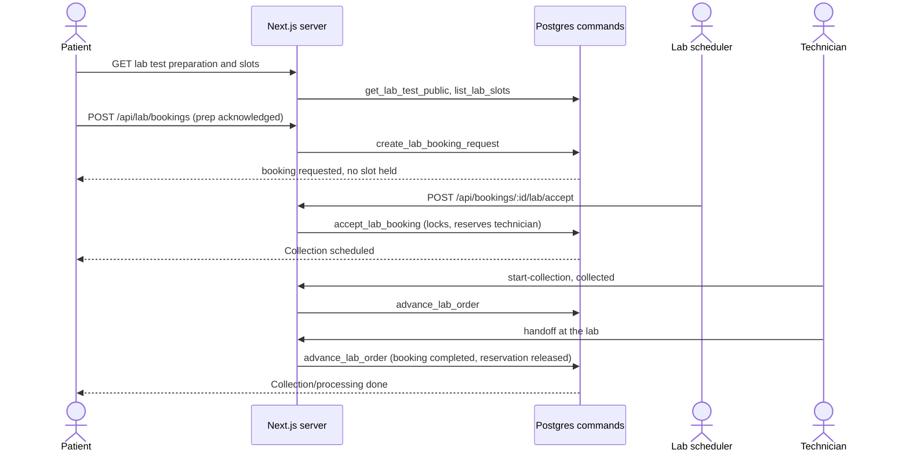

# P5 design: lab home sample collection flow

_Phase 5 lab flow · Design v0.1 · 19 November 2026 · Kiro · branch `task/P5-lab-design`, base `integ/all` at `a7c14a1` · Owner review PENDING_

This is a design document. It adds no migration, code, flag, route or seed. Nothing here is implemented or tested, and no database was started to write it. Every claim about the built stack comes from reading the SQL on `integ/all` at `a7c14a1`.

It replaces §4 (lab) of `S01_DESIGN.md` v0.3 (branch `task/S01-design`, commit `e2abee9`) for the lab category. S01 v0.3 was written while the B01 hardening (`20261117001000` to `20261117001200`) was unmerged WIP. That hardening is now merged on `integ/all`, so this design is checked against it. Where this design departs from S01 v0.3, §2 says so and why.

## 1. Sources and baseline

| Source | Used for |
|---|---|
| `README.md` Phase 5, §12 | Lab is one of four Phase 5 flows; one migration author at a time; forward-only migrations. |
| `docs/MASTER_BLUEPRINT.md` §5 | Patient chooses, provider manually accepts, server price snapshot in paise, booking and payment states separate, no fabricated availability. |
| `docs/BUSINESS_RULES_AND_APPROVAL_MATRIX.md` | Shared support (provider first-line, platform escalation); verified coverage only; lab report release needs clinical governance; default-off for paid/clinical flows. |
| `docs/API_CONTRACTS.md` | Typed server service per route; authn + authz + Zod + idempotency; stable 401/403/404/409/422/429; minimal Realtime event shape. |
| `docs/DECISIONS.md`, `docs/S00_DECISION_SHEET.md` | S00 approved with defaults. Q06 (only individually verified people assigned), Q07 (exact PINs, no ETA), Q08 ("collection/processing done", never "report delivered", report release is P2), Q02/Q03/Q04/Q05 safe defaults. |
| `docs/CANONICAL_SCHEMA_DRAFT.md` L184-207, L274-298, L354, L419, L425 | `lab_tests`, `lab_orders`, `lab_order_items`, lab substates `scheduled -> collecting -> collected -> processing_handoff`, lab collector sees address/contact/test/preparation and no clinical history. |
| `C:\tmp\scv_logs\review_S01.md`, `C:\tmp\scv_logs\review_P01.md` | Reviewer findings this design must not repeat (§13 maps them). |

### What `integ/all` already provides for lab

| Built object (file) | Behaviour today for `category = 'lab'` |
|---|---|
| `providers.public_reference` (`20261117000620`) | `SCV-LAB-NNNNNN`, server-allocated, immutable. Lab projections in this design return it, never the provider UUID. |
| `lab_profiles` (`20261117000640`) | `accreditation_label`, `home_collection` in the frozen public snapshot. Read only by this design: create requires `published_profile->>'home_collection' = 'true'` (§7.1). |
| `services`, `service_price_versions`, `provider_service_areas` (`202611170004`) | One published service with one effective price version; exact approved PIN coverage. |
| `create_booking_request` (`20261117001100` L80) | **Serves lab with no gate.** Checks coverage, effective price, 90-day horizon, 10 `requested` per patient, patient-row lock. |
| `accept_booking` (`20261117001100` L135) | Rejects every non-doctor category with `category_deferred_to_s01` (H3). |
| `list_slots` (`202611170005` L530) | **Serves lab with no gate**, one global symmetric buffer from the latest published `booking_policy_versions`. |
| `cancel_booking` (`20261117001100` L173) | Patient until `start_at` (or published cutoff); scheduler any time for `draft/requested/accepted/confirmed`; only the doctor assignee may cancel. Releases reservations. |
| `decline_booking`, `get_booking`, `list_bookings` | Generic; work for lab. `get_booking` returns `provider_id` (UUID) and `service_id`, and returns `address_snapshot`/`contact_snapshot` to the scheduler and any assignee inside `[start_at - 60 min, end_at + 12 h)` while `confirmed`/`in_progress` (L237). |
| `identity_private.is_assigned(b,'lab_collection')` (`20261117001100` L16) | Active account, active assignment, own person resource, window `[start_at - 60 min, end_at + 12 h)`, publishable provider, `resource_eligible`. **No person-credential check for lab** (doctor only). |
| `booking_private.resource_eligible` (`20261117001100` L5) | Non-doctor person resources pass with an active membership holding `provider:read`. |
| `providers_private.person_is_verified` (`20261117001000` L73) | Q06 case approved, unexpired, evidence kind `required_kind(category)`, which is `licence` for lab. Individual owners pass. |
| `booking_transitions` (`202611170005` L52) | `confirmed -> in_progress`, `in_progress -> completed`, `in_progress -> interrupted` (actor `assigned`); `confirmed -> no_show` (actor `provider`). No command uses `no_show` or `interrupted` today. |
| `booking_events.reason` (`202611170005` L69) | Closed CHECK of 12 values. No lab milestone code fits. |
| `resource_reservations` (L113) | Global GiST exclusion per resource. The only overlap authority. |
| `booking_private.transition` / `release` (L207, L218) | Atomic booking update + event + audit + outbox; `release` ends assignments and releases reservations. |

## 2. Design decisions

| # | Decision | Alternatives rejected and why |
|---|---|---|
| D1 | **Single item per booking**, on `lab_orders` + `lab_order_items` from day one, with `unique(booking_id)` on items. | Baskets need nullable `bookings.service_id/price_version_id` and a new `guard_booking` insert rule (S01-01). That is a shared B01 change the other three P5 designs do not need. Dropping the unique index later enables baskets on the same tables. |
| D2 | **Lab-owned create, accept and slots commands** (`create_lab_booking_request`, `accept_lab_booking`, `list_lab_slots`). Generic `accept_booking` keeps H3 for lab permanently. | Adding a category hook inside the shared `accept_booking`/`create_booking_request` would have four P5 designs editing the same functions in parallel. Cost: `accept_lab_booking` repeats ~40 lines of orchestration (it reuses every private helper). A parity suite (§12, 022) runs the generic negative matrix against it. |
| D3 | **The generic create path cannot produce a lab booking.** A deferred constraint trigger on `bookings` (lab rows only) fails the commit unless a `lab_orders` row exists. Only the lab command inserts that row. | Editing `create_booking_request` is a shared change. A session GUC flag is forgeable or fragile. |
| D4 | **Cancellation after the first milestone is blocked** by a lab-scoped trigger on `bookings` (`WHEN old.category = 'lab' and new.state = 'cancelled'`). | Changing `cancel_booking` is shared. The trigger runs inside `cancel_booking`'s existing booking row lock, so cancel and milestones serialise. |
| D5 | **Release at handoff.** Completion means the technician is at the lab, so the after-buffer (travel to the lab) is already used. Failures and absence also release. | S01 v0.3 kept reservations active after completion (B-8). For lab that wastes capacity and, because `set_booking_availability` and `upsert_booking_resource` treat any `active` reservation as `resource_in_use` with no time check (`202611170005` L484, L505), it would freeze the technician's availability edits forever. |
| D6 | **Pre-start failure goes through the scheduler's existing `cancel_booking`** (reason `unable_to_service` or `provider_unavailable`) while the lab substate is `scheduled`. | `confirmed -> interrupted` needs a new transition row and actor mapping in shared `guard_booking` (S01 B-4). Not needed for lab. |
| D7 | **Patient absence:** technician reports `absence_reported` (booking stays `confirmed`, reservation released); a scheduler who is not the reporter confirms `no_show` through the existing `confirmed -> no_show` provider edge. No fee exists (Q02), so `no_show` is a label only. | S01 v0.3 routed absence to platform support (`ops` actor, B-4/B-9), which does not exist. This choice conflicts with the canonical "support validates no-show" rule; it is LAB-Q06. |
| D8 | **No receiving branch in core.** Handoff is to the lab provider; no `provider_locations`. | `provider_locations` is a shared table (ambulance base too) that needs address verification. Creating it in the lab range would collide with the ambulance design. LAB-Q08. |
| D9 | **Lab buffers, lead time and horizon** live in a lab policy table and are snapshotted on `lab_orders` at create. | The global `booking_policy_versions.buffer_minutes` is symmetric and shared. Lab needs a short before-buffer and a longer after-buffer for travel to the lab. |
| D10 | **Technician must pass Q06 `person_is_verified`** in every lab command, not only `resource_eligible`. | Changing `resource_eligible`/`is_assigned` for lab is shared (SP-3). Until SP-3, `get_booking` contact reads by a technician whose case lapsed after acceptance are a residual (§9). |

## 3. User journey



1. **Discover.** Patient searches `category = lab` by exact PIN (built `search_providers`). The listing shows `SCV-LAB-...`, the frozen profile, the test title and the fixed price. A lab only appears in the lab flow if its snapshot has `home_collection = true` (LAB-Q11).
2. **Prepare.** The test page shows preparation from `get_lab_test_public`: fasting hours and an approved preparation code rendered as fixed copy. No turnaround is shown (S01-Q05 default).
3. **Pick a time.** `list_lab_slots(service, date)` returns advisory windows that have at least one verified technician free for the whole buffered period. Slots never hold anything.
4. **Request.** Patient picks a saved address with a covered PIN, confirms price and terms, and ticks the preparation acknowledgement when the test needs preparation. The booking is `requested`, lab substate `pending`.
5. **Accept or decline.** A lab scheduler (`schedule:manage` or individual owner) accepts and picks one verified technician, or declines with a reason. Acceptance reserves the technician for `[start_at - before, end_at + after)` and moves the booking to `confirmed`, substate `scheduled`.
6. **Collect.** Inside the window the technician reads the address and phone (built `get_booking`) and the collection detail (`get_lab_order`: sample type, container codes, preparation, quantity; no test title, no price). They record `start-collection` (booking `in_progress`), then `collected`.
7. **Hand over.** At the lab the technician records `handoff`. The booking is `completed`, the reservation is released and the technician's access ends. The patient sees "Collection/processing done".
8. **Exceptions.** Absence, collection failure and handoff failure open a follow-up the lab scheduler sees in `list_lab_followups`. The scheduler contacts the patient outside the app (provider first-line support) and closes the follow-up with a code. Recollection is a new booking.
9. **Payment** is out of scope (P01). Nothing in this flow reads or writes payment state, and the technician never sees an amount.

## 4. Feature gate

| Layer | Mechanism | Default |
|---|---|---|
| Server | New flag `lab` / env `FEATURE_LAB` in `src/lib/feature-flags/index.ts` (`isEnabled` accepts exactly `"true"`). Lab routes return 503 `feature_unavailable` when off. | OFF |
| Database | `booking_private.gate_state('lab')` from the shared `feature_gates` table (SP-1). States `off`, `on`, `suspended`. Both layers must allow. | `off` |

| Gate state | `get_lab_test_public`, `list_lab_slots`, create, accept | `start_collection` | `report_absence`, `collected`, `handed_over`, failures, `no_show`, follow-up close |
|---|---|---|---|
| `off` | Rejected (`0A000`); slots and public test return empty. | Allowed for already accepted bookings (S01-Q01). | Allowed. |
| `on` | Allowed. | Allowed. | Allowed. |
| `suspended` | Rejected. | Rejected; each accepted, not-started booking appears in `list_lab_followups` as `gate_suspended`. | Allowed, so a sample in custody can always be closed out. |

The lab migrations fail at the top if `booking_private.gate_state(text)` does not exist, so there is never a lab command without a gate.

## 5. Data model changes

### 5.1 Migration ranges

| Range | Owner | Contents |
|---|---|---|
| `20261117001600`-`20261117001699` | B01 engine owner (single author), shared | SP-1 to SP-3 below. Proposed; the orchestrator allocates (LAB-Q01). |
| `20261117001700`-`20261117001799` | Lab | `001700`, `001710`, `001720` below. `001730`-`001799` reserved for lab forward fixes. |

All four P5 designs were told to number "from `20261117001600` up". This design assumes README Phase 5 order (doctor `0016xx`, lab `0017xx`, ambulance `0018xx`, care `0019xx`) and puts shared changes in a block the orchestrator must confirm. Renumbering is free while nothing is written. All names use the 14-digit prefix so they sort after `20261117001200` (P01 review M13).

### 5.2 Shared prerequisites (not in the lab range)

| ID | Change | Blocks | Why lab cannot do it alone |
|---|---|---|---|
| SP-1 | `feature_gates(key unique, state off/on/suspended default off, changed_by, changed_at, version)`, written only by an AAL2 admin-capability command that writes an audit row; `booking_private.gate_state(text)`. Generic `list_slots` returns no rows for a non-doctor category whose gate is not `on`. One table for S01/P01/P5 (S01-27). Adding the capability must rebuild `admin_capabilities_capability_check` from the **current six values** (`20261117000660` L15) plus the new one (P01 review H1). | LAB-1 coding | Shared table and shared `list_slots`. |
| SP-2 | Replace the closed `booking_events.reason` CHECK with an FK to `booking_private.reason_codes(code)`, seeded with the **current 12 values** (`202611170005` L69). Each category migration inserts its own codes. | LAB-1 coding | Four designs rebuilding one CHECK in parallel would drop each other's values (the P01 H1 failure). Fallback if declined: one shared CHECK rebuild containing all categories' codes. |
| SP-3 | (a) `is_assigned` lab branch requires `person_is_verified(provider, auth.uid())`, as the doctor branch does. (b) `get_booking`/`list_bookings` return `address_snapshot`, `contact_snapshot`, `patient_id` only to the patient and the active assignee, not to the scheduler (S01-03). (c) For a lab assignee, `get_booking` omits `service_id` and returns `provider_reference` instead of `provider_id`. | Gate `on` in shared staging | Shared functions. |
| SP-4 | Platform `ops` actor (`booking:incident`, AAL2), closeout of custody when the technician is locked out (window over, provider suspended, membership revoked), patient dispute of `no_show`. | Nothing in LAB-1; limits in §10 | Shared actor model in `guard_booking`. |
| SP-5 | B01 defect report: `requested` bookings past `start_at` count forever toward the 10-request cap (`20261117001100` L101) and the patient cannot cancel them (`cancellation_window_closed`, L187). Fix with request expiry or by excluding past-start requests from the cap. | Nothing | Shared. Lab's MR-08 check ignores past-start requests (§7.1). |

### 5.3 `20261117001700_lab_catalog.sql`

Preflight: raise if `booking_private.gate_state(text)` or `booking_private.reason_codes` is missing.

`create schema lab_private;` revoke all from `public, anon, authenticated`. No usage grant (no RLS policy calls lab helpers).

```text
public.lab_tests
  service_id        uuid primary key references public.services(id) on delete restrict
  provider_id       uuid not null references public.providers(id)
  sample_type       text not null check in ('venous_blood','capillary_blood','urine','stool','swab')   -- LAB-Q10
  container_codes   text[] not null check (cardinality 1..6, no nulls,
                    <@ array['edta','serum','fluoride','citrate','heparin','urine_cup','stool_cup','swab_tube'])
  fasting_hours     smallint not null default 0 check (fasting_hours between 0 and 16)
  preparation_code  text not null default 'none' check in ('none','fasting','first_morning_sample')
  check ((fasting_hours > 0) = (preparation_code = 'fasting'))
  version           integer not null default 1 check (version > 0)
  updated_at        timestamptz not null default now()

public.lab_policy_versions
  id uuid pk, version integer unique check > 0
  lead_minutes          integer not null check (lead_minutes between 0 and 1440)
  horizon_days          integer not null check (horizon_days between 1 and 90)
  before_buffer_minutes integer not null check (before_buffer_minutes between 0 and 60)
  after_buffer_minutes  integer not null check (after_buffer_minutes between 0 and 120)
  status text not null default 'draft' check in ('draft','published','disabled')
  created_at timestamptz not null default now()
```

- A trigger rejects a `lab_tests` row whose service is not `category = 'lab'` or whose `provider_id` differs from the service's. Writes only through `set_lab_test`.
- `lab_policy_versions`: reuse `booking_private.policy_immutable()` (published rows are immutable). No command and no seed; synthetic staging fixtures insert one published row. The proposal for staging fixtures is lead 120 min, horizon 30 days, before 30 min, after 90 min (LAB-Q04).
- `before_buffer_minutes <= 60` keeps `lower(occupied_period)` inside the built `is_assigned` window, which opens at `start_at - 60 min`.
- No free-text column anywhere (no notes, no instructions text). Copy for each code is fixed i18n text.
- Reason codes inserted into SP-2's table: `collection_started`, `absence_reported`, `sample_collected`, `sample_handed_over`, `collection_failed`, `handoff_failed`, `no_show_confirmed`.

### 5.4 `20261117001710_lab_orders.sql`

Preflight: raise if any `bookings` row with `category = 'lab'` exists. Lab bookings made through the generic path before this migration exist only as synthetic data and are cleared by a synthetic reset (S01 X24).

```text
public.lab_orders
  booking_id             uuid primary key references public.bookings(id)
  policy_version_id      uuid not null references public.lab_policy_versions(id)
  before_buffer_minutes  integer not null check (between 0 and 60)    -- snapshot
  after_buffer_minutes   integer not null check (between 0 and 120)   -- snapshot
  preparation_ack_at     timestamptz                                  -- null when the test needs none
  substate  text not null default 'pending' check in ('pending','scheduled','absence_reported',
            'collecting','collected','handed_over','collection_failed','handoff_failed')
  assignment_id          uuid, foreign key (assignment_id, booking_id) references public.booking_assignments(id, booking_id)
  check ((substate = 'pending') = (assignment_id is null))
  absence_reported_by    uuid references public.profiles(id)
  check ((substate = 'absence_reported') <= (absence_reported_by is not null))
  failure_code text check in ('patient_declined','preparation_not_followed','sample_not_obtained',
               'technician_unable','sample_damaged','sample_lost','lab_not_receiving')
  check ((substate in ('collection_failed','handoff_failed')) = (failure_code is not null))
  followup_closed_at     timestamptz
  followup_closed_by     uuid references public.profiles(id)
  followup_code text check in ('patient_contacted','new_booking_offered','escalated_to_platform')
  check (num_nulls(followup_closed_at, followup_closed_by, followup_code) in (0, 3))
  created_at timestamptz not null default now()

public.lab_order_items
  id uuid pk
  booking_id         uuid not null references public.lab_orders(booking_id)
  service_id         uuid not null references public.services(id)
  price_version_id   uuid not null references public.service_price_versions(id)
  title_snapshot     text not null check (char_length between 1 and 160)
  quantity           smallint not null default 1 check (quantity = 1)        -- D1
  unit_paise         bigint not null check (unit_paise between 0 and 10000000000)
  line_paise         bigint not null check (line_paise = unit_paise * quantity)
  sample_type, container_codes, fasting_hours, preparation_code   -- snapshot of lab_tests, same CHECKs
  unique (booking_id)                                               -- single item in core (D1)
```

Triggers in this file:

| Trigger | On | Rule |
|---|---|---|
| `lab_order_category` | `lab_orders` before insert | Booking must be `category = 'lab'`. |
| `lab_item_immutable` | `lab_order_items` before update/delete, before truncate | Raise `immutable_snapshot`. |
| `lab_order_no_delete` | `lab_orders` before delete, before truncate | Raise. Updates come only from lab commands. |
| `lab_order_required` | `bookings` after insert, `WHEN (new.category = 'lab')`, `DEFERRABLE INITIALLY DEFERRED` constraint trigger | At commit, raise `55000 lab_command_required` unless the `lab_orders` row and exactly one item exist and the item's service, price version and `line_paise` equal the booking's `service_id`, `price_version_id` and `amount_paise` (D3). |
| `lab_cancel_guard` | `bookings` before update, `WHEN (old.category = 'lab' and new.state = 'cancelled')` | Raise `55000 invalid_transition` unless the lab substate is `pending` or `scheduled` (D4). |

Grants: RLS enabled on both tables; `revoke all ... from public, anon, authenticated, service_role` (P01 review H2: Supabase gives `service_role` ALL on new public tables by default). No SELECT grant and no policy; every read goes through definer projections. Same for `lab_tests` and `lab_policy_versions`. No table is added to the `supabase_realtime` publication (S01-21).

### 5.5 `20261117001720_lab_commands.sql`

All functions are `security definer`, `set search_path = ''`, start with `identity_private.require_actor()` (anonymous sessions rejected) except `get_lab_test_public`, and have EXECUTE revoked from `public, anon, authenticated` and granted back explicitly (§7.1). Ends with `notify pgrst, 'reload schema'`.

## 6. State machine

```mermaid
stateDiagram-v2
    accTitle: Lab Order Substates
    accDescr: Lab substates and the booking state each maps to. Only the assigned verified technician records milestones; the scheduler accepts, cancels before the first milestone and confirms no-show. Completion means handed to the lab, never report delivered.
    [*] --> pending: patient creates request
    pending --> scheduled: scheduler accepts, technician reserved
    pending --> [*]: decline or cancel
    scheduled --> [*]: scheduler or patient cancels
    scheduled --> collecting: technician starts collection
    scheduled --> absence_reported: technician reports patient absent
    absence_reported --> [*]: another scheduler confirms no_show
    collecting --> collected: technician reports sample collected
    collecting --> collection_failed: technician records failure
    collected --> handed_over: technician records handoff at the lab
    collected --> handoff_failed: technician records handoff failure
    handed_over --> [*]
    collection_failed --> [*]
    handoff_failed --> [*]
```



| Step (command) | From substate / booking | To substate / booking | Actor | Time rule (server `clock_timestamp()`) | Reservation | Reason code | Patient copy (EN proposal) |
|---|---|---|---|---|---|---|---|
| create | none | `pending` / `requested` | patient | `start_at >= now + lead`, `<= now + horizon` | none | `requested` | "Request sent. The lab has not accepted yet." |
| decline (generic) | `pending` / `requested` | `pending` / `declined` | scheduler | none | none | generic | "The lab could not accept this request." |
| accept | `pending` / `requested` | `scheduled` / `confirmed` | scheduler | `start_at > now` | reserved `[start - before, end + after)` | `accepted`, `confirmed` | "Collection scheduled" |
| cancel (generic) | `pending` or `scheduled` | unchanged / `cancelled` | patient (until `start_at`), scheduler | generic H2 rules | released | generic | "Booking cancelled" |
| `start_collection` | `scheduled` / `confirmed` | `collecting` / `in_progress` | technician | `now >= start - before` and `now < end + after` | kept | `collection_started` | "Technician reports collection started" |
| `report_absence` | `scheduled` / `confirmed` | `absence_reported` / `confirmed` | technician | `now >= start` and `now < end + after` | released | `absence_reported` | "Technician reports you were not available. The lab will contact you." |
| `confirm_no_show` | `absence_reported` / `confirmed` | unchanged / `no_show` | scheduler other than the reporter | none | already released | `no_show_confirmed` | "Marked as missed by the lab" |
| `collected` | `collecting` / `in_progress` | `collected` / `in_progress` | technician | inside `is_assigned` window | kept | `sample_collected` | "Technician reports sample collected" |
| `collection_failed` | `collecting` / `in_progress` | `collection_failed` / `interrupted` | technician | inside window | released | `collection_failed` | "Collection could not be completed" |
| `handed_over` | `collected` / `in_progress` | `handed_over` / `completed` | technician | inside window | released | `sample_handed_over` | "Collection/processing done" |
| `handoff_failed` | `collected` / `in_progress` | `handoff_failed` / `interrupted` | technician | inside window | released | `handoff_failed` | "Sample could not be handed over. The lab will contact you." |

- Failure codes allowed per step: `collection_failed`: `patient_declined`, `preparation_not_followed`, `sample_not_obtained`, `technician_unable`. `handoff_failed`: `sample_damaged`, `sample_lost`, `technician_unable`, `lab_not_receiving`. Any other pairing is 422.
- Every step goes through `booking_private.transition()`, so each one bumps `bookings.version`, writes one `booking_events` row (with `request_key`), one `audit_events` row (`booking.<reason>`) and one outbox row `{booking_id, event, version}`. Same-state steps (`absence_reported`, `sample_collected`) write `from_state = to_state`, as `advance_visit` already does.
- The built `guard_booking` already authorises every booking edge used here: `in_progress/completed/interrupted` need `is_assigned(...,'lab_collection')`, `no_show` needs `scheduler`. No transition row is added.
- Q08 wording is fixed: no copy, i18n key, notification, Realtime state name or email in English, Hindi or Telugu says "report", "result", "ready" or names a turnaround. Labels say "reports" because milestones are the technician's claim (S01-26).
- No ETA, countdown or "arriving in N minutes" anywhere. The patient sees the booked window and milestone reports.
- Completion time is read from `booking_events.occurred_at where reason = 'sample_handed_over'`. There is no `completed_at` column (P01 review M9) and none is added.

## 7. RPC and API contracts

### 7.1 Database commands

Error codes follow the built convention, mapped by `bookingCommand`: `42501` -> 403, `P0002` -> 404, `40001`/`55000`/`23P01` -> 409, `22023` -> 422, `53300` -> 429. This design adds `0A000` (gate closed) -> 503 `feature_unavailable` in the mapping table. Authorisation failures use `42501`/`P0002` without saying which check failed.

| Function | Grant | Caller check | Validates (in order) | Writes | Returns |
|---|---|---|---|---|---|
| `set_lab_test(p_service_id, p_sample_type, p_container_codes, p_fasting_hours, p_preparation_code, p_expected_version)` | authenticated | `catalog_private.lock_manager(provider)` (C01 manage predicate: individual owner or owner/manager with `provider:manage`, provider not suspended) | service is `lab`; code lists; `p_expected_version = 0` for insert, else equals `version` (`40001`) | `lab_tests` upsert; audit `lab.test_saved` / `service` | new `version` |
| `get_lab_test_public(p_service_id)` | anon, authenticated | none | gate `on`; service `published`, `lab`; `provider_publicly_bookable` | none | `{sample_type, fasting_hours, preparation_code}` or null |
| `list_lab_slots(p_service_id, p_date)` | authenticated | `active_account()` | gate `on`; date in `[today IST, today + horizon]`; service published lab with `lab_tests`; latest published lab policy | none | `table(start_at, end_at, advisory)`, max 96 rows; a slot needs one person resource with `resource_eligible` **and** `person_is_verified`, `in_schedule` for the buffered period, no active reservation overlap, and no open custody (§10 E14); `start_at >= now + lead` |
| `create_lab_booking_request(p_patient_id, p_service_id, p_address_id, p_start_at, p_preparation_acknowledged, p_request_key)` | authenticated | `booking_private.patient(p_patient_id,'booking:create')` | key not null; idempotency replay (`lab.create`, hash over all params) **before** gate and caps; gate `on`; lock patient row; service is published `lab` with `lab_tests`, provider snapshot `home_collection = true` (else `42501`); published lab policy (else `55000 lab_policy_required`); lead and horizon (`22023`); ack is `true` when preparation is needed (`22023 preparation_ack_required`); MR-08: no other lab booking of this patient in `requested` with `end_at > now` overlapping `[start, end)` (`55000 overlapping_lab_request`); self-dealing: patient's self profile is not the provider's individual owner nor in any `organization_members` row of its organisation (`42501`) | calls built `public.create_booking_request` (coverage, price, 90-day cap, 10-request cap, snapshot, `requested` event); then `lab_orders` (policy snapshot, `preparation_ack_at`) and one `lab_order_items` row copied from the booking's price version and `lab_tests`; idempotency row | booking id |
| `accept_lab_booking(p_booking_id, p_expected_version, p_resource_id, p_request_key)` | authenticated | `booking_private.scheduler(provider)` | replay (`lab.accept`); gate `on`; lock booking, then `booking_private.lock_provider`, recheck scheduler and `provider_is_publishable`; `category = 'lab'` (else `55000`); version (`40001`); `requested` and `start_at > now` (`55000`); `patient_for_requester`; offer unchanged: service published, bookable, PIN coverage valid, price version still effective with the same amount (`40001 offer_changed`); lock resource row; person kind, `resource_eligible`, `person_is_verified`, not the patient's self profile (`42501`); no open custody for that person (`55000 technician_custody_open`); lock `lab_orders`; `in_schedule` for `[start - before, end + after)` (`40001 schedule_changed`) | assignment (`lab_collection`, `assigned_profile_id`, period `[start, end)`); reservation (exclusion violation `23P01` -> 409 with no detail); `accepted` and `confirmed` events; `lab_orders.substate = 'scheduled'`, `assignment_id` | booking `version` |
| `advance_lab_order(p_booking_id, p_step, p_expected_version, p_failure_code, p_request_key)` | authenticated | `is_assigned(b,'lab_collection')` and `person_is_verified(provider, auth.uid())`; otherwise `42501` | replay (`lab.step`, hash over booking, step, version, failure code); gate rule (§4); lock booking, provider, active assignment resources in UUID order, recheck caller; version; lock `lab_orders`; step table §6 (substate, booking state, time rule, failure code) | one `transition()`; `lab_orders` substate / `failure_code` / `absence_reported_by`; `booking_private.release()` after the transition for `report_absence`, `handed_over` and both failures | booking `version` |
| `lab_confirm_no_show(p_booking_id, p_expected_version, p_request_key)` | authenticated | `scheduler(provider)` and `auth.uid() <> absence_reported_by` | replay; lock booking, provider; version; substate `absence_reported`, booking `confirmed` | `transition(no_show, 'no_show_confirmed')` | booking `version` |
| `lab_close_followup(p_booking_id, p_code)` | authenticated | `scheduler(provider)` | substate in `absence_reported`, `collection_failed`, `handoff_failed`; code in list | `followup_*` columns where `followup_closed_at is null`; audit `lab.followup_closed`. A repeat with the same code returns the same result; a different code is `55000`. Booking version unchanged. | `{closed_at}` |
| `get_lab_order(p_booking_id)` | authenticated | patient (`booking:read`), scheduler, or verified assignee; otherwise `P0002` | none | none | role-shaped projection, §8.2 |
| `list_lab_followups(p_provider_id, p_limit 1..50, p_after)` | authenticated | `scheduler(p_provider_id)` | none | none | `{public_ref, kind, substate, opened_at}` per row. Kinds: `absence_reported`, `collection_failed`, `handoff_failed` (open follow-up); `custody_overdue` (`collecting`/`collected` and `now >= end_at + after`); `gate_suspended`. No patient data. |

Idempotency replay looks up `idempotency_requests(actor, action, key)`. A different hash is `40001 idempotency_conflict`. For steps and accept, `result_id` is the `booking_events.id` written with the key, and the replay returns that event's `aggregate_version`, so a retried call returns the same number even after later steps.

### 7.2 HTTP routes

All routes use the existing `endpoint` / `session` / `input` helpers, return `Cache-Control: private, no-store`, check `isEnabled('lab')` first (503 `feature_unavailable`), and call one RPC through a typed `labCommand` (same retry and status mapping as `bookingCommand`). Mutations require the `Idempotency-Key` header through the existing `requestKey()` helper. Bodies use `z.strictObject`, so any extra field (amount, price, state, category, technician id on create, lat/lng, file, result value, note) is 422.

| Route | Body / query (Zod) | RPC |
|---|---|---|
| `GET /api/lab/tests/:serviceId` | path uuid | `get_lab_test_public` |
| `GET /api/lab/availability` | `{ service: uuid, date: iso date }` | `list_lab_slots` |
| `POST /api/lab/bookings` | `{ patientId, serviceId, addressId: uuid, startAt: iso datetime UTC, preparationAcknowledged: boolean }` | `create_lab_booking_request` -> 201 `{ id }` |
| `PUT /api/provider/services/:id/lab-test` | `{ sampleType, containerCodes (1..6 unique enum), fastingHours 0..16, preparationCode, expectedVersion >= 0 }` | `set_lab_test` |
| `POST /api/bookings/:id/lab/accept` | `{ expectedVersion, resourceId }` | `accept_lab_booking` |
| `POST /api/bookings/:id/lab/start-collection` | `{ expectedVersion }` | `advance_lab_order(step 'start_collection')` |
| `POST /api/bookings/:id/lab/absence` | `{ expectedVersion }` | `'report_absence'` |
| `POST /api/bookings/:id/lab/collected` | `{ expectedVersion }` | `'collected'` |
| `POST /api/bookings/:id/lab/handoff` | `{ expectedVersion }` | `'handed_over'` |
| `POST /api/bookings/:id/lab/collection-failed` | `{ expectedVersion, failureCode: enum A }` | `'collection_failed'` |
| `POST /api/bookings/:id/lab/handoff-failed` | `{ expectedVersion, failureCode: enum B }` | `'handoff_failed'` |
| `POST /api/bookings/:id/lab/no-show` | `{ expectedVersion }` | `lab_confirm_no_show` |
| `POST /api/bookings/:id/lab/followup` | `{ code }` | `lab_close_followup` |
| `GET /api/bookings/:id/lab` | path uuid | `get_lab_order` |
| `GET /api/provider/lab/followups` | `{ providerId, limit, cursor }` | `list_lab_followups` |

Existing routes keep working for lab: `POST /api/bookings/:id/decline`, `POST /api/bookings/:id/cancel`, `GET /api/bookings/:id`, `GET /api/bookings`. `POST /api/bookings` with a lab service now fails with 409 at commit (D3). `POST /api/bookings/:id/accept` keeps returning 409 for lab (H3). `GET /api/availability` for a lab service returns no slots once SP-1 lands.

Denied attempts cannot be audited in the database (the raise rolls back the insert, S01-14). The lab routes write one structured log line per denial with actor id, booking id, route and error code only.

Realtime: none in LAB-1. When Phase 6 delivers notifications, they use private broadcast channels fed from `notification_outbox` with RLS on `realtime.messages`; the payload is `{eventId, publicReference, state, labSubstate, version, occurredAt}` and nothing else.

## 8. RLS, capabilities and data exposure

### 8.1 Who can do what

| Actor | Predicate (built unless noted) | Allowed |
|---|---|---|
| Patient (self) | `booking_private.patient(id,'booking:create' / 'booking:read')` | Create, cancel (generic rules, substate `pending`/`scheduled` only), read own order. |
| Lab scheduler | `booking_private.scheduler(provider)`: individual owner, or active accepted member of an active org with `schedule:manage` | Accept, decline, cancel before the first milestone, confirm no-show (not their own report), close follow-ups, list follow-ups, read the order. |
| Catalog manager | `catalog_private.lock_manager` | `set_lab_test`. |
| Technician | `is_assigned(b,'lab_collection')` + `person_is_verified` (new check in lab commands) | Milestones, collection detail, address/contact through built `get_booking` inside the window. Cannot cancel, accept or decline. |
| Org member with only `provider:read` and no verified Q06 case | none | Cannot be assigned, appear in slots or act. |
| Platform admin | none in LAB-1 | No lab capability. Any later one is a named AAL2 capability (SP-4), never a generic bypass. |
| `service_role` | none | No table privilege on lab tables, no EXECUTE on lab functions. |
| `anon` | `get_lab_test_public` only | Public preparation fields. |

`identity_roles()` is not used by any lab check. Scheduling scope is the existing `schedule:manage`; no new org scope or admin capability is added in the lab range.

### 8.2 Data exposure

| Viewer | Before acceptance | Accepted, before custody | After `collected` | Terminal |
|---|---|---|---|---|
| Patient (`get_lab_order`) | `public_ref`, `provider_reference`, test title snapshot, preparation code and fasting hours, `line_paise` as decimal string, substate | plus technician display name (`profiles.display_name`, "Assigned technician" when empty) | same | same, plus `followup` state; timeline of `{to_state, reason, occurred_at}` without actor ids |
| Scheduler (`get_lab_order`, `list_lab_followups`) | test title, containers, preparation, substate. No address, phone or `patient_id` from lab projections | plus assigned `resource_id` and technician display name | same | same, plus failure code and follow-up |
| Technician (`get_lab_order`) | nothing (`P0002`) | `public_ref`, window, sample type, container codes, quantity, preparation code, fasting hours. No title, price, `patient_id` or `provider_id` | same | nothing (assignment ended) |
| Built `get_booking` (unchanged until SP-3) | scheduler sees `service_id`, PIN, `provider_id` | scheduler **and** technician get `address_snapshot`, `contact_snapshot`, `patient_id` inside `[start - 60 min, end + 12 h)` | technician still gets contact until handoff | after release the technician gets `P0002` |

Limits stated plainly:
- Hiding the test title from the technician is display minimisation. Built `get_booking` returns `service_id`, and the public catalog maps it to a title. SP-3(c) closes that for assignees. LAB-Q05 decides whether that is enough before real data.
- The lab's own scheduler sees the test at request time. They need it to decide acceptance and prepare containers.
- No lab function reads `patient_health_facts` or any questionnaire row.
- Logs, audit rows and outbox payloads carry ids and codes only: never address, phone, test title, container codes or failure detail text (there is no free text to leak).

## 9. Locking, concurrency and idempotency

- Lock order everywhere: booking row, then `booking_private.lock_provider` (organisation, then provider), then resource rows in UUID order, then `lab_orders`. This matches built `accept_booking`, `cancel_booking` and `advance_visit`, so lab commands cannot deadlock against them. `lab_cancel_guard` reads `lab_orders` inside `cancel_booking`'s booking lock, so a cancel racing `start_collection` serialises and exactly one wins.
- `create_lab_booking_request` locks the patient row before the MR-08 check; the built create then re-locks the same row in the same transaction.
- Double-booking is prevented only by the built `resource_reservations` exclusion, which is global across providers and categories. A technician who is also a doctor resource elsewhere cannot be double-reserved.
- Every mutation takes `expected_version` and an idempotency key. The built `accept_booking`/`cancel_booking`/`advance_visit` take no key; that gap is noted to the B01 owner and not copied.
- Guarantees apply to application roles (`anon`, `authenticated`) and to `service_role` after the revokes. The table owner can still disable triggers; this design does not claim otherwise (P01 review L12).

## 10. Edge cases

| # | Case | Behaviour |
|---|---|---|
| E1 | Client calls built `create_booking_request` with a lab service | Commit fails `55000 lab_command_required` (D3). No row survives. |
| E2 | Client calls built `accept_booking` on a lab booking | `55000 category_deferred_to_s01` (H3 kept). |
| E3 | Price version replaced between create and accept | `40001 offer_changed`; the patient rebooks at the new price. The booking snapshot never changes. |
| E4 | `lab_tests` edited after a booking | Order item keeps its snapshot; technician sees the snapshot. Patient was shown the old preparation, which is the one that applies. |
| E5 | Coverage for the PIN revoked or expired before accept | `offer_changed`. After accept the booking proceeds (coverage is checked at create and accept only, as built). |
| E6 | Provider suspended between accept and start | `is_assigned` and `person_is_verified` fail, so the technician cannot start. The scheduler cancels with `provider_unavailable` (scheduler predicate does not need publishability); reservation released. |
| E7 | Technician's Q06 case expires or is suspended after accept | Lab commands reject. No reassignment in core; the scheduler cancels. Until SP-3 the technician can still read contact through `get_booking` in the window (residual). |
| E8 | Technician cannot find the address before starting | Technician tells the scheduler; scheduler cancels with `unable_to_service` (D6). |
| E9 | Patient not home | `report_absence` from `start_at`; reservation released; follow-up opened; another scheduler confirms `no_show`. A solo lab (owner is the only scheduler and the technician) cannot self-confirm; the booking stays `confirmed` with the follow-up until LAB-Q06 or SP-4. |
| E10 | Technician arrives early | `start_collection` allowed from `start_at - before_buffer`; `report_absence` only from `start_at`. |
| E11 | Technician arrives late | `start_collection` allowed until `end_at + after_buffer` (LAB-Q14). After that the scheduler cancels or contacts the patient. |
| E12 | Cancel after `start_collection` (patient or scheduler) | `55000 invalid_transition` (D4). Only completion or failure end it. |
| E13 | Two `collected` calls with the same version | Second gets `40001 stale_version`; same key replays the first result. |
| E14 | Technician never records handoff | After `end_at + after_buffer` the order appears as `custody_overdue` in `list_lab_followups`. `accept_lab_booking` and `list_lab_slots` exclude that technician (`technician_custody_open`). The reservation stays `active`, which also blocks availability edits for that resource until handoff. |
| E15 | Handoff needed after `end_at + 12 h`, or provider suspended or membership revoked while the sample is held | `is_assigned` fails, so there is no in-app path. The order stays `collected` / `custody_overdue`. Resolution needs SP-4; LAB-Q13. |
| E16 | Gate set to `suspended` mid-collection | `start_collection` rejected; `collected`, handoff and failures still work. |
| E17 | Gate turned `off` | No new requests, accepts or slots; accepted work continues. |
| E18 | Patient requests two tests at overlapping times | Second `requested` lab booking overlapping the first is rejected (MR-08). Workaround: a lab-defined panel published as one service, or a different time. Baskets are LAB-Q02. |
| E19 | Lab staff books their own lab | Rejected (self-dealing, LAB-Q07). Technician equal to the patient is rejected at accept. |
| E20 | Stale `requested` lab bookings past `start_at` | Accept rejects them. MR-08 ignores them. They still count toward the built 10-request cap and cannot be patient-cancelled (SP-5). |
| E21 | Zero-price test | Allowed by built CHECKs. Shown as "No charge". Payment is P01's concern. |
| E22 | Preparation required but not acknowledged | `22023 preparation_ack_required`; nothing written. |
| E23 | No published lab policy | Create and slots fail closed (`lab_policy_required`, empty slots). |
| E24 | Lab with `home_collection` not `true` in its approved snapshot | Not offered in lab slots or create (`42501`). The snapshot only changes at re-approval (built `freeze_public_snapshot`). |
| E25 | Replay after the gate closes or the cap fills | Returns the original id or version (replay precedes gate and caps, as M1 does). |
| E26 | Same key reused for another booking or step | `40001 idempotency_conflict`. |
| E27 | Recollection after a failure | A new booking. No automatic rebooking, no fee (Q02). |
| E28 | Lab bookings created via the generic path before LAB-1 | `001710` preflight fails until they are cleared by a synthetic reset. |

## 11. Implementation split

| Ticket | Scope | Depends on |
|---|---|---|
| SP-1, SP-2 | Shared gate table and reason-code table (§5.2), one author | Orchestrator allocation (LAB-Q01) |
| LAB-1 | Migrations `20261117001700`, `001710`, `001720` | SP-1, SP-2 merged; LAB-Q03 evidence label agreed for staging |
| LAB-2 | pgTAP-style suites `020`-`024` (§12.1) | LAB-1 |
| LAB-3 | `lab` flag, `.env.example` name `FEATURE_LAB`, `src/lib/validation/lab.ts`, `src/lib/lab/service.ts`, routes in §7.2, `0A000` mapping, `tests/unit/lab.test.ts` | LAB-1 |
| LAB-4 | Patient, scheduler and technician screens with i18n copy | LAB-3; friend/U-ticket handover |
| Gate `on` in shared staging | | SP-3 merged, LAB-1 to LAB-3 tests passing |

## 12. Test plan

### 12.1 Database suites (pgTAP-style, `supabase/tests/`, `_tap_helpers.inc` + a new `_lab_fixture.inc`)

The fixture extends `_b01_fixture.inc` with a lab provider (approved, `home_collection = true`), one published lab service with `lab_tests`, one published `lab_policy_versions` row, a verified Q06 technician case, an unverified member, a second org, and gate rows. All data synthetic. Each suite runs in one transaction and rolls back. Because deferred constraint triggers fire only at commit, suites that test D3 run `set constraints lab_order_required immediate` before the assertion.

**020_lab_catalog**
1. `set_lab_test`: owner and manager with `provider:manage` succeed; staff, technician, other org, suspended provider get `42501`.
2. Non-lab service, unknown sample type, unknown or duplicate container code, 0 or 7 containers, `fasting_hours = 17`, fasting code without hours and the reverse: `22023` or CHECK `23514`.
3. Stale `expected_version`: `40001`. One `lab.test_saved` audit row per success.
4. `get_lab_test_public`: null when gate `off`, service draft, provider not bookable, or category not lab; returns exactly three keys when allowed; callable as `anon`.
5. Published `lab_policy_versions` row cannot be updated or deleted.
6. Preflight: applying `001700` without SP-1 or SP-2 objects raises.

**021_lab_create**
1. Gate `off` and `suspended`: `0A000`; no rows.
2. Built `create_booking_request` with the lab service, then `set constraints ... immediate`: `55000`.
3. Happy path: one `bookings` row (`requested`), one `lab_orders` (`pending`, policy snapshot), one item whose `price_version_id`, `unit_paise`, `line_paise` and title equal the booking and service; one `requested` event.
4. Lead time minus one minute, horizon plus one day: `22023`. No published lab policy: `55000`.
5. Preparation needed and `p_preparation_acknowledged = false` or null: `22023`. Not needed and false: accepted, `preparation_ack_at` null.
6. MR-08: second overlapping `requested` lab booking `55000`; non-overlapping accepted; overlapping one whose `start_at` has passed ignored.
7. Self-dealing: patient profile is the individual owner, or an `invited`/`disabled` member of the org: `42501`.
8. Snapshot `home_collection` false or missing: `42501`. Service without `lab_tests`: `42501`.
9. Replay with the same key after the gate is set `off` returns the same id; same key with a different `p_start_at`: `40001`.
10. Built caps still apply through the lab path: the 11th `requested` booking gives `53300`.

**022_lab_accept**
1. Built `accept_booking` on a lab booking: `55000` (H3 retained).
2. Happy path: one `lab_collection` assignment with `assigned_profile_id` = technician, one reservation with `occupied_period = [start - before, end + after)`, `accepted` and `confirmed` events, substate `scheduled`.
3. Non-scheduler member, patient, technician, other org's scheduler: `42501`.
4. Resource is a vehicle, an unverified member, an expired or suspended Q06 case, another org's member, or the patient's own profile: `42501`; nothing reserved.
5. Overlap with an active reservation of the same person (including a doctor visit under another provider): `23P01`.
6. Price version closed, coverage revoked, service archived after create: `40001 offer_changed`. Availability rule not covering the buffered period: `40001 schedule_changed`.
7. Stale version `40001`; `start_at` passed `55000`; booking not `requested` `55000`.
8. Technician with a `custody_overdue` order: `55000`.
9. Replay returns the same version; key reused with a different resource: `40001`.
10. Parity: every negative case the built suites `005`/`011` assert for `accept_booking` (ported to lab data) gives the same SQLSTATE on `accept_lab_booking`.

**023_lab_steps**
1. Full path `scheduled -> collecting -> collected -> handed_over`: booking `confirmed -> in_progress -> in_progress -> completed`; versions increase by one each step; reason codes and audit actions match §6; outbox payload keys are exactly `booking_id`, `event`, `version`.
2. After `handed_over`, failures and absence: reservations `released`, assignments `ended`; technician's `get_booking` and `get_lab_order` give `P0002`.
3. Every illegal step (skip `collecting`, `handed_over` from `scheduled`, repeat `collected`, any step after a terminal substate): `55000`.
4. Timing with JWT claims and fixed booking times: `start_collection` before `start - before_buffer` and at `end + after_buffer`: `55000`; `report_absence` before `start_at`: `55000`.
5. Unassigned member, scheduler who is not the assignee, patient: `42501`. Technician whose Q06 case is suspended after accept: `42501`.
6. Failure codes: stage A code on `handoff_failed` and the reverse: `22023`.
7. Cancel guard: patient and scheduler `cancel_booking` after `start_collection`: `55000`; in `scheduled`: succeeds and releases.
8. `lab_confirm_no_show` by the reporting technician acting as scheduler: `42501`; by another scheduler: `no_show`; before absence: `55000`.
9. Gate `suspended`: `start_collection` `0A000`; `collected`, handoff, failures succeed. Gate `off`: all steps succeed for an accepted booking.
10. `lab_close_followup`: repeat with the same code returns the same result; different code `55000`; wrong substate `55000`; non-scheduler `42501`.
11. `list_lab_followups` shows `custody_overdue` once `now >= end + after` while `collected`, and `gate_suspended` for accepted not-started bookings.

**024_lab_privacy**
1. `get_lab_order` key sets per viewer exactly as §8.2: technician projection has no `title`, `line_paise`, `patient_id`, `provider_id`; scheduler projection has no address, phone or `patient_id`; other patient and other org get `P0002`.
2. Lab projections return `provider_reference` matching `^SCV-LAB-[0-9]{6,19}$`, never a provider UUID.
3. `has_table_privilege` is false for `anon`, `authenticated` and `service_role` on every lab table for SELECT, INSERT, UPDATE, DELETE, TRUNCATE.
4. `has_function_privilege`: only the grants in §7.1 exist; `service_role` has none on lab functions.
5. No lab table and not `bookings` in `pg_publication_tables` for `supabase_realtime`.
6. No lab command writes `audit_events` or outbox rows containing address, phone or title text (scan payloads of the rows written in 023).
7. After SP-3 merges: scheduler's `get_booking` returns no `address_snapshot`/`contact_snapshot`; lab assignee's `get_booking` has no `service_id`. Marked pending until then.

### 12.2 Race tests (two database sessions)

The repo has no two-session harness today, and single-transaction suites cannot test races. Proposal: `supabase/tests/races/lab_races.ps1` running two `psql` sessions coordinated with `pg_advisory_lock`, against local Supabase only. Cases: two accepts on one booking (one wins, the other `40001`); ten concurrent accepts of different bookings for one technician with overlapping periods (exactly one commits); cancel against `start_collection` (exactly one wins); two `collected` calls with one version; handoff against provider suspension (lock order, no deadlock). Adding the harness needs owner approval because it is new tooling.

### 12.3 Vitest (`tests/unit/lab.test.ts`, run by `npm test`)

1. Every lab body schema rejects extra fields: `amountPaise`, `price`, `state`, `category`, `providerId`, `technicianId` (create), `lat`, `lng`, `file`, `result`, `note`; rejects non-UTC `startAt`, `expectedVersion` 0, missing `preparationAcknowledged`.
2. `failureCode` enums differ per route; a stage A code on `handoff-failed` is rejected.
3. `containerCodes`: empty, more than 6, duplicates rejected.
4. Each step route calls `advance_lab_order` with the expected `p_step` and args (mocked `db.rpc`, as `booking.test.ts` does).
5. Status mapping: `0A000` -> 503 `feature_unavailable`; `23P01` -> 409; deadlock `40P01` retried twice then 409.
6. `isEnabled('lab')` is false unless `FEATURE_LAB` is exactly `"true"`; lab routes return 503 when off without calling the RPC.
7. Missing `Idempotency-Key` on any lab mutation is 422 before the RPC is called.
8. Copy hygiene: lab i18n strings (EN, and HI/TE when added) contain no match for `/report|result|ready|turnaround|eta|minutes away|arriving in/i`.

Commands for the implementer: `npm run lint`, `npm run typecheck`, `npm test`, `npm run build`, then the local Supabase reset and the suite runner the B01 suites already use. None of these were run for this document.

## 13. Owner and orchestrator questions

Each default keeps the flow safe on synthetic staging. None enables real patients.

| ID | Question | Safe default until answered | Related |
|---|---|---|---|
| LAB-Q01 | Migration ranges: shared block `0016xx`, lab `0017xx`, and ranges for doctor, ambulance, care? Who authors SP-1 to SP-3? | Lab uses `0017xx`; shared changes wait for the B01 engine owner. | README §12 |
| LAB-Q02 | Are multi-test baskets needed in core? | One test or lab-defined panel per booking (D1). | S01-Q20, Q12 |
| LAB-Q03 | Which evidence verifies a collection technician? Q06 currently requires kind `licence` for lab staff (`required_kind('lab')`). | No technician is assignable without an approved, unexpired Q06 case. | Q06 |
| LAB-Q04 | Lead time, horizon, before and after buffers. | Fixtures only: 120 min, 30 days, 30 min, 90 min. No migration seed. | Q07, MR-04 |
| LAB-Q05 | May the technician see test names? Is SP-3(c) required before real data? | Technician projection shows containers only; SP-3 before gate `on`. | Q05, D-PRIV |
| LAB-Q06 | May the lab confirm `no_show` (two-party inside the provider), or must platform support do it? What about solo labs? | Two-party inside the provider; solo labs cannot confirm and keep the follow-up open. No fee either way. | Q02, canonical §5 |
| LAB-Q07 | Self-dealing policy for lab staff booking their own lab. | Rejected at create and accept. | Q06 |
| LAB-Q08 | Is branch-level custody (which branch received the sample) required? | No branch in core (D8). | Q07 |
| LAB-Q09 | Must lab staff confirm receipt separately from the technician's handoff? | Not built; handoff is the technician's report. | Q08 |
| LAB-Q10 | Approved sample type, container and preparation code lists and their copy in EN/HI/TE. | The lists in §5.3; copy drafted, not approved. | Q05 |
| LAB-Q11 | Should the lab flow require `home_collection = true` in the approved snapshot? | Yes. | I02 |
| LAB-Q12 | Fee or priority for recollection after a failure? | None; new booking at the listed price. | Q02 |
| LAB-Q13 | Who resolves custody the technician cannot close in the app (E15)? | Lab first-line, outside the app; follow-up stays `custody_overdue` until SP-4. | Q10, SP-4 |
| LAB-Q14 | Late-arrival grace for starting collection. | Until `end_at + after_buffer`. | Q07 |
| LAB-Q15 | Is the preparation acknowledgement wanted? It stores a timestamp only. | Required when the test needs preparation. | Q05 |

## 14. Review findings this design addresses

| Earlier finding | Where handled |
|---|---|
| P01 H1 (CHECK rebuild drops values) | SP-1 rebuilds from the current six; SP-2 replaces the reason CHECK with a table. |
| P01 H2 (`service_role` default grants) | §5.4 revokes on every lab table; 024 asserts it. |
| P01 H5 (drops `is_assigned` hardening) | Lab commands call the built `is_assigned` and add `person_is_verified`; no parallel predicate. |
| P01 M9 (`completed_at` missing) | Completion time from `booking_events`; no new column. |
| P01 M13 (12-digit names) | 14-digit names after `20261117001200`. |
| P01 L11 (tests not runnable on built stack) | §12 uses only built edges plus lab commands; SP-3 cases marked pending. |
| P01 L12 (overstated guarantees) | §9 states the real guarantee. |
| P01 L14 (provider UUID in projections) | Lab projections return `provider_reference`; 024 asserts it. |
| S01-01 basket | D1. |
| S01-02 access window | Built H1 window is the outer bound; lab time rules in §6. |
| S01-03 scheduler sees contact | SP-3(b); residual stated in §8.2. |
| S01-04, S01-20 pre-start failure and `no_show` | D6, D7, LAB-Q06. |
| S01-07, S01-08 release rules | D5 with the `resource_in_use` reason. |
| S01-09 ungated generic commands | D3 blocks generic create; H3 kept; SP-1 gates generic `list_slots`. |
| S01-10 weak eligibility | `person_is_verified` in accept, slots and steps (D10). |
| S01-12 reason CHECK | SP-2. |
| S01-14, S01-15 audit | Denials logged in routes; no read audit because lab projections never return contact. |
| S01-16 buffers | D9. |
| S01-17 reassignment | Not in core; cancel and rebook (E6, E7). |
| S01-18 custody | §6, E14, E15. |
| S01-19 cancel after milestone | D4. |
| S01-21 Realtime | §5.4, §7.2, 024. |
| S01-22 halt | `suspended` gate state (§4). |
| S01-23 test names | §8.2, LAB-Q05. |
| S01-29 MR-08 | §7.1 create, E18. |
| S01-30 free text | No free-text column or field anywhere. |

## 15. Limitations

- Checked against `integ/all` at `a7c14a1` by reading SQL and TypeScript only. No database, test, lint or build was run for this document.
- SP-1 and SP-2 do not exist. LAB-1 cannot start until they merge. SP-3 must merge before the gate turns `on` in shared staging.
- `accept_lab_booking` duplicates the orchestration of built `accept_booking`. A later change to the generic acceptance checks must be mirrored; suite 022 case 10 catches drift only for cases it covers.
- `lab_cancel_guard` and `lab_order_required` are lab-scoped triggers on the shared `bookings` table. The B01 engine owner must review them.
- E9 (solo labs), E14 and E15 leave bookings without an in-app resolution until LAB-Q06 or SP-4 is decided.
- All values (buffers, lead time, horizon, code lists, copy) are synthetic-staging proposals, not approved policy.
- Not reviewed by Claude, Codex or the owner.
